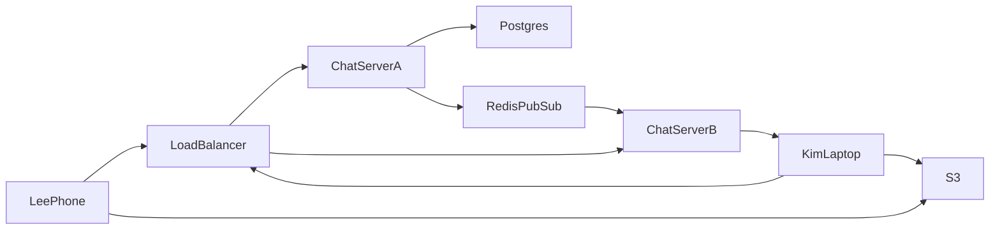
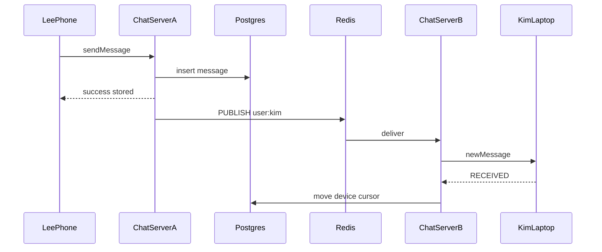
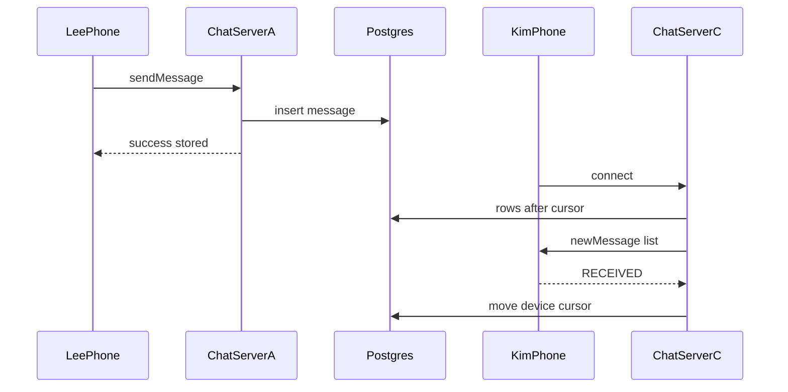
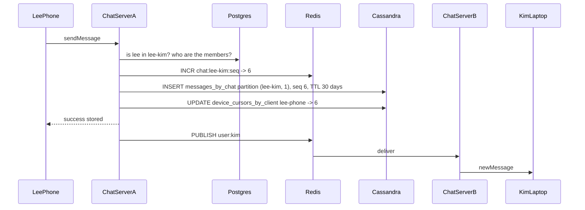
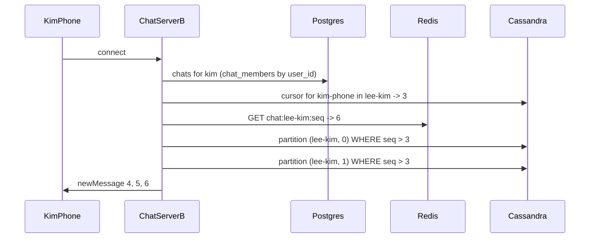
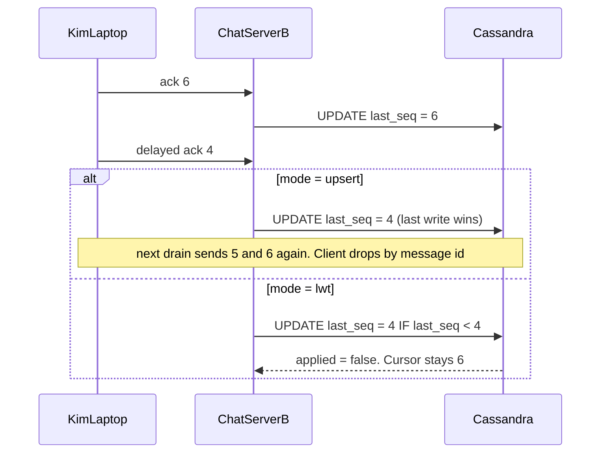
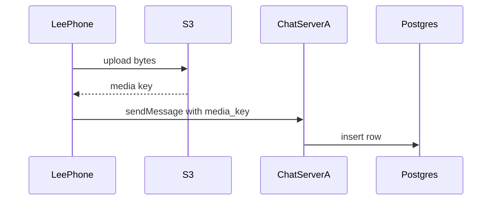

# System flow — Chat System

Each chart runs from the client to the load balancer, the chat server, and the store. Hello Interview is the shape source. These notes are original.

## Overview



## Send while online

```
sendMessage -> { messageId, status, seq, duplicate }
Body: {
  chatId,
  message,
  attachments,
  clientMsgId, // UUID per message. A retry sends the same one and gets the first seq back
  clientSeq    // this device's own counter in this chat. Detects a swap
}
```



## Send while offline

Same store. No Redis listener. On connect, drain after the device cursor.



## Design 2: send with Cassandra

The roster check stays in Postgres. The message row goes to Cassandra. The live push is the same.

```
POST /v1/messages -> 202 Accepted { messageId, status, seq, duplicate, outOfOrder, storedIn }
Body: {
  chatId,
  message,
  mediaKey,    // optional
  serverId,    // A | B
  clientId,
  clientMsgId, // optional UUID per message
  clientSeq    // optional device counter
}
storedIn: { store: "cassandra", table: "messages_by_chat", partition: { chat_id, bucket }, clustering: { seq }, ttlSeconds }
```



## Design 2: drain across buckets

```
POST /v1/lab/connect -> 200 OK { serverId, clientId, userId, status, drained, reads }
Body: {
  serverId, // A | B
  clientId
}
```



## Design 2: late ack

```
POST /v1/ack -> 200 OK { clientId, chatId, seq, cursor }
Body: {
  clientId,
  chatId,
  seq,
  mode // upsert (default) | lwt
}
```



## Image or video


