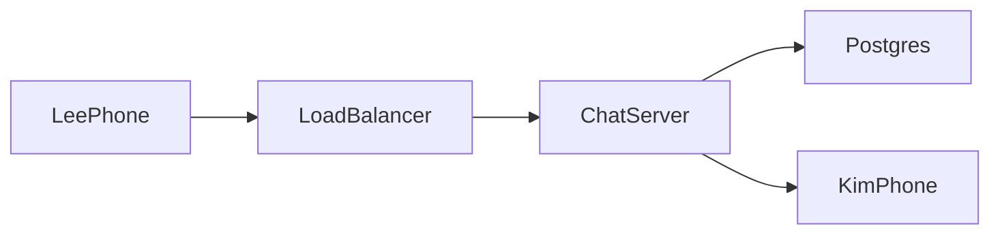

# Chat System

**Status:** Implemented  
**Sources:** Hello Interview (WhatsApp); Alex Xu Vol 1 Ch 12  
**Slug:** `chat-system`

Practice in the five-step interview pattern. Keep notes original; link to Hello Interview / cite Alex Xu instead of copying write-ups.

## 1. Requirements and design scope

### Problem

People send messages to each other from a phone or a computer. A **chat** is the room for those messages. A chat has 2 people, or a group of up to 100. A person who is offline still gets the message later. A message can include an image or a video.

Hello Interview: [WhatsApp](https://www.hellointerview.com/learn/system-design/problem-breakdowns/whatsapp). Alex Xu volume 1, chapter 12.

### Functional requirements

- [x] A user sends a message and the other people in the chat receive it.
- [x] A user starts a group chat. The group has at most 100 people. A chat with 2 people is the same kind of chat. It is not a second product.
- [x] A user who is offline receives messages that were sent while they were away. The server keeps those messages for 30 days. Hello Interview uses that window.
- [x] A message can carry an image or a video, not only text.
- [x] One user can be logged in on more than one device, such as a phone and a laptop. Each device gets the message.

### Non-functional requirements

- [x] About 1 billion users. Hello Interview says billions of users. This session uses 1 billion accounts. A later part of that page uses about 200 million connected clients as an example.
- [x] Message rate. The requirements section gives no rate. The Hello Interview deep dive gives 200 million active users at about 20 messages a day, which is about 4 billion a day. That is about 46,000 per second, and the page rounds it to about 40,000. Hello Interview gives no peak. This session plans for three times the average, about 140,000 messages per second.
- [x] Latency: an online recipient sees the message in under 500 milliseconds. Hello Interview uses that bar. The sender's success means the server stored the message. The sender does not wait for the other phone to display it.
- [x] Durability: the server stores the message before it tells the sender success. A crash after that does not drop the message.
- [x] Availability: one chat server can die. A stored message is still delivered when the client reconnects.
- [x] Consistency: delivery is at least once. A lost client ack can cause a second push of the same message. Exactly once is not the promise.
- [x] The server deletes a stored message after every device has acknowledged it, or after 30 days. Hello Interview says the servers should not keep messages longer than necessary.

### Below the line

Hello Interview puts these out of scope:

- Audio and video calling. A call is a live media path. It is not a stored message.
- Interactions with businesses. A business account, a template, and a support inbox are another product.
- Registration and profile management. This design starts from a user id that already exists.

Hello Interview also puts these non-functional items out of scope:

- An exhaustive security design. The socket is still encrypted. We do not design key exchange or a full threat model.
- Spam detection and scraping prevention.

This session also cuts a news feed. Chat does not rank posts.

**In:** One-to-one chat, group chat up to 100, offline delivery for 30 days, image and video attachments, and more than one device per user.

### Core entities

| Entity | Description |
| --- | --- |
| User | A person. The id already exists |
| Client | One device for that user, such as a phone or a laptop |
| Chat | The room. 2 to 100 users |
| Message | Text plus optional media, in one chat |

### APIs

The live path is a socket command, not a page load. These shapes are the first sketch. Step 2 can revise them.

```
createChat -> { chatId }
Body: {
  participants, // 2 to 100 user ids
  name          // optional
}
```

```
sendMessage -> { messageId, status }
Body: {
  chatId,
  message,
  attachments // optional image or video ids
}
```

```
newMessage -> client ack RECEIVED
Body: {
  chatId,
  messageId,
  userId,
  message,
  attachments
}
```

## 2. High-level design

The client is the phone or the laptop. It holds a socket to a chat server. A load balancer sends the socket to one chat server. That server writes Postgres, then pushes on the socket. Details grow in [FLOW.md](FLOW.md).



### Send while the recipient is online

Lee's phone sends "hi". Kim's phone already has a socket.

1. Lee's phone sends `sendMessage` on its socket.
2. The chat server inserts the message in Postgres.
3. The server tells Lee success. That means stored. It does not mean Kim has seen it.
4. The server finds Kim's open socket and sends `newMessage`.
5. Kim's app shows "hi" and sends `RECEIVED`.
6. The server moves that device's cursor to this message. Kim's phone keeps the text on the device.
7. The server deletes the message only after every device cursor for Kim has passed it, or after 30 days.

A phone-vendor banner is a different path. It wakes an app that has no socket. This online path does not use it.

### Send while the recipient is offline

Kim's phone has no socket. Lee's success is still "stored." The server does not tell Lee "delivered."

1. The chat server inserts the message. Kim's phone cursor stays where it was.
2. There is no `newMessage` yet, because there is no socket.
3. Kim opens the app later. The phone opens a socket.
4. The server sends each message newer than that phone's cursor. That send is the drain.
5. Kim's phone sends `RECEIVED`. The server moves the phone cursor forward.
6. If the phone never connects, the server deletes the message after 30 days. Lee never gets "delivered."

A vendor banner can say that a message is waiting. The text still comes from Postgres on connect. The banner is not the copy of "hi."

### Two devices

Kim has a phone and a laptop. Each device has its own cursor. A **cursor** is the latest message number that device has acked.

1. Lee sends "hi". The server stores one message. The number is 11 for Kim.
2. The laptop is on. The server sends 11. The laptop cursor becomes 11.
3. The phone is off. The phone cursor stays 10. Message 11 stays on the server.
4. The phone connects later. The drain sends every message after 10. The phone cursor becomes 11.
5. Both cursors are past 11, so the server may delete message 11. A device that never returns does not block deletion past 30 days.
6. A newly added laptop starts at the current number. It does not drain old messages.

### Group

A group is the same path as a two-person chat. Any member can send. The message row lives in one `messages` table, with the chat id on the row. There is not a physical table per group.

Each device has a cursor per chat. Kim's phone can be at message 6 in Trip while Kim's laptop is at message 7. Ada's phone has its own cursor in that same chat.

1. Lee sends "hi" in Trip. The server stores one row. The number in Trip is 7.
2. Kim's laptop is on. It receives 7. That cursor becomes 7.
3. Kim's phone is off. Its Trip cursor stays 6. Row 7 stays.
4. Ada is offline. Ada's cursor stays where it was. Row 7 stays for Ada too.
5. A device drains one chat by reading rows in that chat after its cursor.
6. The server deletes row 7 only after every live device in Trip is past 7, or after 30 days.

### Image or video

The file bytes go to S3. The message row stores `media_key`, which is the object key. One Trip photo is one object. Every member downloads that same object.

1. Lee's phone uploads the bytes to S3 and receives the key.
2. Lee sends the message with the text and that key.
3. The server stores one `messages` row. It does not store the bytes.
4. A recipient gets a short-lived URL for that key when the message is pushed or drained.
5. The phone downloads the bytes from S3.
6. When the message row is deleted, the S3 object is deleted too.

A forever public URL is not the value in `media_key`. The key stays. The URL is created at read time and then expires.

## 3. Low-level design and deep dive

### Data model

`messages` is one table for every chat. Primary key `id`. Unique `(chat_id, seq)`.

| Column | Role |
| --- | --- |
| id | Primary key. This is the message id |
| chat_id | Trip, or a two-person chat. Same column |
| seq | The number inside that chat. Trip's "hi" is 7 |
| sender_id | Who sent it. Any member of the chat |
| body | The text. Empty when the message is only a file |
| media_key | Empty for text. The S3 object key for an image or a video. Not the file bytes |
| created_at | When the server stored the row |

A device cursor is not a column on this row. It lives on the device, per chat. The message row does not change when a laptop acks.

`device_cursors` — primary key `(client_id, chat_id)`

| Column | Role |
| --- | --- |
| client_id | One phone or one laptop |
| chat_id | Trip, or a two-person chat |
| last_seq | The latest seq that this device has acked in that chat |
| updated_at | When the cursor last moved |

`clients` — primary key `id`

| Column | Role |
| --- | --- |
| id | One device |
| user_id | Who owns the device |
| status | active or removed |

`chats` and `chat_members` hold the room and who is in it. They are the create-chat write.

### Deep dives

1. **Billions of users, different chat servers.** About 1 billion accounts. A later Hello Interview example uses about 200 million open sockets. One host cannot hold that. Lee's phone is on chat server A. Kim's laptop is on chat server B. A alone cannot write Kim's socket. A stores the message in Postgres first. Then A runs Redis `PUBLISH user:kim`. B already ran `SUBSCRIBE user:kim` when Kim connected. That subscribe is not a key that stores B. It is a live interest in the channel named `user:kim`. Redis sends the publish to every subscriber of that channel. B then looks up a local map `kim -> websocket` and writes `newMessage`. Redis Pub/Sub is at most once. The durable copy is Postgres plus the cursor. A separate key `user:kim -> B` can help presence. It is not the live bus. A Kafka topic per user does not work at this size.

2. **Partition by user or by chat.** The live channel is per user. WhatsApp is mostly one-to-one chats. Kim may be in many small chats. One channel per user means one subscribe when Kim connects. A publish goes to Kim once. A channel per chat would force Kim's server to subscribe to every open chat. A large Trip of 100 people can later publish to the chat channel instead. That hybrid is a later add. This session keeps per-user channels.

3. **More than one device.** The cursor is `(client_id, chat_id, last_seq)`. It is not one number for the whole user. Kim's laptop can be at Trip 7 while Kim's phone is at Trip 6. A publish still goes to the user channel. Each connected device on that server gets the push. The drain uses that device's cursor.

4. **The socket dies.** TCP can take minutes to notice. The chat server sends a ping every 15 seconds. If there is no pong in 5 seconds, it closes the socket. The client reconnects to any healthy chat server. That server subscribes to Kim's Redis channel again. The reconnect also drains messages after the device cursor. A map of user to server is updated on connect and cleared on close. That map is presence. It is not the message store.

5. **The live bus drops a message.** Redis Pub/Sub can lose a publish. The message is already in Postgres. At least once means: store first, then publish. If the publish is lost, the device still gets the text on the next drain, or when a heartbeat carries a sequence that is ahead of the client's cursor. Do not rely on a second publish alone with no durable row.

6. **Out of order.** Lee sends "hi" as seq 7, then "bye" as seq 8. Kim's socket can receive 8 before 7. The app shows them by `seq`, so "hi" stays above "bye". It does not hold "bye" until "hi" arrives. A late 7 can pop in above 8. Exact phone send-time order across servers is not the promise.

7. **Last seen.** Do not write last seen on every heartbeat. That is millions of writes a second at 200 million connections. Write `last_seen` when the last socket for that user closes. A getLastSeen call reads that time. If another chat server still holds a live socket for Kim, it answers ONLINE on the live path.

### Live bus options (how chat server A reaches Kim on B)

The live hop has one job. Chat server A must hand Lee's message to the chat server that holds Kim's socket, within the 500-millisecond bar. Durability is already done: Postgres or Cassandra holds the row, and the cursor drain catches anything the hop drops. So the hop can be best effort. Two questions decide the option: how A finds B, and what the hop costs for each user who connects or disconnects.

- **Option A: No hop. Each server polls the message store for its own users.** It is simple. Polling every second adds about one second of delay and a database read per server per second. It wins only for a small app with a few chat servers.
- **Option B: Kafka, one topic per user.** A publishes to `user-kim`, and B consumes it. Hello Interview rejects this. Kafka keeps about 50 KB of overhead per topic, so 1 billion users means about 50 TB before any message. A variant uses one topic per chat server. A still needs a registry that says "Kim is on B," and each message adds a disk write and a consumer poll. Kafka fits the side paths: push notices for offline users, the search index, and analytics, all fed from the stored messages.
- **Option C: RabbitMQ.** Each chat server owns one queue. A connect binds the routing key `user.kim` to B's queue. A publishes to a topic exchange, and the broker routes to B. The model works, and it has acks. Every connect and disconnect changes a binding, and the cluster shares those bindings. At 200 million online users, that churn is the bottleneck. The broker acks also repeat the work of the store and the drain. It wins at thousands of users, or when the team already runs RabbitMQ.
- **Option D: Direct gRPC from A to B, through a presence registry.** A reads `user:kim:server -> B` and calls B. There is no broker hop. The registry must change on every connect and disconnect. A stale entry, after B dies or Kim moves, sends the push to the wrong server. Kim's phone and laptop on two servers need a set, not one value. About 4,000 chat servers (200 million sockets at about 50,000 each, this session's estimate) need pooled connections between them.
- **Option E: Direct gRPC with consistent hashing.** A hash ring in ZooKeeper or etcd assigns each user to one chat server. The load balancer sends Kim's sockets to that owner. A computes the owner and calls it directly, with no lookup. Hello Interview rates this "Good." Adding a server moves part of the ring. Those users must reconnect without a thundering herd, and messages must go to both owners during the move. Slack runs this idea in production: channel servers own channel ids on a consistent hash ring, and gateway servers hold the WebSockets.
- **Option F: Redis Pub/Sub, one channel per user (our pick).** B subscribes to `user:kim` when Kim connects. A publishes, and Redis forwards to every subscriber. Kim's two devices on two servers just means two subscribers. A channel is an in-memory pointer, not a log. Shard the Redis cluster by user id. Hello Interview cites a Canva benchmark of 100,000 messages per second on one Redis host at 27% CPU. Delivery is at most once. That is fine, because the store and the drain cover a dropped publish.

We pick Option F. The message rate is about 40,000 per second, and the live hop does not need to be durable. Options B and C pay for durability the store already gives. Options D and E pay for routing and resharding work that Redis does for us. We would move to Option E when chat servers must also keep per-chat state and order in memory, as Slack's channel servers do.

## 4. Component questions and special situations

### Specific components

- **One chat server dies with 50,000 sockets.** Those sockets are gone. The clients reconnect through the load balancer to healthy hosts. Each new host stores a local socket map, runs `SUBSCRIBE` for that user, and drains after the device cursor. Messages were already in Postgres, so the death does not drop stored texts. A slow reconnect is fine. Waiting for a human to restart that one host is not.
- **Redis Pub/Sub is down for 2 minutes.** Live pushes stop. `sendMessage` still stores in Postgres and still returns success. Online users get those rows on the next drain, or when a heartbeat seq shows they are behind. Do not block Lee's send on Redis. Redis is best effort.

### Special situations

- **10x sends.** Add chat servers for open sockets. Shard Redis channels by user id. Watch the Postgres write rate on `messages`. More sockets do not help if the primary cannot insert. A rush of connects after an outage is a reconnect storm. Jitter the client reconnect.
- **Hot Trip chat.** Many members send at once. Publishing to each user channel does one Redis publish per online member. For a chat above about 25 people, subscribe those members to `chat:trip` as well, and publish once to that chat channel. Small chats stay on the user channel. Hello Interview describes that hybrid.
- **Postgres primary region is lost.** Keep a replica in a second availability zone first. Fail over the primary. Cross-region async copy is for disaster recovery. It can lag. Do not require every message to commit in two regions before Lee's success. That would break the 500-millisecond bar.

### Capacity estimate (design 2 at the Hello Interview scale)

The inputs come from Hello Interview: 200 million connected devices, about 46,000 messages per second on average, and mostly one-to-one chats. The peak of three times the average, about 140,000 per second, is this session's choice. Every per-node number below is this session's planning assumption, not a measured or cited limit. Change an assumption, and the node count changes in proportion.

| Box | Load at peak | Per-node assumption | Nodes |
| --- | --- | --- | --- |
| Chat servers | 200 million sockets. About 13 million heartbeats per second (one ping every 15 seconds) | 1 million sockets (WhatsApp's 1 to 2 million, per Hello Interview), down to 100,000 for a less tuned stack | 200 to 2,000, plus about 30% headroom |
| Redis Pub/Sub | About 280,000 publishes per second (the sender's and the recipient's user channels) | 100,000 per second, leaving room under Hello Interview's Canva figure of 100,000 at 27% CPU | About 3 for throughput. Run 6 to 10 with replicas for failover and for 200 million subscriptions |
| Redis seq counter | About 140,000 `INCR` per second | 100,000 per second | 2 or more, sharded by chat id |
| Cassandra `messages_by_chat` | 140,000 writes per second. RF 3 makes 420,000 replica writes | 15,000 replica writes per second per node | About 28 for throughput |
| Cassandra storage | 4 billion rows a day × about 200 bytes × 30 days = about 24 TB. RF 3 makes 72 TB. Compaction room adds 50%, so about 110 TB | 2 TB per node, as in Discord's 2017 post | **About 55. Storage, not the write rate, sizes this cluster** |
| Cassandra cursors | About 120,000 acks per second after coalescing, plus the sender cursor | Same 15,000 per node | About 24, more if the sender cursor stays |
| Postgres `chat_members` reads | About 140,000 per second on send, plus about 110,000 per second on reconnect (200 million devices, each reconnecting about every 30 minutes) | About 50,000 indexed reads per second per replica | **About 5 read replicas, or a cache on the chat servers** |

The order in which boxes fill:

1. **Cassandra storage.** Retention times row size sets the node count. A 7-day window instead of 30 cuts it by about four times.
2. **The roster read.** Every send and every reconnect reads `chat_members`, about 250,000 reads per second. Membership changes are rare, so cache the member list in each chat server. Clear it on invite or leave. That turns the reads into memory lookups.
3. **The cursor writes.** They can cost as much as the messages. Coalesce acks to one per device per chat per second. Drop the sender-cursor write: the sender's device acks its own message on the next ack.
4. **The chat server fleet,** sized by sockets and by reconnect storms, not by message rate. A 10% fleet loss sends 20 million reconnects at once. Jitter the reconnects, and drain the cursors in batches.
5. **Redis.** It is not the bottleneck. Watch a seq-counter failover. A counter that restarts low would issue an old `seq` again, and a Cassandra insert would overwrite that old row. Keep an append-only file and a replica. After a failover, start the counter from the highest stored `seq`.

### What the local lab takes

`./scripts/run-load.sh` sends from Lee's phone on server A to Kim's phone on server B for 10 seconds at each concurrency level. Kim is online, so every send pays the store write and the Redis hop. These numbers are from one laptop with 18 CPUs, after the connection pool fix below.

| Design | Best rate | p50 at that rate | p99 at that rate | Kim got all? |
| --- | --- | --- | --- | --- |
| Design 1, Postgres | About 400 per second at 8 senders | 19 ms | 33 ms | Yes, no backlog |
| Design 2, Cassandra | About 640 per second at 8 senders | 12 ms | 21 ms | Yes, no backlog |

What the measurement taught:

- **The first bottleneck was our own code.** Before the fix, each send opened about seven new Postgres connections. Design 1 topped out near 100 per second.
- **The live hop fell behind before the store did.** At 32 senders, Kim got the last push 6 to 12 seconds after the senders stopped. One listener thread opened a Postgres connection for each Redis message. The fix was a connection pool and the in-memory `userToClients` map on the receive path. Design 1 went to about 400 per second, and the backlog went to zero.
- **Now the app process is the limit, not the stores.** During a Design 1 run, the app used about 2 cores. Postgres was at 35% and Redis at 2%. In Design 2, throughput falls past about 16 senders while every container stays nearly idle. The likely cause is that up to 40 request threads compete with the Cassandra driver's one I/O thread for Python's global interpreter lock.
- **The gap to production is the app, not the stores.** At about 500 per second per Python process, 140,000 per second would need about 280 processes. Production chat servers use an async runtime (Erlang, Go, or Java with Netty) with many sockets per host.

## 5. Summary and future improvements

- **What we designed:** Lee sends on a socket. The chat server stores the row in Postgres and returns success. If Kim is online on another host, Redis Pub/Sub carries the live push to that host, and that host writes Kim's socket. If Kim is offline, there is no subscribe. When Kim connects, that host drains Postgres after the device cursor. Redis is not used for that catch-up.
- **Main tradeoffs:** Postgres is durable. Redis is best-effort live. A cursor per device per chat supports a phone and a laptop. Media bytes sit in S3. The message row stores the key.
- **Risks left on the table:** The `messages` table grows with every chat. At about 100,000 writes per second, move it to a wide-column store such as Cassandra. The primary key is `((chat_id, bucket), seq)`, with a 30-day TTL. Sharded Postgres by `chat_id` is the other valid path. The other tables stay in Postgres. A crash after Redis publish and before the cursor moves can still push twice. At least once stays the promise.
- **With more time:** Assign `seq` on the server with an atomic counter per chat, not on the client. Add a spam filter before the live push. A spam cut was below the line for the core design.

## Two message-store designs

The `messages` table is the one table that grows on every send. The store you pick for it changes the key, the drain read, the cursor update, and the retention job. This section compares two designs. The lab runs both side by side.

- **Design 1:** `messages` and `device_cursors` in Postgres. This is the simple path and the lab default.
- **Design 2:** the same two tables in Cassandra. This is the interview answer at the Hello Interview scale, about 40,000 messages per second.

### What moves and what stays

| Data | Design 1 | Design 2 | Why |
| --- | --- | --- | --- |
| `messages` | Postgres | Cassandra `messages_by_chat` | Append-only, read by chat key, 30-day expiry |
| `device_cursors` | Postgres | Cassandra `device_cursors_by_client` | One small write per ack. Read by device on drain |
| `users`, `chats`, `chat_members`, `clients` | Postgres | Postgres | They change rarely. Create-chat needs one transaction |
| `last_seen` | Postgres | Postgres | One row per user. Display only |
| `seq` counter | Redis `INCR` | Redis `INCR` | Cassandra has no safe per-chat counter |
| Live push | Redis Pub/Sub | Redis Pub/Sub | The live hop does not depend on the store |

### Schemas

Design 1, Postgres:

```sql
messages (
  id TEXT PRIMARY KEY,
  chat_id TEXT, seq INT, sender_id TEXT, body TEXT, media_key TEXT, created_at TIMESTAMPTZ,
  UNIQUE (chat_id, seq)
)
device_cursors (
  client_id TEXT, chat_id TEXT, last_seq INT, updated_at TIMESTAMPTZ,
  PRIMARY KEY (client_id, chat_id)
)
```

Design 2, Cassandra:

```sql
messages_by_chat (
  chat_id text, bucket int, seq int,
  id text, sender_id text, body text, media_key text, created_at timestamp,
  PRIMARY KEY ((chat_id, bucket), seq)
) WITH CLUSTERING ORDER BY (seq ASC) AND default_time_to_live = 2592000

device_cursors_by_client (
  client_id text, chat_id text, last_seq int, updated_at timestamp,
  PRIMARY KEY ((client_id), chat_id)
)
```

Design 2 has two Cassandra tables, not three. The lab's "grouped by partition" card is a view of `messages_by_chat`. It groups the same rows by partition key, so you can see how Cassandra stores them.

A **partition key** picks the node through a hash called the **token**. In Design 2 it is `(chat_id, bucket)`. A **clustering key** sorts rows inside one partition on disk. In Design 2 it is `seq`. A **bucket** caps the size of one partition. The lab uses `bucket = seq / 5`, so you see a new partition after five messages. Production would use about 10 days of time, as Discord does, or a larger count.

### Each operation, side by side

**Send.** Lee sends "hi" in `lee-kim`. Redis gives `seq` 6.

- Design 1 inserts one row on the Postgres primary. The sender cursor update can share the transaction.
- Design 2 appends one row to partition `(lee-kim, 1)`. It does not read first. The sender cursor is a second, separate write. A crash between the two writes leaves the sender cursor behind. The next drain sends Lee his own message again, and the client drops it by message id.

**Drain.** Kim's phone reconnects with cursor 3. The current seq is 6.

- Design 1 runs one index range read: `chat_id = 'lee-kim' AND seq > 3`.
- Design 2 reads each bucket from `seq 4` to `seq 6`: partition `(lee-kim, 0)` with `seq > 3`, then `(lee-kim, 1)`. Each read is one sequential slice. A device that was away for a long time reads many buckets.

**Ack.** Kim's laptop acks 6, then a delayed ack for 4 arrives.

- Design 1 runs `GREATEST(old, new)`. The cursor stays 6.
- Design 2 with a plain upsert keeps the last write. The cursor moves back to 4. The next drain sends 5 and 6 again. The client drops them by message id. That is the default, because it costs one write and no read.
- Design 2 with an **LWT** (lightweight transaction, `IF last_seq < ?`) keeps 6. It runs Paxos, which takes about four round trips instead of one, on every ack.

**Retention.** Rows leave after 30 days.

- Design 1 needs a job. It can batch-delete the rows, or drop daily partitions of the table.
- Design 2 sets a TTL on each row. Compaction removes the expired rows. Many deletes in one chat leave **tombstones** (delete markers), and a read must skip them until compaction runs.

**Scale out.** Write rate grows ten times.

- Design 1 needs shard routing by `chat_id`, resharding, and one primary per shard.
- Design 2 adds nodes. The token ring moves partitions to the new nodes.

**One node dies.**

- Design 1 fails over the shard primary to its replica. Writes for that shard pause during the failover.
- Design 2 with three replicas and quorum writes keeps accepting writes. Repair catches the dead replica up when it returns.

### Comparison

| Topic | Design 1: Postgres | Design 2: Cassandra |
| --- | --- | --- |
| `messages` key | `id`, `UNIQUE (chat_id, seq)` | `((chat_id, bucket), seq)` |
| Send | One insert on the primary | One append, no read |
| Drain | One index range | One slice per bucket |
| Late ack | Ignored by `GREATEST` | Moves the cursor back, or LWT at Paxos cost |
| Message plus cursor | One transaction is possible | Two writes, at least once covers the gap |
| 30-day retention | Batch delete or drop partitions | TTL per row, then compaction |
| Scale out | You build shard routing | Add nodes |
| Node loss | Primary failover pause | Quorum keeps writing |
| Ops cost | Familiar | Repair, compaction, tombstones |
| Wins at | Up to about a few thousand writes per second | About 40,000 messages per second, reads by key |

### Why the cursor moves too

The cursor table writes more often than the message table. Hello Interview gives about 40,000 messages per second, mostly one-to-one. This session estimates the cursor writes from that number. These are not Hello Interview numbers.

- One sender cursor update per send: about 40,000 per second.
- One ack per recipient device. With one recipient and about two devices, that is about 80,000 per second.
- The total is about 120,000 cursor writes per second, three times the message rate.

Each write is a small overwrite of one key. In Postgres, each `UPDATE` writes a new row version and a log record, and vacuum later removes the old version. In Cassandra, an update is a blind append with no read. The drain reads cursors by device, so `client_id` is the partition key.

- **Option A: Keep cursors in Postgres.** `GREATEST` and transactions stay. One primary takes about 120,000 updates per second, plus vacuum. It wins while the rate is low.
- **Option B: Cursors in Cassandra.** The update is cheap and scales with nodes. A late ack can move the cursor back, so the device gets a duplicate. It wins at this rate.
- **Option C: Cursors in Redis.** This is the fastest option. A lost Redis node moves cursors back to an older snapshot, and devices get re-sent messages. It wins only when you accept a large burst of duplicates after a failure.
- **Option D: Fewer acks.** The client acks only the highest seq for each chat, once a second. This cuts the write rate whichever store you pick.

We pick Option B plus Option D. Coalescing acks cuts the 80,000 ack writes, and Cassandra absorbs the rest.

### When to choose Cassandra

About 40,000 messages per second is this session's design point from Hello Interview. It is not a hard cutoff. Check each of these:

- **Write rate and growth.** Plan for the rate in two or three years. A store migration later needs dual writes and checks. Messenger's 2018 move from HBase took that work.
- **Total bytes.** Retention times the write rate. Keeping messages forever, as Discord does, favors a wide-column store even at a lower write rate.
- **Read patterns.** Cassandra wins when every read uses the partition key. Search, reports, and "all messages by this user" need a second system, such as a search index.
- **Edits and deletes.** Each delete is a tombstone. A "delete for everyone" feature or a mass cleanup slows reads until compaction runs.
- **Consistency level.** Use `LOCAL_QUORUM` for the message write and for the drain read. With `ONE`, a drain can miss a message that is on another replica. The next drain gets it, but the latency bar breaks.
- **Hot partitions.** A busy 100-member group writes to one partition. The bucket caps its size, not its rate.
- **Multi-region.** Cassandra replicates across data centers. A device reads with `LOCAL_QUORUM` in its own region.
- **Team and cost.** Repair, compaction, and JVM tuning need people. ScyllaDB, Amazon Keyspaces, or DynamoDB move that work to someone else. Three replicas triple the disk.

### Options and the pick

- **Option A: Design 1, one Postgres.** It is simple and gives transactions. One disk and one primary cap it. It wins for this lab and for an early product.
- **Option B: Design 1, Postgres sharded by `chat_id`.** It keeps SQL. You own the routing, the resharding, and the retention job. It wins when the team already runs sharded MySQL or Postgres. Facebook Messenger moved from HBase to MyRocks, which is MySQL on RocksDB, in 2018.
- **Option C: Design 2, Cassandra.** Writes scale by adding nodes, and the TTL handles retention. You give up per-chat counters, joins, and cross-table transactions. You must handle last write wins and tombstones. It wins at about 40,000 messages per second with reads by key. Discord moved to Cassandra in 2017 and later to ScyllaDB.

We pick Option C for the interview at the Hello Interview scale. We keep Option A as the lab default, so the lab shows both. Option B costs routing and retention work you build yourself at that rate.

### Lab API shapes

Both designs serve the same paths. The fields that differ are marked.

```
POST /v1/chats -> 200 OK { chatId, status, created, members }
Body: {
  participants, // user ids. The creator is added
  name,         // optional
  clientId      // the creator's device
}
chatId: two people get a fixed id such as "ada-kim". Three or more get "g-xxxxxx"
created: false when the two-person chat already exists
```

```
POST /v1/messages -> 202 Accepted { messageId, status, seq, storedIn }
Body: {
  chatId,
  message,
  mediaKey,  // optional S3 key
  serverId,  // A | B
  clientId
}
storedIn: { store: "postgres", table: "messages", key }
       or { store: "cassandra", table: "messages_by_chat", partition: { chat_id, bucket }, clustering: { seq }, ttlSeconds }
```

```
POST /v1/lab/connect -> 200 OK { serverId, clientId, userId, status, drained, reads }
Body: {
  serverId, // A | B
  clientId
}
reads: one entry per Postgres index range, or one per Cassandra partition, with rows found
```

```
POST /v1/ack -> 200 OK { clientId, chatId, seq, cursor }
Body: {
  clientId,
  chatId,
  seq,
  mode // Cassandra only: upsert (default) | lwt. Postgres always uses greatest
}
cursor: { mode, before, after, applied, statement }
```

```
POST /v1/lab/reset -> 200 OK { ok, design, cleared, kept }
Body: {}
```

## Local implementation

**Status:** Implemented

### What we implemented

Two designs run from one image. They share the code. Only the message store differs.

| URL | What it is |
| --- | --- |
| `http://localhost:8000` | Design 1: `messages` and `device_cursors` in Postgres |
| `http://localhost:8001` | Design 2: `messages_by_chat` and `device_cursors_by_client` in Cassandra |
| `http://localhost:8000/compare` | Both pages side by side, with the comparison table on top |

On each page:

- Connect a device to chat server **A** or **B** (online). The connect response lists each index range or partition the drain read.
- Disconnect a device (offline).
- Send a message. The store writes first. Redis Pub/Sub carries the live push. The response names where the row landed.
- Each store has its own card, and a yellow flash marks a change. Design 2 adds a partitions card with the token, the row count, and the seq range per `(chat_id, bucket)`. Its message card shows `ttl_seconds` and `writetime`.
- Scenario buttons: same server, cross server, offline then drain, reset.
- Mailbox shows what each device received (`via: user-channel` or `via: drain`).
- **Ack all** moves cursors. **Late ack** sends `seq − 2`. Design 2 has an ack mode: `upsert` (last write wins) or `lwt`.
- The bottom of the page explains every table and has the Design 1 vs Design 2 table.

Run it:

- Setup: `./scripts/setup.sh`. Cassandra takes about a minute to start.
- Integration: `./scripts/run-scenarios.sh`
- Functional: `./scripts/run-functional.sh`
- Load: `./scripts/run-load.sh` (set `LOAD_CONCURRENCY=1,8,32` and `LOAD_SECONDS=10` to change it). It resets each lab before and after.
- Stop: `./scripts/stop.sh`

Compose services: `app` (design 1), `app-cassandra` (design 2), `postgres` (database `app` for design 1, `app_cs` for design 2), `redis` and `redis-cs` (one per design so channels do not cross), and `cassandra` (one node, replication factor 1).

Cuts in this lab:

- Two logical servers in one process. Redis Pub/Sub still shows the hop.
- WebSocket exists. The page uses REST connect plus a mailbox so stores stay easy to read.
- S3 is a `media_key` string only. No real object store.
- Hot chat channel threshold is 25 members. Seed chats are smaller, so the common path is `user:{id}`.
- Cassandra is one node with replication factor 1. Quorum, repair, and node loss are in the notes, not in the lab.
- The bucket is `seq / 5` so a new partition shows up fast. Production would use about 10 days or a larger count.

Tests run against both designs. They prove cross-server live push, offline drain, cursor move on ack, and a 403 for a non-member. Design-only tests prove that Postgres ignores a late ack, that a Cassandra upsert moves the cursor back while an LWT does not, and that six sends split into two partitions with different tokens and a 30-day TTL.

### Session notes

- 2026-10-15: Design closed. Lab shows tables and Redis on every send.
- 2026-10-15: Lab shows each store as its own card with a change flash. Runtime tables start empty, and `POST /v1/lab/reset` clears them. Server A and B show their local `clientToSocket` and `userToClients` maps.
- 2026-10-15: The recipient cursor moves only on ack, not on push. A store reference sits at the bottom of the page.
- 2026-10-16: Partition notes: shard `messages` by `chat_id`. Most other tables stay one piece.
- 2026-10-16: `chat_members` is read on send (membership check and fan-out), on the hot-chat count, on chat-channel receive, and on drain. See FAQ Session questions.
- 2026-10-16: DynamoDB for `chat_members` is the Hello Interview choice. We keep Postgres with an index on `(user_id, chat_id)`. See [high-level-design-comparision.md](high-level-design-comparision.md).
- 2026-10-16: Wide-column store for `messages` at scale. Cassandra, key `((chat_id, bucket), seq)`, 30-day TTL. This replaces "shard Postgres" as the first answer at the Hello Interview scale.
- 2026-10-16: The lab now runs both designs. Design 2 on port 8001 moves `messages` and `device_cursors` to Cassandra. `/compare` shows both pages. See "Two message-store designs."
- 2026-10-16: The partitions card is a view of `messages_by_chat`, not a third table. "Start a chat" lets anyone start a chat (`POST /v1/chats`). A two-person chat gets a fixed id, so a repeat click returns the same chat. Cursors also move to Cassandra, because they write about three times as often as messages. Choosing Cassandra depends on more than the write rate. See "When to choose Cassandra."
- 2026-10-17: Capacity estimate added to step 4. At the Hello Interview scale, Cassandra storage (about 55 nodes) and the roster read (about 250,000 per second) fill first. The lab load test found our own bottlenecks first: a new Postgres connection per query, then a slow receive path. A pool and the in-memory socket map raised Design 1 from about 100 to about 400 messages per second.
- 2026-10-17: Code walk of the cross-server push. The receive path now writes to a real WebSocket (`push_to_socket`), not only the lab mailbox. A test opens `/ws/B/kim-laptop` on both designs.
- 2026-10-17: Session closed. The user had no more questions. The stack was stopped with `./scripts/stop.sh`.
- 2026-10-17: Each chat server runs its own Redis listener. The push crosses from the listener thread to the event loop with `run_coroutine_threadsafe`, because the WebSocket belongs to that loop. Production would use a bounded queue for each socket. See FAQ Session questions.
- 2026-10-17: Live bus options compared: polling, Kafka, RabbitMQ, direct gRPC with a registry, direct gRPC with consistent hashing, and Redis Pub/Sub. Redis Pub/Sub stays. See "Live bus options" in step 3.

## Interview checklist

- [x] 1. Requirements, numbers, and scope stated out loud
- [x] 2. High-level design that actually works end-to-end
- [x] 3. Low-level / deep dive with tradeoffs
- [x] 4. Component probes and special situations (traffic, rush hour)
- [x] 5. Summary and future improvements
- [x] FAQ practiced out loud
