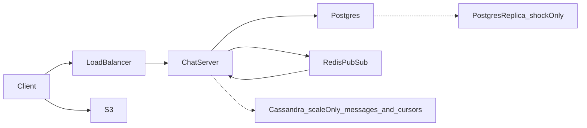

# Final design flow — Chat System

Redraw this at the end. Interview sequences stay in [FLOW.md](FLOW.md). Component roles stay in [COMPONENTS.md](COMPONENTS.md).

Hello Interview is the shape source. These notes are original.

## Overview

The client is Lee's phone or Kim's laptop. The load balancer sends the socket to one chat server. That server writes Postgres. Live delivery uses Redis Pub/Sub. Media bytes go to S3. A second region replica is a shock path only. At about 40,000 messages per second, design 2 moves `messages` and `device_cursors` to Cassandra. The diagram marks that box as scale only.



## Create a chat

```
createChat -> { chatId }
Body: {
  participants,
  name
}
```

1. The client sends `createChat` on the socket.
2. The chat server writes `chats` and `chat_members` in Postgres.
3. The server returns `chatId`.

## Send a message

```
sendMessage -> { messageId, status, seq, duplicate }
Body: {
  chatId,
  message,
  attachments,
  clientMsgId, // UUID per message. A retry sends the same one and gets the first seq back
  clientSeq    // this device's own counter in this chat. Detects a swap
}
```

1. The client sends `sendMessage`.
2. The chat server inserts `messages`.
3. The server returns success. That means stored.
4. If the recipient has a subscribed chat server, Redis Pub/Sub carries the live push.
5. The recipient acks. The server moves `device_cursors`.

## Offline drain

1. The device connects.
2. The chat server reads rows after that device's cursor.
3. It sends them on the socket.
4. After `RECEIVED`, it moves the cursor.

## Image or video

1. The client uploads to S3 and receives `media_key`.
2. `sendMessage` stores the key on the message row.
3. Recipients download with a short-lived URL.

## Services

| Name | When it runs | What it does |
| --- | --- | --- |
| Load balancer | Always | Routes new sockets to a healthy chat server |
| Chat server | Always | Socket, store, publish, drain |
| Redis Pub/Sub | Always | Live hop between chat servers |
| S3 | Always | Media bytes |
| Postgres replica | Shock only | Failover or read lag when the primary region is hurt |

## Databases

### Postgres

`messages` — primary key `id`. Unique `(chat_id, seq)`.

| Column | Role |
| --- | --- |
| id | Message id |
| chat_id | Which chat |
| seq | Number inside that chat |
| sender_id | Who sent it |
| body | Text |
| media_key | S3 key, or empty |
| created_at | Server store time |

`device_cursors` — primary key `(client_id, chat_id)`

| Column | Role |
| --- | --- |
| client_id | One device |
| chat_id | One chat |
| last_seq | Latest acked seq |
| updated_at | When it moved |

`clients` — primary key `id`. Columns: `user_id`, `status`.

`chats` — primary key `id`. Columns: `name`, `created_at`.

`chat_members` — primary key `(chat_id, user_id)`.

`last_seen` — primary key `user_id`. Column: `disconnected_at`.

### Cassandra (design 2, at the Hello Interview scale)

Design 2 moves `messages` and `device_cursors` out of Postgres into these two tables. The other Postgres tables stay.

`messages_by_chat` — primary key `((chat_id, bucket), seq)`. Table TTL 2,592,000 seconds (30 days).

| Column | Role |
| --- | --- |
| chat_id | Partition key, part 1 |
| bucket | Partition key, part 2. `seq / 5` in the lab. About 10 days of time, or a larger count, in production |
| seq | Clustering key. Sorts rows inside the partition |
| id | Message id. The client drops a duplicate by this id |
| sender_id | Who sent it |
| body | Text |
| media_key | S3 key, or empty |
| created_at | Server store time |

`device_cursors_by_client` — primary key `((client_id), chat_id)`

| Column | Role |
| --- | --- |
| client_id | Partition key. One device |
| chat_id | Clustering key. One chat |
| last_seq | Latest acked seq. A plain upsert keeps the last write |
| updated_at | When it moved |

### Redis

| Channel or key | Role |
| --- | --- |
| `user:{userId}` | Pub/Sub channel for live pushes |
| `chat:{chatId}` | Shock only. Hot group channel |
| `user:{userId}:server` | Optional presence map |
| `chat:{chatId}:seq` | `INCR` counter that assigns `seq`. Both designs |

### S3

| Key | Value |
| --- | --- |
| `media/{messageId}` | Image or video bytes |

Interview sequences are in [FLOW.md](FLOW.md). Component roles are in [COMPONENTS.md](COMPONENTS.md).
