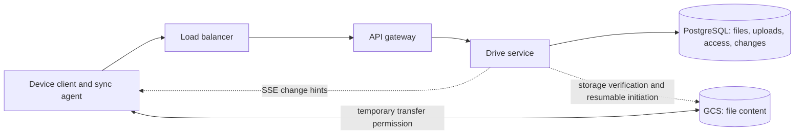

# FAQ — Google Drive

Practice these out loud. Add questions you actually got stuck on. Same five steps as the README.

## 1. Requirements and design scope

**Q: What are the must-have functional requirements?**
A: Upload, download, named-user sharing, and automatic sync in both directions. Include a list of files shared with the current user. External tools edit files. Their changes still need sync.

**Q: What scale numbers would you use, and why?**
A: Hello Interview gives a 50 GB limit, but no numeric traffic peak in its requirements. This session assumes 10 million daily active users. Each user makes two uploads and five downloads per day. That gives about 230 uploads/s and 580 downloads/s on average. A fivefold peak gives about 1,160 uploads/s and 2,900 downloads/s.

An average upload of 10 MB gives about 200 TB of incoming bytes each day. These are decimal units. Counts exclude chunk requests, sync, retries, permission checks, and replication.

- **Option A — Use average rates.** Lower capacity costs less. The assumed fivefold peak can cause queues. This wins when delays are acceptable.
- **Option B — Use peak rates and byte volume.** Capacity costs more. It covers the assumed peak. Count chunks after selecting the transfer method.

**We pick Option B.** Fivefold peak traffic drives the interview capacity plan. The local lab uses small files.

**Q: What would you explicitly cut from a 45-minute interview?**
A: [Hello Interview](https://www.hellointerview.com/learn/system-design/problem-breakdowns/dropbox) excludes editing, preview, user-visible version history, per-user limits, and malware scans. It also excludes building the underlying object store. The learner additionally excludes profile management.

| Cut | Reason |
| --- | --- |
| Built-in editing | An editor is a separate product; external edits still sync |
| Preview | Rendering requires support for file formats |
| Version history | Retention and user restore add a separate feature |
| Per-user limits | Quotas need storage accounting and admission checks |
| Malware scans | Scans add processing and quarantine states |
| Object storage internals | Use an existing service; use a container locally |
| Profile management | Assume existing identities; retain access checks |

**Q: Does low latency mean a 50 GB file transfers within two seconds?**
A: No. At 100 Mb/s, the bytes alone need 4,000 seconds, or about 67 minutes. Protocol overhead and retries add time.

- **Option A — One two-second deadline.** It fits small calls. It cannot fit this transfer. It wins only with a much smaller file limit.
- **Option B — Separate deadlines.** Metadata has a p95 target of 200 ms. Connected devices discover changes within a p95 target of two seconds. The transfer shows progress and supports recovery. This adds transfer state.

**We pick Option B.** The 50 GB limit makes one deadline unsuitable. A p95 target means at least 95% of relevant operations meet the target under normal conditions. These exact targets are session assumptions.

**Q: What can differ across devices?**
A: Lee's phone can briefly show an older committed state after the laptop saves a file. Eventual consistency means devices converge after communication recovers and pending work completes.

- **Option A — Wait for every device.** All devices agree before completion. One offline phone blocks the laptop. This wins when every participant must approve each change.
- **Option B — Commit remotely, then sync devices.** Lee can save while the phone is offline. Retries and conflicts need explicit handling. This wins for independent devices.

**We pick Option B.** One offline phone must not block Lee's laptop. Never expose a partial file. Do not silently lose a conflicting edit. Reject unsafe operations when authoritative state is unavailable. Step 3 chooses the conflict policy.

**Q: When may the system confirm an upload?**
A: Lee sees completion only after verified durable storage and metadata publication. Durable storage preserves accepted data within its stated failure model. Metadata describes the file and its committed state.

- **Option A — Confirm temporary receipt.** The response comes earlier. A crash can lose confirmed data. This wins for disposable data.
- **Option B — Confirm verified storage and publication.** Storage acknowledgments add latency. Recovery must handle interrupted publication. This protects completed uploads from application restarts.

**We pick Option B.** Losing one confirmed personal file violates the requirement. A checksum detects damaged bytes. Replicas or backups provide valid bytes for repair. The lab must test persistence across an application restart. A single local store does not prove disk or region recovery.

**Q: What does sharing require if profiles are out of scope?**
A: Assume existing accounts. Lee grants Kim access to `plan.pdf`. Kim sees the file in the shared-files list. Ada receives an access denial.

- **Option A — Public links.** Link possession grants access. This costs less permission management. It wins for public distribution.
- **Option B — Named-user grants.** The server checks identity and permission. Grants need storage and queries. This wins for private sharing.

**We pick Option B.** This session requires private sharing between named users. Profile management does not remove authentication or authorization. Authentication checks identity. Authorization checks permission.

**Q: Does excluding version history remove revisions and conflict handling?**
A: No. A revision is an internal identifier for a committed file state. It can detect an update based on an old state. It does not promise user-visible history. Two external editors can still create conflicting changes. Storage recovery also remains required.

**Q: Which API shapes are current?**
A: Step 1 records provisional logical interfaces in README and FLOW. Every call includes its method, path, body, and response. Step 2 replaces the initial byte endpoints with upload intents, verified completion, and signed downloads. These endpoints now have local implementations; see README section 6 for exact limits.

## 2. High-level design

**Q: How does each feature work, and which alternatives did we choose?**

The design follows the learner's direct-storage path. Use one logical Drive service with functions for files, grants, and sync. Separate deployment of those functions is not required.

The **control path** carries metadata, permission checks, and transfer credentials. The **byte path** carries file content directly between the client and GCS. GCS means Google Cloud Storage. This service is Google Drive, not Google Docs.



PostgreSQL owns file metadata and grants. GCS owns bytes. A PostgreSQL transaction cannot include a GCS upload. Store pending work first. Publish metadata only after storage verification.

#### Metadata database choice

- **Option A — PostgreSQL.** Store files, uploads, grants, and changes in tables. One transaction can commit related metadata changes. Joins and indexes fit file lists and access checks. Very high metadata traffic eventually needs partitioning or sharding.
- **Option B — DynamoDB.** Model each query with keys and indexes. Managed partitioning fits known access patterns. Transactions exist, but cross-item query design needs more care. It wins when those access patterns and operating constraints justify it.

**We pick Option A.** The session peak is about 1,160 upload starts/s. It does not by itself justify a second database system. This is not a PostgreSQL capacity guarantee. Count actual statements, indexes, grant sizes, and sync requests, then measure.

### 2.1 Upload a file

Lee uploads `plan.pdf`.

1. The client calls Drive through the load balancer and gateway.
2. Drive checks identity and creates an upload record in PostgreSQL. A new file is not ready yet.
3. Drive returns temporary upload permission for a unique storage destination. GCS resumable transfer handles large files.
4. The client sends bytes directly to GCS.
5. The client requests completion. Drive verifies the stored object against the upload record.
6. One PostgreSQL transaction publishes the committed file state and records its change.
7. Drive confirms completion. Other devices can now discover the change.

`uploading` means work exists. It does not mean the file is available to readers. For replacements, keep the prior committed content readable.

| Option | What happens | When it wins |
| --- | --- | --- |
| A | Drive proxies all content to GCS | Small workloads, or mandatory processing in the byte path |
| B | Drive authorizes; the client sends content directly to GCS | Large files and substantial transfer volume |

- **Option A — Proxy the content.** Drive receives and forwards each byte. This centralizes inspection but adds application bandwidth, connections, and failure points. It wins for small files or required inline processing.
- **Option B — Direct storage transfer.** Drive handles control requests. Storage handles bytes. This needs scoped transfer permission and a verified completion path. It wins for 50 GB files.

**We pick Option B.** The workload admits 50 GB files and about 200 TB of new bytes/day. Proxying would add that content to the application network path.

For completion, compare these paths:

- **Option A — Storage events alone.** Storage notifies a consumer after object completion. The browser needs less coordination. Event delays and repeat delivery complicate prompt publication. This wins when asynchronous completion is acceptable.
- **Option B — Client completion with server verification.** The client requests publication after transfer. Drive verifies storage, then commits metadata. This adds one control request. Events or a recovery scan can repeat the same finalizer if the client disappears.

**We pick Option B.** The normal discovery target is two seconds after publication. Do not add an unbounded event-delivery delay to the main completion path. This is not a guarantee that storage verification always finishes within two seconds.

For completion, client confirmation followed by server verification is the main path. Storage events can drive the same idempotent finalizer as a recovery path. Idempotent means a repeat has the same effect as one successful operation. GCS notifications can duplicate or arrive out of order. They are not an atomic commit with PostgreSQL.

Sources: [GCS signed URLs](https://docs.cloud.google.com/storage/docs/access-control/signed-urls), [GCS notifications](https://docs.cloud.google.com/storage/docs/pubsub-notifications).

### 2.2 Download a file

Kim downloads the file after Lee shares it.

1. Kim requests a download URL through the gateway.
2. Drive reads the committed file and checks ownership or the access grant in PostgreSQL.
3. Drive returns a short-lived signed URL for the selected committed content.
4. Kim downloads directly from GCS.

| Option | What happens | When it wins |
| --- | --- | --- |
| A | Drive proxies every download | Inline inspection or strict request-by-request mediation |
| B | Drive returns a signed GCS URL | Private files with little repeated reuse |
| C | Drive returns a signed CDN URL; the CDN caches private content | Popular files read repeatedly from distant locations |

- **Option A — Proxy downloads.** Drive can mediate each request. Every byte crosses the application path. It wins when inline controls justify that cost.
- **Option B — Direct GCS downloads.** Drive checks permission before issuing a URL. The client avoids application bandwidth limits. Distant clients still pay origin network latency. This wins for private files with low reuse.
- **Option C — Add a CDN.** A content delivery network stores copies near readers. Repeated downloads can improve. Cold files miss the cache, and private caching adds cost and access rules. This wins for measured geographic reuse.

**We pick Option B for the main path.** The assumed peak is 2,900 downloads/s, but no cache hit rate or geographic reuse is given. Download rate alone does not prove that a CDN helps. Step 3 covers CDN tradeoffs in full.

A signed URL can be forwarded during its valid period. Checking the access table does not make an already issued URL account-bound. Use short lifetimes. Revocation details belong in the security deep dive.

### 2.3 Share and list files

The application request goes to Drive, not to GCS. The bucket stays private.

1. Lee asks Drive to share `plan.pdf` with Kim.
2. Drive checks that Lee owns the file.
3. Drive upserts a grant and records a change for Kim in one PostgreSQL transaction.
4. Kim lists shared files. Drive queries grants by Kim's identity and joins the ready file metadata.
5. A later download request checks the same owner or grant rule before signing.

An access row needs both identities: `(user_id, file_id)`. Kim can receive many files. The same file can have many recipients. Use a reverse index on `(file_id, user_id)` when listing recipients is needed.

| Option | What happens | When it wins |
| --- | --- | --- |
| A | Each file row contains its recipient list | Tiny lists and file-centered access |
| B | Separate access rows connect users and files | Both shared-file lists and file permission checks |

- **Option A — Embed recipients in file metadata.** One file read finds its recipients. Large lists make the row bulky. Finding all files shared with Kim needs additional indexing or scans. It wins for small, bounded lists.
- **Option B — Use an access table.** Store one row for Kim and this file. A composite key prevents duplicate grants. Index maintenance adds write cost. It wins when Kim must list all shared files.

**We pick Option B.** One recipient can receive many files, so Kim's user ID alone cannot be the row's unique key.

Keep owner lookup in `files.owner_id`. The initial grant role is reader. Sharing a file does not copy its content or expose cloud credentials.

### 2.4 Automatically sync across devices

A local sync agent detects changes. It retains pending edits until remote confirmation. It must avoid treating a file that it just downloaded as a new user edit.

**Local to remote:**

1. Lee's laptop detects an external edit and stages an upload through Drive.
2. The laptop sends content directly to GCS.
3. Completion verifies storage. A PostgreSQL transaction changes the file pointer, increments its revision, and records a durable change.
4. The prior committed content remains visible until that commit.

**Remote to local:**

1. Lee's phone keeps its last server-issued cursor.
2. A push hint or polling timer triggers `GET /v1/changes`.
3. Drive queries durable changes visible to Lee and returns another cursor.
4. The phone requests the committed content and downloads it from GCS.
5. The phone verifies and installs the result before marking that file revision as applied.

Track discovered changes separately from successfully applied content. A durable local work queue can preserve pending downloads after the discovery cursor advances. Exact ordering and recovery are step 3 decisions.

| Option | What happens | When it wins |
| --- | --- | --- |
| A | Poll periodically for changes | Small active populations or relaxed delay |
| B | Push notifications alone | Low delay where missed messages are acceptable |
| C | Push hints plus durable cursor replay and periodic checks | Low delay with recovery after disconnection |

- **Option A — Poll only.** A two-second interval gives about 500,000 requests/s for one million active devices. A longer interval reduces cost but misses the discovery target. It wins for a small lab or a relaxed target.
- **Option B — Push only.** Connected devices receive hints quickly. A missed hint can leave a device stale. It wins for disposable signals, not correctness.
- **Option C — Push plus replay.** Push wakes the client. The durable changes API provides truth. Replay on reconnect and periodic checks repair missed hints. Long-lived connections add operating cost.

**We pick Option C.** The target is two-second discovery under normal conditions. One million active devices is an illustrative concurrency assumption, not the daily user count.

Use server-sent events, or SSE, for one-way change hints in the browser lab. A WebSocket supports two-way messages but needs a broader protocol. Both still need replay. Show polling-only beside SSE plus replay in the lab.

A timestamp shows when an update occurred. It does not describe changed bytes or prove that every event was read. Use an internal revision for file state and a cursor for discovery.

**Whole-file versus delta sync remains open.** Delta sync transfers changed pieces and reuses unchanged pieces. A manifest is an ordered list of those pieces. Native resumable upload alone does not create such a manifest. Step 3 compares full replacement, fixed-size pieces, and content-defined pieces. Do not claim changed-part downloads before choosing and implementing that design.

### Step 2 result

Keep direct GCS transfers, PostgreSQL metadata, a separate access table, and durable changes with push hints. The local storage stand-in will be MinIO. Transfer recovery, detailed schemas, changed-part sync, encryption, and conflict policy await steps 3 and 4.

See [FLOW.md](FLOW.md), [COMPONENTS.md](COMPONENTS.md), and [high-level-design-comparision.md](high-level-design-comparision.md).

## 3. Low-level design and deep dive

**Current interview prompt, 2026-11-01:** Steps 1–4 are taught and the learner requested the next step. Step 5 asks for a short interview wrap-up: main components, upload/download/share/sync paths, two reliability mechanisms, and one tradeoff or future improvement. The learner's summary is pending. See final-design-flow.md for the consolidated reference.

**Required source probes:** large-file recovery, transfer performance, and file security are taught at the design level. Local validation remains pending. Step 4 failure and scale probes continue. See the coverage table in README.

### Large-file upload recovery — taught 2026-10-31

The learner proposes listing stored chunks, resuming the remaining data, retrying a chunk write, and checking an ETag before completion. Storage inspection and verified completion are useful parts of that answer. Four corrections are required:

- Stateless API instances still need durable upload state in PostgreSQL.
- An expected manifest is needed to distinguish missing chunks from an incomplete plan.
- Retry the same immutable chunk safely; do not blindly overwrite published content.
- A GCS ETag is not a general content checksum or proof of complete file content.

#### 3.1.1 Protocol choice and persistent state

The walkthrough uses independently stored chunk objects, matching the learner's listing proposal. Native GCS resumable uploads are a different protocol. They use a session URI and acknowledged byte ranges, not a listing of completed chunk objects.

For arithmetic only, split 50 decimal GB into 5,000 chunks of 10 decimal MB. If 4,900 chunks are verified, 100 chunks remain. That is 1 GB, not necessarily one chunk. Content-defined mode uses actual lengths instead of this fixed-size example.

| Owner | Persistent state |
| --- | --- |
| Client | uploadId, access to the original snapshot, manifest identity, chunking settings, and local progress hints |
| PostgreSQL uploads | uploadId, ownerId, fileId, baseRevision, mode, expected total size, idempotency key, expiry, and state |
| PostgreSQL upload_chunks | Expected ordinal, length, CRC32C, optional declared SHA-256, storage destination, generation, and verification method |
| GCS | Complete uploaded chunk objects and provider metadata |

An API instance can restart without losing the attempt. A file name is not an upload identity. fileId identifies the logical file. uploadId identifies this transfer attempt. The frozen expected checksums and lengths bind resume to the declared content plan. If the local file changes, do not mix it into the old attempt. Use a stable snapshot or a new attempt. A browser can require file selection again after restart.

For state ownership:

- **Option A — Infer the attempt from a storage listing only.** This avoids application upload records. It cannot establish the expected order, missing entries, owner, base revision, or content plan without additional retained metadata. It fits disposable uploads with weaker requirements.
- **Option B — Keep an upload plan and reconcile with storage.** PostgreSQL describes what should exist. GCS shows what was stored. This adds metadata writes and verification work. It fits authenticated, resumable uploads.

**We pick Option B.** A 50 GB upload takes at least about 67 minutes at 100 Mb/s. Restarting should not discard 49 GB of completed work.

#### 3.1.2 Discover verified progress and resume

1. The client reconnects with its saved uploadId.
2. Drive authenticates the caller and loads the pending attempt.
3. Drive reconciles expected destinations with storage metadata. A scoped, paginated listing can discover candidates. A name alone does not prove correctness.
4. Reuse verified receipts for protected immutable objects. Verify newly discovered objects before treating them as reusable content.
5. Return verified, stored-but-pending, and missing entries separately.
6. The client uploads only missing entries. It waits for pending verification rather than uploading another copy immediately.

A byte counter from the client is only a hint. In parallel transfer, missing entries can occur anywhere. The highest uploaded ordinal does not prove that all earlier entries exist.

- **Option A — Trust client progress or object names.** Fewer checks reduce control work. A lost response, damaged object, or misleading claim can produce false progress. It fits a progress display, not final publication.
- **Option B — Reconcile and verify against the expected plan.** Storage calls and validation cost more. Persistent receipts avoid repeating expensive verification for unchanged protected objects. It fits reliable recovery.

**We pick Option B.** The 4,900 verified entries justify 49 GB of reusable work. Objects still awaiting validation are not counted as verified.

Progress has phases: preparing the chunk plan, transferring bytes, verifying content, and publishing. Show transferred progress separately from verified progress. Do not label the upload complete just because the network progress reaches 100%.

#### 3.1.3 Retry after a lost success response

Suppose chunk 17 reaches GCS, but Lee never receives the response.

- **Option A — Overwrite the destination on every retry.** This is simple and can be acceptable for a private disposable staging location when bytes are guaranteed identical. It wastes transfer work. Without that guarantee, retries can replace valid data or invalidate an existing reference.
- **Option B — Reconcile and conditionally create an immutable chunk.** Use the same upload identity and expected chunk destination. If the matching verified object exists, reuse it. If absent, upload it with a create-only precondition. If a competing request created it, verify that existing object. Reject mismatching content.

**We pick Option B.** Losing one response must not create another logical chunk, replace committed content, or publish another file revision. Repeated identical operations must have the same logical effect. This property is idempotency.

GCS supports a generation-match value of zero for create-only writes. An existing live object causes a precondition failure. That failure is not, by itself, proof that the existing object is the expected content. This policy applies to ordinary chunk-object writes, not XML multipart-part requests.

Use upload-scoped destinations and immutable content records for the first lab. Do not grant global chunk access based only on a guessed hash. Cross-user deduplication remains a security and scale probe.

#### 3.1.4 Integrity, ETags, and publication

**Policy revised 2026-10-31 after the learner's performance question.** A byte-reading SHA-256 worker is an optional stronger mode, not mandatory for ordinary transfer verification. The main path uses provider-side checksum validation and an authoritative metadata check.

The expected chunk plan retains length and CRC32C. Client SHA-256 is optional declared information until a trusted party validates it. Give each chunk a server-assigned opaque chunkId. Do not use an unverified SHA-256 claim as a trusted storage identity or global deduplication key.

1. The client registers expected length and CRC32C.
2. Drive freezes the plan and signs a write to its planned destination with the required checksum and create-only headers.
3. The client uploads bytes directly to GCS.
4. GCS calculates CRC32C and rejects a mismatch.
5. The client reports completion. This report only triggers verification.
6. Drive reads object metadata directly from GCS: destination, generation, size, and provider-computed CRC32C.
7. Drive compares these with the frozen plan and records a receipt for the protected generation.
8. Once every required entry is verified, the SQL finalizer publishes the manifest, file pointer, required changes, stream counters, and completed attempt.

No chunk-byte download is needed in steps 6 and 7. Existence alone is insufficient. The metadata must establish the expected object, expected size, and expected checksum. Keep the referenced generation immutable and protected from cleanup.

An ETag is a provider validator and can act as a receipt identifier. It is not generally a content checksum. GCS ETags can differ between XML and JSON APIs for the same object. Our GCS path therefore uses generation and provider checksum, rather than requiring equal ETag strings across those APIs.

For validation placement:

- **Option A — Provider checksum validation plus Drive metadata verification.** Small control reads replace application byte rereads. This establishes transfer integrity under the supported checksum contract. CRC32C does not prove an optional SHA-256 claim.
- **Option B — Also read and hash bytes in an application worker.** This adds roughly one full content read for each new chunk. It can establish a trusted SHA-256 identity or meet an independent verification requirement.

**We pick Option A for the normal path.** At the assumed 200 TB/day of new uploads, an extra verification pass would read roughly another 200 TB/day before retries or storage effects. Keep Option B as a stronger comparison when trusted cryptographic identities are required.

The receipt records verification_method and sha256_verified separately. A provider_crc32c receipt does not set sha256_verified=true. Optional SHA-dependent deduplication must use a validated digest. Authorized reuse can instead reference an existing protected chunkId. Do not grant access based on a guessed hash.

If provider validation cannot be established or checksum metadata is unavailable, do not silently mark the entry verified. Use another supported validation path or reject finalization. Exact local MinIO checksum capabilities must be checked during implementation; MinIO is not GCS.

Checksum verification is not whole-file completeness. All expected ordinals, order, lengths, permissions, and base-revision checks still matter. No independent chunk objects need to be assembled in GCS for a manifest-based file.

Hello Interview's example uses S3 native multipart upload. Its backend verifies reported part receipts with ListParts. That can establish that the claimed part is stored in that upload. A configured upload checksum supplies integrity validation; ETag equality alone is not a general checksum proof.

If verification remains pending, return 202 with a verifying state. Return 200 ready only after publication commits. Repeated completion returns the stored committed result. Push hints follow commit.

#### 3.1.5 Transfer protocols compared

| Protocol | Resume evidence | Resulting content |
| --- | --- | --- |
| Native GCS resumable upload | Query session URI; resume after the server-acknowledged byte range | One completed object |
| Independent chunk objects | Reconcile expected entries and verified objects | Manifest plus reusable stored chunks |
| S3-compatible native multipart upload | Inspect the upload's parts and their provider receipts, then complete multipart assembly | One assembled object; original parts are not automatically a reusable delta manifest |

For native GCS resumability, an empty PUT to the session URI checks progress. A 308 response can contain the persisted Range. Do not list the bucket to find native resumable parts. The session must remain valid. This baseline stays available as a conceptual comparison. MinIO is not a native GCS protocol emulator.

The first independent-chunk walkthrough selects explicit upload plans and receipts. The existing whole-object baseline remains available. The 10 MB fixed-size example is arithmetic, not the final content-defined boundary policy.

#### Status and next probe

Upload recovery is taught. Large-file coverage is not complete until interrupted downloads and content-revision pinning are taught. Performance probes still include parallelism, chunk-size limits, compression, CDN, and metadata growth. Security and conflict probes also remain.

Sources: [GCS resumable upload procedure](https://docs.cloud.google.com/storage/docs/performing-resumable-uploads), [GCS request preconditions](https://docs.cloud.google.com/storage/docs/request-preconditions), [GCS ETags](https://docs.cloud.google.com/storage/docs/metadata#etags), [GCS checksums](https://docs.cloud.google.com/storage/docs/data-validation). Application schemas and worker choices are this session's design.

### Interrupted downloads and revision consistency — taught 2026-10-31

The learner keeps the revision number, finishes revision 7 before syncing revision 8, avoids mixed bytes, and stops if revision 7 is unavailable. These are useful choices. A revision number alone is not enough to resume 49 GB of verified local work. The design must pin the manifest and protect referenced content.

This case assumes no concurrent local edit. Local edit conflicts remain a later probe.

#### 3.2.1 What the phone retains

| State | Purpose |
| --- | --- |
| fileId and downloadId | Identify the logical file and this download session |
| Selected revision 7 and manifest M7 | Keep one file state for this job |
| Ordered chunk references, object generations, lengths, and validated checksums | Describe exactly what the file contains |
| Durable verified-chunk set and local cache locations | Know what bytes can be reused after a restart |
| Temporary output and job state | Keep incomplete content separate from the installed file |
| Session expiry | Know whether the server still promises this retained state |

Store progress in SQLite for a native client or IndexedDB for the browser lab. Signed URLs are temporary credentials. They are not the durable file identity.

For the fixed-size arithmetic example, 4,900 verified 10 MB chunks represent 49 GB. Keep the actual set, not merely the count or highest ordinal. Parallel transfer can leave gaps. Mark a chunk verified only after validation and durable local storage. A crash between data storage and the progress update may cause extra verification, not false completion.

- **Option A — Save only revision and a byte counter.** This costs less state. It cannot describe gaps or prove that the cached bytes are valid. It fits a strictly sequential baseline only with additional offset and integrity rules.
- **Option B — Save a selected manifest and verified chunk set.** This adds local records and cache management. It supports parallel recovery without downloading 49 GB again.

**We pick Option B.** The phone has 98% of the example file already. Resume should preserve that verified work.

#### 3.2.2 Finish revision 7 or switch to revision 8?

The phone learns that revision 8 exists. Discovery of a newer state does not mutate this download's selected manifest.

- **Option A — Finish the selected revision 7, then sync a newer revision.** The job completes a coherent snapshot. The phone may briefly show revision 7 while the next update waits. It wins when the download is almost complete.
- **Option B — Cancel this job and start a distinct revision 8 job.** This prioritizes freshness. It needs a new manifest and recovery decision. It can reuse chunks that revision 8 explicitly references, but cannot blindly append revision 8's remaining bytes.

**We pick Option A.** Only 1 GB remains in the example. Queue the later update separately. Once revision 7 is complete and installed, process the current pending update, revision 8 in this case.

Bounded internal retention supports this choice. It does not add a user-visible version-history feature.

#### 3.2.3 How the design prevents mixed content

1. At start, Drive selects a committed manifest and creates a download session in one database operation with appropriate locking.
2. The session points to revision 7 and M7. Later file publication changes the current file pointer, not this session.
3. The phone requests manifest and chunk URLs through the saved downloadId.
4. Drive checks current permission and session validity, then signs only chunks belonging to M7.
5. The signed storage request selects each recorded object generation.
6. The phone verifies each downloaded chunk's length and provider-validated checksum against M7.
7. It reconstructs content in M7 order and installs the completed file only after all required checks pass.
8. It records applied revision 7 separately from the discovery cursor and pending revision 8.

For a native client, stage output and use an atomic replacement on the same filesystem where supported. The browser lab can model installation as an atomic local pointer update. Never expose incomplete output as a ready file.

- **Option A — Ask for the current file's URLs on every retry.** This avoids a session record. The current pointer may now select revision 8. It is unsafe for appending into a revision 7 partial result. It fits a complete fresh download with no continuation.
- **Option B — Bind the job to one immutable manifest.** This needs retained references and session state. It guarantees that every required entry comes from the selected file state.

**We pick Option B.** A revision 8 suffix must not be appended to a revision 7 prefix.

Unchanged content can still be shared safely between revisions. A verified cached chunk from M7 may satisfy M8 only if M8 references the identical protected chunk identity and object version. That is intentional reuse, not accidental mixing.

GCS supports selecting a particular object generation. This pins a storage version; our application must separately pin the file manifest. Do not confuse file revision 7 with a GCS generation number.

#### 3.2.4 URL expiry versus revision expiry

A signed URL expiring does not imply that revision 7 disappeared. If the session and permission remain valid, fetch fresh URLs for the same M7 chunks. Do not restart the entire download or silently choose M8.

The session design selects a 24-hour maximum lifetime as a study assumption. Download URLs last at most five minutes and cannot outlive the session. A 50 GB transfer needs about 67 minutes at 100 Mb/s, so the session is much longer than that lower bound. The values are not vendor requirements or production measurements.

Create new sessions for the current committed revision. Resume an older state only through its existing valid session. Do not use repeated historical requests to extend old retention indefinitely. Cleanup must coordinate with live sessions and a safe grace policy.

The proposed download_sessions table stores downloadId, ownerId, fileId, selectedRevision, manifestId or whole-object identity, createdAt, leaseExpiresAt, and status. A lease is a bounded promise to retain the referenced state. Publishing revision 8 does not delete chunks still protected by revision 7's live lease. Other current manifests can also retain shared chunks.

If revision 7 is unavailable:

- **Option A — Stop this job and offer an explicit restart from the latest revision.** The user sees a clear expired-download result. Keep reusable verified cache entries until normal cache eviction. This avoids an unexpected version switch.
- **Option B — Automatically create a fresh latest-revision job.** This can improve automatic sync freshness. It must select M8 and independently validate every reused chunk. It must not treat the remaining 1 GB as interchangeable.

**We pick Option A**, matching the learner's preference. Return a revision-expired result rather than silently substituting revision 8. A deliberate restart can reuse only chunks required by its newly selected manifest.

Missing content while a valid lease still protects it is a storage failure, not normal expiry. Return a retryable unavailable result and recover the referenced content. Do not quietly substitute another version. A revoked permission returns access denial, not a fallback download.

#### 3.2.5 Whole-object baseline with byte ranges

The whole-object baseline follows the same snapshot rule. Retain file revision 7's immutable object identity and generation. Save the selected metadata, temporary output, and confirmed local offset.

For a sequential 49 GB prefix of a 50 GB decimal file, request the remaining bytes from that exact object version:

```text
GET {revision7SignedUrl}
Body: none
Range: bytes=49000000000-
Expected honored-range response: 206 Partial Content
Content-Range: bytes 49000000000-49999999999/50000000000
Body: remaining bytes
```

Check the response range before appending. If storage returns the complete object instead, do not append that whole response to the partial file. Correctly restart or handle the complete response as a new temporary result.

The original multipart upload boundaries do not constrain download ranges. A whole-object checksum covers the whole object, not this 1 GB response. Validate the reconstructed complete file against the expected object checksum. Do not compare a partial response's checksum with the full-object checksum.

The independent-chunk variant checks complete chunk objects and tracks their set. The baseline checks the final reconstructed whole object. Both avoid mixed revisions.

#### Result and remaining probes

Upload and download recovery are taught. The large-file source topic has coverage for progress, identity, resumability, verification, and range recovery. At this dated design checkpoint, implementation had not started. The tested lab is now described in README section 6. Performance and security coverage is still incomplete.

The next interview probe is parallel transfer: Lee uploads 50 GB over a 100 Mb/s connection. Would 20 concurrent uploads make it 20 times faster? How should the client bound and adjust concurrency?

Sources: [Hello Interview large-file discussion](https://www.hellointerview.com/learn/system-design/problem-breakdowns/dropbox), [GCS generation selection](https://docs.cloud.google.com/storage/docs/json_api/v1/objects/get), [GCS object downloads and range behavior](https://docs.cloud.google.com/storage/docs/xml-api/get-object-download), [GCS download checksums](https://docs.cloud.google.com/storage/docs/data-validation). Session lifetimes, API contracts, and client policies are our choices.

### Parallel transfers and the shared bandwidth limit — taught 2026-10-31

The learner suggests that 20 transfers can make the upload 20 times faster and wants to adapt concurrency to the user's environment. Adapting to observed conditions is useful. The linear speedup claim is incorrect when the transfers share one 100 Mb/s upload connection.

#### 3.3.1 The bandwidth bound

Assume 50 decimal GB must cross the connection. There is no compression or previously reusable content in this calculation.

```text
50 GB = 400 gigabits
400 gigabits / 100 megabits per second = 4000 seconds
4000 seconds = about 66.7 minutes
```

All concurrent transfers share the same aggregate link. If 20 transfers split it equally, each gets about 5 Mb/s and their total remains 100 Mb/s. They do not each get a separate 100 Mb/s connection. Real end-to-end time includes overhead, preparation, and retries.

Parallel work can help when one request underuses the available connection. It can overlap request latency or work around a per-request limit. It cannot remove the slowest shared resource. Check source disk speed, chunking and checksum CPU, available upload bandwidth, and storage acceptance.

Do not confuse the number of chunks with the number of simultaneous uploads. The 5,000-chunk example can use a pool of four workers. Each worker takes another missing chunk when it becomes free. HTTP request concurrency also need not equal the number of TCP connections.

#### 3.3.2 Real alternatives and the choice

- **Option A — Sequential transfers.** Upload one chunk at a time. Memory and scheduling are simple. A sufficiently fast single transfer can fill the link. It wins on constrained clients or where extra transfers show no benefit.
- **Option B — A fixed large pool, such as 20.** This can fill a high-bandwidth link that individual requests underuse. It adds in-flight work, request pressure, and memory. On a saturated 100 Mb/s link it cannot provide 20 times the aggregate speed.
- **Option C — Bounded adaptive concurrency.** Start small, measure useful throughput, and adjust within resource limits. This needs a controller and metrics. It fits different device and network conditions.

**We pick Option C.** The illustrative application policy starts with two requests, allows a minimum of one, and caps adaptive concurrency at eight. Those are session choices, not storage-provider limits. Memory and CPU limits can lower the effective cap.

For illustration only, a test might produce:

| Concurrent requests | Useful payload rate | 50 GB transfer time |
| --- | --- | --- |
| 1 | 25 Mb/s | About 267 minutes |
| 2 | 50 Mb/s | About 133 minutes |
| 4 | 95 Mb/s | About 70 minutes |
| 8 | 95 Mb/s | About 70 minutes |
| 20 | 95 Mb/s | About 70 minutes |

These are invented teaching measurements, not benchmarks or a forecast. At the illustrated plateau, four requests are enough. Extra requests provide no payload gain. A different device can plateau at one or need more than four.

#### 3.3.3 A concrete adaptation policy

Goodput means useful newly accepted bytes per second. Do not count repeated bytes from retries as new useful work. The controller's local performance estimate does not replace server-side verification.

1. Start at two active transfers for the device's shared scheduler.
2. Observe goodput, request duration, retries, throttling, CPU pressure, and memory.
3. Use a stable window with enough completed work. The study policy uses at least ten seconds and roughly two typical chunk durations.
4. Try one extra worker only if there is pending work and resource headroom.
5. Keep the increase if goodput improves materially. The study threshold is ten percent.
6. If the gain is negligible, return to the best lower concurrency and use a cooldown before another probe.
7. On provider throttling, repeated timeouts, or significant resource pressure, reduce concurrency and apply bounded retry backoff with jitter.
8. Restart conservatively after a network change instead of retaining the old network's aggressive setting.

Jitter adds a small random delay so retries do not synchronize. These thresholds are a simple teaching policy. They do not guarantee a global optimum. Real measurements need noise tolerance and hysteresis. Hysteresis means resisting rapid oscillation around a threshold.

A checksum mismatch is an integrity failure, not evidence that more workers will help. An expired URL needs credential refresh while the attempt remains valid. Do not treat every error as the same congestion signal.

Use one pool across the device's files. Giving twenty simultaneous files eight workers each would create 160 active transfers. Apply fair scheduling so Lee's small plan.pdf does not wait behind every chunk of a large video.

#### 3.3.4 Bound bytes and preparation work as well as request count

If the implementation buffers a complete 10 MB chunk, eight transfers alone can hold about 80 MB before overhead. Streaming can reduce buffers. It does not increase network capacity. Include checksum and chunking buffers in the memory budget.

Limit preparation queues and in-flight bytes. Do not load the whole 50 GB file into memory. A count cap without a byte budget can fail when variable chunks become larger.

Keep the frozen logical manifest stable during retries and concurrency changes. The scheduler can select a different number of pending chunks without changing their boundaries. Changing chunking parameters creates a new plan; it must not rewrite a live attempt's expected content.

Obtain upload URLs for bounded near-term batches. Do not generate thousands of short-lived URLs and assume they remain valid for an hour-long transfer. Refresh expired permission only for still-authorized planned content.

Once the connection is saturated, adding Drive API servers does not improve that user's physical upload rate. If URL issuance or receipt checks are actually the bottleneck, measure and improve those control requests. Keep raw content out of the API relay path.

#### Lab and remaining coverage

The planned lab should compare sequential, fixed-concurrency, and bounded-adaptive modes. Show aggregate useful bytes per second, active transfers, retries, and the resource cap. A controlled bandwidth simulation must be labeled as simulated. Do not present the table above as measured output.

Parallelism is taught. The full performance deep dive still needs chunk-size policy and boundary costs, compression, CDN, and metadata growth. Security and conflict probes remain.

The next interview prompt compares 1 MB and 100 MB chunks for a 50 GB file. Explain request count, retry cost, memory, and what you would choose.

Sources: [Hello Interview performance deep dive](https://www.hellointerview.com/learn/system-design/problem-breakdowns/dropbox), [Amazon S3 performance guidelines](https://docs.aws.amazon.com/AmazonS3/latest/userguide/optimizing-performance-guidelines.html), [GCS parallel upload guidance](https://docs.cloud.google.com/storage/docs/parallel-composite-uploads). The arithmetic, example measurements, and controller policy are this session's teaching choices.

### Chunk size, content boundaries, and compression — taught 2026-10-31

The learner proposes choosing chunk size from network and device conditions and considering compression. Both factors matter. The answer needs numerical costs and a distinction between logical content chunks, transfer scheduling, and encoded bytes.

#### 3.4.1 One megabyte versus one hundred megabytes

Use decimal units for this comparison. A 50 GB file has 50000000000 bytes.

| Fixed independent-object size | Chunk count | Full retry work for one failed ordinary PUT | Memory for eight fully buffered chunks |
| --- | --- | --- | --- |
| 1 MB | 50000 | Up to 1 MB | About 8 MB before overhead |
| 100 MB | 500 | Up to 100 MB | About 800 MB before overhead |

A 100 MB retry needs at least 80 seconds over a 10 Mb/s link. A 1 MB retry needs about 0.8 seconds. These bounds omit overhead. Smaller chunks can also finish sooner and give finer progress. Larger chunks amortize request and metadata overhead.

This table describes independently stored objects. Native multipart has provider constraints. For example, S3 multipart has at most 10000 parts and a normal minimum part size of 5 MiB, except the last part. Do not apply a 1 MB independent-object choice directly as S3 multipart part size.

For chunk policy:

- **Option A — Small fixed chunks around 1 MB.** Retries and memory are bounded tightly. Fifty thousand entries add signing, storage-request, checksum, and metadata work. This fits constrained or unreliable clients.
- **Option B — Large fixed chunks around 100 MB.** Five hundred entries reduce request overhead. Retries can waste 100 MB and buffering can be expensive. This fits stable high-throughput sequential blob transfer when independent small edits are less important.
- **Option C — Bounded content-defined chunks with a moderate target.** Keep useful retry bounds and reuse after insertions. The chunker and variable manifest are more complex. This fits the delta-sync variant.

**We pick Option C for delta sync.** The study parameters are a 1 MiB minimum, nominal 4 MiB target, and 8 MiB maximum. One MiB is 1048576 bytes. A 50 decimal GB file would have about 11921 chunks if its mean size were exactly 4 MiB. Actual count depends on content. These are study parameters, not vendor defaults.

Fixed 1 MB and 100 MB modes remain lab comparisons. The whole-object baseline uses its provider-appropriate transfer policy.

#### 3.4.2 How content defines boundaries

Use a rolling fingerprint over a small byte window. Rolling means the calculation updates as the window moves over the input. A boundary rule identifies candidate cuts from that fingerprint. Do not cut before the minimum; force a cut at the maximum; finish with the remaining tail at end of file.

Our study design selects a recorded rolling-hash policy, with a 64-byte window and nominal target matching the above bounds. A Rabin-style implementation or compatible tested library must expose stable settings. Record algorithm version and parameters in the manifest. A target is not a promise that every chunk has that length.

The rolling fingerprint chooses boundaries. It is not the provider CRC32C used to validate transfer. It is not proof of a trusted SHA-256 content identity.

With fixed offsets, inserting one byte near the beginning shifts later windows of file content at those offsets. Many later chunks acquire different contents. With content-based cuts, later boundaries can match again after the changed area. Reuse is often much better, but exact savings depend on content and file format. Already-compressed formats can rewrite many bytes after a small semantic edit.

Keep the same boundary policy for repeated versions of a file when possible. Arbitrarily changing it from 1 MB to 100 MB can destroy reuse. Adapt concurrency and buffer limits first. Changing a logical policy requires a new recorded plan. Never mutate a frozen attempt or reinterpret its ordinals during resume.

A smaller buffer does not require smaller logical chunks. Streaming can move a larger logical chunk through bounded memory.

#### 3.4.3 Compression is an independent decision

A slow network can benefit from fewer bytes. A weak CPU or already-compressed content can make compression slower overall.

For a hypothetical chunk over a 10 Mb/s connection:

```text
Original size:           10 MB -> 8.0 seconds of transfer
Compressed size:          3 MB -> 2.4 seconds of transfer
Compression CPU:                  0.3 seconds
Decompression CPU:                0.1 seconds
Total compressed path:            2.8 seconds
```

Those sizes and timings are illustrative, not measurements. If 10 MB shrinks only to 9.9 MB, transfer saves about 0.08 seconds on that link. A 0.3-second compression cost loses. On a much faster link, CPU cost can outweigh even a good ratio.

For compression policy:

- **Option A — Never compress.** No encode/decode cost and simpler recovery. More bytes cross the network when data is compressible. It fits already-compressed files or CPU-constrained clients.
- **Option B — Always compress.** One uniform representation is simple. It wastes CPU and can enlarge incompressible content. It fits known compressible workloads.
- **Option C — Compress selectively.** Sample data, measure savings and encode cost, and account for decoder work. This adds a policy and raw fallback. It fits mixed text, media, and device conditions.

**We pick Option C.** The initial lab uses raw identity encoding and gzip, with a selective mode. Keep compression only when size savings are meaningful and estimated total time improves. A ten-percent size threshold is a study starting point, not a vendor rule. Measure the result. Check browser runtime support during implementation.

Gzip is available through the specified browser compression-stream interfaces. A codec can still be unsupported in a particular runtime. Raw fallback remains necessary. Additional codec choices are not required for this lesson.

#### 3.4.4 Chunk first, then encode each chunk

Create logical content chunks from the original bytes. Then decide the stored encoding independently for each new chunk. Compressing the entire file first can spread a local edit through a large compressed stream and make reuse harder. Independent compressed chunks cost some compression efficiency but preserve separate decode and retry units.

The representation pipeline is:

```text
Original file
 -> stable logical chunks
 -> identity or gzip for each chunk
 -> stored-byte checksum
 -> direct storage upload
```

If client-side encryption is later selected, compress before encryption. The transport checksum describes the final bytes submitted to storage.

Do not re-encode an unchanged referenced chunk merely because the network changed. Keep its existing immutable representation. A new codec or different compressed bytes need a new planned object identity. For retries, retain prepared bytes or reproduce and check the exact frozen stored length and checksum. A codec name alone does not guarantee byte-identical output across implementations.

The simple lab can prepare a complete manifest before upload, using bounded buffers and temporary storage where necessary. This adds preparation latency. A production optimization can register immutable entries as they are prepared and seal the final manifest later. That streaming-plan optimization is not selected for the initial lab.

#### 3.4.5 Logical length differs from stored length

The previous uncompressed examples had equal logical and stored sizes. Compression makes that equality false. Current compressed manifests must be explicit:

```text
ordinal:          17
logicalSizeBytes: 10000000
storedSizeBytes:   3000000
encoding:         gzip
storedCrc32c:     checksum of the 3000000 encoded bytes
```

GCS sees the 3 MB representation. Its size and CRC32C must match storedSizeBytes and storedCrc32c. Do not compare GCS size with the 10 MB logical size. Do not compare its stored checksum with a checksum of uncompressed bytes.

The ordinary Option A verifier still reads metadata only. It records transfer integrity for the stored representation. It does not prove that custom logical size or encoding labels are semantically correct. The downloader validates the stored length and checksum, decodes with bounded output, and checks the logical length before installation. Reject decoding errors or unexpected output. Never allocate unbounded memory from a declared output size.

Optional SHA-256 fields in this storage contract describe stored bytes and remain unverified unless the selected stronger mode establishes them. If a logical-byte fingerprint is later recorded, give it a separate name. Do not mix logical and stored digests.

The manifest records order in logical bytes. Sum logical lengths to get file length and offsets. Sum stored lengths to estimate transfer volume. Progress must distinguish logical completion from network bytes.

Store gzip chunks as application/gzip without HTTP Content-Encoding: gzip. The manifest owns application decoding. This avoids transparent decompression changing the served bytes before checksum verification. GCS documents this non-transcoding representation. The whole-object Range baseline remains identity-encoded for the first lab.

#### 3.4.6 Metadata and request growth

Smaller chunks multiply expected-plan entries, receipts, signed permissions, and storage operations. Fifty thousand 1 MB objects cost more control work than five hundred 100 MB objects. Even an eight-worker client can eventually issue all fifty thousand operations.

Use bounded batches for permission requests and receipt reconciliation. Index attempt entries by uploadId and ordinal. Do not scan every chunk for every progress poll or every SSE hint. Store incremental status carefully and keep the final completeness check authoritative.

Expire abandoned attempts and collect unused representations safely. Retain chunks referenced by current manifests, live download sessions, or protected pending work. General metadata sharding and large-recipient fan-out remain step 4 probes.

#### Status and next probe

Chunk-size tradeoffs, stable content-defined boundaries, selective compression, and representation checks are taught. Parameter tuning and codec support still need actual implementation measurements. The performance topic still needs the CDN decision. Security, conflicts, and scale-failure probes remain.

The next interview prompt compares a private file downloaded once with one shared file downloaded by 10000 readers across regions. Explain where a CDN helps and how private access remains enforced.

Sources: [Hello Interview performance discussion](https://www.hellointerview.com/learn/system-design/problem-breakdowns/dropbox), [restic content-defined chunking](https://restic.readthedocs.io/en/stable/100_references.html#backups-and-deduplication), [S3 multipart limits](https://docs.aws.amazon.com/AmazonS3/latest/userguide/qfacts.html), [GCS resumable transfer constraints](https://docs.cloud.google.com/storage/docs/resumable-uploads), [WHATWG compression streams](https://compression.spec.whatwg.org/), [GCS compression representations](https://docs.cloud.google.com/storage/docs/transcoding). Numeric thresholds and codec policy are session choices.

### CDN placement and private cached content — taught 2026-10-31

The learner proposes nearby CDN copies and access checks with a valid user name. Nearby copies help. Cache reuse matters as much as distance. A user name alone proves neither identity nor file permission.

#### 3.5.1 One cold download versus many readers

A content delivery network (CDN) keeps cached content at edge locations near users. The origin is the durable source, GCS in this design. A cache hit serves an existing copy. A cache miss fetches content from the origin.

One global CDN service normally supplies many edge locations. We do not deploy a separate CDN service for each reader's region. The provider routes requests to available edges. Copies usually fill on demand. A copy in one edge does not imply that every edge has that copy.

Lee downloads one private file once. A cold edge must fetch it first. There is little reuse, so cache fill and CDN egress can add cost without a guaranteed speed gain. A provider backbone can still help some cold paths. Measure rather than promise a universal result.

Kim and 9999 other readers download the same immutable chunk across four edge caches. Suppose the stored chunk is 4 MB. Direct origin delivery transfers about 40 GB from origin. Four cache fills transfer about 16 MB from origin in an ideal case. Readers still receive 40 GB through the CDN. This assumes one coalesced fill per edge, a retained copy, identical representation, and no eviction or retries. Real traffic can require more fills.

Readers in different regions can each benefit from reuse at their local edges. If every reader requests a different file once, even a large total download count can produce a poor hit rate. Count byte hit rate, origin bytes, cold latency, total delivery latency, and cost.

For delivery:

- **Option A — Direct GCS delivery.** Keep the existing authorized signed-storage path. There is no CDN cache setup. Distant repeated reads still reach origin. This fits private files with little reuse.
- **Option B — Send all content through a CDN.** One delivery route can serve popular chunks quickly. Cold private content adds cache work and delivery cost. This fits a workload with demonstrated broad reuse or measured network benefit.
- **Option C — Keep direct delivery and add CDN delivery for measured repeated reads.** Popular immutable content can reuse nearby copies. Route selection and monitoring add complexity. This fits a mixed Drive workload.

**We pick Option C.** The ordinary path stays direct GCS. The repeated-read path can use a CDN. The 10000-reader case justifies a cache comparison. The assumed 2900 peak download starts/s alone does not establish a useful hit rate. The lab will show direct delivery and private cached delivery side by side.

#### 3.5.2 Authenticate the caller, then authorize the file

Authentication establishes identity from a validated session or token. Authorization checks whether that identity may read this file. A request field such as userName: Kim is not proof. An authenticated Ada still cannot read Lee's file unless the grant allows it.

The control chain is:

1. Kim sends a download request through the load balancer and API gateway.
2. The gateway validates Kim's session.
3. Drive checks ownership or the access row for Kim and this file.
4. Drive checks the active download session and membership in its pinned manifest.
5. Drive signs only the selected immutable object and generation.
6. Kim sends the returned URL to the CDN.
7. The CDN validates the signed credential before it serves protected cached content.
8. A miss fetches from the protected origin; a hit returns the cached representation.

No file bytes pass through Drive on the chosen ordinary route. A cache hit must not bypass credential validation. The provider's signed-URL key and format differ from a direct GCS signed URL. A storage URL does not automatically authorize a CDN endpoint.

#### 3.5.3 A signed URL does not require Kim to sign in again

An ordinary signed URL is a bearer credential. Anyone who possesses a valid URL can use its permission. The CDN can validate the signature and expiry without looking up Kim in PostgreSQL.

Kim signs in to obtain a link. If Kim forwards that complete valid link to Ada, Ada can use it until expiry under this ordinary policy. Adding Kim's user name to a query string does not change that property.

For access during delivery:

- **Option A — Check access only before returning a plain cache URL.** It avoids request-time credential checks. Anyone who learns that URL can reach cached bytes. It fits explicitly public files, not this private-sharing requirement.
- **Option B — Check Drive access before issuing short-lived signed CDN URLs.** Each protected GET validates the signed permission, including cache hits. It avoids a PostgreSQL check for every byte request. A copied URL remains usable until expiry. This fits the current temporary-URL policy.
- **Option C — Require a validated user session and current authorization before every protected GET.** An edge function or authorization gateway can bind each request to the authenticated user. This adds an authorization dependency and latency. Cached authorization also introduces a stale-permission window. This fits stricter requirements about copied links or rapid revocation.

**We pick Option B for the ordinary route.** Keep the study maximum of five minutes and never exceed the active download lease. This choice accepts temporary bearer access; it does not guarantee that only Kim can use a copied link. Option C remains a comparison when the requirements demand stronger identity binding or a shorter revocation delay. A signed cookie by itself is also a bearer credential, not proof of an independently authenticated session.

Revocation changes future authorization immediately at Drive. Existing signed permissions have separate expiry semantics. Detailed revocation policy, in-flight transfers, transport encryption, and storage encryption are the next security probes. Do not mark security complete here.

#### 3.5.4 Cache content identity separately from permission

A cache key identifies reusable stored bytes. Use the immutable storage destination and selected generation. Encoding belongs to that representation. Do not use only fileId or a mutable latest path. Revision 8 must not receive cached revision-7 bytes.

After credential validation, Kim and another authorized reader can reuse the same cached representation. Use provider-supported signed delivery and cache-key settings. Avoid one cached copy per user or signature. Preserve every field that changes bytes, especially object identity and generation. Do not remove arbitrary query fields to increase hits. Cache-key normalization must never remove authorization validation.

Cache lifetime and permission lifetime serve different purposes. Retaining bytes for one hour does not grant one hour of access. The edge must reject an expired credential even when the bytes remain cached. Cache eviction or purge alone is not an authorization policy.

Keep GCS private. Grant only the required delivery identity access to origin content. Block unsigned origin access. For Google Cloud CDN, enabling signing does not automatically reject all unsigned requests. Configure the private origin and signed/unsigned behavior according to the provider contract. Never leave a public bypass or an unsigned cache path to private content.

Keep user-specific metadata and access responses outside the shared content cache. Preserve the stored encoded bytes and provider-validated checksum contract. Disable representation changes that would silently decompress or recompress these chunks. The downloader still validates stored bytes, then decodes and checks logical output.

The next interview prompt asks what happens when Lee removes Kim's access while Kim holds a link valid for another four minutes. Security remains in progress. General scale, conflicts, and region-failure probes remain in step 4.

Sources: [Cloud CDN overview](https://docs.cloud.google.com/cdn/docs/overview), [Cloud CDN signed requests and private origin](https://docs.cloud.google.com/cdn/docs/using-signed-urls), [Cloud CDN cache keys](https://docs.cloud.google.com/cdn/docs/caching#cache_keys), [Hello Interview performance and security](https://www.hellointerview.com/learn/system-design/problem-breakdowns/dropbox). Traffic examples are study assumptions, not measured vendor results.

### Access revocation during a download — taught 2026-10-31

The learner accepts completion under an existing permission, followed by failure when a later chunk needs renewed permission. This fits short-lived bearer delivery. Distinguish the file grant, each signed URL, and an HTTP response already in progress.

#### 3.6.1 Three independent states

The file grant in PostgreSQL determines whether Drive may authorize new access. A signed URL delegates a scoped permission until its expiry. A download session pins content for resume; it does not override a removed grant.

Lee removes Kim's grant. Drive stops issuing new download permissions after the removal commits and later authorization checks observe that removal. Existing signed permissions do not consult that row on each GET. Overlapping checks need a defined authorization order; a permission authorized before the removal can remain in the existing-permission group. Detailed database races remain a step 4 probe.

A retained manifest is not a grant. Kim can have an unexpired 24-hour session and still receive 403 when requesting fresh URLs. An unexpired old URL can still authorize its exact selected chunk.

| Time | Event | Ordinary result |
| --- | --- | --- |
| 12:00 | Drive authorizes Kim and signs URLs for chunks 17 and 18 until 12:05 | Two existing scoped permissions |
| 12:01 | Lee removes Kim's grant; PostgreSQL commits | Later Drive authorization denies new permissions |
| 12:02 | Kim GETs chunk 18 using its existing valid URL | Can succeed despite the removed application grant |
| 12:02 | Kim asks Drive for a URL for chunk 19 | 403 access_denied, even before 12:05 |
| 12:06 | Kim starts a GET using the expired URL for chunk 18 | Denied by the protected delivery route |

Do not tell Kim that all old URLs become invalid as soon as Lee removes a row. Do not wait until URL expiry to deny a new URL request. If Kim already holds valid URLs for every remaining chunk, the whole download can finish without renewal.

#### 3.6.2 Expiry checks requests; it does not promise stream cancellation

An HTTP GET starts a response that can take time to finish. URL expiry does not necessarily terminate that response. CloudFront explicitly checks expiry when the request arrives. Its documentation permits an admitted download to finish after expiry. A later reconnect or Range GET must pass expiry checks again.

This is a documented CloudFront example, not proof that every provider has identical stream behavior. The selected lab contract validates permission when it admits each request. It allows an admitted response to finish. Actual GCS and CDN integration must follow their supported request and timeout behavior. The later local implementation is described in README section 6.

The study maximum of five minutes limits the start of new requests under an issued URL. It does not guarantee that all byte delivery stops within five minutes of revocation. A whole-object response could run much longer. Small independent chunk requests reduce typical remaining work, but do not establish a hard time bound on a slow connection.

Strict cancellation of an active stream needs a separate mechanism. Checking a grant at request admission alone cannot cancel that stream. The service also cannot retract bytes Kim already saved.

#### 3.6.3 Revocation options and the selected policy

These options compare revocation policies. They are separate from the option labels for CDN placement.

- **Option A — Stop new permissions and let existing URLs expire.** Drive checks current access when it issues or refreshes URLs. The byte path validates the signed URL without a database lookup. Existing URLs permit new requests until expiry, and admitted streams can finish later. This fits the learner's accepted interruption policy and ordinary personal-file sharing.
- **Option B — Check current user authorization on each request.** An authorization gateway or edge function checks the user and current file grant before it serves a chunk, including cache hits. This adds latency and a dependency. Cached decisions require a stated stale-permission limit. It fits requirements for faster rejection of requests after revocation, but does not alone terminate admitted streams.
- **Option C — Add active cancellation to the stronger request checks.** A delivery proxy or suitable edge runtime tracks active streams and enforces revocation signals or repeated checks. This adds distributed state, propagation delay, and byte-path cost. It fits a specified requirement to stop ongoing delivery within a bounded interval. Already delivered bytes remain outside server control.

**We pick Option A.** Keep signed URLs at most five minutes and no longer than the download lease. Deny newly authorized URLs as soon as the committed grant removal governs that check. Accept that old URLs and admitted streams can outlive the grant. The learner accepts an interrupted logical file when remaining chunks lack permission.

Fetch URLs for near-term batches. This avoids issuing permission for all chunks at once. Batch size alone is not a strict security bound, especially if a client requests many batches before removal. A stronger byte or time bound requires an explicit enforcement mechanism.

Do not delete shared GCS objects or rotate a global signing key merely to remove Kim's grant. Lee and other recipients can still need those bytes. Cache purge does not revoke a valid credential. Global key removal affects unrelated links and depends on provider propagation.

#### 3.6.4 Server and client actions

Lee sends the removal request through the load balancer and gateway. Drive verifies ownership. One PostgreSQL transaction removes the grant and records the required access-removal change for Kim. A repeat removal is safe and does not append duplicate removal events. Send an optional hint after commit.

A cooperating client can stop sooner when it receives the change. The hint is not the security boundary. A disconnected or modified client can continue using existing signed permissions.

The client treats Drive's 403 as access denial. It stops requesting refreshes and does not retry forever. It never installs a partial file as complete. It can remove its temporary download state under the local cleanup policy. The server cannot guarantee deletion from Kim's device or retract completed files.

A storage or CDN 403 from an expired URL can trigger a refresh attempt. Drive issues fresh permission only if current access and the download lease remain valid. A current grant denial stays 403. Retention expiry remains 410. These failures have different recovery actions.

The encryption probe is next. Explain protection on client-to-Drive, client-to-storage, CDN-to-origin, and stored-content paths. Distinguish transport encryption, provider-managed storage encryption, and optional client-side encryption.

Sources: [CloudFront request-time expiry and interrupted downloads](https://docs.aws.amazon.com/AmazonCloudFront/latest/DeveloperGuide/private-content-signed-urls.html#private-content-check-expiration), [GCS bearer signed URLs](https://docs.cloud.google.com/storage/docs/access-control/signed-urls), [Cloud CDN signed request checks](https://docs.cloud.google.com/cdn/docs/using-signed-urls). Five minutes and the lab admission rule are session choices.

### HTTPS, storage encryption, and key control — taught 2026-10-31

The learner chooses HTTPS and GCS encryption, with keys protected separately from stored content. These are the correct layers. The missing detail is which access an attacker obtains. Raw encrypted storage and an authorized object download have different outcomes.

#### 3.7.1 Confirm the selected revocation policy and URL scope

The planned lab uses revocation Option A from section 3.6. Drive stops issuing new permissions after it observes grant removal. Existing signed URLs remain valid under their own scope and expiry. This is a selected contract, not an implemented lab yet.

A URL for chunk 17 does not grant chunk 18. Our ordinary URLs bind one immutable object and generation. Kim can fetch the next chunk only if Kim already holds a valid URL for that chunk. Editing the signed path or generation invalidates the permission. Drive returns 403 if Kim requests a new URL after the removed grant governs the authorization check.

| What Kim holds after removal | Can Kim request the next chunk? |
| --- | --- |
| Only a valid URL for chunk 17; next is chunk 18 | No permission for chunk 18 from that URL |
| An already issued, valid URL for chunk 18 | Yes, under the selected expiry policy |
| An expired URL for chunk 18 | No new request with that URL |
| A live download session but no usable URL for chunk 18 | Drive checks current access and denies a fresh URL |

Some providers support signed prefixes or wildcard policies. Those can authorize multiple objects. They are a different scope choice. The initial design uses exact-object permissions and near-term batches.

#### 3.7.2 Encrypt each transport hop

HTTPS uses Transport Layer Security (TLS). TLS encrypts bytes on a connection and authenticates the server through certificate validation. It protects file bytes, login credentials, and signed URLs from ordinary network interception. A URL signature authorizes a request; it does not encrypt the request or its content.

The production design protects all applicable paths:

| Path | Protection and endpoint that sees application bytes |
| --- | --- |
| Client to gateway or load balancer | HTTPS; the TLS endpoint decrypts the control request |
| Gateway or load balancer to Drive | A new authenticated TLS connection when the first connection terminates at the edge |
| Client directly to GCS | HTTPS; GCS receives the selected application representation |
| Client to CDN | HTTPS; the CDN can inspect and cache the selected representation |
| CDN to origin | HTTPS on the origin connection as well |
| Drive to storage metadata APIs and key services | Authenticated TLS |
| Drive to PostgreSQL | TLS and authenticated database credentials in production |

TLS termination means one endpoint decrypts the connection. A CDN or gateway can terminate TLS and start a new encrypted connection to the next service. HTTPS is not end-to-end file encryption against those services.

For transport:

- **Option A — Encrypt only the public client connection.** This is simpler and can fit an isolated educational loopback deployment. A cleartext internal or origin hop remains exposed to an attacker on that path. It is insufficient for this production design.
- **Option B — Encrypt and authenticate each applicable hop.** Configure HTTPS endpoints, origin TLS, service credentials, certificate verification, and database transport protection. This adds certificate operations and configuration. It fits the design's confidentiality requirement.

**We pick Option B for production.** One exposed hop can reveal a signed permission that remains valid for up to five minutes. Encryption only on the client-to-CDN hop does not protect CDN-to-origin traffic.

Local TLS and certificate trust must be set up and checked during implementation. A local HTTP mock, if used for a particular comparison, must be labeled as a teaching simplification. It cannot prove production transport security. No cloud account is required.

#### 3.7.3 GCS encrypts before disk and decrypts authorized reads

Encryption at rest protects stored bytes. Cloud Storage applies server-side encryption before it writes content to disk. Standard GCS encryption uses Google-managed keys. Google manages their storage, access controls, and lifecycle. Drive does not need to keep a plaintext file key in PostgreSQL or return it to Kim.

For an ordinary chunk upload and download:

1. The client produces a chunk and optional compression.
2. The client calculates the stored-byte checksum.
3. The client uploads those application bytes through HTTPS.
4. GCS validates the upload checksum and encrypts data for storage.
5. GCS authorizes a later download request.
6. GCS decrypts its storage encryption and returns the original application bytes through HTTPS.
7. The client verifies stored bytes, decodes if needed, and checks logical output.

Provider storage encryption is transparent to our manifest. If the uploaded representation is a 3 MB gzip chunk, the ordinary GET returns that representation. Our checksum describes those 3 MB, not Google's internal disk ciphertext. No extra SHA reread becomes necessary because storage encryption is enabled.

The precise GCS internal chunk layout is not our application's CDC manifest. Do not map provider key units one-to-one to the app's 1–8 MiB chunks without evidence.

#### 3.7.4 What separate keys protect

Plaintext means data before a particular encryption layer. Ciphertext means the encrypted output of that layer. Our gzip representation is still plaintext relative to provider storage encryption.

| Attacker's access | What standard storage encryption provides |
| --- | --- |
| A stolen raw disk or encrypted storage copy, without usable keys | The attacker cannot directly recover the original content from ciphertext |
| A valid signed GET URL or effective object-read permission | GCS can decrypt and return the application bytes |
| Both ciphertext and the required decryption capability | Separating storage locations alone no longer prevents reading |
| Only a key identifier | An identifier is not the secret key or permission to use it |

The learner's separate-key idea fits the first case. It does not mean anyone with object API access remains unable to read. A public bucket or leaked valid signed URL can expose content despite encryption at rest.

Envelope encryption is a common key pattern. A data encryption key (DEK) encrypts data. A key encryption key (KEK) protects that data key. A key management service (KMS) controls operations with the protected key. The encrypted data key can remain with ciphertext because reading it does not reveal the unencrypted key.

This is a conceptual explanation of separate key roles, not an exact GCS schema or a new Drive service. Google documents a layered key hierarchy. Ordinary default encryption keeps those operations within the provider. Merely putting an unprotected key in another folder does not establish separation of authority.

Control which identities can invoke decryption, not just which identities can read a key's name. Key administrators and object readers can have different responsibilities. Losing required keys can make otherwise durable files unreadable.

#### 3.7.5 Key-management and client-encryption alternatives

For encryption at rest:

- **Option A — Google-managed server-side encryption.** GCS encrypts storage and decrypts authorized downloads automatically. Google manages keys. This keeps sharing, direct transfers, checksums, and recovery simple. It trusts the provider and does not give the application direct control of the key lifecycle. It fits this general-purpose interview.
- **Option B — Customer-managed keys through Cloud KMS.** The customer controls key permissions, rotation, and lifecycle. The GCS service agent uses the key while it has permission. Authorized reads still receive decrypted application bytes. This adds key configuration, operational cost, and a key-availability dependency. It fits an explicit requirement for customer key control.
- **Option C — Client-side encryption with client-held keys.** The client encrypts content before upload and decrypts after download. With keys unavailable to the service, storage and CDN see application ciphertext. This adds device key recovery, secure sharing, and cryptographic state. Key loss can lose access to all content. It fits a requirement that the storage service must not learn file content.

**We pick Option A for the ordinary interview design.** The system permits 50 GB files and direct client transfers. There is no stated customer-key or service-blindness requirement. Provider encryption avoids an additional Drive byte pass. Options B and C remain comparisons with distinct trust boundaries.

Cloud KMS is not an ordinary folder that contains downloadable plaintext keys. In the CMEK mode, GCS uses the configured service agent and key permissions. Changing the key to disable a file affects other authorized readers too. It is not a replacement for removing Kim's grant. Cached decrypted content also has a separate lifecycle.

In Option C, chunk and compress before encryption. Use a tested authenticated-encryption library, correct nonce handling, and explicit encryption metadata. The provider checksum then covers the final client-encrypted bytes. The client verifies stored bytes, decrypts, and decodes. This remains an alternative, not a requirement for the selected schema.

Google also supports customer-supplied server-side keys. This differs from client-side encryption because GCS still performs server-side cryptographic operations. It is not selected for our design.

#### 3.7.6 Lab scope and remaining probes

The lab uses local components rather than GCS or Google KMS accounts. See README section 6 for verified behavior and limits. Its UI and documentation must distinguish real local protection from an illustrative provider feature. A plaintext MinIO container is not proof of encrypted storage. The implementation must verify its local transport and storage choices or label the corresponding limitation.

Protect PostgreSQL storage and backups separately from GCS objects. GCS encryption does not encrypt a local temporary file, another database, or a CDN cache. Verify those components' own storage policies. Redact signed URLs and credentials from logs. Keep checksums, access decisions, and encryption as distinct responsibilities.

The three Hello Interview deep-dive areas are now taught at the design level: large-file recovery, transfer performance, and file protection. Measurements and local validation remain pending. Step 4 still covers concurrent edits, permission races, metadata scale, hot shared files, dependency failures, cleanup, and region loss.

The next interview prompt starts step 4. Lee's laptop and phone both edit revision 7 offline. The laptop publishes first. Explain what happens when the phone uploads its different edit with baseRevision 7. Preserve both users' work without a silent overwrite.

Sources: [GCS standard encryption and transparent decryption](https://docs.cloud.google.com/storage/docs/encryption/default-keys), [GCS encryption options](https://docs.cloud.google.com/storage/docs/encryption), [GCS customer-managed keys](https://docs.cloud.google.com/storage/docs/encryption/customer-managed-keys), [Google default key hierarchy](https://docs.cloud.google.com/docs/security/encryption/default-encryption), [Cloud CDN signed request scopes](https://docs.cloud.google.com/cdn/docs/using-signed-urls), [Hello Interview security discussion](https://www.hellointerview.com/learn/system-design/problem-breakdowns/dropbox). Chosen trust boundaries and lab policies are session decisions.

**Q: Why this storage model over the alternative?**
A: Independent immutable chunks let a new manifest reuse unchanged content. They require chunk plans, verified receipts, references, and safe cleanup. Whole-object transfers are simpler and remain a small-file comparison. Neither choice requires Drive to hash all bytes in the ordinary verification path.

**Q: Where is the bottleneck as traffic grows?**
A: Measure control requests, SQL reads and writes, fan-out backlog, chunk operations, and bytes separately. Add Drive instances for control pressure, immutable caches for reusable reads, and storage/CDN capacity for bytes. Sharding addresses a measured database limit.

## 4. Component questions and special situations

### 4.1 Concurrent edits from the same base revision — taught 2026-10-31

The learner proposes last-write-wins: the later save becomes current, then every device syncs it. This can produce convergence. Convergence means replicas eventually show the same selected state. It does not mean the system preserved every edit.

The encryption follow-up is correct. Google manages default GCS encryption keys. Drive authenticates the user and checks file permissions before it issues scoped storage permission. Existing signed permissions still follow their own expiry. Key ownership, user authorization, and URL validation are separate responsibilities.

#### 4.1.1 What last-write-wins loses

Lee's laptop and phone both start with report.txt at revision 7. Both edit it outside Drive.

| Event | File content or result |
| --- | --- |
| Initial revision 7 | Budget: 100 |
| Laptop edits its local copy | Budget: 120 |
| Phone edits its offline revision-7 copy | Budget: 150 |
| Laptop publishes first | Original file becomes revision 8 with Budget: 120 |
| Phone publishes later without a base check | Original file becomes revision 9 with Budget: 150 |
| Devices sync revision 9 | Both show Budget: 150; the laptop's distinct edit is no longer current |

Content survives storage and checksums can all pass. The application still loses the laptop's edit if it retains no conflict or history. Storage durability does not prevent a logical overwrite.

Define later carefully. Server commit order differs from local edit time. An offline phone can upload an older edit after the laptop uploads a newer one. Client clocks can also differ. Do not use an untrusted device timestamp to establish which edit the user intended to win.

The comparison mode defines last-write-wins by server publication order. Each publication remains atomic and receives a new internal revision. This avoids ambiguous clock ordering but still accepts loss of an overwritten edit. The later atomic commit wins; the last started request need not win.

#### 4.1.2 Options for a generic file

- **Option A — Last-write-wins.** Publish each completed authorized replacement in server order. All devices can converge on the last committed content. The earlier concurrent edit can disappear from the active file with no retained alternative. This fits disposable state or a requirement that explicitly accepts concurrent-edit loss. It remains a labeled lab comparison.
- **Option B — Check the base revision and preserve a conflict.** Publish only if the current revision equals the upload's baseRevision. A stale upload returns a conflict. Keep the local source and verified uploaded references until resolution or recorded expiry. An explicit conflict-copy action creates another logical file without replacing the original. This adds conflict UI and another file. It fits arbitrary user files and the goal of avoiding silent edit loss.
- **Option C — Merge edits automatically.** A format-aware service combines compatible operations or content changes. It can reduce manual work for supported formats. Arbitrary PDFs, archives, and binary files lack a universal safe merge. This requires format semantics and potentially edit histories or operations. It fits a collaborative document product, which is outside this interview's file-editing scope.

**We pick Option B for the ordinary interview and lab path.** Two devices at revision 7 must not silently overwrite each other's work. The selected behavior keeps the first published original and preserves the later conflicting content. The lab also exposes Option A and shows the lost-edit result. Automatic document merging is a notes comparison, not a selected editor implementation.

This refines the learner's proposed last-write-wins policy. The reason is application-level data preservation, not a limitation in PostgreSQL or GCS. If concurrent-edit loss becomes an explicit accepted requirement, Option A is a valid simpler policy.

#### 4.1.3 Publish with an atomic base check

Optimistic concurrency control means a writer supplies the state it read, then the server checks that state when it publishes. Our token is baseRevision. The file's internal revision is distinct from each user's replay cursor.

The client registers baseRevision 7 when it starts a replacement upload. That value remains frozen even if transfer takes an hour. Drive can reject an already stale intent early. It must check again at publication because another device can publish during transfer.

GCS stores immutable candidate chunks before SQL publication. Drive verifies the upload plan through the selected provider-checksum policy. It performs external storage calls before the short publication transaction. Content verification cannot decide which concurrent edit should win.

Inside the shared finalizer, PostgreSQL checks the current file and modifies it atomically. A simplified conditional update is:

```sql
UPDATE files
SET current_manifest_id = :candidate_manifest_id,
    revision = revision + 1,
    updated_at = now()
WHERE file_id = :file_id
  AND owner_id = :authenticated_owner_id
  AND revision = :base_revision
RETURNING revision;
```

This is a proposed schema example. Both devices have the same owner; shared grants remain reader-only. The real finalizer also verifies upload ownership, current permission, attempt state, and candidate completeness.

If one row changes, append the required replay records, advance their transactional counters, and complete the upload in the same transaction. Commit once. Return the resulting revision. An idempotent retry returns the already published result.

If no row changes, determine the authorized failure. A removed permission returns 403. A valid owner with a stale base returns 409 revision_conflict. Record the conflicted attempt without switching the file pointer or creating a false file-update event. Do not expose revision details to unauthorized callers.

Two concurrent conditional updates against revision 7 cannot both replace that revision successfully. PostgreSQL waits for a conflicting update and evaluates the condition against the updated row under its documented Read Committed behavior. The second writer no longer matches revision 7. All finalizer locks must use a consistent order; retain the existing stream-counter discipline.

A separate SELECT followed by an unconditional UPDATE is unsafe. Both requests can read revision 7 before either update. Database transactions alone do not turn that pattern into a checked update. Use a conditional write or a row lock with a check in the same transaction.

#### 4.1.4 Preserve a stale upload without reuploading the content

After the laptop publishes revision 8, the phone's completion returns 409. The client keeps its unsynced local content. It must not download revision 8 over that content. It must not silently change baseRevision to 8 and retry the same replacement; that defeats conflict detection.

Drive records the stale attempt as conflicted and protects its verified candidate references until the attempt's recorded expiry. A conflict is not a failed checksum. The uploaded bytes can be correct but based on an old revision.

The selected UI offers Save conflict copy. The learner can inspect both files and resolve them outside Drive. Creating a conflict copy is an explicit action. It is not a silent successful overwrite.

| Original file | Conflict copy |
| --- | --- |
| fileId f1, report.txt | New fileId f2, report (conflict phone).txt |
| Revision 8, Budget: 120 | Revision 1, Budget: 150 |
| Existing grants remain | Owner Lee; private by default |
| Laptop edit remains current | Phone edit is separately discoverable |

The copy operation references the already verified chunk objects. It creates a new manifest and file metadata as needed. It does not send a 50 GB file again merely to assign another fileId. Authorized reuse still checks the exact candidate plan and protected generations.

A transaction creates the new logical file, its required changes and stream counters, and the resolution result on the attempt. A repeat resolution returns the same file. Do not create a new copy for every timeout. If the content lease expired or required chunks disappeared, return an explicit failure. The phone still has its local source and can start another upload.

A conflict copy is a separate current file. It is not a user-visible version-history or restore feature. The service does not merge document content. A conflict name is a display label; fileId supplies identity.

Dropbox documents conflicted copies for simultaneous and offline edits. This supports the product behavior as a real example. It does not prove Dropbox uses our PostgreSQL schema, conditional UPDATE, or exact API.

#### 4.1.5 Publication, sync, and verification variants

The original file's revision-8 change reaches devices through existing replay and hints. The phone can discover it but must retain its dirty local revision-7-derived content. Discovery is not permission to overwrite local unsynced work.

After the conflict copy commits, Lee's devices discover f2 through the normal creation change. Original readers do not automatically receive a private conflict copy. Avoid leaking a candidate's content through inherited permissions.

Add proposed attempt fields: state can include conflicted; conflict_current_revision stores the observed conflict; resolution_kind distinguishes normal publication from conflict_copy; result_file_id and result_revision retain the chosen repeat-safe result. Retention must protect unresolved candidates according to the attempt expiry.

The lab should show two revision-7 clients, two different candidate manifests, publication order, rows affected by the conditional update, a 409, and the preserved new file. The last-write-wins comparison shows the same race with two successful replacements and one edit absent from current content.

Meaningful future checks include two simultaneous completions with the same base, repeat completion after a lost response, repeat conflict-copy resolution, and a dirty client receiving a remote change. No code or concurrency test runs in this documentation turn.

Next probe: one shared file has 100000 recipients and changes once. Our current per-user journal can require 100000 change rows. Explain whether upload publication should wait for all recipients, and how asynchronous notification work survives a crash.

Sources: [PostgreSQL concurrent conditional updates](https://www.postgresql.org/docs/current/transaction-iso.html#XACT-READ-COMMITTED), [Dropbox conflicted copies](https://help.dropbox.com/organize/conflicted-copy), [GCS default keys](https://docs.cloud.google.com/storage/docs/encryption/default-keys). The chosen API, schema, private-copy rule, and expiry policy are session choices.


### 4.2 One file update with 100000 readers — taught 2026-10-31

The learner understood 100000 people editing the same file and proposed last-write-wins. This probe instead has one owner edit and 100000 readers. Reader-only grants remain the initial sharing model. Concurrent-edit conflict handling is a separate decision.

#### 4.2.1 One publication produces many discovery records

Lee owns report.pdf. Lee shares it with 100000 readers, including Kim and Ada. Lee publishes revision 8 once. The system stores the new content and changes the original file pointer once. It does not create 100000 independent logical files or copy the full content for each reader.

Our per-user changes model can require one small row for each reader:

| User | Example replay entry |
| --- | --- |
| Kim | userId=kim, sourceEventId=e8, fileId=f1, revision=8, type=updated |
| Ada | userId=ada, sourceEventId=e8, fileId=f1, revision=8, type=updated |
| Other readers | Their own stream entries for the same source event |

Each user's stream has an independent seq. Kim's seq can be 41 while Ada's is 930. Neither must equal file revision 8. Source event e8 identifies the single committed update.

Fan-out means one input causes work for many recipients. This probe is about fan-out of small discovery records. It is not 100000 edits and not automatic transfer of 100000 file copies. Offline clients can read their rows later. Only connected clients need immediate wake-up hints.

#### 4.2.2 Alternatives and the choice

- **Option A — Write every reader's change in the publication transaction.** Lock the affected streams, update the file, insert 100000 rows, and commit them together. There is no later discovery-materialization gap. The upload waits for the large transaction and its locks. This fits a small bounded recipient list and remains our simple comparison.
- **Option B — Commit a durable work record, then create recipient changes in batches.** Publish the file, the owner's immediate change, and one outbox event together. A worker later appends the reader rows. This shortens the publication transaction and supports retries. Recipient discovery can lag, and the system still performs 100000 writes. This fits the large shared-file case.
- **Option C — Store a shared journal and let clients read it.** One shared namespace can retain one change record. Each client keeps a cursor for each shared namespace. This avoids per-user copies of every update, but changes our client and permission model. Many shares can increase journal reads and cursor count. It fits a product organized around shared folders or namespaces.

**We pick Option B for this 100000-reader case.** Keep Option A as the small-list lab comparison. Explain Option C as a real architectural alternative. Dropbox's 2014 engineering description documents namespace journals. It does not prove Dropbox uses our per-user fan-out queue.

This changes the earlier simple transaction boundary for large recipient lists. Previously all recipient changes committed with publication. Now publication commits a durable promise to create those rows. The worker fulfills that promise afterward. Missing recipient rows temporarily reflect pending work, not a lost update.

#### 4.2.3 The outbox closes the crash gap

An outbox is a database table that records work to perform after a transaction commits. It is not a memory queue. Our selected local design can use PostgreSQL as the durable work queue. It does not require Kafka or Google Pub/Sub.

The publication transaction commits:

1. The new committed manifest and file revision, after verified storage.
2. Lee's immediate replay entry and stream counter.
3. Outbox event e8 for f1, revision 8, with state pending.
4. The completed upload result for repeat-safe responses.

If any required statement fails, roll back this transaction. GCS bytes remain outside SQL and can be pending. A successful commit means both the file publication and the durable work record exist. Return ready without waiting for all 100000 readers.

Unsafe alternatives are update database, then enqueue only in memory, or update database, then publish once to an external queue without recovery. A crash between these actions can leave a committed file without a durable discovery job. The database does not repair an omitted outbox insert by itself.

An optional relay can later send committed outbox events to a broker. It must retain retry state and tolerate duplicate delivery. The initial lab can avoid that second system by letting a worker read the PostgreSQL outbox directly.

#### 4.2.4 Worker batches, durable progress, and restart

For this example, the recipient list stays fixed. The worker reads access rows by an indexed fileId and stable userId order. A study batch size is 1000 recipients. One hundred batches cover 100000 readers. This is a teaching parameter, not a measured optimal batch size.

A proposed outbox row is:

```text
event_id:              e8
file_id:               f1
revision:              8
event_type:            updated
state:                 pending
last_recipient_id:     null
lease_owner:           null
lease_until:           null
lease_epoch:           0
created_at:            server timestamp
```

A worker claims an eligible event with a bounded lease. A lease is temporary exclusive permission to process that work. A restart or replacement worker can reclaim it after expiry. Multiple workers can use locked job claims; PostgreSQL documents SKIP LOCKED for queue-like consumers.

For each batch, one transaction verifies the current lease and fencing epoch, appends eligible user changes, advances their stream counters, and saves last_recipient_id. A fencing epoch changes on reclaim. It prevents an old worker from committing after a replacement owns the job. Use a consistent order for stream locks.

Save recipient rows and the batch checkpoint together. Never advance the checkpoint before the rows commit. Mark the event done only after enumeration finishes. Retain unfinished events for repair; do not discard them merely because they are old.

If the worker dies after 40000 readers, the durable checkpoint covers those committed batches. A replacement continues with the remaining 60000. If it dies within a batch before commit, that batch rolls back and can run again.

#### 4.2.5 Repeated work must not duplicate journal entries

At-least-once processing permits the same work to run again. It avoids relying on one successful delivery. The worker must be idempotent: repeating event e8 for Kim creates one logical replay entry.

Add source_event_id to changes and a unique constraint on (user_id, source_event_id). Keep the existing primary key (user_id, seq). Under Kim's stream lock, check whether e8 already exists. Append a new row and advance last_seq only when it does not.

| Crash point | Durable state and recovery |
| --- | --- |
| Before publication commit | File and outbox changes roll back; retry finalization |
| After publication commit, before worker execution | e8 remains pending; a worker can claim it |
| After 40000 recipients commit | The checkpoint and rows survive; resume the other 60000 |
| During the next uncommitted batch | Roll back that batch; retry it |
| Duplicate delivery or repeated job | The unique event/user key prevents another logical entry |
| After recipient rows commit but before an SSE hint | Replay and periodic checks still find committed rows |

A unique event identity comes from the original publication. A retry must not invent a new eventId. The original upload result prevents another source event for the same completed upload.

Push hints follow recipient-row commits. A hint is optional and can be lost. The outbox protects unfinished discovery work. The changes journal protects completed per-user replay. Neither role belongs to an SSE connection.

#### 4.2.6 Cursor order, access changes, and the latency limit

In the asynchronous variant, seq orders committed appends to that user's journal. It is not necessarily the global order of original file-publication commits across different files. This refines earlier wording about publication order. The transactional counter still prevents a later committed row from being hidden behind an unsafe cursor.

A pending source event has not reserved a lower per-user seq. When its row eventually commits, it receives a later visible seq. A client that polled earlier can discover it on a later call.

Preserve content-event order per file. The selected worker processes one active event per file and finishes it before advancing to the next revision. Parallel workers can handle different files. Fenced ownership protects restart. Across different files, no global publication order is required.

File revision still identifies content state. A stale hint or replay event must not make a device replace a newer applied file revision with an older one. Download authorization selects current state or an existing pinned session under its own rules.

Recipients can join or leave during production fan-out. Check current access before returning details or signing bytes. Skip revoked recipients. A new grant creates its own durable initial-state discovery event, so adding a user behind a page cursor does not depend on re-running an old content event. Grant/removal ordering and safe pagination need explicit implementation checks.

The source event contains file identity and revision, not a 100000-user array. Add a reverse access index (file_id, user_id) for recipient enumeration. The user-leading access primary key alone is not the best path for this query.

Queueing moves work off the request path; it does not erase the work. A two-second discovery target for all 100000 recipients implies roughly 50000 recipient appends/s before overhead. This is capacity arithmetic, not a PostgreSQL benchmark. A worker at 10000 recipients/s would need about ten seconds. Batching does not automatically meet the target.

Measure oldest pending age, recipient throughput, failures, retries, and time to replay visibility. Add workers and database capacity within the ordering limits. Apply backpressure when backlog grows. If large shared groups dominate, revisit the shared-journal alternative. The normal two-second target needs a stated mass-fan-out exception or sufficient tested capacity; do not silently claim both.

### 4.2.7 Exact rows: whose stream does the client read?

The learner's table has user_id=lee in every row. In our chosen schema, those rows belong to Lee's replay stream. Kim's changes request does not read Lee's stream. The user_id column identifies the recipient of a discovery record, not the person who edited the file.

There is one physical changes table with many users' rows. The server selects the authenticated user's rows. Position is the display name for seq in the proposed database schema. Position is not the file revision and is not globally shared by all users.

Use the learner's exact file example. Lee owns plan-file. Kim and Ada have reader grants. Everyone's local content starts at revision 3. Lee's cursor is 40, Kim's is 72, and Ada's is 8.

The current file metadata has one row:

| file_id | owner_id | current_revision |
| --- | --- | --- |
| plan-file | lee | 3 |

Lee publishes revision 4. The publication transaction changes that file row to revision 4. It appends Lee's position 41 and inserts outbox event e4. This example's readers remain eligible throughout processing.

The worker reads the recipient grants. For each reader it appends a row to that reader's stream. After processing Kim and Ada, the same physical changes table contains:

| user_id | position | file_id | revision | change_type | Written by |
| --- | --- | --- | --- | --- | --- |
| lee | 40 | plan-file | 3 | updated | Earlier publication |
| lee | 41 | plan-file | 4 | updated | Current publication transaction |
| kim | 73 | plan-file | 4 | updated | Fan-out worker |
| ada | 9 | plan-file | 4 | updated | Fan-out worker |

All three new rows describe one file revision. They do not create three file contents. Kim's position 73 and Ada's position 9 have no numeric relationship to Lee's position 41. Each stream counts its own records.

The learner's later row (lee, 42, photo-file, 1, created) can also exist. It still belongs to Lee's stream. Sharing plan-file does not let Kim read Lee's unrelated photo event.

With 100000 readers, the worker creates approximately 100000 recipient rows like the Kim and Ada rows, plus the owner's separate row. It creates persistent server-side metadata. It does not send 100000 file copies. It does not need 100000 connected clients.

#### Kim's pull reads the row the worker created

Kim goes offline with cursor 72 and local plan-file revision 3. The worker commits Kim's position 73 while Kim remains offline. No network message to Kim is necessary for that insert.

On reconnect, Kim makes:

```text
GET /v1/changes?cursor=72&limit=100 -> 200 OK {
  changes: [
    { cursor: 73, fileId: "plan-file", revision: 4, type: "updated" }
  ],
  nextCursor: 73,
  hasMore: false
}
Headers: Authorization: Bearer <Kim's validated session token>
Body: none
```

The service derives Kim's identity from the validated session. Its simplified query is:

```sql
SELECT seq, file_id, revision, type
FROM changes
WHERE user_id = :authenticated_user_id
  AND seq > :cursor
ORDER BY seq
LIMIT 100;
```

Apply current disclosure permissions as well. The API maps seq to cursor and type to the chosen response field. It does not accept a client-supplied user name as proof.

This example has no newer file revision. Kim learns that local revision 3 is stale and uses the existing authorized download-session and chunk interfaces to get revision 4. A later source update can instead make the current selected revision newer. The changes feed discovers work; it does not force downloads of every intermediate revision.

The client persists pending work before it advances the discovery cursor. Download completion and applied file revision remain separate from discovery progress. Reconnect and periodic safety checks use the same API.

#### A live hint is a separate optional action

After Kim's row commits, a connected Kim device can receive an SSE hint such as changes_available. It then calls the changes API above. An offline device receives no live hint and calls that API when it reconnects.

The worker can trigger hints after successful row batches. The durable fan-out result is the database row. A notification service can own live connection delivery separately. A missed hint does not remove the row.

| Item | Example | Where it exists | What reads it |
| --- | --- | --- | --- |
| File metadata | plan-file current revision 4 | PostgreSQL files | Authorized metadata/download function |
| Outbox job | e4: distribute discovery for plan-file revision 4 | PostgreSQL outbox | Background worker |
| Kim's replay row | kim, 73, plan-file, 4, updated | PostgreSQL changes | Kim's changes API request |
| Optional hint | changes_available | Live SSE connection | Connected client |
| Content | Verified chunk bytes for the selected manifest | GCS or CDN | Authorized download requests |

#### The learner's periodic revision checks are another valid design

The learner proposes checking each file's current revision periodically. That can work. It has a different read/write tradeoff.

For the discovery model:

- **Option A — Compare current metadata periodically.** The client lists accessible files or checks known files and compares revisions. It needs no personalized copy of every content event. Polls still examine unchanged files. A batched API reduces HTTP request count but does not eliminate metadata work. This fits a small file set or a simple lab.
- **Option B — Read a per-user changes feed.** The server prepares rows for each affected user. A client asks for records after one cursor. It avoids repeatedly comparing every unchanged file, but one popular update can require 100000 recipient writes. This fits the selected efficient incremental-sync model.

**We keep discovery Option B for the current design.** It is the source of the fan-out work, not a universal requirement of file storage. A shared-journal design is another alternative already listed as fan-out Option C in section 4.2.2. Option labels belong to their named comparison.

For example, Kim has 10000 files and only two change. A full metadata comparison examines up to 10000 file entries in that cycle. The per-user feed can return two change records. Now reverse the workload: one file changes for 100000 readers. The server pays to prepare those feeds.

The interview point is selecting where the work occurs and making it recoverable. Once we select per-user feeds, large sharing amplifies writes. The outbox keeps that expansion outside the publication request while retaining a durable job. A checkpoint and duplicate protection make worker restart safe.

There is no need for this outbox fan-out merely to poll an individual file's revision. If we switch to metadata scans or a shared journal, we must revise the discovery protocol and its costs. We must not keep only Lee's rows while promising that Kim's per-user cursor will find them.

This clarification describes our application contract. It makes no additional claim about Google Drive or Dropbox internals.

The next discussion can stay on the crash example until the learner understands it. The following probe asks about a database outage after chunk upload. Explain why ready publication waits for PostgreSQL even when GCS already stores all bytes.

Sources: [Transactional outbox](https://docs.aws.amazon.com/prescriptive-guidance/latest/cloud-design-patterns/transactional-outbox.html), [PostgreSQL queue-like locking](https://www.postgresql.org/docs/current/sql-select.html#SQL-FOR-UPDATE-SHARE), [Dropbox historical namespace journals](https://dropbox.tech/infrastructure/streaming-file-synchronization). Batch sizes, lease state, source-event keys, and local worker design are session choices.

### 4.3 PostgreSQL outage and repeat-safe publication — taught 2026-10-31

The learner correctly rejects ready confirmation before publication. The learner also keeps uploaded bytes and retries verification and SQL finalization. The third answer identifies idempotency, but mixes operation identity with content deduplication. A matching file name or fingerprint does not prove that this upload attempt already committed.

#### 4.3.1 Completion response while PostgreSQL is unavailable

Lee replaces revision 7 with a 50 GB candidate in upload attempt u123. All candidate chunks have verified receipts. PostgreSQL becomes unavailable before publication. GCS still stores the bytes.

For acknowledgment:

- **Option A — Return ready because storage contains all chunks.** The byte transfer is complete, but the committed file pointer and durable discovery work may still be missing. This gives a fast response with a false publication promise. It fits a storage-only API whose contract does not claim a published Drive file.
- **Option B — Keep publication unconfirmed and return a retryable dependency failure.** The client keeps its uploadId and shows waiting for confirmation. SQL recovery delays completion. It fits our promise that ready includes committed metadata and required recovery state.

**We pick Option B.** Return 503 metadata_unavailable while the required metadata dependency cannot confirm completion. Include a retry hint and retain the existing attempt identity. Do not turn the UI into a fresh upload or claim that the 50 GB disappeared.

An ambiguous commit also remains unconfirmed until the server can inspect durable state. An error or timeout does not prove rollback. Do not claim definitely not committed merely because the connection failed.

A 202 verifying response remains valid only when the required work has already been durably accepted under the selected contract. An in-memory task during a PostgreSQL outage does not establish that acceptance. The selected outage response is 503, not an unsupported success claim.

This sacrifices publication availability during the outage. Eventual device consistency does not permit inventing a published file state. Existing signed downloads can still work under their scoped permissions, but new control operations may depend on PostgreSQL. Region and failover policy remains a later probe.

#### 4.3.2 Resume finalization; do not send the 50 GB again

For recovery:

- **Option A — Create a new attempt and upload all content again.** This avoids using old attempt state but duplicates work and can create another logical operation. It adds 50 GB of transfer even when storage already has valid bytes. It fits only a recovery case where the old state and content are actually unusable.
- **Option B — Resume the same attempt using durable state and stored chunks.** Read the frozen plan and trusted receipts. Reconcile metadata only where evidence needs refresh. Then rerun the common finalizer. This requires retained state and protected content, but avoids unnecessary byte transfer.

**We pick Option B.** Retrying a small control operation is preferable to another 50 GB transfer. At 100 Mb/s, 50 GB needs at least about 67 minutes before overhead.

The retry order is:

1. Authenticate the caller and read u123 from the authoritative writable database.
2. If u123 already completed, return its recorded publication result.
3. Otherwise, validate the attempt and reuse its frozen plan and verified receipts.
4. Reconcile missing or uncertain storage observations through the metadata policy where needed.
5. Recheck current permission, expiry, completeness, and baseRevision.
6. Atomically publish or return the appropriate conflict or failure.

Previously verified protected chunk generations do not require a mandatory new byte-hashing pass. Our ordinary policy remains provider checksum validation and metadata checks. Never infer current proof from a client-supplied fingerprint alone.

Another device may publish while PostgreSQL is unavailable. If the file is now revision 8 but u123 still has baseRevision 7, completion can return 409 revision_conflict. Recovery does not grant permission to overwrite a newer file. The existing conflict-copy path can preserve the candidate.

Retain the original file and committed pointer until publication. Cleanup must not delete a live candidate merely because metadata is temporarily unreachable. Safe abandoned-content cleanup is the next probe.

#### 4.3.3 Use operation identity for an ambiguous commit

Idempotency means repeating the same operation has one logical effect. The relevant identities are:

| Identity | Role |
| --- | --- |
| Owner plus initial Idempotency-Key | Recognize retries of the same upload-creation request |
| uploadId u123 | Identify the same transfer and publication attempt |
| fileId f1 | Identify the logical file being updated |
| manifestId M8 | Identify selected ordered content references |
| object key and generation | Identify a stored chunk version |
| fingerprint | Describe content under a defined validation policy |
| source eventId e8 | Identify the one committed discovery event |

For duplicate completion:

- **Option A — Infer success from a file name or existing storage object.** A name can change or be reused. Stored bytes can be pending. This does not establish the attempted SQL publication. It fits checking object existence, not proving this Drive operation completed.
- **Option B — Store and replay the operation result.** Serialize finalization for u123 and retain its committed result with the publication transaction. This requires durable operation state and a documented retention window. It fits retries after timeouts or crashes.
- **Option C — Match a content fingerprint.** A digest can support storage reuse when trustworthy. Identical content can belong to several files, users, and independent operations. It does not establish which action already committed. It fits deduplication as a separate storage feature.

**We pick Option B for idempotency.** Fingerprint-based reuse is not a substitute.

Suppose SQL commits but Drive dies before replying. In the same transaction, PostgreSQL already persisted:

| Table | Committed effect |
| --- | --- |
| files | f1 points to M8 at revision 8 |
| changes and user_streams | Lee's immediate replay record and counter |
| outbox | One source event e8 for recipient discovery |
| uploads | u123 completed with result_file_id=f1, result_revision=8, result_manifest_id=M8, result_event_id=e8, result_updated_at, and completion kind |

Lee retries POST /v1/uploads/u123/complete. Drive reads u123 and returns the stored result. It does not create revision 9 or another outbox event.

For simultaneous retries, lock the same upload row in the finalization transaction. After the first commits, the next request observes completed state and returns its result. A unique source_upload_id for content-publication outbox events adds a database guard. These statements use a consistent lock order.

Do not check the current base revision before recognizing a completed attempt. A later legitimate revision 9 does not invalidate u123's historical acknowledgment of revision 8. Returning the saved result must not reset the file pointer to M8. Current byte access still uses current authorization.

Saving completed state in a later transaction is unsafe. A crash could leave publication committed but its operation record pending. File publication, required journal or outbox state, and the attempt result must commit together.

Keep the initial idempotency mapping unique by owner and request key. Persist the canonical request fields or their request fingerprint. Reusing a key with changed intent returns a mismatch error. This request fingerprint describes request parameters; it is distinct from a digest of file content.

Result retention must cover the advertised retry window. An expired attempt returns an explicit expired or unavailable result. Do not reconstruct success from a file name after deleting the only operation record.

#### 4.3.4 Different names and equal content are storage reuse

The learner's rename-and-reuse idea is useful, but answers a different question.

| Request | Logical interpretation |
| --- | --- |
| Retry creation with owner Lee, key K1, same frozen parameters | Return the same upload attempt u123 |
| Retry completion of u123 | Return its one saved publication result |
| Reuse K1 while changing the requested name | Reject changed intent with an idempotency mismatch |
| New key K2, create plan-copy.txt with the same bytes | A new logical file operation; it can reuse authorized stored content |
| Another user supplies the same claimed hash | No automatic access or global reuse permission |

A new file has its own fileId, name, owner, and grants. Two logical files can refer to the same protected chunks where reuse is authorized. They remain different operations even when their bytes match exactly.

Our ordinary path has provider-validated CRC32C receipts and opaque chunkIds. CRC32C is not a safe global deduplication identity. A client-declared SHA-256 remains unverified unless a trusted validation path establishes it. Do not reintroduce mandatory SHA rereads merely to make publication idempotent.

Reuse an existing authorized chunk reference with its verified storage identity under the selected policy. A cross-user hash index requires separate authorization and trustworthy identity. It remains an optional scope, not a requirement for this retry design.

This is storage deduplication, not implicit renaming. Renaming an existing file and creating a second file are distinct intents. A fingerprint cannot choose between them.

#### 4.3.5 Lab variants and next probe

Show retryable database failure with all chunks retained, a completion retry after recovery, and a dropped response after a successful commit. The UI should show u123, f1, M8, e8, the resulting revision, and the absence of duplicate publication. Also show a new file intent with the same content to distinguish reuse from request identity.

The local database restart must retain its volume. No database outage or implementation test runs in this documentation turn. Future assertions include one committed revision and event after duplicate completion, no retransmission of existing verified bytes, and a stale-base conflict after an intervening publication.

The next interview prompt concerns abandoned content. Some chunks belong to failed uploads, while others belong to current manifests or active download sessions. Explain how cleanup identifies safe deletion without breaking a live file or resume operation.

Sources: [Idempotent operation keys as a production API pattern](https://docs.stripe.com/api/idempotent_requests), [PostgreSQL transaction and concurrent-write behavior](https://www.postgresql.org/docs/current/transaction-iso.html), [GCS checksum validation](https://docs.cloud.google.com/storage/docs/data-validation). Stripe illustrates the general pattern; our status codes, upload records, key scope, and publication transaction are our own contract.

### 4.4 Safe chunk cleanup — taught 2026-11-01

The learner correctly identifies references as the deletion condition. The learner proposes waiting until the phone syncs the file deletion, and deleting expired-upload chunks immediately. Two refinements are required: bounded server retention does not wait for every device acknowledgment, and deletion must coordinate with new references.

#### 4.4.1 Decide what remains in the concrete example

The original file uses [A, B, C, D]. Its independent copy uses [A, X, C, D]. Lee deletes the original. The phone still has a valid download lease for the original manifest. An abandoned upload has Y and Z and has expired.

| Chunks | Current protection | Cleanup decision |
| --- | --- | --- |
| A, C, D | Current copy manifest, also the phone's retained manifest | Keep |
| X | Current copy manifest | Keep |
| B | Phone's still-valid download lease | Keep while that protection remains |
| Y, Z | Expired upload; no current file reference in this example | Candidates after a complete protection check and grace |

Expired upload does not mean delete every object once associated with it. A verified chunk might have been reused by another file or pending attempt. Check all live roots before deletion.

Deleting a logical file removes its current-file protection. It does not remove another file's references. It also does not undo an already created bounded download lease.

#### 4.4.2 Device synchronization is not the storage-retention clock

The phone can discover a deletion through normal replay. A cooperating client removes its local file or cancels the pending download under the sync policy. This is client behavior, not the server's condition for eventual storage reclamation.

For reader retention:

- **Option A — Wait for every device to acknowledge deletion.** This can preserve content for every disconnected device. One lost or permanently offline device can retain storage forever. It fits a separately specified archival policy, not bounded operational retention.
- **Option B — Use server-owned bounded leases and safe release.** Protect the selected manifest until the valid lease ends or is safely closed. Offline clients beyond the window cannot resume that old state. This requires lease state but bounds storage retention.

**We pick Option B.** The existing study maximum is 24 hours for a download session. It is not a vendor limit. A phone need not acknowledge deletion before the server eventually releases expired protection.

If the phone remains offline past expiry, B can become a deletion candidate without a phone reply. If the phone processes deletion earlier, it can cancel its job, but cleanup still respects the server's credential and retention guards. Do not erase promised content solely because a push hint was sent.

New sessions cannot select a logically deleted file. Existing scoped URLs and existing leases follow their bounded policies. Retaining bytes does not grant fresh access. A live lease must not override a revoked user grant during URL issuance.

A signed-URL expiry limits request admission under the selected contract. It does not prove that every admitted response has finished. Lease expiry ends the server's retained-state promise; no design should promise unlimited completion beyond that boundary. Operational grace is not proof that every slow response has ended.

#### 4.4.3 Trace live roots, not every historical metadata row

A root is server state that currently protects content. Trace it through its selected manifest or chunk plan.

| Live root | Database evidence |
| --- | --- |
| Current, nondeleted file | files.current_manifest_id and its manifest_chunks |
| Protected download | download_sessions selected manifest and retention state |
| Active upload or unresolved conflict candidate | uploads state and expiry, with upload_chunks |
| Safe-release or credential guard | Server-recorded protection deadline for issued permissions |
| Pending publication or reuse operation | Its active attempt and protected selected references |

The worker also checks the exact chunk identity, generation, and deletion state. A local file on a disconnected phone is not an enumerable server root by itself.

An old manifest row can exist without a live root. Its mere presence must not keep every old version forever. The same applies to completed upload receipts and old changes rows. A replay record or idempotency receipt is not an unlimited historical-content lease.

If multiple ordinals reference the same chunk, one live path is enough to retain it. Different file names and grants do not change immutable content identity.

#### 4.4.4 Cleanup strategies and our choice

For garbage collection, which means reclaiming unused stored content:

- **Option A — Delete by object age alone.** Simple bucket rules need little application state. Old shared chunks may still be current, and a young expired attempt can already be unused. This fits an isolated temporary prefix with a strict independent lifetime.
- **Option B — Maintain transactional reference counts.** Increment and decrement every relevant protection atomically. Zero can identify candidates quickly. Missed updates, retries, expiring leases, and counter drift require careful handling and repair. This fits a large service with disciplined reference accounting.
- **Option C — Trace live roots and delete unreachable candidates.** Scan the application's current files, active attempts, and retained sessions. This avoids treating an unchecked counter as truth. Graph scans add database work and require concurrency coordination. This fits the small educational lab.

**We pick Option C for the lab.** Show protection paths and deletion candidates. Keep age-only behavior as an explicitly unsafe comparison on disposable demo data. Explain reference counts as another production alternative.

A practical production system can combine counts, indexes, bounded scans, and reconciliation. Do not claim that one age rule can inspect PostgreSQL references automatically.

#### 4.4.5 Use a deletion state to close the race

Checking zero references and issuing DELETE later is unsafe:

1. Cleanup observes B as unused.
2. A new authorized manifest starts reusing B.
3. Cleanup deletes B.
4. The new file points to missing content.

A grace period alone does not prevent this race. All operations that acquire content protection must coordinate with cleanup.

Add a proposed chunk_objects registry:

```text
chunk_id, bucket, object_key, object_generation,
state, created_at, unreferenced_since,
delete_token, delete_started_at, deleted_at
```

A stored candidate normally has state live, or staged before publication. Retirement moves it through deleting to deleted. Planned entries may have no completed generation yet. The registry tracks exact storage identities; it is not a content-hash lookup.

The selected protocol is:

1. Find apparently unreachable candidates and record unreferenced_since.
2. Wait a configurable grace period and respect active retention deadlines.
3. Start a short PostgreSQL transaction and lock the candidate registry row.
4. Recheck all live-root evidence using authoritative state.
5. If no root or guard exists, mark deleting with a stable delete token and commit.
6. Delete the exact protected storage generation outside the SQL transaction.
7. Record deleted after confirmed removal of that generation.

Reference-acquisition paths lock the same registry rows in a consistent order. They require a usable state before creating a file reference, upload pin, or download lease. An operation that finds deleting or deleted cannot claim those bytes as a valid source. It must fail explicitly or prepare a different object.

If reference creation wins the lock first, cleanup observes protection and skips deletion. If cleanup marks deleting first, the new operation cannot attach a dangling reference. Follow the registry discipline on every acquisition path, including authorized reuse and download-session creation.

The scan's initial snapshot is not the deletion decision. The locked final recheck and admission barrier provide safety. Full scans and many-row pinning can be costly; the lab uses small datasets and does not claim production throughput.

#### 4.4.6 Generation-bound removal, crashes, and late writes

GCS generation-match conditions bind a deletion to the intended object version. They protect against delayed or repeated DELETE requests removing another generation. This storage check does not replace the PostgreSQL reference check.

If cleanup crashes after marking deleting, a replacement resumes that same deletion intent. The object may remain longer, but new references remain blocked. If GCS deletion succeeds and its response is lost, reconcile that selected generation and finish the database state safely.

Keep tombstone identity for retirement. Do not reopen a deleting chunk merely because its object is still visible. Do not reuse an old retired application key for a new upload. New valid attempts use fresh destinations.

Expired signed PUTs and in-flight requests can leave late objects after an attempt expires. Expiry is not proof that no request remains active. Reject publication of expired or retired attempts, and run a bounded inventory reconciliation for late orphan generations. Such objects must not become valid references merely because they reappear under a name.

If PostgreSQL is unavailable, pause reference-based deletion. GCS listing alone cannot prove the absence of current files, active attempts, or download leases. Preserve data until authoritative protection state becomes available.

Unexpected generation or authorization failures remain work to investigate or retry. Do not mark a newer unknown object deleted merely because an earlier generation disappeared. Provider retention, holds, and soft delete can delay actual physical reclamation after an application deletion.

The grace duration is configurable and still needs implementation measurement. It does not replace leases, generation conditions, or the reference-admission barrier. No arbitrary one-day age cutoff is selected.

#### 4.4.7 Delete discovery, lab evidence, and next probe

A logical delete creates a tombstone in files and durable deletion discovery. For large sharing, use the selected outbox path. Clients discover that logical state through replay, independently of when storage reclamation runs. A repeated delete must not create duplicate logical effects.

The lab should show which roots protect A, B, C, D, X, Y, and Z. It should expire a download lease, show B becoming eligible, and restart cleanup after the deleting mark. It should also race a reuse request with cleanup in a controlled namespace. No live data is deleted in this documentation turn.

Meaningful future checks include shared-chunk retention after deleting one file, active-session retention, expiry cleanup without an offline acknowledgment, crash recovery, generation-bound retry, and safe refusal to reuse deleting content.

The next scale probe multiplies the assumed peak transfer starts by ten. Approximate targets become 11600 uploads/s and 29000 downloads/s. Explain which parts carry bytes, which parts receive control and chunk requests, and how to scale without assuming that more Drive instances alone fix every bottleneck.

Sources: [GCS generation preconditions](https://docs.cloud.google.com/storage/docs/request-preconditions), [GCS object deletion](https://docs.cloud.google.com/storage/docs/json_api/v1/objects/delete), [PostgreSQL row locks](https://www.postgresql.org/docs/current/explicit-locking.html), [GCS lifecycle and retention behavior](https://docs.cloud.google.com/storage/docs/lifecycle). Live-root rules, registry states, and the lab collector are application design choices.

### 4.5 Tenfold peak traffic — taught 2026-11-01

The learner proposes more Drive instances, a PostgreSQL cache, and longer CDN retention. These are useful levers. Each helps a different path. We must also count chunk operations, SQL writes, connection pressure, worker backlog, and retries.

#### 4.5.1 Separate transfer starts from requests and bytes

The shock multiplies the assumed peak transfer starts by ten: about 11600 uploads/s and 29000 downloads/s. That is about 40600 starts/s. It is not the total number of HTTP requests or a measured database capacity.

| Work | Main path | What increases |
| --- | --- | --- |
| Upload intent, plan, URLs, completion | Drive and PostgreSQL | Control calls, authentication, signing, plans, receipts, publication |
| Upload bytes | Client directly to GCS | Storage PUTs, ingress, provider request rates |
| Download intent, leases, URLs | Drive and PostgreSQL | Permission checks, session rows, manifest reads, signing |
| Download bytes | GCS or private CDN | Chunk GETs, egress, cache fills |
| Change discovery | Drive and PostgreSQL | Per-user replay queries and journal rows |
| Large-recipient fan-out | Outbox workers and PostgreSQL | Recipient writes, checkpoints, backlog |
| SSE | Connection endpoints and hint routing | Open connections and reconnect rate |

At the existing 10 MB logical mean upload size, 11600 starts/s implies about 116 GB/s of new logical upload content if that mix remains unchanged. Compression and reuse can reduce stored/network bytes. This is approximate 928 Gb/s before overhead and provider redundancy.

Do not multiply daily traffic by ten solely because the peak increased. Daily volume depends on duration and the full traffic curve.

For an explicitly illustrative mean of three new chunks per upload, storage sees about 34800 chunk PUTs/s before retries. Metadata-only verification can also require about 34800 object observations/s. Plans and receipts add SQL work. These are scenario assumptions, not measured mean chunk counts.

If downloads require an illustrative mean of three network chunks, 29000 starts/s implies about 87000 chunk GETs/s before client reuse and retries. A large file can require many more chunks. The number of concurrent workers on one device does not change total required content.

#### 4.5.2 Scale application instances with downstream budgets

For application scale:

- **Option A — Add Drive instances only.** This can relieve CPU, signing, and request handling when the application tier is the limit. Every instance still competes for SQL, storage operations, and worker capacity. It fits an isolated measured application bottleneck.
- **Option B — Scale the application tier with explicit budgets for downstream work.** Add stateless instances behind the load balancer. Bound database connections, in-flight verification, pending jobs, and request queues. This requires metrics and admission control. It fits this multi-component workload.

**We pick Option B.** More instances help control traffic; they do not carry the ordinary file bytes. Choose fleet size from the measured full request mix at the latency target, not from transfer starts alone.

A planning relation is peak_control_requests_per_second divided by safe_requests_per_instance, with failure headroom. Measure safe capacity with the real database and signing path. No per-instance rate or machine count is invented here.

For example, 100 instances with 20 database connections each can demand 2000 server connections. That arithmetic does not prove the database can serve them. Use bounded application pools and a shared connection budget. PgBouncer transaction pooling is a production option if the application avoids incompatible session features. Never use statement pooling for our multi-statement publication transactions.

Scale the logical SSE handler by connection count and reconnect behavior as well as request rate. If workers and connected clients use different instances, a best-effort shared hint channel can route wake-ups. Redis Pub/Sub is an optional local hint backplane. Durable changes and outbox work must not depend on its delivery.

#### 4.5.3 Cache selected data rather than database correctness

A metadata cache stores selected read results outside PostgreSQL. The selected optional cache technology is Redis.

For cache scope:

- **Option A — No extra cache initially.** Keep indexed SQL reads and measure them. This has less operational state. Repeated large-manifest reads can still cost work. It fits a small lab or a workload without useful reuse.
- **Option B — Cache all mutable metadata and allow decisions.** This can remove more reads, but stale grants can issue fresh links after revocation. Stale upload state can repeat or misreport publication. It fits only a different explicitly bounded-consistency contract.
- **Option C — Cache immutable manifest payloads behind live authorization checks.** Key entries by selected manifestId and page or immutable representation. The same bytes can serve many authorized requests. Current permission, lease validity, and publication still use authoritative state. This reduces repeated payload reads but not all database load.

**We pick Option C as the cache-enabled variant.** Keep cache-disabled behavior beside it. Redis does not own upload state, idempotency records, counters, outbox progress, or access grants.

The request first validates the caller and current file access. Drive selects or validates the pinned session. It can then return cached data for that exact manifest. A cache hit does not itself authorize access or extend retention.

A mutable current-manifest pointer can be short-lived cached only under a documented staleness policy. For the initial selected route, the authoritative session-creation transaction selects current state. The cache stores the resulting immutable manifest pages. Private metadata must not be returned to someone solely because their previous request succeeded.

Coalesce concurrent fills for a hot immutable key. Bound cache memory, pages, and expiration. Monitor hit rate and SQL work saved. Cache failure uses the database only within its fallback budget; otherwise return retryable overload. Do not convert a cache outage into unlimited primary queries.

Read replicas can serve reads that tolerate lag. They do not scale primary writes or guarantee that a fresh permission revocation is visible. Our initial strict new-permission checks remain on authoritative state.

#### 4.5.4 Indexes, write pressure, and later partitioning

A read cache cannot remove writes for upload plans, verified receipts, session leases, publication, journal rows, and outbox progress.

Required access paths include:

| Work | Key or index |
| --- | --- |
| Create-request retry | UNIQUE(owner_id, idempotency_key) |
| Chunk state lookup | upload_chunks(upload_id, ordinal) |
| User replay | changes(user_id, seq) |
| Repeated source event | UNIQUE(user_id, source_event_id) |
| Recipient enumeration | access(file_id, user_id) |
| Manifest page | manifest_chunks(manifest_id, ordinal) |
| Pending jobs | Work-state and eligible-time index |
| Cleanup candidates | Registry state and unreferenced_since |

Batch plans, URL requests, and receipt reconciliation. A batch of 100 permissions can reduce HTTP round trips. It does not erase 100 chunk identities, signatures, or integrity checks.

Use shorter transactions and retain consistent lock order. Avoid a global sequence row or global publication lock. Existing stream counters serialize one user's stream, not all users. A single hot user remains a separate pressure point.

Measure SQL latency, CPU, lock waits, write-ahead log pressure, connection waits, disk throughput, and vacuum/retention work. Separate caches that save reads from changes that reduce writes.

If the primary remains write-bound after these measures, partition and then consider multiple database shards. A shard is a subset of authoritative data on another database. This is a production scale path, not a claim that a single local PostgreSQL container handles the target.

Our owner-scoped reuse helps a possible owner-based layout: file state, upload state, chunk registry, owner replay, and source outbox remain colocated. Recipient streams route by recipient user. Delivering those rows already has an asynchronous boundary. Canonical grants stay with the file authority; a recipient listing can be an asynchronous projection.

Such a layout changes cross-user sharing transactions. They must commit canonical state plus outbox locally and update recipient projections afterward. Do not claim one ordinary PostgreSQL transaction spans independent shards. Exact routing, migration, and hot-owner placement need a separate production design.

The local lab stays on one PostgreSQL instance and teaches request amplification, cache behavior, bounded pools, and backlog. It does not claim a production tenfold benchmark or silently introduce working database sharding.

#### 4.5.5 CDN retention and byte-cache reuse

For content delivery:

- **Option A — Keep direct GCS delivery.** Simple and suitable for cold private content. Popular distant reads still reach origin.
- **Option B — Retain immutable content longer at private CDN edges when reuse justifies it.** More hits can reduce origin GETs and bytes. Capacity, eviction, cold fills, and delivery cost still matter. It fits repeated reads of the same protected chunks.
- **Option C — Extend signed URL lifetime to match cache retention.** This reduces permission refreshes but increases exposure after sharing or revocation. It changes the access contract. It does not follow automatically from longer cache retention.

**We pick Option B for the repeated-read route and keep Option A for cold content.** We do not choose Option C. Our five-minute signed-permission maximum remains separate from byte-cache lifetime.

A cache can retain a chunk for an hour while every new request still needs a valid short-lived credential. Cache keys retain immutable content identity and generation. Signed delivery validation still applies on hits.

An illustrative 90 percent byte hit ratio leaves roughly ten percent of eligible delivery bytes to fetch from origin. It does not remove ninety percent of Drive's permission checks. It also does not remove bytes sent from edges to readers. No hit ratio is assumed from 29000 starts/s alone.

Measure byte hit rate, fill rate, eviction, cold latency, origin traffic, edge egress, and cost. Longer retention only helps if content is reused and stays in cache. It cannot make every one-off private download a hit. CDN caching does not fix upload ingress or database writes.

#### 4.5.6 Backpressure during rush hour

Backpressure means limiting incoming work to what downstream components can safely process.

For overload:

- **Option A — Accept unlimited work and retry immediately.** This avoids early rejections but can exhaust memory, connections, and durable queues. Repeated retries amplify the peak. It fits no sustained capacity guarantee.
- **Option B — Bound work, preserve durable acceptance, and retry with delay.** Reject or delay new work when capacity is exhausted. Retain accepted jobs and the same attempt identities. This adds visible waiting but protects recovery and the latency budget.

**We pick Option B.** Use bounded control queues, connection pools, verification work, and fan-out concurrency. Give already accepted progress a deliberate budget. Pause nonurgent cleanup before starving publication or discovery.

Return a retryable overload response when the service cannot safely accept more work. An in-memory queue is not durable acceptance. Clients use exponential backoff with jitter and retain their original operation keys.

Keep the device-wide transfer cap; do not multiply it just because the server fleet grew. One client's link still has the same bandwidth. Poll and reconnect jitter reduce synchronized load.

Watch oldest outbox age rather than only worker CPU. Adding workers against a saturated database can make it worse. A 100000-reader event still needs its recipient writes, or a future shared-journal model.

#### 4.5.7 Storage request distribution, evidence, and next probe

Cloud Storage request capacity also needs review. Follow the provider's current quotas and request-rate guidance. Gradually ramp new high-rate key ranges and use a distributed object naming scheme. Random upload identifiers fit that direction better than rotating all traffic into a fresh sequential timestamp prefix.

Object-level request rates, verification metadata reads, ingress, egress, and retries remain real even when Drive transfers no file bytes. Do not create one bucket per user on the request path. Do not infer provider throughput from a successful local MinIO test.

The selected plan is layered: scalable control instances, bounded database access, a selective immutable cache, measured CDN reuse, durable workers, batch interfaces, and controlled admission. Scale the bottleneck that metrics identify. No new production capacity is claimed before load tests.

The next interview prompt is region loss. The primary PostgreSQL region fails just after Lee receives ready for revision 8. A second region has GCS bytes and an asynchronous metadata replica still at revision 7. Explain whether immediate promotion can lose the acknowledged revision, and choose the acknowledgment and failover policy.

Sources: [PostgreSQL connection resources](https://www.postgresql.org/docs/current/runtime-config-connection.html), [PgBouncer pooling modes](https://www.pgbouncer.org/features.html), [GCS rate distribution](https://docs.cloud.google.com/storage/docs/request-rate), [GCS quotas](https://docs.cloud.google.com/storage/quotas), [Cloud CDN credential validation](https://docs.cloud.google.com/cdn/docs/using-signed-urls), [Cloud CDN cache keys](https://docs.cloud.google.com/cdn/docs/caching#cache_keys). Throughput arithmetic and the local variant choices are session assumptions, not benchmarks.

### Short capacity explanation — 2026-11-01

The learner asks for a shorter explanation of chunk request rates.

| Load | How we handle it |
| --- | --- |
| 34800 storage PUTs/s | Clients upload directly to GCS. Test provider request capacity, distribute object keys, ramp traffic, and retry transient failures with backoff. |
| 87000 chunk GETs/s | Serve repeated immutable chunks through private CDN caches; misses reach GCS. |
| Drive control calls | Scale stateless API instances and batch control requests. |
| SQL work | Cache reusable immutable manifests, maintain indexes, bound connections, and scale the write authority if measured capacity requires it. |

If 90 percent of GET requests hit CDN caches, about 8700 of those 87000 GETs/s reach origin. This is an illustrative request-hit ratio. It is not the earlier byte-hit ratio, a benchmark, or a guarantee. Unequal chunk sizes can make request and byte hit ratios differ.

The CDN does not remove upload PUTs. Adding Drive instances does not add GCS capacity. A cache reduces selected reads; it does not eliminate SQL state writes or current authorization checks. This is the short version of section 4.5.

### 4.6 Region loss after a confirmed upload — taught 2026-11-01

The learner proposes waiting briefly for the primary, then marking the upload failed and asking the client to retry elsewhere. Waiting can reduce unnecessary failover during a transient fault. The correction is that Lee already received ready. The service cannot redefine that confirmed result as a failed upload merely because a replica lags.

#### 4.6.1 Confirmed and unconfirmed operations differ

| Operation state | Recovery contract |
| --- | --- |
| Client never received confirmation | Outcome can be unknown. Retry or query the same uploadId after authoritative recovery. |
| Client received ready for revision 8 | Preserve and recover that committed result under the stated durability policy. |
| A request was rejected before durable acceptance | The client can retry the same intended operation with its existing key. |

A client may remove its local source after receiving ready. Requiring another 50 GB upload cannot be the durability plan for already confirmed work.

In this scenario, region A's primary committed revision 8. Region B's asynchronous replica still queries revision 7. GCS bytes exist in B by the scenario assumption. Those bytes alone do not establish the committed file pointer, grant state, upload receipt, stream counters, or outbox result.

A visible revision 7 does not prove all revision-8 log data is absent. The replica may have received database logs but not applied them. Inspect durable replication position and replay. If the required log never reached B, merely waiting for B cannot invent it. Recover from surviving primary storage, a suitable archive, or another authoritative copy when available.

If the missing committed log is permanently lost, an asynchronous setup can lose confirmed metadata. A retry does not retroactively make that guarantee true.

#### 4.6.2 Acknowledgment choices

- **Option A — Acknowledge local commit and replicate asynchronously.** Lower cross-region commit latency and fewer remote dependencies. A failover can lose recently acknowledged transactions. This fits a requirement that explicitly accepts a nonzero recovery loss window.
- **Option B — Require durable cross-region metadata replication before ready.** The publication transaction waits for an appropriate replica in another region. This adds network and replication latency. If required protection is unavailable, new confirmations can block or fail retryably. This fits protecting acknowledged work against one region loss.

**We pick Option B for the production durability target under one-region failure.** This refines the earlier unspecified PostgreSQL deployment. Ordinary SQL atomicity is not by itself a region-loss guarantee. The single-region local lab does not prove this protection.

The selected PostgreSQL policy requires the publication commit record on durable storage in an eligible remote-region standby before ready. With PostgreSQL, synchronous_standby_names must select the appropriate standby and synchronous_commit=on requires remote durable flush. Setting synchronous_commit alone without configured synchronous standbys does not add cross-region durability.

remote_apply can additionally wait for replay and query visibility. It costs more delay than only remote durable flush. The selected production path can use durable flush plus confirmed replay before serving after failover. Do not equate in-memory receipt or remote_write with durable protection against an operating-system failure.

The failover candidate must include the transactions that supplied acknowledgments. A quorum that only acknowledges same-region replicas does not protect loss of that region. Multiple potential standbys must preserve the stated failure-domain requirement.

Apply the durability policy to authoritative metadata, including publication results, canonical permissions, retention protections, and source outbox state. Otherwise failover can expose revoked access, repeat an operation, or collect protected content.

This adds latency and can reduce write availability. Measure commit latency against the normal target. Do not claim zero-loss regional failover, local-only commit latency, and unrestricted writes during every partition at once.

#### 4.6.3 Content replication is a separate requirement

The question explicitly gives B the content bytes. A full production guarantee must also protect immutable content against the same region loss before it confirms publication.

The actual storage configuration must establish that protection. Two metadata copies cannot recover missing content. A nominal multi-region product name is not proof of a zero-loss replication boundary for every just-accepted object.

If application-managed copies are selected, record each replica's location, version, and verification state, then wait for the required protection. Alternatively use a storage service whose acknowledgment contract meets the chosen failure model. Exact cloud provisioning is not implemented in this lab.

A checksum detects damage; a valid surviving copy enables recovery. Backups and tested restoration protect additional failures and operator mistakes. Synchronous replication does not replace them.

#### 4.6.4 Safe failover and retry

A short health-check window can precede failover. There is no arbitrary wait duration that repairs missing metadata.

The failover process must:

1. Select a candidate with the required durable acknowledged history.
2. Apply its received log before serving that history.
3. Prevent the old primary from continuing as an independent writer.
4. Promote one new authoritative writer and update routing.
5. Resume operation lookup, outbox work, and normal control requests.
6. Rejoin the old region as a reconciled follower, not as another writable fork.

Preventing an old writer from continuing is fencing. Routing clients elsewhere alone is insufficient if old processes or workers can still commit. The production control system needs a safe leader and failure-domain policy; PostgreSQL replication alone is not a complete automatic election service.

Pause cleanup and new permission issuance when authoritative state is uncertain. Existing valid storage/CDN URLs may continue under their own policy if their content remains available. Replica lag must not create fresh authorization based on already revoked grants.

Lee retries or queries u123 against the recovered authority. Its completed result returns f1, revision 8, M8, and e8. Do not publish another revision just to return an acknowledgment. An unconfirmed transaction can remain ambiguous until recovery; it must not produce a fake success or a new attempt.

If only an asynchronous revision-7 replica survives and revision-8 history is unavailable, the system cannot truthfully promise lossless immediate promotion. An explicit weaker disaster policy could promote with accepted data loss. That is not the selected ready guarantee.

#### 4.6.5 Recovery terms and local evidence

Recovery point objective describes the acceptable loss of committed data. The selected target is no acknowledged publication loss for the stated single-region failure. Recovery time objective describes the acceptable restoration delay. No failover-time guarantee is invented here.

The lab must label cross-region protection as a production policy unless it actually runs and verifies independent durable replicas. A same-machine process restart is not proof of regional survival. Any local comparison should show asynchronous lag versus waiting for a simulated or actual replica, and label the evidence precisely.

The learner asked for a short chat explanation. These notes retain the full tradeoffs for later study. Region-loss choices are now taught; questions remain open before the final design summary and implementation.

Sources: [PostgreSQL synchronous replication and loss windows](https://www.postgresql.org/docs/current/warm-standby.html#SYNCHRONOUS-REPLICATION), [PostgreSQL commit modes](https://www.postgresql.org/docs/current/runtime-config-wal.html#GUC-SYNCHRONOUS-COMMIT). The application failure model, acknowledgment contract, and lab boundary are session choices.

**Q: What fails if this component dies, and how do you recover?**
A: Sections 4.3–4.6 cover database publication recovery, safe content retirement, capacity dependencies, and regional failover. The same upload and source-event identities preserve operation results.

**Q: What would you change for 10x traffic or rush hour?**
A: See section 4.5 for request amplification, bounded application scaling, selective immutable caching, database and worker budgets, CDN reuse, and overload recovery. Actual local throughput remains unmeasured.

**Q: How do you handle a hot key or a single hot partition?**
A: Sections 3.5, 4.2, and 4.5 cover popular-content CDN reuse, cache-fill coalescing, recipient fan-out, and hot-user limits. A global cache is not a substitute for authoritative authorization or a plan for write pressure.

## 5. Summary and future improvements

**Completed 2026-11-01.** The learner named the main components, direct signed transfers, multi-region protection, sync positions, upload state, conflicts, and future scale work. README section 5 records the teacher review and a short interview answer.

**Q: What are the biggest risks in this design?**
A: Real regional failover must preserve acknowledged history and prevent two writers. Mass-recipient fan-out can exceed the normal discovery target. Cleanup must serialize with new references. None of these risks is removed merely by adding cache.

**Q: What would you add with more time?**
A: Measure SQL, queue, provider, and byte limits. Test restore and regional failover. Add production authentication and key lifecycle. Partition metadata only when measured load justifies its cost.

## Session questions

Questions you asked at the end of a practice session. Append new ones with a date. Do not delete old entries unless a later design change superseded them.

### 2026-10-30

No end-of-session questions yet. Step 1 requirements and teacher probes appear above. Steps 1 and 2 are recorded. Step 3 awaits the learner.

**Q: Do connected clients mainly use SSE or WebSocket, with periodic checks for missed changes?**

A: Yes. A connected client mainly receives push hints. Each hint triggers a request to the durable changes API. Durable means the change record survives an application restart. The client asks for changes after its saved cursor. A cursor records a position in that stream.

| Trigger | Client action |
| --- | --- |
| SSE or WebSocket hint | Fetch changes after the saved cursor |
| Reconnect | Fetch changes immediately; do not wait for the next hint |
| Periodic timer, including while connected | Fetch changes to recover a missed hint |

- **Option B — Push only.** This uses fewer discovery requests. A lost hint can leave the device stale. It fits disposable signals.
- **Option C — Push plus replay and periodic checks.** This adds requests and client state. It gives prompt discovery during normal operation and recovery after missed hints. It fits reliable file sync.

**We pick Option C**, with the same label as the discovery list above. It supports the normal two-second discovery target. Recovery after a lost hint can take until the next check or reconnect. The changes API supplies durable state. Push supplies a hint. File content downloads separately.

**Q: What does replay mean in this sync design?**

A: Replay means reading retained change records after the client's saved cursor. It does not repeat the original upload or edit. A cursor is the client's saved position in the change stream. The numbers below are illustrative positions, not a chosen cursor implementation.

1. Lee's phone finishes processing through change 40. It saves that position.
2. The phone disconnects. The server commits changes 41 and 42.
3. The phone reconnects and requests `GET /v1/changes?cursor=40`.
4. The server returns changes 41 and 42. The phone discovers the affected files and downloads their committed content.

The client can also repeat a request after a timeout. It must handle repeated change records safely. Exact cursor ordering, local pending work, and expired-cursor recovery remain step 3 decisions.

- **Option B — Push only.** A disconnected phone misses the hints for changes 41 and 42. This costs fewer discovery requests. It fits disposable signals.
- **Option C — Push plus replay.** The phone reads those retained changes after reconnect. This requires stored records and a cursor. It fits reliable sync across offline periods.

**We pick Option C.** The phone must recover both missed changes. Replay supports recovery; push supports the normal two-second discovery target.

**Q: Where does the system save the change records used for replay?**

A: The Drive service saves a record for each committed change in PostgreSQL. It saves the record whether devices are online or offline. The record does not have a server-side "missed" flag. Each device's saved cursor determines which records that device still needs.

For Lee's stream, this proposed table contains:

| user_id | seq | file_id | revision | type |
| --- | --- | --- | --- | --- |
| lee | 40 | plan-file | 3 | updated |
| lee | 41 | plan-file | 4 | updated |
| lee | 42 | photo-file | 1 | created |

The primary key is `(user_id, seq)`. A stream is an ordered list of change records. A revision identifies a committed file state. The records contain descriptions, not file bytes. GCS stores the bytes. Two devices for Lee can read the same stream with different cursors.

A proposed helper table, `user_streams(user_id PRIMARY KEY, last_seq)`, allocates the next position. The writer locks Lee's stream row until the transaction finishes. The counter update and change insert are transactional. A later writer for Lee cannot publish a higher position before this writer finishes. This local design serializes Lee's publication transactions. It does not serialize all users.

After GCS storage verification:

1. Start one PostgreSQL transaction.
2. Lock Lee's stream row and allocate the next position.
3. Update the committed file metadata.
4. Insert Lee's change record and update the stream counter.
5. Commit the transaction.
6. Send an SSE hint after commit.

The file update and its change record both commit, or neither commits. A crash after commit but before the hint leaves the record available for replay. A repeat finalization must still detect an already committed upload and avoid another revision.

If the phone's saved position is 40, the logical lookup is:

```sql
SELECT seq, file_id, revision, type
FROM changes
WHERE user_id = :authenticated_user_id
  AND seq > :saved_seq
ORDER BY seq
LIMIT 100;
```

The external cursor encodes and validates the caller's stream position. Do not trust a client-supplied user ID. Apply current permission checks when returning file details or signing downloads.

The phone stores its position persistently on the device, such as in SQLite or IndexedDB. These are local databases. It can advance discovery after saving returned changes in a durable local work queue. Download failure must not erase pending work. The exact client implementation remains pending.

- **Option A — Keep only current file metadata.** This costs fewer writes. A recovering device must reconcile a full listing, or use a carefully designed metadata query. It fits a small file set. It does not supply an ordered replay log.
- **Option B — Keep a durable change journal.** This adds a row for each affected user and committed change. It supports a bounded lookup after the cursor. It adds storage, retention work, and serialization for each user's stream.

**We pick Option B for change storage.** The normal discovery target is two seconds. We also need recovery after an offline period. A large recipient list creates fan-out cost; steps 3 and 4 must cover that cost.

Do not use an ordinary auto-increment ID as proof of commit order. PostgreSQL allocates sequence values before commit and does not roll them back. The row-lock counter above is one simple ordering policy for the planned lab. The design must also define retention. A cursor older than retained history requires a full resync. These records do not promise user-visible file version history.

Sources: [PostgreSQL transactions](https://www.postgresql.org/docs/current/tutorial-transactions.html), [PostgreSQL sequences](https://www.postgresql.org/docs/current/functions-sequence.html). The table layout and counter policy are this session's design.

**Q: Does Option A keep only each file's position, while Option B records changes to every database table?**

A: Almost. Both options keep the current metadata for each file. Option B adds a journal for sync. It does not replace the metadata table. It does not record every internal database-table update.

| Storage choice | Current metadata | Additional retained records |
| --- | --- | --- |
| Option A | For example, plan-file at revision 4, with its name, owner, content pointer, and update time | No separate change journal |
| Option B | The same current metadata | Sync events, such as plan-file reaching revision 3 and then revision 4 |

A revision identifies one file's state. A position identifies an event in a user's change stream. For example, Lee's position 40 can describe plan-file revision 3. Position 41 can describe plan-file revision 4. Position 42 can describe photo-file revision 1. The position and revision are different values.

- **Option A — Current metadata only.** It can store the latest revision and update time. A stream position is not required by this option. It uses fewer writes. A device must reconcile current metadata because older transitions are unavailable. It fits small file sets.
- **Option B — Current metadata plus a change journal.** The journal retains committed events needed for sync, such as file creation, content updates, and sharing grants. It adds storage and retention work. It supports replay after a cursor.

**We pick Option B.** The normal discovery target is two seconds, and offline devices need recovery. Journal retention is bounded. These records describe file changes, not file bytes or a full audit of database tables. They do not imply user-visible file version history.

**Q: Is a position per user or per file? Is Lee's position 40 the 40th action by Lee?**

A: In our proposed design, the position belongs to a user's change stream. The stream contains sync events relevant to that user. It is not a count of actions performed by that user. All Lee's devices read Lee's stream. Each device saves its own progress.

| Stream owner | Position | Event |
| --- | --- | --- |
| lee | 40 | Lee updates plan-file to revision 3 |
| lee | 41 | Kim shares budget-file revision 1 with Lee |
| lee | 42 | Kim updates budget-file to revision 2 |

Position 40 can be understood as the 40th committed record assigned to Lee's stream, under our counter policy. It does not mean Lee personally made 40 edits. A save is not necessarily one keystroke. Kim's changes to shared files also affect Lee. Older records can expire under retention. Kim's stream has its own independent positions.

A file revision and a stream position have different scopes. In this example, budget-file revision 2 appears at position 42 in Lee's stream. Its revision is not 42.

For stream layout:

- **Option A — Per-user stream.** One cursor covers changes relevant to Lee across many files. Sharing creates recipient records, so large recipient lists cost more writes. This fits our per-user changes API.
- **Option B — Per-file stream.** One stream orders changes to one file. Shared changes can avoid copying a journal record for each recipient. A device must track many streams or use another service to combine them. This fits file-centered subscriptions.

**We pick Option A for stream layout.** The current API uses one cursor per user stream. Each device saves its own cursor. Large sharing fan-out remains a step 4 probe.

Creation and content updates produce file events. Sharing also produces an event for the recipient. A deletion would need an event if we add deletion support. No deletion API is selected yet.

**Q: After an edit creates a new file state, do we upload the changed part or the whole new file? What about Google Docs?**

A: Separate a native Google Docs document from an ordinary file uploaded to our Drive service. Google's public documentation distinguishes those file types. The Docs API supports edit requests, such as inserting text at a location. Those APIs do not establish the browser's exact protocol or Google's internal GCS storage layout.

Our current Drive design covers externally edited files. It does not build a collaborative editor. For these files, the baseline stages the whole new content, verifies storage, and publishes a new internal revision. The delta variant would stage only changed chunks and publish a new manifest.

For content transfer:

- **Option A — Whole-file replacement.** Upload a complete new object to GCS. Keep the old committed content readable until verification and publication. This is simpler. A small edit to a 100 MB file still transfers about 100 MB. It wins for smaller files or an initial working system.
- **Option B — Delta sync with chunk reuse.** A chunk is a smaller piece of content. A manifest is an ordered list of chunk references. Compare chunk hashes, upload new chunks, and reuse unchanged chunks. This adds hashing, access checks, manifests, and cleanup. It wins for large files with repeated local changes.

Consider a 100 MB file split into four 25 MB chunks. The labels below represent content identities:

```
Old manifest: [A, B, C, D]
New manifest: [A, X, C, D]
```

If only the second chunk differs, Option B transfers about 25 MB plus metadata. It reuses A, C, and D. These numbers assume a replacement within one chunk. An insertion can shift fixed-size boundaries and change many chunks. Content-defined boundaries remain a required performance probe.

A complete new logical file state does not require a complete new physical copy. With Option B, GCS stores the new chunk X. The manifest refers to old and new chunks together. GCS does not infer this structure or patch the old object just because the client uses a resumable upload. The application must define the reuse protocol.

**We pick Option A as the current baseline**, not as a final performance decision. Option B is the required changed-part comparison for step 3. Do not claim that a 50 GB edit always retransmits only a few bytes. Actual savings depend on file format, changed content, and chunk boundaries.

For downloads, a device that already has A, B, C, and D can fetch X. A new device needs all chunks. Another design can assemble a complete downloadable object, with additional server work. That choice remains open.

Sources: [Google Drive file types](https://developers.google.com/workspace/drive/api/guides/about-files), [Google Docs text operations](https://developers.google.com/workspace/docs/api/how-tos/move-text), [GCS resumable uploads](https://docs.cloud.google.com/storage/docs/resumable-uploads). Chunk manifests and the baseline choice are this session's proposed design.

**Q: Can a file change commit without an insert into changes? Will the journal eventually catch up?**

A: Our publication rule forbids a committed metadata change without its required journal records. Update the file metadata and insert the changes in one PostgreSQL transaction. A transaction makes its executed statements commit together. It does not invent an INSERT that the application forgot. All publication paths must call the same finalizer and require the journal insert before commit.

**Scale refinement, 2026-10-31:** The above is the synchronous small-list rule. Section 4.2 adds the large-recipient path. Its publication transaction requires the owner's journal entry and a durable outbox event. Recipient rows follow in retryable batch transactions. A committed file without either the required synchronous rows or the selected durable work record remains a defect.

For Lee's file, the operation is conceptually:

```text
Verify staged content in GCS.

BEGIN
  Lock required stream counters and validate the upload and base revision.
  Update the committed file pointer and revision.
  Insert the required change records and advance their counters.
  Mark this upload finalized.
COMMIT

Send push hints.
```

Any required database error aborts publication. Do not swallow an insert error and then commit the file update. A repeat completion returns the existing result for the same upload. The existing finalizer also prevents repeated successful requests from creating extra revisions.

| Failure point | Committed database result | Recovery |
| --- | --- | --- |
| GCS succeeds; finalization does not commit | Old committed file and no new journal event | Retry verified finalization, or expire the pending attempt |
| After metadata UPDATE but before journal INSERT, within the transaction | Neither update commits after rollback or crash recovery | Repeat finalization |
| Journal INSERT fails | The transaction must abort; the old revision remains current | Correct the failure and retry |
| COMMIT succeeds; service dies before a push hint | Both new metadata and journal records exist | Replay or polling discovers the change |
| COMMIT succeeds; response is lost | Both new metadata and journal records exist | Repeat completion returns the committed result |

Bytes in GCS are not automatically a published file change. The object store and PostgreSQL do not share a transaction. Pending bytes can temporarily exist without a journal event. Keep the prior committed file readable until publication. A recovery worker must have retained upload intent and verified content before it can complete publication. Eventual repair requires an explicit mechanism.

For journal publication:

- **Option A — Commit metadata and append the journal independently.** This avoids coordination between those writes. A crash can leave a permanent gap. It fits best-effort logging, not reliable file sync.
- **Option B — Publish metadata and journal in one transaction.** This adds transaction work, locks, and metadata writes. It prevents that gap when the required statements execute. It fits our PostgreSQL design.

**We pick Option B.** One missing publication record can leave an offline device stale. The normal two-second discovery target cannot repair a record that was never stored.

A separate design can commit a durable outbox row with metadata, then build recipient journals asynchronously. An outbox is a database record of work that a worker must deliver. That permits bounded processing lag but requires retries, duplicate handling, and ordering. We have not selected that design for the main path.

The planned lab needs failures before journal insertion and after commit but before the hint. The former must leave the old revision current. The latter must recover through replay. This is a test plan, not a report of executed tests.

Source: [PostgreSQL transactions](https://www.postgresql.org/docs/current/tutorial-transactions.html). The finalization rule and failure cases are this session's design.

**Q: Can replacement chunk X be larger or smaller than 25 MB? Must we rebalance chunks periodically?**

A: Yes, a variable-size manifest can reference a larger or smaller X. The earlier 25 MB value was an example, not a required length. Each manifest entry needs its content identity and byte length. The lengths determine the total file size and the start of each chunk.

Assume A, C, and D each remain 25 MB:

| X length | Total file length | Start of C, measured from byte zero |
| --- | --- | --- |
| 20 MB | 95 MB | 45 MB |
| 25 MB | 100 MB | 50 MB |
| 30 MB | 105 MB | 55 MB |

For the 30 MB case, a conceptual manifest is:

```text
[
  { chunk: A, length: 25 MB },
  { chunk: X, length: 30 MB },
  { chunk: C, length: 25 MB },
  { chunk: D, length: 25 MB }
]
```

Read the chunks in that order. C and D shift in the logical file. Their stored bytes do not need to move or change. Reuse assumes their contents really are unchanged and the chosen boundary policy identifies them.

Distinguish two boundary policies:

- **Option A — Fixed-size chunks.** Split the edited byte stream at fixed offsets, such as every 25 MB. This gives simple indexing and predictable maximum transfer work per chunk. The last chunk can be shorter. Insertions or deletions can shift all later boundaries and force many new chunks. It wins for simplicity or edits that preserve boundaries.
- **Option B — Content-defined, variable-size chunks.** Use the bytes to select boundaries within minimum and maximum size limits. A small insertion often changes nearby chunks while later chunks match again. This adds hashing and manifest complexity. It wins for delta sync after insertions or deletions.

**We pick Option B for the planned delta-sync variant.** An insertion into a 50 GB file should not routinely force transfer of the entire remaining suffix merely because fixed offsets shifted. The whole-file baseline remains available. The lab must compare fixed boundaries and content-defined boundaries. Exact limits and algorithm details remain step 3 work.

The four-entry manifest is conceptual. A real chunker can produce several replacement chunks, not exactly one X. If new content exceeds the maximum, split it. A boundary policy avoids excessive tiny chunks. The final chunk can be shorter than the usual minimum. Correctness does not require equal lengths.

No scheduled rebalance is required just because X changes size. Chunk boundaries are selected when building the new file manifest. Garbage collection is separate. It removes content only after no protected file state, pending upload, or active reader needs it. Do not delete B merely because one newer manifest stops using B.

Application chunks are independent stored objects in this variant. They are not necessarily native GCS resumable transfer ranges or provider multipart parts. Provider transfer rules apply within each upload; they do not define the manifest's logical boundaries.

Source: [restic design reference — backups and deduplication](https://restic.readthedocs.io/en/stable/100_references.html#backups-and-deduplication). It documents content-defined variable chunks with size bounds. The 25 MB numbers and manifest are this session's examples.

### 2026-10-31

**Q: Can GCS content changes and PostgreSQL metadata share one transaction? How do we bind them?**

A: No. The transaction covers PostgreSQL records only. Earlier references to an atomic file update meant publishing the database pointer, not changing GCS bytes inside a SQL transaction.

For the proposed delta variant, store the manifest in PostgreSQL. A manifest is an ordered list of chunk references and lengths. GCS stores the chunk bytes under immutable identities. Immutable means the published chunk's bytes do not change. Upload X as a new object. Do not overwrite B.

| Phase | Operation | Reader-visible state |
| --- | --- | --- |
| Before update | PostgreSQL points to manifest M1: A, B, C, D | M1 |
| Prepare content | Client uploads X to GCS; Drive verifies required objects | Still M1 |
| Publish | One PostgreSQL transaction inserts M2: A, X, C, D, switches the file pointer, appends journal records, and completes the upload | M1 before commit; M2 after commit |
| Notify | Drive sends hints after commit | M2; replay repairs missed hints |

The publication transaction contains database references and lengths. It contains no GCS upload. The reader selects a committed manifest and retrieves the referenced content. All referenced chunks must exist and remain protected from deletion while needed.

A partial proposed schema for the delta variant is:

| Table | Key | Relevant fields |
| --- | --- | --- |
| manifests | manifest_id | File identity, internal revision, total size |
| manifest_chunks | (manifest_id, ordinal) | Authorized chunk reference, stored object identity, byte length |
| files | file_id | Owner, current revision, current_manifest_id |
| changes | (user_id, seq) | File identity, revision, event type |

The earlier full-file baseline still uses its committed object pointer. The new manifest schema is proposed, not implemented.

Conceptual publication, after upload and verification:

```text
BEGIN
  Validate upload and base revision; lock required stream counters.
  Store M2 and its ordered chunk references.
  Set files.current_manifest_id = M2.
  Set files.current_revision to the next revision.
  Insert required change records and update stream counters.
  Mark the upload finalized.
COMMIT
```

All SQL publication steps must succeed. Retain a valid prior state until commit. Do not place a long GCS upload inside this SQL transaction and assume rollback can undo it.

| Failure | Result and explicit recovery |
| --- | --- |
| X upload fails | No publication; retry content transfer |
| X exists but SQL publication fails | M1 remains current; retry finalization or safely clean up unused X later |
| SQL commit succeeds but response or hint is lost | M2 and journal records exist; retry returns the prior result and replay discovers the update |

For storage layout:

- **Option A — Store content and metadata inside PostgreSQL.** The database can coordinate its own stored data in one transaction. Large content increases database I/O, backup size, and operating cost. This fits small file limits.
- **Option B — Store immutable content in GCS, then publish references in PostgreSQL.** This needs verified staging, retry logic, and safe cleanup. Large bytes bypass the database. This fits the 50 GB limit.

**We pick Option B.** The order is upload, verify, then publish. This is an application protocol, not a joint transaction feature of GCS and PostgreSQL.

Sources: [PostgreSQL transactions](https://www.postgresql.org/docs/current/tutorial-transactions.html), [GCS objects](https://docs.cloud.google.com/storage/docs/objects). The manifest schema and publication protocol are this session's design.

**Q: Is content-defined chunking a GCS feature? Do we maintain sizes ourselves?**

A: Our client or application code performs content-defined chunking. GCS does not choose the application manifest's boundaries. GCS stores and serves the objects that we upload. Its native resumable upload ranges are a separate transfer mechanism.

| Responsibility | Owner in the proposed delta variant |
| --- | --- |
| Select chunking algorithm and minimum, target, and maximum size policy | Application |
| Apply that algorithm to local file bytes | Client sync agent |
| Compute chunk identities and lengths | Client sync agent |
| Verify stored content and authorized references before publication | Drive service |
| Store chunk objects and their actual object lengths | GCS |
| Store ordered chunk references, lengths, and total file length | PostgreSQL |
| Read the manifest and reconstruct the file | Downloading client |

We do not manually pick each chunk's length. Use a chunking algorithm or library. Its content rules choose boundaries within configured limits. The final piece can be shorter. Record each actual length. A 100 MB file can become several unequal chunks.

For chunking location:

- **Option A — Chunk on the server.** The client implementation is simpler. All 50 GB must first cross the application server, so we lose the direct-transfer benefit. It fits small uploads or required server-side inspection.
- **Option B — Chunk in the client sync agent.** This costs client CPU and implementation work. It lets the agent identify new pieces before upload and transfer them directly to GCS. It fits large-file delta sync.

**We pick Option B.** The maximum file size is 50 GB. Reuse a suitable library where possible. Keep algorithm settings consistent for a given comparison mode. Verify reported lengths and integrity before publication.

GCS already knows each stored object's length. Our application also records logical chunk lengths in the manifest to reconstruct file order and offsets. It validates the total file length from those entries. This is bookkeeping, not manual balancing.

Source: [restic design reference — content-defined chunking](https://restic.readthedocs.io/en/stable/100_references.html#backups-and-deduplication), [GCS resumable uploads](https://docs.cloud.google.com/storage/docs/resumable-uploads). The allocation of responsibilities is this session's proposed design.


**Q: Does PostgreSQL store the manifest so the client can reconstruct the file? Could the manifest instead live in GCS?**

A: Yes. Our proposed delta design stores the manifest in PostgreSQL tables. It does not require a separate manifest file. The client calls Drive's API. It does not connect directly to PostgreSQL.

For example, manifest M2 has these entries:

| manifest_id | ordinal | chunk_id | size_bytes |
| --- | --- | --- | --- |
| M2 | 0 | A | 25000000 |
| M2 | 1 | X | 30000000 |
| M2 | 2 | C | 25000000 |
| M2 | 3 | D | 25000000 |

The manifest header records the total size, 105000000 bytes. MB means decimal megabytes in this example. The letters are simplified content identifiers.

1. The client asks Drive for a committed file revision.
2. Drive checks the caller's access and returns that revision's ordered manifest.
3. The client sums lengths to find logical offsets and total file size.
4. The client obtains temporary URLs for authorized chunks it needs.
5. It downloads, verifies, and writes chunks in manifest order.

A starts at 0 MB. X starts at 25 MB. C starts at 55 MB. D starts at 80 MB. The file ends at 105 MB. Downloads can run in parallel, but the reconstructed file must preserve this order. A client can reuse verified local chunks.

For manifest location:

- **Option A — PostgreSQL manifest tables.** Keep the header and ordered entries with the file metadata. Publication can commit those records, the current pointer, and changes together. The database stores more metadata. This fits our simple four-entry example and transactional publication design.
- **Option B — An immutable manifest object in GCS.** Upload the manifest before publication. PostgreSQL stores its object identity, current revision, and journal records. This reduces database manifest storage but adds another object read and requires verification and cleanup. It fits larger immutable manifests.

**We pick Option A for this session.** The example has four entries. Keeping the manifest in PostgreSQL makes the publication boundary easy to inspect in the lab. GCS remains the content store. Option B is a valid alternative, not an additional copy required by our current design.

In Option B, the manifest upload still does not join the SQL transaction. Upload and verify content and the immutable manifest first. Publish its reference in PostgreSQL second.

The chunk lengths support reconstruction. They do not cause the client to rechunk content during download. The chunking algorithm selected boundaries when preparing the upload. In this uncompressed example, the sum of the chunk lengths equals the file length.

The proposed manifest and chunk-URL API contracts appear in README and FLOW. No delta endpoint exists yet.

**Q: Where do production systems store manifests? Do famous systems disclose this?**

A: There is no single location established for all production systems. Public sources show both database-backed file metadata and repository-object approaches. Do not infer industry frequency from a few examples.

| System and source | Published evidence | What we can conclude |
| --- | --- | --- |
| Dropbox, engineering post dated July 10, 2014 | Its ordered block hash list is stored in the Server File Journal, a metadata database | The historical manifest equivalent is database metadata, separate from content blocks |
| Dropbox, currently available architecture overview | File metadata uses a MySQL-backed database service; content blocks use separate storage | Supports metadata/content separation; does not prove the exact 2014 schema is unchanged today |
| Google Drive, official API documentation reviewed in this session | Exposes file metadata, but does not specify its internal chunk-manifest storage | Internal manifest location remains unverified |
| restic, current format documentation | Ordered content identities appear in tree metadata. Tree blobs are stored in repository pack files. A repository can use S3 | A real backup system can keep manifest-like metadata in object storage |

Dropbox calls the ordered content list a blocklist. The 2014 description lists namespace, path, blocklist, and journal position as metadata fields. A namespace is a scope for a user's root folder or a shared folder. The historical journal is therefore not identical to our simplified per-user journal.

The Dropbox article also describes fixed-size 4 MB blocks. Do not cite it as proof of content-defined boundaries in today's Dropbox. Our content-defined delta variant is a design choice for this study. Its current algorithm is not established by that old post.

The currently available architecture page names MySQL for file metadata. We must not combine that broad statement with an old schema and claim exact current storage layout. Similarly, Edgestore publications describe broader product metadata; they are not proof of the precise blocklist backend.

Restic is a backup tool, not a claim about Google Drive or Dropbox. Its metadata tree contains ordered content references. These metadata blobs live in pack files, rather than necessarily one standalone JSON object per file. This demonstrates an object-repository alternative.

For our manifest location:

- **Option A — Metadata database.** Query the manifest through the application service. It can participate in database publication. More entries increase database storage and read work. This fits our four-entry example and interactive file metadata.
- **Option B — Immutable repository or storage objects.** Store manifest-like metadata outside the database, then publish a reference. This adds object reads, verification, and cleanup. It fits snapshot-style metadata and larger immutable structures.

**We keep Option A for the planned lab.** Dropbox's historical public design supports the general metadata-database approach. Our use of PostgreSQL is a study choice. Our use of GCS is also a study choice, not a verified statement about Google's internal Drive implementation.

Sources checked 2026-10-31:

- [Dropbox — Streaming File Synchronization](https://dropbox.tech/infrastructure/streaming-file-synchronization), July 10, 2014.
- [Dropbox — Architecture overview](https://www.dropbox.com/business/trust/security/architecture).
- [Google Drive — Manage file metadata](https://developers.google.com/workspace/drive/api/guides/file-metadata). This API document does not establish the internal storage engine.
- [restic — Trees and Data](https://restic.readthedocs.io/en/stable/100_references.html#trees-and-data).
- [restic — Amazon S3 repositories](https://restic.readthedocs.io/en/stable/030_preparing_a_new_repo.html#amazon-s3).


**Q: What did the teacher correct in my 50 GB upload recovery answer?**

A: Drive API instances can be stateless, but PostgreSQL retains the upload plan and receipts. Listing names alone does not prove content. Retry planned immutable chunks with verification. An ETag is not a general checksum. The full teacher lesson is in FAQ section 3 and README section 3.1.

**Q: What is the chunk plan table? Is it separate from file metadata?**

A: Yes. The proposed independent-chunk design has one uploads row for the attempt and upload_chunks rows for its expected content. These are separate from the current ready file metadata. A pending plan is not a published manifest.

Example uploads row:

| upload_id | owner_id | file_id | expected_size_bytes | expected_chunk_count | status |
| --- | --- | --- | --- | --- | --- |
| u123 | lee | f9 | 50000000000 | 5000 | uploading |

Example upload_chunks rows, with shortened symbolic hash labels:

| upload_id | ordinal | expected_size_bytes | declared_sha256 (optional) | object_key | state |
| --- | --- | --- | --- | --- | --- |
| u123 | 16 | 10000000 | H16 | uploads/u123/16 | verified |
| u123 | 17 | 10000000 | H17 | uploads/u123/17 | missing |
| u123 | 18 | 10000000 | H18 | uploads/u123/18 | stored |

The primary key is (upload_id, ordinal). ordinal is the zero-based position in the plan. The foreign key points to uploads. Distinct positions may contain identical bytes, so content hashes do not have to be unique across the plan.

Planning fields include expected_crc32c and optional declared_sha256. Receipt fields include object_generation, observed_size_bytes, observed_crc32c, verification_method, sha256_verified, optional verified_sha256, and verified_at. Real SHA-256 values are not the H17 placeholders above.

- missing: no acceptable stored object was found.
- stored: an object exists, but required verification is pending.
- verified: the planned content has a trusted receipt for the protected object version.
- invalid: stored data does not match the plan.

The client computes the plan. Drive validates identity, file access, total size, ordinal layout, and limits before freezing it. A new file edit needs a new attempt instead of silently replacing expected checksums. GCS observations update receipt fields, not the frozen expected plan. The current ordinary path validates CRC32C and length. The optional declared SHA-256 is not automatically trusted.

For plan storage:

- **Option A — Embed one JSON plan in uploads.** This is simple for a few chunks. Updating many individual statuses complicates concurrent writes or rewrites a large value. It fits small plans.
- **Option B — Separate upload_chunks rows.** Each ordinal has its own status and primary key. This adds rows and indexes. It fits 5,000 chunks and independent verification workers.

**We pick Option B.** A receipt for ordinal 17 updates one row. A repeat cannot create another row with that same primary key. Verified progress is a sum of verified rows, not a counter increased for each repeated response.

On completion, the verified plan publishes manifests and manifest_chunks, the current file pointer, and journal records. Upload rows describe attempts. Published manifest rows describe readable file states. They may share internal storage later, but their logical states must stay distinct.

Source for key and uniqueness semantics: [PostgreSQL constraints](https://www.postgresql.org/docs/current/ddl-constraints.html). This schema is proposed, not implemented.

**Q: How does create-only upload make a retry idempotent? Why is 412 not automatically success?**

A: Idempotency means that repeating the operation preserves the same logical result as one success. It does not require every HTTP response to have the same status.

Drive assigns a stable key, uploads/u123/17, to the frozen expected chunk H17. Retrying the same chunk uses that same key and plan.

A generation is GCS's identifier for an object data version. The special precondition value zero means create only if no live object currently has this name. It is not the first object's actual generation number.

| Step | Event | Storage result |
| --- | --- | --- |
| 1 | Client uploads chunk 17 with the create-only condition | No object exists, so GCS creates it |
| 2 | The success response is lost | The object remains stored |
| 3 | Client repeats the same create-only request | A live object exists, so GCS returns 412 |
| 4 | Client asks Drive to reconcile u123 | Drive inspects the planned key and its actual version |
| 5 | Drive verifies the planned size and provider checksum, or reuses a protected receipt; optional SHA verification can also establish H17 | Matching content becomes one verified plan entry |
| 6 | A repeat status query occurs | The same entry remains verified; no extra progress is counted |

A missing response does not mean storage failed. The 412 only says the create-only condition was not met. It cannot establish who created the object or whether those bytes match H17. Drive still checks ownership, destination membership, length, and integrity. Mismatching content causes an error and explicit repair. Do not silently accept or overwrite it.

A preliminary existence check alone is insufficient. Two requests can both observe absence. The write precondition is checked by GCS as part of the write, which protects against that race.

- **Option A — Blind overwrite.** This is simple for guaranteed-identical disposable staging data. It adds transfer work and can replace valid bytes when the assumption fails.
- **Option B — Conditional creation plus reconciliation.** This can add metadata and validation requests. It preserves immutable destinations and turns a matching existing object into the already completed logical operation.

**We pick Option B.** Two attempts to upload chunk 17 must still produce one plan entry, not two entries or two progress increments.

Idempotency has several layers:

| Layer | Protection |
| --- | --- |
| Initial upload creation | Stable Idempotency-Key scoped to the owner and request |
| Chunk object | Stable planned key and conditional creation |
| Chunk plan row | Primary key (upload_id, ordinal) and repeat-safe status update |
| File publication | Finalize the same uploadId once; repeated calls return its stored committed result |

These are our application rules. GCS create-only alone does not provide exactly-once file publication. The file finalizer still needs PostgreSQL concurrency and idempotency checks.

Source: [GCS generation preconditions](https://docs.cloud.google.com/storage/docs/request-preconditions).

**Q: How do client, GCS, and Drive use checksums? Do we need a whole-file checksum? How does ETag differ?**

**Historical byte-verifier walkthrough, superseded for the ordinary path on 2026-10-31.** The latest receipt-policy answer below selects provider checksum validation and small metadata reads. The SHA-256 byte-read steps here describe only the optional stronger mode.

A: Integrity and completeness are separate checks. Integrity asks whether stored bytes match expected bytes. Completeness asks whether every required piece is present in the correct structure. A valid checksum for one chunk cannot prove the other chunks exist.

A checksum is a value calculated from bytes by a known algorithm. CRC32C detects accidental transfer damage. SHA-256 is a cryptographic hash used here for content identity and verification. CRC32C is not a cryptographic defense against deliberate collisions.

An ETag is an HTTP entity tag. Treat it as an opaque validator assigned by the serving system. Its purpose is representation validation for cache checks and conditional requests. Do not derive an expected GCS ETag by hashing local bytes.

For one 10 MB chunk, use symbolic labels:

```text
Client's source chunk: B17
expected_sha256 = SHA256(B17) = H17
expected_crc32c = CRC32C(B17) = C17
```

H17 and C17 stand for full algorithm outputs, not real values.

| Step | From → to | Information and check |
| --- | --- | --- |
| 1 | Client → Drive | Register ordinal 17, length, expected H17, and expected C17 |
| 2 | Drive → PostgreSQL | Freeze the expected plan |
| 3 | Drive → Client | Return permission for the planned key and required signed upload headers |
| 4 | Client → GCS | Send B17 with the supported CRC32C upload validation field |
| 5 | GCS | Compute its own CRC32C from received bytes; compare with C17; reject a mismatch |
| 6 | Drive verifier → GCS | Read actual size and provider metadata, pin the observed object generation, and read that version's bytes |
| 7 | Drive verifier | Compute actual SHA-256 and compare with expected H17; also check size and expected provider checksum |
| 8 | Drive → PostgreSQL | Record verified receipt only after required checks pass |

Signed upload permission binds the planned destination and required headers. The expected client checksum and the provider checksum are not merely two copies of client metadata. GCS calculates the provider value from received bytes. Likewise, a client-set metadata field containing H17 is not proof that storage contains H17. Our verifier computes SHA-256 from the stored bytes.

The expected plan expresses the authorized client's intended upload. It does not prove external authorship or that the content is harmless. Authentication, authorization, and excluded malware scanning are separate concerns.

The checksum rejection and precondition failure are different paths. A checksum mismatch means received content failed validation. A 412 means the requested state condition was false. Handle each according to its actual cause.

Before publishing, Drive checks:

1. The frozen expected plan is complete and valid.
2. Every required ordinal has an authorized verified chunk reference.
3. Expected and verified lengths and hashes match.
4. The ordered lengths sum to 50000000000 bytes in the example.
5. The base revision, upload state, and publication checks still pass.

Repeated content is allowed at different ordinals. The manifest order must be correct. Checking all individual chunk hashes without checking the ordered plan is insufficient.

For whole-file validation:

- **Option A — Verify chunks against a frozen ordered plan.** Each new chunk is verified once. The manifest supplies order and lengths. This avoids a separate whole-file read and fits the independent-chunk design.
- **Option B — Also verify SHA-256 of the complete reconstructed byte stream.** This gives an additional end-to-end file identity. The client supplies the expected digest. Drive or the final recipient hashes the actual bytes in order. A separate server pass over a 50 GB file costs another 50 GB read. An ordered verification pass can compute both kinds of digest together.

**We pick Option A as the required server publication check.** Whole-file SHA-256 is optional extra validation, not a mandatory second full read. If a whole-file checksum is promised in the API, then the chosen verifier must actually validate it. Do not claim it from the chunk hashes alone.

```text
SHA256(A || B || C || D)            // full-file digest
SHA256(H_A || H_B || H_C || H_D)    // digest of hash values
```

These generally differ. A manifestHash is a digest of the manifest representation. It is not automatically the digest of the file bytes.

| Value | Origin | Use in this design |
| --- | --- | --- |
| CRC32C | Calculated from bytes by client and GCS | Detect accidental transfer damage |
| SHA-256 | Calculated from bytes by client and trusted verifier | Content identity and integrity validation |
| ETag | Provider-assigned HTTP validator | Cache validation and conditional requests; opaque in general |
| GCS generation | Provider-assigned data-version identifier | Pin verification and reads to one object version |

For GCS, the same object can have different ETags through its JSON and XML APIs. ETags can reflect metadata changes. Under specific documented conditions an ETag can equal MD5, but that is not a general checksum contract. Prefer the documented generation mechanism for the create-only policy.

The downloading client also checks received chunk length and SHA-256 against the selected manifest before reusing or installing content. It preserves manifest order. That final check protects the storage-to-device path.

Sources: [GCS upload checksums](https://docs.cloud.google.com/storage/docs/data-validation), [GCS object metadata and ETags](https://docs.cloud.google.com/storage/docs/metadata#etags), [HTTP entity tags](https://www.rfc-editor.org/rfc/rfc9110.html#section-8.8.3). The verification pipeline and optional whole-file policy are this session's design.


**Q: Can storage validate the upload checksum while Drive verifies only the receipt and metadata? How does this relate to Hello Interview's ETag example?**

A: Yes. The learner's proposed optimization is the selected ordinary path. Earlier mandatory byte rereads for SHA-256 were a stronger policy, not necessary for transfer validation. That policy is superseded for the ordinary path. It remains an optional mode when the server must establish a trusted SHA-256 identity.

Do not require CRC32C, SHA-256, and ETag as three independent integrity checks. They serve different roles.

| Value | Origin | What it establishes | What it does not establish |
| --- | --- | --- | --- |
| Expected C17 | Client computes CRC32C from its local chunk | Declared expected transfer checksum | Storage acceptance |
| Observed C17 | GCS computes CRC32C from received bytes | Integrity comparison against the expected CRC32C | A cryptographic SHA-256 identity |
| H17 | Client computes SHA-256; optional provider or worker validation can authenticate that claim | Fingerprint; trusted content identity only after validation | Successful upload merely because the client sends it |
| ETag | Storage returns a validator for the stored representation or part | Receipt or version correlation under the provider's API rules | Expected original length or general content integrity by itself |
| Generation | GCS assigns a data-version identity | Identifies the stored version to protect and read | Agreement with the expected checksum by itself |

Our fast GCS example uses a 10000000-byte independent chunk at ordinal 17. C17, H17, E17, and G17 below are symbolic labels. Actual checksum fields use the provider's encoding.

1. **Plan.** The client sends expected size and C17 to Drive. It can also send declared H17. Drive freezes the expected plan and assigns an opaque chunkId.
2. **Permission.** Drive returns a signed URL for the planned key plus required headers. The signature binds the checksum condition and create-only rule.
3. **Transfer.** The client sends the chunk directly to GCS with its expected CRC32C validation field.
4. **Provider validation.** GCS computes CRC32C from actual received bytes. A mismatch rejects the write. A matching successful write stores the object.
5. **Receipt.** GCS returns success and provider receipt headers. The client reports completion to Drive. The report is a trigger, not a trusted database update.
6. **Authoritative check.** Drive uses its own storage credentials to read the planned object's metadata. It reads name, generation, size, and provider CRC32C without downloading content.
7. **Comparison.** Drive checks upload ownership, planned destination, actual size=10000000, actual CRC32C=C17, and the selected protected generation. It does not trust an arbitrary URL or metadata JSON supplied by the client.
8. **Receipt persistence.** Drive records object generation, size, checksum, verification_method=provider_crc32c, and state=verified. sha256_verified remains false unless H17 was independently validated.
9. **File publication.** After all required entries pass, Drive publishes the complete ordered manifest and journal records in one PostgreSQL transaction.
10. **Notification.** Push hints follow commit. Reconciliation recovers a client that died before reporting completion.

The metadata query is not another file download. GCS Objects:get defaults to metadata. Requesting alt=media would fetch bytes, which this fast path does not do.

An ETag equality check can confirm a reported receipt under one consistent API context. It does not independently confirm that the original intended chunk was 10 MB. Check the expected size and checksum as well.

GCS's JSON and XML APIs can return different ETag values for the same object. A signed XML PUT receipt must not be compared blindly with JSON metadata's etag. The fast GCS path uses generation and provider checksum. The client-provided ETag is optional information, not a required correctness dependency.

Hello Interview's example is different: S3 native multipart parts. The backend calls ListParts for the correct uploadId. It can inspect partNumber, ETag, Size, and checksum fields when configured. The client does not get to mark PostgreSQL complete by itself. Part receipts also participate in multipart completion. Persistent application chunks and native multipart parts remain different layouts.

A supported checksum must be requested and validated; successful storage plus an ETag is not evidence that an arbitrary H17 was checked. S3 supports explicit SHA-256 part checksum fields. For that configured mode, storage can validate H17 and return an authoritative checksum without Drive rereading the bytes. GCS's ordinary object path supports CRC32C and MD5 validation, not a general plaintext SHA-256 checksum field.

For verification placement:

- **Option A — Provider validation and metadata comparison.** Trust the configured provider's checksum computation. Drive reads a small metadata response and compares it with the frozen plan. This avoids a new 50 GB verification download. It fits the ordinary file-transfer path.
- **Option B — Additional application byte verification.** A worker reads stored bytes and calculates SHA-256. This costs another content read if done as a separate pass. It wins when we need a trusted digest that the provider does not validate or a separate assurance requirement.

**We pick Option A for ordinary uploads.** At 200 TB/day of incoming data, an extra full pass would add about 200 TB/day of reads. A small metadata check does not remove all storage request cost, but it avoids that byte volume.

Completeness means all planned chunks exist with expected lengths and validated transfer checksums in the correct order. A checksum match alone does not prove the whole file is present. It also does not prove that a malformed client plan matches the user's external intent.

A client-declared H17 remains a hint until validated. The authoritative chunkId is opaque and maps to an authorized object key and generation. Download manifests include the validated checksum and length. Downloaders check those values. Include SHA-256 as a trusted download field only when sha256_verified is true. Clients can compute their own fingerprints from locally verified bytes for future comparison.

If a checksum or receipt is unavailable, do not silently promote the chunk. Reconcile again or select another supported validation path. Lost acknowledgments still use the same frozen expected checksum and stable destination.

Sources: [Hello Interview chunk-status discussion](https://www.hellointerview.com/learn/system-design/problem-breakdowns/dropbox), [GCS upload checksums](https://docs.cloud.google.com/storage/docs/data-validation), [GCS metadata reads](https://docs.cloud.google.com/storage/docs/json_api/v1/objects/get), [GCS object fields](https://docs.cloud.google.com/storage/docs/json_api/v1/objects), [GCS ETags](https://docs.cloud.google.com/storage/docs/metadata#etags), [S3 ListParts](https://docs.aws.amazon.com/AmazonS3/latest/API/API_ListParts.html), [S3 UploadPart](https://docs.aws.amazon.com/AmazonS3/latest/API/API_UploadPart.html).


**Q: Does sha256_verified=false require another step? Can Drive compare size, C17, and H17 from GCS metadata and then publish?**

A: Another SHA-256 step is required only if the selected policy requires a validated SHA-256 digest. Our ordinary policy requires provider-validated CRC32C, expected size, planned destination, protected generation, and the complete manifest. sha256_verified=false means SHA-256 was not established. It does not mean CRC32C verification failed.

The remaining distinction is the origin of H17. Ordinary GCS object metadata exposes provider-computed CRC32C. It does not expose a general provider-computed plaintext SHA-256 field. A custom metadata entry named sha256 is supplied by the uploader. Reading it back does not validate the digest.

| Metadata | Who establishes the value? | Can it support our check? |
| --- | --- | --- |
| size | GCS observes stored object length | Yes; compare with the frozen expected length |
| crc32c | GCS computes the content checksum | Yes; compare with expected C17 under the selected validation contract |
| metadata.sha256 | Uploader chooses the custom value | Not by itself; it is only a declared label |
| generation | GCS assigns a data-version identity | Yes; pin the protected object version |

For example, a client could accidentally set metadata.sha256="WRONG". GCS can store that label alongside bytes whose real SHA-256 differs. Drive reading the same label back from GCS would only confirm that the label was saved. It would not prove the SHA-256 of those bytes.

For this publication policy:

- **Option A — Require the provider CRC32C and size checks.** Drive reads small authoritative metadata, compares it with the frozen plan, and records transfer verification. No extra SHA-256 read is required. This fits our ordinary upload path.
- **Option B — Also require trusted SHA-256.** Use a storage API that computes and validates that algorithm, or read the bytes in a verifier. This adds capability or I/O requirements. It fits trusted SHA-dependent deduplication or an explicit stronger verification requirement.

**We pick Option A.** A 50 GB upload does not need another 50 GB read merely to set an optional SHA flag. If we later choose Option B, publication must wait for that required check. Do not mark it verified just because two copies of a client label match.

The current receipt can therefore be state=verified, verification_method=provider_crc32c, sha256_verified=false. This means all checks required by the CRC32C policy passed. File publication still waits for all planned chunks and the other SQL checks. The boolean does not distinguish unrequested work from failed work, so the UI must explain it as "SHA-256 not checked," not "integrity failed."

Sources: [GCS checksums and custom metadata](https://docs.cloud.google.com/storage/docs/metadata), [GCS object resource fields](https://docs.cloud.google.com/storage/docs/json_api/v1/objects). The publication policy is this session's choice.


**Q: Is the overall S3/GCS idea the same: Drive reads storage metadata and signs off the upload?**

A: Yes. Storage validates the bytes with the configured supported checksum. Drive independently checks authoritative storage state against the frozen upload plan. It then records acceptance. The differences discussed are checksum support and API details, not a fundamental difference in whether storage can validate data.

| Example | Authoritative storage lookup |
| --- | --- |
| S3 native multipart parts | ListParts for the correct upload ID; inspect part number, size, receipt, and configured checksum |
| Our independent GCS chunk objects | Object metadata for the planned key; inspect size, computed CRC32C, and generation |

The examples also use different transfer layouts. Do not infer that provider name alone determines that layout. An application can choose other supported upload APIs.

Drive does not sign off merely because some object exists. It checks the correct upload, expected destination, expected length, required checksum validation, and protected object version. After every required chunk passes, the PostgreSQL finalizer publishes the file and its change records together. It confirms ready only after that commit.

This retains verification Option A: provider validation plus metadata comparison. Optional application byte hashing remains Option B when a stronger requirement needs it.

Sources: [S3 ListParts](https://docs.aws.amazon.com/AmazonS3/latest/API/API_ListParts.html), [GCS object metadata reads](https://docs.cloud.google.com/storage/docs/json_api/v1/objects/get), [GCS checksum validation](https://docs.cloud.google.com/storage/docs/data-validation).

**Q: Does multipart mean storage handles checksums, while independent objects mean Drive handles them for education?**

A: No. This combines two independent decisions. Storage layout determines whether provider parts form one assembled object or independent chunks remain behind a manifest. Verification policy determines who validates a supported checksum. Storage can validate upload checksums in either layout when configured correctly.

| Responsibility | Native multipart upload | Independent chunk objects |
| --- | --- | --- |
| Client prepares expected content | Yes | Yes |
| Provider validates a configured supported upload checksum | Yes, for the selected multipart checksum contract | Yes, for each ordinary chunk-object upload |
| Drive independently confirms stored work | Query the correct upload and part records | Query the planned object metadata |
| Drive checks the plan | Expected parts, numbers, sizes, receipts, and checksum evidence | Expected objects, ordinals, sizes, checksums, and protected versions |
| File representation after publication | One assembled content object | Ordered manifest plus independently stored content |

Multipart is not a guarantee that an arbitrary checksum was requested or validated. Configure the provider's checksum feature and retain the expected plan. ETag receipt matching alone does not establish every expected length or whole-file completeness. Multipart completion still needs the correct selected parts and successful assembly before the file is ready.

The current independent-object path also delegates checksum calculation to storage. GCS computes C17. Drive reads the provider result and compares it with expected C17 and size. G17 pins the object version. ETag is optional receipt information in this GCS path. H17 remains optional and unverified unless a selected trusted SHA-256 path validates it.

We choose independent objects to demonstrate persistent chunk reuse and delta sync. They are also a real production design option. They do not require application byte rehashing merely because they are independent objects. Native multipart upload alone does not preserve a persistent reusable-chunk manifest after assembly.

The verification alternatives keep their existing labels: **Option A** is provider validation plus authoritative metadata comparison. **Option B** adds application byte hashing for a stronger requirement. Either policy can be considered independently of storage layout. **We pick Option A** for the ordinary path. A 50 GB upload does not need another 50 GB read just because it uses independent objects.

Sources: [S3 UploadPart checksum fields](https://docs.aws.amazon.com/AmazonS3/latest/API/API_UploadPart.html), [S3 ListParts](https://docs.aws.amazon.com/AmazonS3/latest/API/API_ListParts.html), [GCS upload validation](https://docs.cloud.google.com/storage/docs/data-validation).

**Q: Is byte checksum verification in Drive an enhancement in our design?**

A: Yes, as an optional stronger verification mode. It is now implemented as a comparison mode. The ordinary path delegates upload checksum validation to storage and compares authoritative metadata with the plan.

- **Option A — Provider validation plus metadata checks.** This is the selected ordinary path. Drive does not reread chunk bytes merely to repeat the supported checksum check.
- **Option B — Additional application byte verification.** A background worker reads stored bytes and computes a required digest, such as SHA-256. It is useful when storage did not validate that digest or another requirement needs an independent check. A separate pass over 50 GB adds about 50 GB of reads.

**We pick Option A by default.** Option B remains a stronger comparison mode. It is not required merely because chunks are independent objects. The full local lab is now implemented; see README section 6.

**Q: Under Option A, exactly what does Drive check in storage metadata before marking a chunk verified?**

A: Use the frozen PostgreSQL plan as the expectation. Read metadata directly from the configured storage service as the observation. Do not trust a client-supplied metadata JSON document. The following checklist is the current independent-GCS-object design.

| Check | Evidence and comparison | Why |
| --- | --- | --- |
| Upload identity and ownership | PostgreSQL uploadId belongs to the authenticated caller; the attempt is valid and its state allows this operation | Do not acknowledge another user's attempt or a changed plan |
| Planned chunk | The ordinal and server-assigned chunkId occur in the frozen plan | Do not accept arbitrary extra objects |
| Storage destination | Use the planned bucket and object key; compare returned identity with that destination | Check the correct object, not just an object with similar bytes |
| Stored object exists | Authenticated metadata lookup succeeds for the intended finalized object version | A client completion report alone is insufficient |
| Expected size | Provider size equals the plan's exact byte length, such as 10000000 | Reject short or oversized content |
| Checksum algorithm and value | Provider crc32c equals the frozen expected CRC32C under the same encoding and algorithm | Establish the selected transfer-integrity check |
| Object generation | Record the observed generation on first successful verification; use the selected generation on later reads and checks | Prevent mixing receipts and content from replacement versions |
| Required validation evidence | The selected provider checksum is available and matches the plan; the upload permission uses the configured validation contract | Never promote an entry merely because the request returned success |
| Receipt persistence | Update the same upload_chunks row with the verified method, observed size, checksum, generation, and time | Repeated reports do not add another chunk or another progress increment |

Ownership, attempt state, and ordinal membership are application checks. Name, size, provider checksum, and generation come from storage. Do not expect GCS object ownership metadata to identify Lee; application uploads can all use the service's cloud identity.

The initial upload plan normally cannot predict the new GCS generation. The first authoritative verification discovers G17 and records it. Later code pins that selected version. Do not compare a new upload's generation with a made-up expected generation, or assume unrelated generation numbers have global order.

GCS does not need to return a field named checksum_passed. Drive knows its selected upload validation contract. It compares the provider's computed checksum with the frozen expected checksum. A user-defined metadata.sha256 field is not that provider evidence.

Example, with symbolic C17 and G17:

```text
PostgreSQL expected plan:
  uploadId = u123
  ordinal = 17
  bucket = private-files
  key = uploads/u123/17
  expected_size_bytes = 10000000
  expected_crc32c = C17

GCS authoritative observation:
  name = uploads/u123/17
  size = 10000000
  crc32c = C17
  generation = G17
```

After required checks pass, record:

```text
state = verified
verification_method = provider_crc32c
observed_size_bytes = 10000000
observed_crc32c = C17
object_generation = G17
verified_at = server time
```

ETag is optional receipt information for this GCS path. Compare ETags only under compatible API rules; XML and JSON ETags can differ. Do not require an ETag to be MD5. Do not require sha256_verified=true for Option A. A client-declared H17 remains unverified unless another selected path validates it.

Chunk acceptance is not file publication. Before publishing the whole file, check:

1. All planned ordinals have accepted verified references. Repeated content at different ordinals is allowed.
2. Manifest order and individual lengths agree with the frozen plan.
3. The sum of lengths equals the expected file size, such as 50000000000.
4. The base revision and current permission checks still pass.
5. One PostgreSQL transaction commits the manifest, file state, required changes, counters, and completed attempt.

Missing metadata, mismatched size or checksum, or an unexpected version must not silently produce verified state. Retain pending work or return a mismatch result according to the failure. If an object no longer exists, reconcile and restore the required content before publication.

The alternatives retain their labels: **Option A** checks provider-validated content through metadata and the plan. **Option B** additionally reads and hashes bytes when a stronger requirement needs it. **We pick Option A.** A 50 GB upload therefore needs metadata checks rather than another 50 GB read.

Sources: [GCS object metadata fields](https://docs.cloud.google.com/storage/docs/json_api/v1/objects), [GCS checksums and generations](https://docs.cloud.google.com/storage/docs/metadata), [GCS upload validation](https://docs.cloud.google.com/storage/docs/data-validation). The exact acceptance checklist is our application design.


**Q: What did we choose after my interrupted-download answer?**

A: Keep one selected revision and its immutable manifest. Save a verified local chunk set, not just the revision number. Finish revision 7 under a bounded lease, then sync the later update. Expired content stops this job without silently switching to revision 8. The full lesson and alternatives are in section 3.2 above.

**Q: Would twenty concurrent transfers make one 50 GB upload twenty times faster?**

A: Not on one shared 100 Mb/s uplink. The lower bound is about 67 minutes for unchanged uncompressed bytes. Parallel requests can fill unused capacity, but cannot multiply that capacity. We chose bounded adaptation to measured goodput. The detailed options and policy appear in section 3.3 above.

**Q: How did we refine my network/device-based chunk-size and compression idea?**

A: Compare request count, retries, and memory numerically. Keep a stable bounded content-defined policy for delta reuse; adapt scheduling first. Choose compression separately from chunking. The selected selective gzip mode records logical and stored lengths separately. Ordinary storage verification checks the stored representation, while the client decodes and validates logical output. Full alternatives and examples appear in section 3.4 above.

**Q: Does a CDN need one deployment per region, and is a link plus a valid user name sufficient for private access?**

A: A global CDN supplies multiple edges. Copies fill on demand, and repeated reads at each edge determine cache reuse. Drive authenticates a real session and checks the file grant before issuing signed delivery permission. A user name alone is insufficient. The CDN validates the credential even on a hit. Ordinary signed links remain transferable bearer credentials until expiry. Section 3.5 gives the options, numeric example, and selected policy.

**Q: Can a download continue after access removal, then stop when it needs another chunk?**

A: Yes under the chosen short-lived permission policy. Old valid URLs can still start requests until expiry. Drive denies new URLs after the removed grant governs its authorization check, even before the old URLs expire. An admitted response can finish after expiry under the selected lab rule; CloudFront explicitly documents this behavior. The logical file stops only if remaining content lacks usable permission or another failure occurs. Existing URLs for all remaining chunks can allow the whole file to finish. Section 3.6 records the timeline, alternatives, and client actions.

**Q: Did the planned lab choose revocation Option A, and does one presigned URL allow Kim to fetch the next chunk?**

A: Yes, the planned lab chooses expiry of issued permissions. One exact-object URL only permits its own chunk and generation. Kim needs an already issued valid URL for the next chunk. Changing the signed path is not allowed. A grant removal prevents fresh permissions; it does not cancel valid old ones. No lab endpoint is implemented yet.

**Q: Do HTTPS and GCS encryption prevent anyone who accesses the storage location from reading content?**

A: HTTPS protects transport. Default GCS encryption protects stored bytes and decrypts authorized reads automatically. Theft of raw ciphertext without keys differs from use of a valid signed URL. A valid URL can still return readable application content. Google manages default keys. Customer-managed KMS control and client-held encryption are alternatives with different responsibilities. Section 3.7 gives the paths, choices, key roles, and trust limits.

**Q: Does Google manage encryption keys while Drive uses user-based access control?**

A: Yes for the selected default. Google manages GCS storage keys. Drive authenticates the user and checks the owner or named grant before issuing a signed URL. Storage or CDN validates that scoped permission. Existing URLs remain bearer permissions until expiry.

**Q: Can the last saved edit win and then sync to the other device?**

A: Yes, if the requirements accept loss of another concurrent edit. Define last by server publication order rather than device clocks. For our default, preserve both edits with an atomic baseRevision check, a stale completion conflict, and an explicit private conflict-copy action. Keep last-write-wins as a comparison. Section 4.1 gives the example, SQL boundary, retry behavior, and alternatives.

**Q: Does one file with 100000 users mean all users edit it, and how does a crash affect the update?**

A: This probe means one owner edits once while 100000 readers need discovery records. Last-write-wins does not solve that work. The selected large-recipient path commits the publication and one durable outbox event together. A worker appends recipient rows in batches and saves each checkpoint with the rows. A crash after 40000 recipients leaves 60000 to process. Stable event IDs and uniqueness prevent duplicates. Section 4.2 explains the alternatives and how this refines the earlier synchronous transaction.

**Q: Do we maintain an outbox and a worker to fan out an update to the 100000 recipients?**

A: Yes, for the selected large-recipient path. The publication transaction inserts one durable outbox event. A worker creates a small changes row for each eligible recipient in batches. It saves progress with those rows and retries safely after a crash. The worker can then send optional SSE hints to connected clients. It does not push file bytes to every recipient. Clients replay their changes and request authorized content from storage or the CDN when needed. Offline recipients discover the same durable rows later.

| Component | Responsibility |
| --- | --- |
| Outbox | Retain pending fan-out work for a committed file update |
| Worker | Create recipient change rows and save batch progress |
| Changes table | Retain the records that each user's devices replay |
| SSE hint | Wake a connected client after its change record commits |
| Storage or CDN | Serve authorized file bytes to a requesting client |

The alternatives keep the labels from section 4.2. Option A writes recipient rows synchronously. Option B uses an outbox and worker. Option C uses a shared journal. **We keep Option B for 100000 readers.**

**Q: Does the outbox make the update discoverable to all readers, and can we skip offline readers because they pull later?**

A: The outbox retains the work required to create eligible recipients' replay records. It does not prove that every device received or downloaded the file. Always create the change row for an eligible offline recipient. Skip only the live SSE hint when no suitable connection exists. Connected clients also pull the changes API after a hint. Push supplies a wake-up signal; pull supplies the durable replay record.

| Recipient device | Create the user's change row? | Live hint | How it discovers the update |
| --- | --- | --- | --- |
| Connected | Yes | Attempt after row commit | Pull changes after the hint or periodic check |
| Offline | Yes | No live connection to notify | Pull changes on reconnect |

Kim can be offline with cursor 40. The worker appends Kim's row 41 for file f1, revision 8. Kim later requests changes after 40, discovers the row, and requests authorized content. If a newer revision already exists, the normal sync path can fetch that current state; replay is not a promise to download every intermediate revision.

For offline handling:

- **Option A — Record only connected recipients.** Fewer rows, but offline users cannot recover through this per-user cursor alone. A separate file scan or shared journal would be required. This is not our selected replay contract.
- **Option B — Record every eligible recipient and hint only connected devices.** Keep 100000 replay writes while supporting durable offline recovery. This fits our selected per-user stream.

**We pick Option B.** A worker marks fan-out complete after it creates all required rows or records authorized skips. It does not wait for 100000 users to connect or acknowledge. Each device retains its own cursor. If a device stays offline beyond journal retention, it needs a full authorized metadata resync. Current permissions still govern replay details and byte access.

**Q: What exactly does the worker create for 100000 readers? Can Kim pull the rows labeled lee? Is polling each file's revision enough?**

A: user_id names the recipient stream. Kim's per-user feed cannot read Lee's rows. For one plan-file revision-4 update, the worker inserts Kim's own row, such as (kim, 73, plan-file, 4, updated), and one row for every other eligible reader. Kim pulls it after cursor 72. These are server database writes, not mandatory push messages. Periodic metadata checks are a valid alternative discovery model with more repeated reads and fewer prepared recipient entries. Section 4.2.7 gives exact before/after tables and the HTTP/SQL path.

**Q: Can database-outage recovery reuse uploaded bytes and use a file fingerprint to recognize a completed upload?**

A: Reuse existing verified bytes and retry the same attempt's finalizer. The server cannot confirm ready while required SQL publication is unconfirmed. A completed upload row stores the result in the publication transaction. Retrying u123 returns that result without another revision or outbox event. A content fingerprint answers a storage-reuse question, not which user operation committed. A new file with another name is a new intent, even if authorized content references can be shared. Section 4.3 gives the options, API errors, transaction, and race cases.

### 2026-11-01

**Q: Where is upload state stored? Is there an upload-session table? How is the idempotency key defined and used?**

### 4.3.6 Upload session state and idempotency keys — clarified 2026-11-01

The learner asks where upload state lives and how the idempotency key is defined. The selected application session lives in PostgreSQL uploads. Per-chunk plans and receipts live in upload_chunks. GCS stores chunk bytes. Client state retains the identifiers needed to resume.

#### Where state lives

| State | Location | Example |
| --- | --- | --- |
| Upload attempt and result | PostgreSQL uploads | u123, owner Lee, base revision 7, uploading or completed |
| Expected chunks and verified receipts | PostgreSQL upload_chunks | u123 ordinal 17, stored length, CRC32C, generation, verified |
| Current published logical file | PostgreSQL files | f1, current revision 8, manifest M8 |
| Deferred recipient discovery | PostgreSQL outbox | e8, pending or done |
| Content bytes | GCS object versions | Immutable chunk objects |
| Resume identity and prepared source | Client durable storage | Initial key K1, uploadId u123, local source and frozen plan |

The uploads row is an application upload session. It is separate from a GCS native resumable session URI or an S3 multipart identifier. Independent-object mode uses one application uploadId across its planned chunk objects.

A proposed uploads row is:

```yaml
upload_id: u123
owner_id: lee
idempotency_key: K1
create_request:
  name: plan.txt
  sizeBytes: 50000000000
  mimeType: text/plain
  fileId: f1
  baseRevision: 7
  mode: independent-chunks
file_id: f1
base_revision: 7
state: uploading
expires_at: <attempt expiry>
result_file_id: null
result_revision: null
result_manifest_id: null
result_event_id: null
result_updated_at: null
```

The server stores normalized creation parameters, or a deterministic fingerprint of those parameters plus the fields needed to handle the request. This request fingerprint is not the file-content checksum. The result fields populate in the successful publication transaction.

State can move from uploading to verifying and then completed. Conflicted identifies a stale base; expired and cancelled identify stopped attempts. The completion API's ready describes the published file. It is not a separate in-memory upload session.

upload_chunks uses primary key (upload_id, ordinal). One illustrative row has u123, ordinal 17, logical_size_bytes, stored_size_bytes, encoding, expected_crc32c, planned destination, observed_generation, observed_crc32c, and state=verified. Another chunk can remain planned while this one is verified.

The outbox state is independent. An upload can be completed while recipient fan-out remains pending. A worker does not keep publication state exclusively in its own memory.

For session storage:

- **Option A — Keep state only in an API process.** This is fast and fits disposable transfers that can restart. An application crash loses progress and result identity. It does not fit a 50 GB resumable upload.
- **Option B — Keep authoritative session state in PostgreSQL.** Any authorized instance can resume the attempt after restart. This adds database reads and writes. It fits durable progress and publication retries.

**We pick Option B.** Client copies and caches help recovery, but PostgreSQL owns the application state. A process restart must not require another 50 GB transfer.

#### Who creates the key

An idempotency key is a client-chosen identifier for one intended operation. The client generates a random UUID before the first upload-creation request. K1 is a readable label for that random value. It is not derived from the file name, content checksum, ETag, revision, or current clock.

Persist K1 before sending the request. A desktop or phone can use its local durable database. A browser lab can use IndexedDB. Keep it if the request times out before the client learns uploadId.

The key does not authenticate Lee. Drive must validate Lee's session and scope lookup to Lee. It is not a download credential or storage-encryption key.

#### Exact request chain

First request:

```text
POST /v1/uploads -> 201 Created {
  uploadId: "u123", fileId: "f1",
  mode: "independent-chunks", status: "uploading"
}
Headers:
  Authorization: Bearer <Lee's session token>
  Idempotency-Key: K1
Body: {
  name: "plan.txt",
  sizeBytes: 50000000000,
  mimeType: "text/plain",
  fileId: "f1",
  baseRevision: 7,
  mode: "independent-chunks"
}
```

Drive inserts u123 and the key mapping in one row. It creates required pending file metadata in the same transaction when the intent creates a new file. The database enforces UNIQUE(owner_id, idempotency_key). This table only stores upload-creation keys, so its operation scope is implicit.

Suppose Drive commits, but its response is lost. The client still has K1. It repeats the same creation request with K1 and identical normalized parameters. Drive returns the original creation receipt for u123. It does not create u124.

The selected contract can replay 201 with the saved creation receipt. This receipt identifies the originally created attempt; GET /v1/uploads/u123 supplies its current progress. Replay need not invent a new attempt because its status later changed.

If K1 exists but parameters differ, return 409 idempotency_key_reused. Do not overwrite its name, target, or base revision. A new intentional upload generates a new key. The source bytes changing also require a new attempt, even if name and size remain equal.

The first POST carries metadata, not chunk bytes. Parameter comparison cannot detect every later change in file content. Freezing the manifest separately prevents an existing attempt from silently changing its planned chunks.

After learning u123, the client uses u123 in subsequent paths. The manifest PUT repeats safely only with the same frozen plan. Each chunk uses its stable ordinal and planned storage destination. Completion uses the attempt row as its operation identity.

```text
GET /v1/uploads/u123 -> 200 OK {
  uploadId: "u123", fileId: "f1", status: "uploading",
  reconciliation: "idle",
  totalSizeBytes: 50000000000,
  totalStoredSizeBytes,
  storedBytes,
  verifiedStoredBytes,
  verifiedLogicalBytes,
  missingOrdinals,
  pendingOrdinals,
  result: null
}
Headers: Lee's validated session
Body: none
Meaning: read durable attempt progress. This example is still uploading.

POST /v1/uploads/u123/complete -> 200 OK {
  fileId: "f1", revision: 8, manifestId: "M8", status: "ready",
  updatedAt,
  completionKind: "normal",
  discovery: { eventId: "e8", state: "pending", mode: "outbox-fanout" }
}
Headers: Lee's validated session
Body: {}
Meaning: publish once or return the already stored publication result.
No new creation key is required for this completion endpoint.
```

The completion transaction locks u123. If completed, return its saved result. Otherwise validate and publish once. Commit the result, file state, required owner change and counter, and outbox together. The key protected initial creation; uploadId and durable result protect completion.

#### Concurrent creation and table choices

Do not implement check-then-insert only in application memory. Two instances can both observe no row. The database uniqueness rule must decide the race.

An insert can use ON CONFLICT DO NOTHING. If another row already owns the key, read it and compare canonical parameters. Return its attempt or reject changed intent. Do not blindly overwrite the existing row through an upsert.

For storing keys:

- **Option A — Store upload-creation keys on uploads.** One row contains the key, canonical parameters, state, and result references. This is simple for one operation family. It is less reusable across unrelated APIs.
- **Option B — Add idempotency_requests.** Key it by authenticated owner, operation, and request key. It can point to many operation types. It adds a table and requires atomic creation of the mapping and operation state.

**We pick Option A for this lab.** A separate idempotency table is not necessary for upload creation. Another operation, such as conflict-copy resolution, still needs its own operation scope and repeat-safe result; it must not reuse K1 as an unrelated action.

| Client action | Key and attempt |
| --- | --- |
| Retry the same initial POST after a timeout | Same K1; recover u123 |
| Resume chunks | Existing u123 and frozen ordinals |
| Retry completion after a lost reply | Existing u123; return the recorded result |
| Intentionally create another file with identical bytes | New key K2 and new attempt |
| Reuse K1 with changed creation parameters | 409 idempotency_key_reused |

Retain the mapping while the attempt is active and keep terminal results for the advertised retry window. Attempt-content expiry and receipt retention serve different purposes. After the mapping is removed, a server cannot promise deduplication of arbitrarily late initial requests. Clients must not intentionally recycle keys.

This is an application-defined contract. Stripe's key pattern illustrates production usage, not our exact response caching or retention policy. Source: [Stripe idempotent requests](https://docs.stripe.com/api/idempotent_requests), [PostgreSQL INSERT and conflict handling](https://www.postgresql.org/docs/current/sql-insert.html). No implementation or tests run in this clarification.

**Q: If I upload another file with identical content but another name, must the underlying bytes be duplicated?**

### 4.3.7 Different names with equal content: deduplication — clarified 2026-11-01

The learner asks whether another upload with identical bytes and a different name needs duplicated underlying storage. Deduplication is optional. Distinct logical files can use separate content objects or reference the same immutable content.

#### Logical files and stored content are separate

Lee has plan.txt. Lee intentionally creates plan-copy.txt with identical content. This is a new operation with a new key K2 and upload attempt u456. It is not a retry of the earlier request.

Both files need independent metadata:

| file_id | name | owner_id | revision | current_manifest_id |
| --- | --- | --- | --- | --- |
| f1 | plan.txt | lee | 8 | M8 |
| f2 | plan-copy.txt | lee | 1 | Mcopy |

The revision counters belong to different files. Equal content does not require equal revision numbers. Their names, grants, deletion, and future edits remain independent. A new copy is private by default in the lab; it does not inherit source grants automatically.

With authorized reuse, both manifests can initially contain the same protected chunk references:

```text
M8:    [A, B, C, D]
Mcopy: [A, B, C, D]
GCS:   A, B, C, D
```

A, B, C, and D stand for immutable chunk identities plus recorded object generations. Neither manifest requires another copy of their bytes. These manifests hold ordered references, not duplicate full-file payloads.

#### Choices and our default

For duplicate content:

- **Option A — Store separate content for each upload.** Two logical files also have distinct chunk objects. Implementation and isolation are simple. Two identical 50 GB files use roughly 100 GB of application payload, before metadata and provider redundancy. This fits a simple baseline or a low-duplication workload.
- **Option B — Reuse authorized existing chunk references.** Create separate logical files and manifests, but point to the same already verified immutable chunks. Two identical 50 GB files can use roughly 50 GB of application payload plus metadata. This adds reference tracking, retention, and authorization checks. It fits our manifest-based delta design and explicit reuse within one owner.
- **Option C — Automatically deduplicate by a global content fingerprint.** A trusted index can find equal content across unrelated uploads or users. This can save more space, but adds digest validation, privacy, access, encoding, and lifecycle concerns. A supplied hash alone cannot prove access to existing content. This fits a separately specified trusted deduplication system.

**We pick Option B for the lab's authorized-reuse path.** Option A remains a visible comparison. Option C remains a notes alternative. We do not add mandatory SHA-256 rereads to the ordinary upload path.

This choice is explicit reuse, not a promise that every ordinary repeated upload will automatically collapse to one object set. A new upload that supplies only new bytes can still create separate objects. An authorized reuse request gives the server a source reference it can validate.

Storage deduplication does not make the new file a second name for the same mutable fileId. Each file changes independently. It also does not change whether an earlier operation completed.

#### How another upload can reuse content safely

The selected lab scope permits reuse from a file owned by the uploader. For each source entry, Drive validates the owner, the selected source manifest, its ordinal, and the protected chunk receipt. A guessed chunkId or a matching claimed hash is insufficient.

The client can choose to copy known content or match local content to an already authorized manifest. Local fingerprints can help select candidates. A raw local-file upload alone does not tell Drive that reuse is safe or desired.

The upload-creation call still creates u456 and f2 under K2. The manifest PUT accepts two entry shapes:

1. A new entry uses the existing logical/stored length, encoding, checksum, and optional declared digest fields.
2. A reuse entry names an authorized source file, selected manifest, and source ordinal.

For a reuse entry, Drive derives lengths, encoding, checksum, object generation, and chunkId from the authoritative source. It rejects conflicting or unauthorized claims. It does not promote an unverified declared SHA-256 to a trusted digest.

Protect selected references for the new attempt before returning its accepted plan. A concurrent source update or deletion must not expose the candidate to cleanup. The resulting manifest is a stable selection, not a pointer that follows the source's future content.

The response identifies whether each ordinal needs an upload. Reused entries use existing verified receipts and need no new signed PUT. Only new chunks transfer. Final publication checks the complete ordered candidate and uses the shared repeat-safe SQL finalizer.

For compressed content, reuse the existing exact stored representation. Equal logical content can have different compressed bytes. Do not equate their provider checksums or force re-encoding an existing referenced chunk. Chunk-boundary policy also affects reuse opportunities.

#### Editing and deletion remain independent

If Lee changes only the copy:

```text
Original M8: [A, B, C, D]
New Mcopy2:  [A, X, C, D]
```

Upload X as a new immutable object. Do not overwrite B. The original still contains B. This is copy-on-write: write replacement content separately, then change only the selected file's references.

Deleting f1 does not authorize deletion of A, B, C, and D while f2 still references them. Current manifests, pending authorized attempts, and active download leases can all protect content. Cleanup must account for those references. The exact cleanup algorithm remains the next probe.

Permissions attach to logical files. Access to f1 does not automatically grant access to f2. Shared chunks remain behind file-scoped authorization. A private copy does not expose its source grants or grant access to another user's file.

#### Evidence limits for named products

Dropbox's 2014 engineering description separates file metadata and blocklists from block storage. Its API content_hash documents content comparison. Those sources do not establish today's complete deduplication scope across owners.

Google Drive's files.copy API describes a logical copy. That page does not specify the physical allocation policy for every identical upload. We should not infer one physical copy or two solely from visible names.

These are our design choices, not claims that Google Drive or Dropbox uses this exact schema or same-owner-only reuse policy.

Sources: [Dropbox historical blocklists](https://dropbox.tech/infrastructure/streaming-file-synchronization), [Dropbox content hash](https://docs.dropboxapi.com/dropbox-api/docs/technical-reference/content-hash), [Google Drive logical copy API](https://developers.google.com/workspace/drive/api/reference/rest/v3/files/copy). No running copy or deduplication code is claimed.

**Q: With shared chunks, do the two files have independent manifests, references, updates, deletion, and grants?**

A: Yes for the selected authorized-reuse model. Each logical file has its own fileId, manifest selection, revision, name, and grants. Their manifests can reference the same immutable object generations. Updating one changes only its own references. Deleting one must retain chunks protected by the other file, a pending upload, or a live download lease. The learner confirmed understanding and moved to the cleanup probe in section 4.4.

**Q: Can cleanup keep A/B/C/D until the phone syncs deletion, delete Y/Z immediately, and remove chunks after all references disappear?**

A: Check live references, but do not wait indefinitely for every phone acknowledgment. The copy protects A/C/D/X. The valid download lease protects B until expiry or safe release. Expired-upload Y/Z are candidates after checking every other root and retention guard. A grace period and locked final recheck precede a durable deleting mark. New references must coordinate with that mark. Generation-bound storage deletion and retryable intent complete the cleanup. Section 4.4 gives the example and alternatives.

**Q: At tenfold peak, can we add Drive servers, cache PostgreSQL data, and retain CDN content longer?**

A: Those levers help different paths. Drive scales control work; GCS/CDN carry ordinary bytes. Cache immutable manifest data behind current authorization, not mutable correctness state. Bound database connections, verification, fan-out, and admission. Longer byte-cache retention does not extend signed credentials. Count chunk operations separately and measure whether SQL reads, writes, storage, or backlog is the limit. Section 4.5 gives options, arithmetic, and the production-versus-lab boundary.

**Q: Simply, how do we handle 34800 PUTs/s and 87000 GETs/s? Can a confirmed upload become failed after region loss?**

A: Clients send PUTs directly to storage; verify and ramp provider capacity. CDN hits serve repeated GETs, with misses reaching origin. Drive and SQL still need control capacity. For region loss, waiting can help a transient outage, but an already confirmed upload must recover as confirmed. Asynchronous metadata can lose recent commits. The selected production target waits for durable remote-region metadata before ready, then fails over only to a candidate with the acknowledged history. The same uploadId retrieves the result. Sections 4.5 and 4.6 give the longer notes.

**Q: Must the required replication to another region finish before we tell Lee the upload is ready?**

A: Yes for the selected guarantee that acknowledged uploads survive one region loss. Protect the verified content under the storage contract, then require the metadata publication and operation result to be durable on an eligible remote-region replica before ready. The transaction includes the source outbox event. It does not wait for all recipient change rows, device acknowledgments, or downloads. This adds commit latency and can delay confirmation when required replication is unavailable. The learner confirmed this acknowledgment boundary on 2026-11-01.

**Q: Simply, do we need two regions ready before confirming the upload?**

A: Yes as shorthand for the selected one-region-loss guarantee: at least two independent regions must hold the required durable content and committed metadata before ready. One region can serve as the primary and the other as a standby. Both do not need to accept writes. This does not require recipient devices to finish syncing.

**Q: Are steps 1–4 complete, and what is next?**

A: The learner confirmed the final region-loss acknowledgment boundary and requested the next step. The design and required failure/scale topics are taught. Step 5 is the learner's interview wrap-up, followed by the teacher summary and local implementation. The new final-design-flow.md consolidates service roles, every state store, schemas, and API paths. It is a design reference, not a running system.

### 2026-11-01 — End-of-session questions

**Q: How does the worker know e8 is a new task? Is my understanding of the two transactions and online/offline readers correct?**

A: Yes, with two additions: the publication transaction includes the actual file metadata, and the worker transaction includes its batch checkpoint. Drive inserts e8 with state=pending. The worker periodically queries unfinished outbox rows. pending means ready for another batch; it can be a new event or a partially processed event. running with a valid lease means another claim owns it. running with an expired lease is eligible for recovery. done is skipped. The worker uses saved state, not the event ID's spelling or a remembered last-seen ID. Actual event IDs are random; e8 is only our example label. Claims use row locks and a lease epoch, and the query holds later events for the same file until earlier fan-out finishes.

The first transaction commits the file/manifest update, Lee's change, one source outbox event, and the completed upload result together. Later batch transactions commit Ada's/Kim's change rows and the outbox checkpoint together. After each batch commit, the worker attempts optional hints for connected clients. Online clients still pull the changes API after a hint. Hints can be missed, so reconnect and periodic safety pulls remain necessary. Offline readers get durable rows too and pull them when back online. Neither an outbox done state nor a sent hint means the device downloaded the content.

**Q: How is outbox populated, how is one update saved reliably, and how does it fan out to other users?**

A: In the default Durable outbox mode, Drive inserts the outbox event when it successfully publishes a file update. It inserts that event in the same PostgreSQL transaction as the new file state. A background worker later creates each reader's durable changes row. Optional SSE hints follow those commits.

Use this example: Lee owns f1, report.pdf. Kim and Ada have reader access. Lee publishes revision 8. The event label e8 below is a short example ID; actual IDs are random.

**1. Upload bytes first; publish afterward.**

The client uploads chunks to storage and the required checks pass. This is outside the SQL transaction. Lee then calls POST /v1/uploads/u123/complete with body {}. A successful response includes fileId=f1, revision=8, status=ready, and discovery.eventId=e8. Discovery can still be pending.

**2. One publication transaction saves the update and its recovery work.**

| Table | Change in this one SQL transaction |
| --- | --- |
| manifests / manifest_chunks | Create immutable manifest m8 and ordered references to verified chunks |
| files | Point f1 to m8 and revision 8; update size and server time |
| changes / user_streams | Append Lee's own e8 change and advance Lee's stream |
| outbox | Insert one source event e8 for f1, revision 8, type updated |
| uploads | Save completed state and the exact ready response for u123 |

The outbox insert is explicit application code. PostgreSQL does not automatically detect a file edit and fill the table. In this path, it happens on publication, not once per uploaded chunk. A later revision 9 gets a new event row e9; it does not overwrite the revision-8 event. The worker delays a later event for this file until its earlier fan-out job finishes.

Example initial row:

```yaml
id: e8
source_upload_id: u123
owner: lee
file_id: f1
revision: 8
type: updated
state: pending
cursor: ""
processed: 0
lease_owner: null
lease_until: 0
lease_epoch: 0
```

Either all required SQL changes commit, or they all roll back. If the outbox insert fails, revision 8 is not published. Uploaded bytes can remain staged for recovery. There is no PostgreSQL/GCS transaction.

Saving files first, then trying to enqueue work afterward, leaves a crash gap. The file could be updated without any durable fan-out task. The transactional outbox closes this gap.

**3. The worker reads outbox and access, then writes changes.**

The lab worker polls for pending jobs or expired claims. It uses a row lock to claim e8, records its worker ID, and increments lease_epoch. The lease gives temporary ownership of the job. Its recorded duration is ten seconds in this lab.

It reads reader IDs from access, ordered by user_id. The background default is 50 readers per batch. The manual UI can choose another batch size. For each reader, it calls append_change with the same source event e8.

Example resulting reader records:

| user_id | seq | source_event_id | file_id | revision | type |
| --- | --- | --- | --- | --- | --- |
| ada | 930 | e8 | f1 | 8 | updated |
| kim | 41 | e8 | f1 | 8 | updated |

The user_streams row is locked while allocating that user's next seq. Kim's seq 41 and Ada's seq 930 are independent. Neither needs to equal file revision 8.

The worker inserts that batch's reader rows and saves its progress in one SQL transaction. Its outbox.cursor stores the last scanned recipient user_id. It does not store Kim's change position. processed counts the scanned recipient entries. When more readers remain, the job returns to pending. The next claim continues after the saved recipient ID.

For only Ada and Kim, one 50-reader batch can finish the job. With 100000 readers, it continues through batches. If a full final batch exactly matches the limit, one later empty scan confirms completion. done means the fan-out scan finished under its current-grant policy. It does not mean every device downloaded the file.

The worker does not copy the content for each reader. It creates small discovery records. The actual bytes remain behind the shared file and manifest.

**4. Crashes and retries do not require guessing.**

| Failure | Recovery |
| --- | --- |
| Drive crashes before publication commit | Required SQL changes roll back; retry the same upload |
| Drive commits, then crashes before replying or starting a worker | The saved upload result and pending outbox event remain; retry returns the result and a worker resumes the event |
| Worker dies after claiming the job | Its claim expires; another claim gets a new lease_epoch |
| Worker dies before its batch commit | Reader rows and checkpoint roll back together; retry that batch |
| Worker commits the batch, then dies before a hint | Reader rows and progress remain; reconnect or safety polling finds the update |
| An older worker resumes after another claim | Its owner/epoch check prevents it from saving work under the replacement claim |

The source upload has a unique outbox source_upload_id. Publication locks the attempt and rechecks its saved result. A repeated completion therefore returns the existing publication rather than creating another event.

The changes table has UNIQUE(user_id, source_event_id). append_change checks for an existing event while holding that user's stream lock. A repeated e8 for Kim returns the existing position instead of allocating a second visible change. This is retryable processing with duplicate protection, not a guarantee that a worker executes only once.

**5. Each device reads its own durable stream.**

After a batch commits, the worker can publish an optional hint through Redis and Drive's SSE connections. Connected clients pull their changes. Offline readers still get durable change rows; they do not need a live connection.

Kim authenticates and calls:

```http
GET /v1/changes?cursor=40&limit=100
Body: none
```

Example response:

```json
{
  "changes": [
    {"cursor": 41, "fileId": "f1", "revision": 8, "type": "updated"}
  ],
  "nextCursor": 41,
  "hasMore": false
}
```

Kim saves pending local work, then advances the discovery cursor. It uses the normal authorized download flow to install a complete selected revision. A missed hint does not erase e8. The current-grant checks still govern returned details and new download permissions. A later share operation separately records the current file for a newly granted reader.

Keep four values separate: event e8 identifies the source update; revision 8 identifies the file state; Kim's seq 41 identifies a position in Kim's stream; outbox.cursor is a recipient-scan checkpoint.

**Why this choice?**

- **Option A — All recipient changes in the publication transaction.** This has no later fan-out gap. It adds locks and makes Lee wait for all reader rows. It fits small, bounded sharing lists.
- **Option B — One atomic source event, then batch fan-out.** Lee's publication transaction remains small. Discovery can lag, and total recipient-row work remains. It fits the 100000-reader case.

**We choose Option B by default.** The lab retains Option A as the synchronous comparison. Option A creates recipient changes directly and does not insert an outbox row for that publication. A ready file, completed fan-out, and a device's installed revision are three distinct milestones.

In the lab, grant Kim access before publishing a replacement if you want to inspect update fan-out. With no shared readers, an event can finish with processed=0: Lee's own change already exists. Sharing after an old event finished creates a separate shared change for Kim; it does not rerun that old publication job.

Code references: src/domain.py publish and append_change; src/jobs.py fanout; src/schema.sql changes and outbox constraints. This explanation follows the implemented lab. No practice data was changed to answer this question.

**Q: Why does the browser show unsafe, and can we fix it?**

A: The original server certificate signed itself. HTTPS still encrypted traffic, but the browser could not verify a trusted issuer. The fix uses a dedicated local CA and a separate server certificate. The CA signing key stays on the host, outside container mounts. All service clients verify against ca.crt. The macOS trust helper trusts the exact non-CA server certificate for SSL in the current user Keychain. An initial hostname-scoped CA entry worked with macOS verification but was ignored by Chromium. The exact-certificate entry avoids granting a CA authority to issue trusted certificates for other sites. It does not turn off certificate verification. A macOS authorization prompt must be completed by the user. Certificate setup and normal browser trust are separate steps. The helper and removal command are documented in README. After the learner authorized macOS, normal browser reload and ordinary macOS HTTPS verification passed. The unused CA trust entry was removed; only the exact non-CA server certificate remains trusted for SSL.


**Q: Why does Inspect rows fold closed while I read a table?**

A: The inspector refreshes every five seconds. Its first implementation replaced all card HTML on each refresh. This created new, closed details elements and discarded the previous UI state. The fix keeps each card and details element in place. It updates the count and row text only when needed. Expanded tables, focus, and row scroll positions now survive ordinary refreshes. A full page reload still starts with closed inspectors.

**Q: Do we have each table's purpose and schema? Where can I look?**

A: Yes. In final-design-flow.md, section 14 lists every implemented PostgreSQL table, its key, fields, and purpose. The full applied SQL follows that table. The source file src/schema.sql defines the actual columns, types, defaults, indexes, and constraints. Section 9 contains the broader production proposal; use section 14 for the running lab. Section 14 also explains JSONB fields and state in Redis, MinIO, the edge cache, and browser IndexedDB. The replica_model table is only a local simulation, not a second region.

## Local system

**Q: What did the simplified implementation teach you that the diagram did not?**
A: The implementation showed why a cursor and an applied revision differ. Saving the cursor is safe only after durable pending work exists. Polls must retry that saved work even when no new rows arrive. A lost completion response also requires a saved SQL result, not another byte upload. Sixteen checks now cover actual local services, including an API restart. The browser uses IndexedDB jobs and validates downloaded bytes. The one-database regional model is illustrative.

### 2026-11-01 — Summary and implementation review

**Q: Is the learner summary correct?**

A: It has the main structure. Upload and download can stay in one Drive service. Sync positions belong to recipient users, while revisions belong to files. The default conflict policy checks the base revision and offers a private conflict copy. Last-write-wins stays a comparison. Use an operation key for retries; do not confuse it with content deduplication. Measure the bottleneck before sharding. README section 5 contains the options, costs, choices, and a short answer to rehearse.

**Q: Does this lab prove that ready uploads survive one region loss?**

A: No. It proves selected local persistence and retry behavior. Both region-model records live in one PostgreSQL database. A real deployment must enforce remote content protection, durable metadata, safe promotion, and old-primary fencing.

**Q: What runs locally, and what remains open?**

A: The full-stack lab runs on HTTPS port 8420. All 12 integration scenarios and 4 functional checks pass. Named sharing, per-user replay, content validation, immutable revisions, recovery, and comparison modes use real local services. Mock identities, fixed keys, small files, and simulated regional receipts are explicit limits. End-of-session Q&A was completed on 2026-11-01; the learner requested chapter closure.

**Q: What if my cursor advances, but I have not downloaded the changed file yet?**

A: Keep the change in a durable device queue. The cursor only says which server rows the device has discovered. Every later sync pass retries that queue, even if the server returns no new rows. The browser test confirmed this: Kim held pending work at cursor 1, then installed revision 2 from an empty changes response. The applied revision updates only after complete verified content is saved.

### 2026-11-01 — Chapter closure

The learner confirmed full understanding after the outbox follow-up and requested closure. All end-of-session questions are recorded. Resume by reading README and the saved FAQ; start the local lab with scripts/setup.sh when needed.
