# System flow — Google Drive

Steps 1 and 2, 2026-10-30. These are design contracts. The local selected paths are implemented. The step 2 interfaces supersede the initial logical byte endpoints.

**Implementation update, 2026-11-01:** The local full-stack lab is now implemented and tested. Earlier dated sections describe the design sequence. [final-design-flow.md](final-design-flow.md) section 14 maps the applied schema, local services, and deliberate limits. README section 6 has setup and tests.

Original diagrams follow the feature-by-feature shape of [Hello Interview — Dropbox](https://www.hellointerview.com/learn/system-design/problem-breakdowns/dropbox). This session chooses GCS instead of S3. The local lab will use MinIO with its S3-compatible protocol.

### Large-recipient publication refinement — 2026-10-31

For the 100000-reader path, publication commits the file, completed upload, owner's immediate journal entry, and one durable outbox event together. A worker creates recipient changes in later batch transactions. The earlier all-recipient-in-one-transaction rule remains the synchronous small-list comparison.

A file can be ready while recipient fan-out remains pending. This is allowed discovery lag, not partial file publication. A changes cursor orders that user's committed journal appends. Across different files, asynchronous delivery need not preserve original publication order. The worker preserves per-file revision order and clients guard against content regression.

The outbox is required durable recovery state on this path. It is not an optional lost push hint.

## Overview

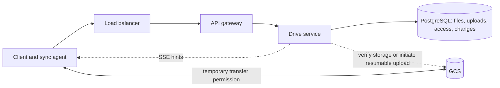

The API path carries small control requests. The direct GCS path carries content. One database transaction cannot include GCS.

## 1. Upload

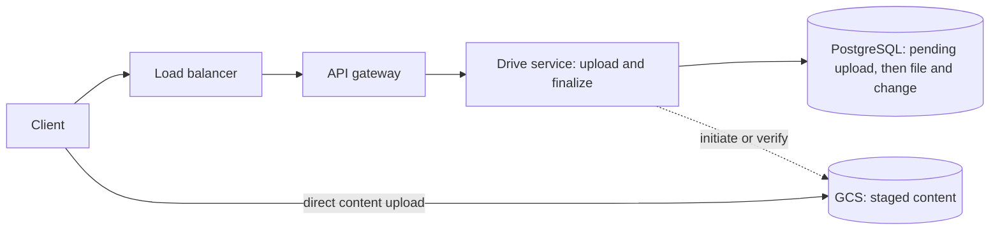

| Step | From → to | Sent | Returned and next action |
| --- | --- | --- | --- |
| 1 | Client → gateway → Drive | Name, size, type | Drive creates pending metadata |
| 2 | Drive → PostgreSQL | Upload record and new file identity | Pending row; return transfer permission |
| 3 | Client → GCS | Content bytes | Storage accepts content |
| 4 | Client → gateway → Drive | Completion request | Drive verifies stored content |
| 5 | Drive → PostgreSQL | File publication and durable change in one transaction | Commit; return ready file |

```
POST /v1/uploads -> 201 Created {
  uploadId, fileId, status: "uploading",
  transfer: { kind: "signed-put" | "gcs-resumable", url, headers }
}
Body: { name, sizeBytes, mimeType, fileId?, baseRevision? }

PUT {transfer.url} -> provider response
Body: <file bytes, or a byte range for resumable transfer>
Headers: transfer.headers; Content-Range for resumable requests
Response: 200 OK with object metadata after completion;
          308 Resume Incomplete with Range for accepted incomplete GCS uploads.

POST /v1/uploads/{uploadId}/complete -> 200 OK {
  fileId, status: "ready", revision, updatedAt
}
Body: {}
Failure: 409 { code: "upload_incomplete" | "revision_conflict" }
```

Repeat successful completion returns the same committed revision. New files are not readable while pending. A replacement does not hide the prior committed content.

GCS resumable uploads use a session URI after initiation. Individual byte ranges do not need individual signed URLs. Chunk recovery details await step 3.

## 2. Download

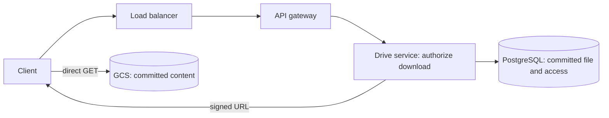

| Step | From → to | Sent | Returned and next action |
| --- | --- | --- | --- |
| 1 | Kim → gateway → Drive | File ID and validated session | Drive checks owner or grant |
| 2 | Drive → PostgreSQL | File and permission query | Committed content pointer |
| 3 | Drive → Kim | Signed URL and revision | Kim requests bytes |
| 4 | Kim → GCS | Signed GET | File bytes |

```
POST /v1/files/{fileId}/download-url -> 200 OK { fileId, revision, url, expiresAt }
Body: {}
Failure: 403 { code: "access_denied" }

GET {url} -> 200 OK <file bytes>
Body: none
Headers returned by storage: Content-Type, Content-Length
```

Only issue a URL after checking access. A valid URL can be forwarded. Its short lifetime limits exposure. Exact enforcement and revocation await the security deep dive.

## 3. Share and list

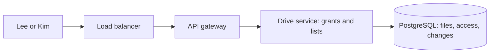

| Step | From → to | Sent | Returned and next action |
| --- | --- | --- | --- |
| 1 | Lee → gateway → Drive | File ID, Kim ID, reader role | Verify Lee owns the file |
| 2 | Drive → PostgreSQL | Grant and Kim's change in one transaction | Commit; return grant |
| 3 | Kim → gateway → Drive | List shared files | Query access rows for Kim and ready metadata |
| 4 | Drive → Kim | File list and pagination cursor | Kim may request a download URL |

```
POST /v1/files/{fileId}/shares -> 200 OK { fileId, recipientId, role: "reader" }
Body: { recipientId, role: "reader" }

GET /v1/files?scope=owned|shared&cursor={cursor} -> 200 OK {
  files: [{ fileId, name, sizeBytes, revision }], nextCursor
}
Body: none
```

Use a composite access key, `(user_id, file_id)`. A repeat grant returns the same grant. GCS receives no application-level share request.

## 4. Automatic sync

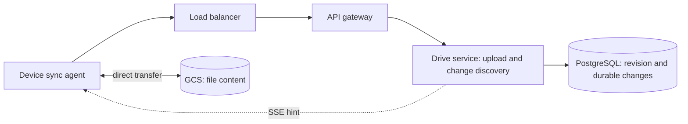

| Step | From → to | Sent | Returned and next action |
| --- | --- | --- | --- |
| 1 | Laptop agent → gateway → Drive | Upload intent with file ID and base revision | Pending transfer |
| 2 | Laptop agent → GCS | New content | Stored result; request verified completion |
| 3 | Drive → PostgreSQL | Publication and change in one transaction | New committed revision |
| 4 | Drive → phone | Optional SSE hint | Phone requests durable changes |
| 5 | Phone → gateway → Drive → PostgreSQL | Last change cursor | Changes, next cursor, hasMore |
| 6 | Phone → gateway → Drive | Download URL request | Permission-checked URL |
| 7 | Phone → GCS | Content request | Verify and install; mark revision applied |

The upload and completion APIs are the same as feature 1. For an existing file, send `fileId` and `baseRevision` in the upload intent. The download APIs are the same as feature 2.

```
GET /v1/changes?cursor={cursor}&limit=100 -> 200 OK {
  changes: [{ cursor, fileId, type, revision }], nextCursor, hasMore
}
Body: none

GET /v1/events -> 200 OK, Content-Type: text/event-stream
Body: none
Event: data: {"type":"changes_available"}
```

PostgreSQL stores every committed change, whether the device is connected or not. A publication transaction locks the user's stream row, updates file metadata, appends `changes(user_id, seq, file_id, revision, type)`, and advances `user_streams.last_seq`. It sends the hint after commit. The stream belongs to the affected user. It includes changes by other users to shared files. Each device has its own saved cursor.

SSE means server-sent events, a one-way stream from server to client. Hints are not durable file state. Replay changes on reconnect. Periodic checks recover from a lost hint.

Keep discovered work until file application succeeds. A timestamp cannot identify changed bytes. The current baseline stages the whole replacement file. Full replacement is sufficient for basic correctness. Changed-part reuse needs a manifest and remains step 3 work.

## Failure path: bytes stored but publication interrupted

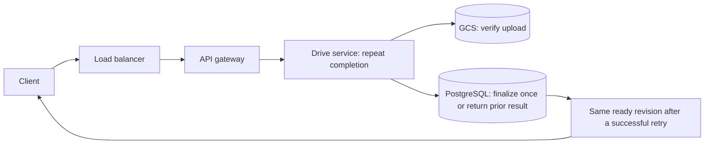

The object and database do not commit together. A client retry or recovery worker verifies the pending upload and repeats the same finalizer. Duplicate storage events must not publish extra revisions. Exact recovery and ordering await step 3.

Sources for provider behavior: [GCS signed URLs](https://docs.cloud.google.com/storage/docs/access-control/signed-urls), [GCS resumable uploads](https://docs.cloud.google.com/storage/docs/resumable-uploads), [GCS notifications](https://docs.cloud.google.com/storage/docs/pubsub-notifications).

## Follow-up: publication boundary and delta representation

A PostgreSQL finalization transaction publishes the committed file pointer, required journal rows, stream counters, and completed upload state. If a required statement fails, abort the transaction. Uploaded GCS content can remain pending outside this transaction. A lost push after commit is recovered through replay.

The proposed delta variant uploads new chunks, verifies them, then publishes their ordered manifest through the same finalizer. Each manifest entry records identity and length. The whole-file baseline remains available. Delta read API shapes now appear below; independent-chunk upload contracts now appear in the recovery section. No delta endpoint is implemented.

## Transaction boundary clarification, 2026-10-31

For the proposed delta variant, the client runs content-defined chunking and uploads X directly to GCS. Drive verifies required objects. In PostgreSQL only, one transaction writes manifest M2, switches the current file pointer, records changes, updates counters, and completes the upload. Only then does Drive send hints.

Before SQL commit, readers select M1: [A, B, C, D]. After commit, readers can select M2: [A, X, C, D]. Readers already using M1 must retain access to its protected content. X can exist unused if SQL publication fails. There is no shared GCS/PostgreSQL transaction. Delta read API shapes now appear below. Independent-chunk upload contracts now appear in the recovery section.

## Proposed delta read path: manifest in PostgreSQL

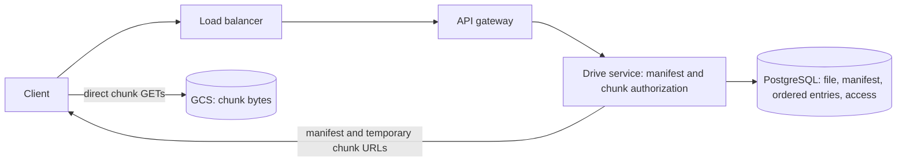

### Proposed delta download interfaces

These interfaces extend the delta design. The selected local paths now run; README section 6 records the limits. The existing whole-file download URL remains the baseline.

```
GET /v1/files/{fileId}/manifest?revision={revision} -> 200 OK {
  fileId, revision, manifestId, totalSizeBytes,
  chunks: [{ ordinal, chunkId, sizeBytes, crc32c, sha256?, sha256Verified }]
}
Body: none
Failure: 403 { code: "access_denied" }
Meaning: authorize the caller, then return the selected committed manifest.

POST /v1/files/{fileId}/chunk-download-urls -> 200 OK {
  fileId, revision,
  chunks: [{ chunkId, url, expiresAt }]
}
Body: { revision, chunkIds }
Failure: 403 { code: "access_denied" }
Meaning: check file access and membership of each requested chunk in that revision.
A chunk ID alone does not authorize a download.

GET {url} -> 200 OK <chunk bytes>
Body: none
Meaning: download directly from GCS using temporary permission.
```

Use one selected revision for all calls. Do not combine chunk references from different revisions. URLs are generated after authorization; they are not permanent values stored in the manifest. Large manifest paging and URL batch limits remain design details to resolve before implementation.

The client uses one committed revision. It verifies downloaded chunks and reconstructs their ordered content. A PostgreSQL manifest contains references and lengths, not file bytes. The current design does not also require a manifest object in GCS.

## Independent-chunk upload recovery — 2026-10-31

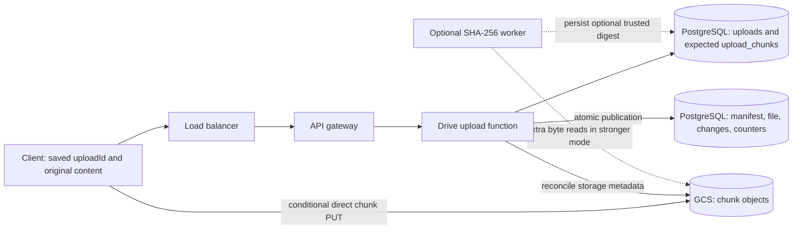

| Step | From → to | Sent | Returned or next action |
| --- | --- | --- | --- |
| 1 | Client → gateway → Drive → PostgreSQL | Pending upload intent and expected chunk plan | Stable uploadId, fileId, and planned destinations |
| 2 | Client → Drive | Requested missing ordinals | Scoped temporary URLs and required headers |
| 3 | Client → GCS | One planned chunk | Provider receipt or ambiguous lost response |
| 4 | Client → Drive → PostgreSQL | Reconcile request | Durable pending work |
| 5 | Drive or verifier → GCS → PostgreSQL | Inspect protected expected objects; compare provider checksum and size | Trusted receipts or missing and pending entries |
| 6 | Client → Drive | Upload status query | Actual verified progress and remaining work |
| 7 | Client → Drive | Complete request | 202 while verifying; 200 only after publication commits |

A 50 GB file divided into 10 MB independent objects has 5,000 entries. If 4,900 are verified, 100 entries remain. This decimal arithmetic is not a native GCS range-alignment rule.

A GCS ETag is not a general content checksum. CRC32C supports transfer validation. SHA-256 content identities require a trusted validation path. The ordinary verifier reads metadata only. Optional trusted SHA-256 verification reads bytes and adds storage I/O. Stateless API instances do not eliminate durable attempt state.


### Proposed independent-chunk upload interfaces

These extend the whole-object baseline. The selected local endpoints are now implemented; see README section 6. The initial lab prepares a complete expected chunk plan before transfer. This adds a preparation pass. Streaming plan construction is a later optimization.

```
POST /v1/uploads -> 201 Created { uploadId, fileId, mode: "independent-chunks", status: "uploading" }
Headers: Idempotency-Key: <stable key for this create request>
Body: { name, sizeBytes, mimeType, fileId?, baseRevision?, mode: "independent-chunks" }
Meaning: PostgreSQL retains owner, target, expected size, expiry, and attempt state.
Repeating the key with the same request returns the same attempt; conflicting reuse fails.

PUT /v1/uploads/{uploadId}/manifest -> 200 OK { uploadId, manifestHash, chunks: [{ ordinal, chunkId }], status: "uploading" }
Body: {
  chunking: { algorithm, version, parameters },
  chunks: [{ ordinal, logicalSizeBytes, storedSizeBytes, encoding, storedCrc32c, declaredStoredSha256? }]
}
Meaning: register the expected complete plan. Drive assigns opaque chunkId values; declared SHA-256 is optional.
The logical lengths must sum to the attempt's expected file size. Stored lengths describe encoded object bytes.
Repeating the identical plan is safe. Changing a frozen plan returns 409.

POST /v1/uploads/{uploadId}/chunk-upload-urls -> 200 OK {
  uploadId, chunks: [{ ordinal, url, headers, expiresAt }]
}
Body: { ordinals }
Meaning: authorize only planned destinations. Returned headers enforce the chosen provider's safe-write policy.

PUT {url} -> 200 OK (empty response body; provider receipt headers)
Headers: use the returned signed headers, including integrity and create-only requirements where supported
Body: <one chunk's bytes>
Possible GCS response: 412 Precondition Failed if a live object already exists
Meaning: reconcile and verify an existing object; do not treat any 412 as automatic success.

POST /v1/uploads/{uploadId}/reconcile -> 202 Accepted { uploadId, reconciliation: "pending" }
Body: {}
Meaning: retain reconciliation work in PostgreSQL; discover and verify planned objects.

GET /v1/uploads/{uploadId} -> 200 OK {
  uploadId, fileId, status, reconciliation, totalSizeBytes,
  totalStoredSizeBytes, storedBytes, verifiedStoredBytes, verifiedLogicalBytes, missingOrdinals, pendingOrdinals,
  result: { fileId, revision, manifestId } | null
}
Body: none
Meaning: authenticate attempt ownership. Do not infer completeness from the highest ordinal.
Ready attempts return the committed result.

POST /v1/uploads/{uploadId}/complete -> 202 Accepted { uploadId, fileId, status: "verifying" }
                                         or 200 OK { fileId, revision, manifestId, status: "ready", updatedAt }
Body: {}
Failures: 409 { code: "upload_incomplete" | "revision_conflict" | "plan_changed" }
Meaning: 202 accepts pending verification. 200 confirms committed publication.
A repeat after success returns the same revision.
```

The existing full-object completion call can also return 202 while verification is pending. This extends its initial 200-only sketch. Storage is not automatically trusted because the client presents an ETag. Request batch limits and retention values must be fixed before implementation.

## Checksum call flow, 2026-10-31

| Step | From → to | Sent or checked | Result |
| --- | --- | --- | --- |
| 1 | Client → gateway → Drive → PostgreSQL | Frozen ordinal, expected length, CRC32C, optional declared SHA-256 | Expected upload_chunks entry |
| 2 | Drive → client | Planned object URL and required signed headers | Authorized direct upload |
| 3 | Client → GCS | Chunk bytes and supported CRC32C validation field | GCS computes and compares checksum |
| 4 | Drive verifier → GCS | Authoritative object metadata | Compare size and provider CRC32C; pin generation |
| 5 | Verifier → PostgreSQL | Verified receipt | One verified entry, even after retries |
| 6 | Drive finalizer → PostgreSQL | Complete ordered plan, lengths, base revision | Atomic publication or rejection |

These calls use the manifest, chunk-upload URL, direct PUT, reconciliation, status, and complete contracts already shown above. No additional checksum endpoint is required. A create-only 412 triggers verification of the existing object. A checksum mismatch is an integrity failure. Neither raw response is an automatic application-level success.

Whole-file SHA-256 is optional. Hashing chunk hashes cannot substitute for hashing the original file byte stream. ManifestHash identifies the plan representation. The downloader verifies received lengths and validated provider checksums against the selected committed manifest. Use trusted SHA-256 only if its verification flag is true.

## Current ordinary receipt chain, 2026-10-31

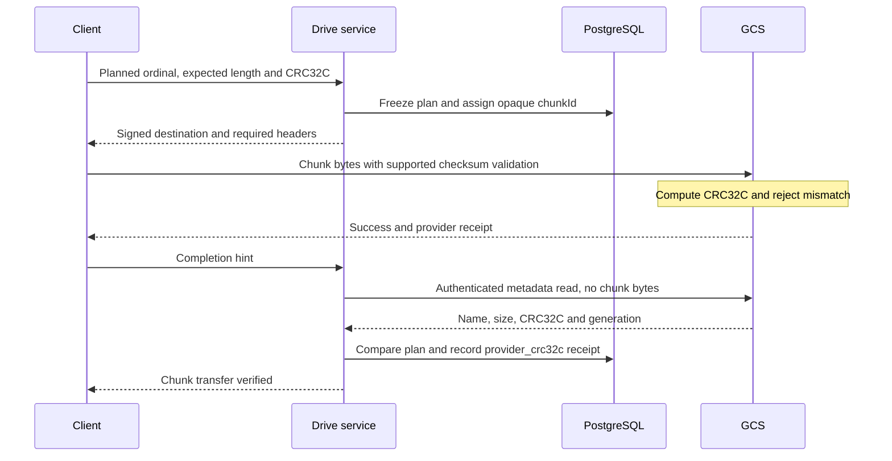

### Chunk receipt and metadata verification

This is the current ordinary path. It supersedes the earlier mandatory SHA-256 byte-reread policy. The endpoints remain proposed.

```
POST /v1/uploads/{uploadId}/chunks/{ordinal}/complete -> 200 OK {
  uploadId, ordinal, chunkId, state: "verified",
  verificationMethod: "provider_crc32c", sha256Verified: false
}
Body: { etag?, generation? }
Meaning: use client fields as hints only. Read authoritative provider metadata.
Return 202 { uploadId, ordinal, state: "verifying" } if checks are still pending.
Return 409 { code: "chunk_missing" | "chunk_mismatch" } on a failed content-plan check.

GET https://storage.googleapis.com/storage/v1/b/{bucket}/o/{encodedObjectKey}
    ?fields=name,size,generation,crc32c,etag
    -> 200 OK { name, size, generation, crc32c, etag }
Body: none
Caller: Drive with service credentials, using the stored planned destination.
Meaning: metadata only; do not request alt=media for this path.
```

The checksum must have been validated through the supported upload mechanism and must match the frozen expected checksum. Store the selected object generation. Protect it from overwrite and premature deletion.

Upload manifest entries now use { ordinal, logicalSizeBytes, storedSizeBytes, encoding, storedCrc32c, declaredStoredSha256? }. Drive assigns chunkId values and returns their ordinal mapping. A declared SHA-256 is not a verified chunkId.

Download manifest entries use { ordinal, chunkId, generation, logicalSizeBytes, storedSizeBytes, encoding, storedCrc32c, storedSha256?, storedSha256Verified }. Return a trusted storedSha256 value only when the chosen validation path established it. Native GCS and S3-compatible lab checksum mechanisms must be checked separately.


ETag can correlate a receipt in a consistent API context. GCS XML and JSON ETags can differ. Do not use a cross-API ETag string comparison as the only check. The ordinary path does not mark a declared H17 as SHA-256 verified. Optional strong-mode byte hashing remains separate.

## Pinned download recovery — taught 2026-10-31

This is the selected long-download path. Earlier raw manifest and URL endpoints are lower-level reads; they do not by themselves retain an old revision.

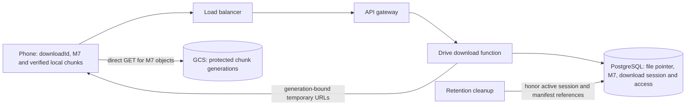

| Step | From → to | Sent or read | Result |
| --- | --- | --- | --- |
| 1 | Phone → gateway → Drive → PostgreSQL | File identity and current permission | Create session d7 pointing to revision 7 and M7 |
| 2 | Phone → Drive → PostgreSQL | Session manifest request | Return M7 with ordered references, generations, lengths, checksums |
| 3 | Phone → Drive | Selected missing chunk identities | Sign only authorized M7 chunks |
| 4 | Phone → GCS | Version-specific direct GET | Check bytes; persist verified progress locally |
| 5 | Server publishes revision 8 | Current pointer changes | d7 still selects M7 |
| 6 | Phone reconnects → Drive | d7 plus missing M7 chunk requests | Fresh URLs for M7 if session and access are valid |
| 7 | Phone | Complete M7 and validate output | Install revision 7, then process queued revision 8 |
| 8 | Phone → Drive after session expiry | d7 resume request | 410 revision_expired; do not silently return M8 |

A valid session with an unexpectedly missing protected object is a dependency failure, not ordinary expiry. Return content_unavailable and recover. A valid session whose short-lived URL expired needs only new URLs.

The study policy uses at most 24 hours for a download session and at most five minutes for each URL. These are application choices. Old state is protected for active jobs, not exposed as unlimited user history.


### Proposed pinned download sessions

These contracts make long downloads retain one selected file state. They supplement the earlier low-level manifest and URL calls. The selected local endpoints are now implemented; see README section 6.

```
POST /v1/downloads -> 201 Created {
  downloadId, fileId, revision, manifestId, mode, totalSizeBytes, leaseExpiresAt
}
Body: { fileId }
Meaning: authorize the caller; select the current committed state and create a bounded retention lease together.
The study default is a maximum 24-hour session, not unlimited historical downloads.

GET /v1/downloads/{downloadId}/manifest -> 200 OK {
  downloadId, fileId, revision, manifestId, totalSizeBytes,
  chunks: [{ ordinal, chunkId, generation, logicalSizeBytes, storedSizeBytes, encoding, storedCrc32c, storedSha256?, storedSha256Verified }]
}
Body: none
Meaning: return the session's pinned manifest, not the file's newer current manifest.
Failures: 410 { code: "revision_expired" }, 403 { code: "access_denied" }

POST /v1/downloads/{downloadId}/chunk-download-urls -> 200 OK {
  downloadId, revision,
  chunks: [{ chunkId, generation, url, expiresAt }]
}
Body: { chunkIds }
Meaning: check current access, session validity, and membership in the pinned manifest.
URLs select the recorded generations. Lifetimes are at most five minutes and no longer than the session.

GET {chunkUrl} -> 200 OK <chunk bytes>
Body: none
Meaning: read the selected stored object generation directly.
The client validates length and checksum against the pinned manifest.

POST /v1/downloads/{downloadId}/download-url -> 200 OK {
  downloadId, fileId, revision, generation, totalSizeBytes, crc32c, url, expiresAt
}
Body: {}
Meaning: whole-object baseline only; sign the session's selected object version.
GET {url} -> 200 OK <whole object> or 206 Partial Content <requested range>
Body: none
Optional request header: Range: bytes={nextOffset}-
Meaning: check the returned range before appending and validate the complete reconstructed object.

POST /v1/downloads/{downloadId}/complete -> 200 OK { downloadId, revision, status: "completed" }
Body: {}
Meaning: client reports local completion. This is not independent server proof of the phone's bytes.
The client installs only after its own integrity checks. Retention cleanup still observes its safe lease policy.
```

A signed-URL expiry while the session is valid needs fresh URLs for the same revision. An expired session returns 410 instead of a silent latest-version fallback. A protected object unexpectedly missing during a valid session returns a retryable 503 { code: "content_unavailable" }; current access denial returns 403.


Whole-object Range recovery selects one immutable revision-7 object and checks the returned byte range before appending. Its final checksum covers the reconstructed complete object. An HTTP response containing only a range cannot generally be compared directly with the complete-object checksum.

## Transfer scheduling, 2026-10-31

The client keeps a queue of missing planned chunks. One device-wide bounded worker pool requests URLs for near-term work, sends content directly to storage, and reports receipts. Completed work frees a slot. Retries retain their original upload and chunk identities.

The study adaptive mode starts with two requests and caps at eight, subject to resource budgets. Goodput, errors, and memory guide adjustment. A parallel scheduling change does not alter the frozen manifest. This is client behavior and does not add a new API endpoint. The existing upload URL, PUT, receipt, status, and completion contracts still apply.

## Encoded chunk representation, 2026-10-31

This refines earlier uncompressed examples. Identity encoding has equal logical and stored lengths. Codec choices and lengths belong to each immutable plan entry. No new endpoint is required.

| Step | From → to | Sent or checked | Result |
| --- | --- | --- | --- |
| 1 | Client preparation | Original bytes, stable CDC boundaries | Ordered logical chunks |
| 2 | Client encoder | Identity or selective gzip per chunk | Frozen encoded bytes, logical length, stored length, stored CRC32C |
| 3 | Client → Drive → PostgreSQL | Manifest PUT with the explicit entry fields above | Authorized frozen representation plan |
| 4 | Client → GCS | Encoded bytes and supported expected checksum | Provider validates the stored representation |
| 5 | Drive → GCS → PostgreSQL | Native size, crc32c, generation | Compare stored length and CRC32C; persist receipt |
| 6 | Downloader → Drive → GCS | Pinned manifest and generation-bound GET | Validate stored bytes before decoding |
| 7 | Downloader | Bounded decode and logical length check | Install only complete reconstructed content |

For a 10 MB logical chunk compressed to 3 MB, GCS and Drive validate 3 MB and its checksum. The downloader reconstructs 10 MB. The ordinary Drive verifier does not read and decompress content.

Upload intent sizeBytes and session totalSizeBytes describe logical file length. Status additionally reports totalStoredSizeBytes, storedBytes, verifiedStoredBytes, and verifiedLogicalBytes. The last value sums declared logical lengths for entries with verified stored receipts; it is not proof that Drive decoded them. Repeated acknowledgments do not increment these totals twice.

Store gzip as application/gzip without HTTP Content-Encoding: gzip. This keeps direct GET bytes consistent with the stored checksum. Changing compression or boundaries requires a new plan; reconnecting preserves the existing plan.

Sources: [GCS non-transcoding representations](https://docs.cloud.google.com/storage/docs/transcoding), [browser compression streams](https://compression.spec.whatwg.org/).

## Private CDN delivery — taught 2026-10-31

The ordinary route still uses direct GCS URLs. This is the repeated-read variant.

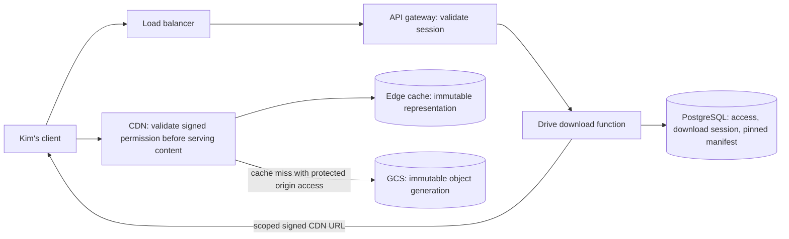

A hit reuses content, not another user's access decision. Drive checks permission before signing. The CDN checks signature and expiry on each signed request. The private origin and unsigned-request policy must prevent bypass.

### Private CDN delivery variant — proposed API refinement

The server selects direct storage or CDN delivery under the same authorization rules. This refines the existing endpoint. No separate share or public-link API is added.

```text
POST /v1/downloads/{downloadId}/chunk-download-urls -> 200 OK {
  downloadId, revision,
  chunks: [{ chunkId, generation, delivery: "storage" | "cdn", url, expiresAt }]
}
Headers: validated session cookie or Authorization: Bearer <session token>
Body: { chunkIds }
Checks: current file access, session owner, valid lease, and pinned manifest membership.
Failure: 403 { code: "access_denied" }, 410 { code: "revision_expired" }
Meaning: issue scoped permission, at most five minutes and no longer than the lease.

GET {cdnUrl} -> 200 OK <the selected stored chunk bytes>
Body: none
Credential: provider-specific signature and expiry in the URL.
Failure: 403 for invalid or expired signed permission on the protected route.
Meaning: validate permission on cache hits and misses. A miss uses protected origin access.
The URL selects an immutable object and generation; retain representation fields in the cache key.
```

A signed CDN URL is distinct from a GCS signed URL. The local cache must model private hits, expiry, misses, and protected origin fetches. This remains a proposed contract, not running code.

Cache identity contains the selected immutable destination and generation. Use the provider's supported signed-delivery cache configuration. Preserve exact encoded bytes. Cache retention can exceed five minutes; credential expiry still blocks later requests. A forwarded unexpired URL remains usable under the ordinary bearer policy. Stronger user binding and revocation policy remain a security probe.

Sources: [Cloud CDN overview](https://docs.cloud.google.com/cdn/docs/overview), [signed delivery and private origin](https://docs.cloud.google.com/cdn/docs/using-signed-urls), [cache keys](https://docs.cloud.google.com/cdn/docs/caching#cache_keys).

## Grant removal and active downloads — taught 2026-10-31

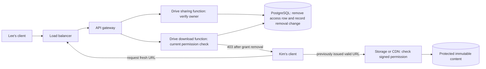

### Remove a named grant — proposed API

```text
DELETE /v1/files/{fileId}/shares/{recipientId} -> 204 No Content
Headers: validated session cookie or Authorization: Bearer <session token>
Body: none
Response body: none
Failure: 403 { code: "access_denied" } if the caller lacks owner permission.
Meaning: authorize the owner; remove the grant and append required access-removal changes in one PostgreSQL transaction.
An already absent grant returns 204 after authorization, without another removal event.

POST /v1/downloads/{downloadId}/chunk-download-urls -> 403 Forbidden {
  code: "access_denied"
}
Headers: Kim's validated session
Body: { chunkIds }
Condition: a later authorization check observes that Kim's grant was removed.
Meaning: no new URLs, even when an old download session remains active.
```

Existing scoped URLs keep their own expiry rules. The study admission policy permits valid requests and allows admitted responses to finish. A removed application grant does not itself cancel them.

The grant-removal transaction commits the access change and required replay record. An optional hint follows commit. The hint can stop a cooperating client earlier, but cannot invalidate an existing bearer permission.

The client can refresh an expired URL only while access and the download lease remain valid. Current grant denial returns 403. Session retention expiry remains 410. Stop a denied job and never install an incomplete file. Already downloaded bytes cannot be revoked.

Under the chosen lab rule, each GET validates at admission. Expiry does not cancel the response already admitted. CloudFront documents this rule; verify actual GCS/CDN behavior separately. A five-minute URL does not guarantee that all bytes stop within five minutes of grant removal.

Source: [CloudFront expiry checks](https://docs.aws.amazon.com/AmazonCloudFront/latest/DeveloperGuide/private-content-signed-urls.html#private-content-check-expiration).

## Transport and storage encryption — taught 2026-10-31

The existing HTTP methods, bodies, and responses remain unchanged. Use HTTPS URLs for client control calls, direct PUT and GET, and CDN delivery in production. Provider encryption does not add a file-key field to the default manifest.

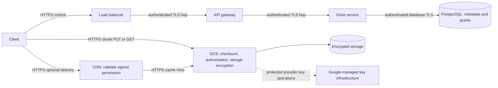

TLS can terminate at each endpoint. The next hop needs its own protected connection. CDN and GCS can see application bytes in the ordinary server-side encryption design. This is not client-held end-to-end encryption.

On upload, the client chunks and optionally compresses original bytes, computes the stored checksum, and uploads through HTTPS. GCS validates the application representation and encrypts its internal storage. On an authorized read, GCS decrypts and returns the same representation through HTTPS. The downloader validates stored bytes, then decodes. Our CRC32C is not a checksum of Google's internal ciphertext.

Google manages the default encryption keys. A customer-managed Cloud KMS key is an alternative trust and operations choice. Client-side encryption instead changes application bytes and requires explicit cryptographic metadata and device key handling. Neither alternative is selected for the ordinary path.

A valid signed GET authorizes automatic server-side decryption. Encryption at rest therefore does not fix a leaked bearer URL or public origin. An exact-object URL for chunk 17 also cannot authorize chunk 18.

Local TLS and storage encryption remain implementation work. A local stand-in must not claim to demonstrate GCS cryptography merely because it stores files.

Sources: [GCS standard encryption](https://docs.cloud.google.com/storage/docs/encryption/default-keys), [GCS key options](https://docs.cloud.google.com/storage/docs/encryption).

## Concurrent edits and conflict preservation — taught 2026-10-31

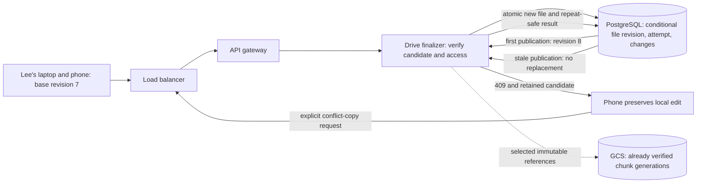

Both clients can upload valid bytes before either publishes. The ordinary finalizer atomically checks baseRevision and updates the file. One candidate wins revision 8. The other gets 409 and cannot silently replace it. Store candidate and resolution state durably.

### Concurrent publication and conflict copies — proposed API

These contracts extend the existing upload completion API. They do not change the provider checksum policy.

```text
POST /v1/uploads/{uploadId}/complete -> 409 Conflict {
  code: "revision_conflict",
  fileId,
  baseRevision: 7,
  currentRevision: 8,
  uploadId,
  candidateState: "conflicted",
  candidateExpiresAt,
  allowedResolution: "save_conflict_copy"
}
Headers: validated session cookie or Authorization: Bearer <session token>
Body: {}
Meaning: an authorized stale candidate does not replace the original.
Keep verified chunks until the recorded attempt expiry and preserve the local source.
The initial upload request still carries the frozen baseRevision.

POST /v1/uploads/{uploadId}/conflict-copy -> 201 Created {
  uploadId,
  fileId: "f2",
  originalFileId: "f1",
  revision: 1,
  status: "ready",
  completionKind: "conflict_copy",
  name
}
Headers: validated session; Idempotency-Key: <stable resolution key>
Body: { name? }
Meaning: explicitly create a private file owned by the uploader from the verified candidate.
Use the shared finalizer and retain one resolution result per attempt.
A repeated successful resolution returns 200 with the same result.
Failure: 403 { code: "access_denied" }
         409 { code: "candidate_not_verified" | "resolution_conflict" }
         410 { code: "upload_expired" }
```

Completion status and repeat responses identify completionKind when resolution created a new file. Do not present a conflict copy as a successful replacement of the original. A stale candidate must not silently rebase.

A conflict-copy transaction creates a new private file, manifest references, required changes and counters, and the attempt result. It reuses authorized verified chunks. Repeating the resolution returns that file. The client keeps dirty local content until explicit resolution; remote discovery must not overwrite it.

Internal revision checks and separate conflict files do not add user-visible revision history. Generic document merging remains outside scope. The lab comparison will show last-write-wins using server publication order.

Sources: [PostgreSQL conditional updates](https://www.postgresql.org/docs/current/transaction-iso.html#XACT-READ-COMMITTED), [Dropbox conflict copies](https://help.dropbox.com/organize/conflicted-copy).

## Large-recipient fan-out and restart — taught 2026-10-31

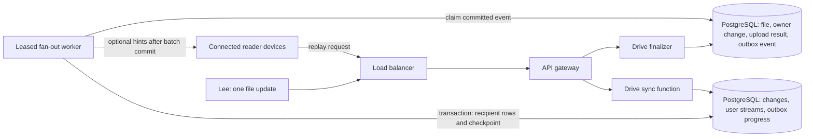

### Large-recipient completion and replay — proposed API refinement

```text
POST /v1/uploads/{uploadId}/complete -> 200 OK {
  fileId, revision: 8, manifestId, status: "ready", updatedAt,
  discovery: { eventId: "e8", state: "pending", mode: "outbox-fanout" }
}
Headers: validated session
Body: {}
Meaning: verified content, metadata, owner replay, upload result, and the fan-out event committed.
It does not mean every recipient's changes row or SSE hint already exists.
Repeat completion returns the same publication and eventId.

GET /v1/changes?cursor={cursor}&limit=100 -> 200 OK {
  changes: [{ cursor, fileId, type, revision }],
  nextCursor,
  hasMore
}
Headers: validated recipient session
Body: none
Meaning: return this user's committed authorized replay rows.
A recipient row can appear after worker processing; later polling or reconnect finds it.
```

Workers read database jobs directly in the initial lab. No user-facing enqueue endpoint and no 100000 signed URLs are required for this metadata task.

For the large-recipient mode, required publication state is the file, owner replay, upload result, and outbox event. Recipient batches each commit rows, deduplication keys, counter updates, and checkpoint atomically. Expired worker leases permit restart; fencing prevents a stale worker from writing after replacement. No GCS call joins these SQL transactions.

Use unique (user_id, source_event_id) on changes. Keep unfinished events until successful processing or explicit repair. Per-file workers preserve revision order. Hints can be lost; replay survives. Existing access checks still protect metadata and bytes.

This supersedes the requirement to insert every recipient row in the same publication transaction on this scale path. The synchronous variant remains available for comparison. No queue or worker runs yet.

Source: [Transactional outbox](https://docs.aws.amazon.com/prescriptive-guidance/latest/cloud-design-patterns/transactional-outbox.html).

## Exact per-recipient rows versus live hints — clarified 2026-10-31

One update to plan-file revision 4 produces distinct stream entries: Lee at position 41, Kim at position 73, and Ada at position 9. Position is the seq column. The worker writes Kim and Ada rows in PostgreSQL even when their devices have no connection. The existing source_event_id links them to one committed event.

```text
GET /v1/changes?cursor=72&limit=100 -> 200 OK {
  changes: [{ cursor: 73, fileId: "plan-file", revision: 4, type: "updated" }],
  nextCursor: 73, hasMore: false
}
Headers: Kim's validated session
Body: none
Meaning: select Kim's rows after seq 72; apply current disclosure permission.
```

An SSE changes_available hint only wakes a connected client to make this request. An offline client makes it on reconnect. Kim then uses the existing download session, manifest, and signed chunk GET contracts. Kim does not read Lee's rows.

Periodic metadata comparison is a separate valid discovery model. A metadata scan can avoid per-user event copies but examines unchanged files. The selected incremental feed needs recipient rows; the outbox makes their creation recoverable.

## Metadata outage and ambiguous completion — taught 2026-10-31

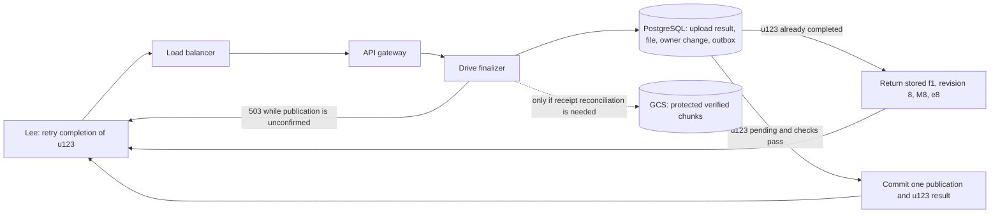

### Database outage and completion replay — proposed API refinement

```text
POST /v1/uploads/u123/complete -> 503 Service Unavailable {
  code: "metadata_unavailable",
  uploadId: "u123",
  retryable: true
}
Headers returned: Retry-After: 5
Headers sent: validated session
Body: {}
Meaning: ready publication is not confirmed. The transaction may be uncommitted or ambiguous.
Keep the same attempt. Five seconds is an illustrative retry delay, not a provider limit.

POST /v1/uploads/u123/complete -> 200 OK {
  fileId: "f1", revision: 8, manifestId: "M8", status: "ready",
  updatedAt,
  completionKind: "normal",
  discovery: { eventId: "e8", state: "pending", mode: "outbox-fanout" }
}
Headers: validated session
Body: {}
Meaning: either publish u123 once or return its saved committed result.
A retry does not publish revision 9 or append a second source event.

POST /v1/uploads -> 409 Conflict { code: "idempotency_key_reused" }
Headers: validated session; Idempotency-Key: K1
Body: <different intent from the earlier request with the same owner and K1>
Meaning: reject changed canonical request parameters.
A new intentional file creation uses a new key, even if its content is identical.
```

The retry first recognizes a completed attempt before repeating publication checks. All ordinary access protections remain. Stored completion data does not issue permanent content access. An unavailable metadata status query also returns a retryable dependency failure.

The file update, required owner change and counter, outbox event, and upload result commit together. A retry reads authoritative operation state. It does not infer success from GCS existence, name equality, or a content digest. Duplicate completions serialize on the same upload row. A unique source_upload_id guards the content-publication event.

Verified receipts can be reused; reconcile metadata where needed. No mandatory 50 GB byte rehash or reupload follows a transient database outage. A changed base revision can still produce a conflict for a pending attempt. Recognize already-completed attempts first.

A new intent with equal bytes is storage reuse, not request replay. Keep it under a new operation key and distinct logical file identity when the user asks to create another file.

Source: [Idempotent API pattern](https://docs.stripe.com/api/idempotent_requests).

## Upload session and creation-key trace — clarified 2026-11-01

```mermaid
sequenceDiagram
  participant C as Lee's client
  participant L as Load balancer
  participant G as API gateway
  participant D as Drive upload function
  participant P as PostgreSQL uploads
  Note over C: Generate and persist random key K1
  C->>L: POST /v1/uploads with K1 and frozen creation metadata
  L->>G: Route request
  G->>D: Validated Lee identity
  D->>P: Insert u123; unique owner plus key
  P-->>D: One committed attempt
  D--xC: Creation reply lost
  C->>L: Repeat same POST with K1
  L->>G: Route retry
  G->>D: Validated Lee identity
  D->>P: Read existing key and compare creation parameters
  P-->>D: Existing u123
  D-->>C: Original creation receipt
  C->>L: POST /v1/uploads/u123/complete
  L->>G: Route completion
  G->>D: Validated attempt owner
  D->>P: Publish once or replay completed result
  D-->>C: Same committed file, revision, manifest, event
```

The earlier upload-create, status GET, and completion blocks give methods, paths, bodies, and responses. Creation uses Idempotency-Key. Later attempt operations use uploadId; completion needs no additional creation key. Replay creation can return the original 201 receipt. Status GET returns current state. Changed canonical creation parameters under the same owner and key return 409 idempotency_key_reused.

Store the upload session and initial key mapping on uploads. Store expected chunks and receipts on upload_chunks. The client persists K1 before the first call and u123 after learning it. GCS stores content bytes. A matching content digest is not a replacement for operation identity.

Source: [PostgreSQL conflict handling](https://www.postgresql.org/docs/current/sql-insert.html).

## Separate logical files with reused content — clarified 2026-11-01

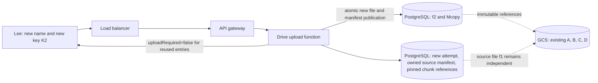

### Authorized chunk reuse — proposed manifest refinement

New chunk entries retain the existing plan fields. A reuse entry is the alternative shape below. It applies to a source owned by the uploader in the initial lab.

```text
POST /v1/uploads -> 201 Created {
  uploadId: "u456", fileId: "f2",
  mode: "independent-chunks", status: "uploading"
}
Headers: Lee's validated session; Idempotency-Key: K2
Body: {
  name: "plan-copy.txt", sizeBytes: 16000000,
  mimeType: "text/plain", mode: "independent-chunks"
}
Meaning: a new logical file intent, despite equal source content.

PUT /v1/uploads/u456/manifest -> 200 OK {
  uploadId: "u456", manifestHash,
  chunks: [
    { ordinal: 0, chunkId: "A", uploadRequired: false },
    { ordinal: 1, chunkId: "B", uploadRequired: false },
    { ordinal: 2, chunkId: "C", uploadRequired: false },
    { ordinal: 3, chunkId: "D", uploadRequired: false }
  ],
  status: "uploading"
}
Headers: Lee's validated session
Body: {
  chunking: { algorithm, version, parameters },
  chunks: [
    { ordinal: 0, reuseFrom: { fileId: "f1", manifestId: "M8", ordinal: 0 } },
    { ordinal: 1, reuseFrom: { fileId: "f1", manifestId: "M8", ordinal: 1 } },
    { ordinal: 2, reuseFrom: { fileId: "f1", manifestId: "M8", ordinal: 2 } },
    { ordinal: 3, reuseFrom: { fileId: "f1", manifestId: "M8", ordinal: 3 } }
  ]
}
Meaning: validate and pin owned source references; derive chunk metadata from server records.
Failures: 403 { code: "access_denied" }
          409 { code: "plan_changed" | "source_unavailable" | "size_mismatch" }
New-entry responses use uploadRequired: true.
This arithmetic example has four logical chunks of 4000000 bytes each.

POST /v1/uploads/u456/complete -> 200 OK {
  fileId: "f2", revision: 1, manifestId: "Mcopy", status: "ready",
  updatedAt, completionKind: "normal"
}
Headers: Lee's validated session
Body: {}
Meaning: publish the new private file from the complete verified plan.
Reused entries require no byte PUT. New entries still use the existing upload and verification chain.
```

This does not add a global hash lookup endpoint. Reuse does not change source grants or the source file pointer.

In the default reuse mode, source ownership and exact protected references authorize reuse. Do not grant access by hash alone. Distinct new-byte uploads remain the non-deduplicated comparison. Separate manifests allow independent updates and grants. A new X never overwrites B. Cleanup must retain shared chunks while any protected reference remains.

Provider evidence does not establish identical internal deduplication policy for every Google Drive or Dropbox upload.

## Safe cleanup after logical deletion — taught 2026-11-01

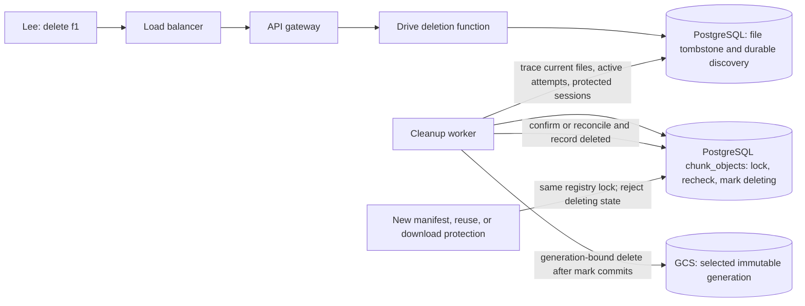

### Logical deletion and storage cleanup — proposed API

```text
DELETE /v1/files/f1 -> 204 No Content
Headers: validated owner session
Body: none
Response body: none
Meaning: tombstone the logical file and commit required deletion discovery with it.
Large-recipient discovery uses an outbox event. Physical cleanup runs later.
Repeat deletion returns 204 after authorization without another logical event.
Failure: 403 { code: "access_denied" }

POST /v1/downloads -> 404 Not Found { code: "file_deleted" }
Headers: validated session
Body: { fileId: "f1" }
Meaning: a new download session cannot select a logically deleted file.
This does not erase an existing session's bounded retention protection.

DELETE https://storage.googleapis.com/storage/v1/b/{bucket}/o/{encodedObjectKey}
       ?generation={recordedGeneration}&ifGenerationMatch={recordedGeneration}
       -> 204 No Content
Caller: cleanup worker using service credentials
Body: none
Response body: none
Meaning: delete only the selected storage generation after the database marks it deleting.
A missing selected generation can be reconciled as already removed.
Unexpected version/precondition failures need reconciliation; never delete a different generation blindly.
```

The initial local stand-in uses its supported S3-compatible identity and deletion controls. It must not claim a GCS generation API. Provider policy can delay physical reclamation.

A/C/D/X remain because the copy references them. B remains while the original download lease protects it. Y/Z are eligible only after the expired attempt and every other live-root check permit retirement. A phone's acknowledgment is not the retention clock.

The initial scan only discovers candidates. The final short transaction locks a registry row, rechecks live roots and guards, and marks deleting. New reference acquisition uses the same lock and requires a usable state. Storage deletion follows outside SQL, then a second transaction records completion. Crash recovery retries the same selected generation.

Do not delete by age alone or continue authoritative reference checks while PostgreSQL is unavailable. Old manifest rows, change records, and idempotency receipts are not unlimited content leases. Live roots and explicit protection determine retention.

Sources: [GCS deletion preconditions](https://docs.cloud.google.com/storage/docs/request-preconditions), [PostgreSQL locking](https://www.postgresql.org/docs/current/explicit-locking.html).

## Tenfold peak and selective caching — taught 2026-11-01

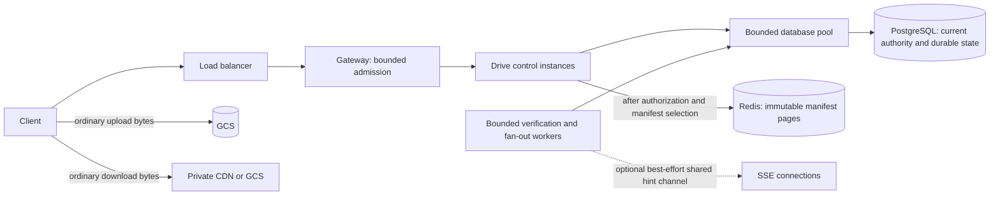

### Cache read path and capacity rejection — proposed refinement

The existing endpoints retain their authorization rules. Caching does not create another user-facing metadata API.

```text
GET /v1/downloads/d7/manifest -> 200 OK {
  downloadId: "d7", fileId: "f1", revision: 7, manifestId: "M7",
  totalSizeBytes, chunks
}
Headers: validated session
Body: none
Meaning: check current access and retained session in authoritative SQL.
Then read the selected immutable manifest page from Redis or PostgreSQL.
Cache key: manifest:M7:page:0; the page format/version also belongs to cache identity.
The download manifest chunk shape remains the explicit logical/stored representation defined earlier.

POST /v1/uploads -> 503 Service Unavailable {
  code: "capacity_exhausted",
  retryable: true
}
Headers sent: validated session; Idempotency-Key: K1
Headers returned: Retry-After: 5
Body: <the same upload-creation metadata as before>
Meaning: capacity cannot safely accept more work now.
Retry with backoff and the same K1. Do not create a new logical operation for each retry.
Five seconds is an illustrative hint, not a provider quota.

GET /v1/changes?cursor={cursor}&limit=100 -> 503 Service Unavailable {
  code: "capacity_exhausted",
  retryable: true
}
Headers: validated session
Headers returned: Retry-After: 5
Body: none
Meaning: retain the device's cursor and retry later; a failure does not advance discovery.
```

Current permission denial remains 403. This overload response is not a per-user storage quota. Real local metrics and lower-scale scenarios must verify bounded behavior before any performance claim.

Redis stores selected read payloads, not publication authority. Cache outage fallback is bounded. Permission checks and session creation use authoritative state. CDN bytes and signed credentials have independent lifetimes. More Drive instances do not expand database or storage capacity automatically.

The production scale path can partition/shard ownership while keeping each publication and source outbox local. Recipient journals can materialize asynchronously on their user's shard. Do not imply a transaction across independent PostgreSQL databases. The initial lab stays on one database and does not prove the target throughput.

Sources: [PostgreSQL connections](https://www.postgresql.org/docs/current/runtime-config-connection.html), [PgBouncer](https://www.pgbouncer.org/features.html), [GCS rate guidance](https://docs.cloud.google.com/storage/docs/request-rate).

## Region-loss acknowledgment boundary — taught 2026-11-01

```mermaid
flowchart LR
  C[Lee: complete u123] --> L[Load balancer] --> G[API gateway] --> D[Drive finalizer]
  D --> A[(Region A PostgreSQL: publication and operation result)]
  A -->|required durable replication before ready| B[(Region B eligible metadata standby)]
  D -->|ready only after required acknowledgment| C
  F[Failover control: select safe history and prevent old writer] --> B
  R[Lee: retry or query u123 after recovery] --> L
  D -->|after safe promotion and replay| B
  S[(Storage copies meeting the region-loss contract)] -. content protection also required .-> D
```

The existing POST /v1/uploads/{uploadId}/complete contract changes its production durability boundary, not its method or body. Its 200 ready result requires the selected remote durable metadata protection plus verified storage protection. Uncertain authority returns the existing retryable metadata_unavailable response. GET upload status must not report a stale replica as the latest authoritative result.

A lagging asynchronous replica cannot safely turn an acknowledged revision 8 into a failed upload. Recover and replay its history where possible. Promote only with the required committed history and prevent the old primary from continuing as a writer. Then the same u123 returns its recorded result. If the history was never replicated and is lost, waiting or retry cannot manufacture the selected guarantee.

Cross-region content protection is a separate storage contract. The lab does not prove regional durability until its replicas and failure model are actually verified.

Sources: [PostgreSQL synchronous replication](https://www.postgresql.org/docs/current/warm-standby.html#SYNCHRONOUS-REPLICATION), [commit durability modes](https://www.postgresql.org/docs/current/runtime-config-wal.html#GUC-SYNCHRONOUS-COMMIT).

## Consolidated design reference — 2026-11-01

Steps 1–4 are taught. [final-design-flow.md](final-design-flow.md) collects the selected feature paths, HTTP contracts, services, and state-store schemas. This file keeps the detailed interview sequences and the dated refinements. Step 5 and implementation remain pending.
