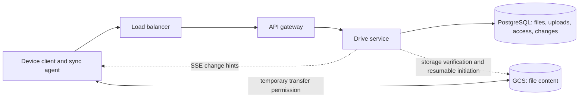

# Google Drive

**Status:** Implemented
**Sources:** Alex Xu, *System Design Interview*, Vol 1, Ch 15; [Hello Interview — Dropbox](https://www.hellointerview.com/learn/system-design/problem-breakdowns/dropbox).
**Slug:** `google-drive`

**Session:** 2026-10-30 through 2026-11-01. All five interview steps are complete. The local full-stack lab passes 12 integration scenarios and 4 functional checks. End-of-session Q&A is complete. The learner closed the chapter on 2026-11-01.

Notes use short sentences and active voice, following [ASD-STE100](https://www.asd-ste100.org/).

## 1. Requirements and design scope

### Problem

Design a file storage service like Google Drive or Dropbox. Lee can access files from a laptop and a phone. Lee can share files with Kim.

### Functional requirements

1. Upload files from any device.
2. Download files from any device.
3. Share files with named users. List owned files and files shared with the current user.
4. Automatically sync local changes to the server and remote changes to other devices. External tools edit the files.

### Non-functional requirements

Hello Interview supplies the 50 GB limit and qualitative goals. It gives no numeric traffic peak or latency target in its requirements. The following traffic and latency values are this session's planning assumptions. They are not measurements of Google Drive or Dropbox.

| Requirement | Session target | Meaning |
| --- | --- | --- |
| File size | Up to 50 GB | Large transfers need progress and recovery after interruption |
| Scale | 10 million daily active users; 2 uploads and 5 downloads per user per day | About 230 uploads/s and 580 downloads/s on average |
| Peak | 5 times average | About 1,160 uploads/s and 2,900 downloads/s; excludes sync, permission, retry, and part requests |
| Storage | Average upload size: 10 MB, decimal units | About 200 TB of incoming bytes/day, before replication, cleanup, or reuse |
| Metadata latency | p95 at most 200 ms under normal conditions | At least 95% of metadata requests finish within this time |
| Sync latency | p95 at most 2 seconds for change discovery | Applies to connected devices under normal conditions; file transfer follows |
| Availability | Prefer usable reads and delayed sync during disruption | Reject unsafe writes or access grants when authoritative state is unavailable |
| Consistency | Devices may temporarily show different committed revisions | A revision is an internal identifier for a file state; do not expose partial files |
| Durability | Confirm file completion only after verified durable storage and metadata publication | Durable means accepted data survives the failures covered by the storage policy |
| Security | Check identity and file permission | Profile management is excluded; access checks remain required |

At 100 Mb/s, a 50 GB transfer needs at least 4,000 seconds, or about 67 minutes. This bound excludes protocol overhead and retries. Two seconds applies to change discovery, not the full transfer.

#### Latency: what does the user wait for?

Lee uploads a 50 GB video. A fast control response cannot remove the limit of Lee's connection. Metadata means the file name, size, owner, and current state.

- **Option A — One two-second deadline for every operation.** Small requests fit the deadline. The large transfer cannot fit at 100 Mb/s. This option works only with a much smaller file limit.
- **Option B — Separate response, discovery, and transfer targets.** Keep metadata fast. Discover a committed change within the normal sync target. Show transfer progress and support recovery. This adds transfer state but fits large files.

**We pick Option B.** The file limit is 50 GB. The transfer alone needs about 67 minutes at 100 Mb/s. The local lab uses small files and controlled interruptions.

#### Availability and consistency: what may differ?

Lee saves a file on the laptop. The phone can show the prior committed state for a short time. Eventual consistency means the devices converge after communication recovers and pending work completes. It does not permit partial data or silent loss of a conflicting edit.

- **Option A — Wait for every device before confirming the save.** All devices agree before the save completes. One offline phone can block Lee's laptop. This wins only when all participants must approve each operation.
- **Option B — Commit remotely, then sync each device.** An offline phone catches up later. This adds retry and conflict handling. It fits independent devices and the normal two-second discovery target.

**We pick Option B.** One offline phone must not block the laptop. Conflict policy remains a step 3 decision. Access decisions and file publication still need correctness. The design can reject an unsafe operation during a partition.

#### Durability: when can we say the upload is complete?

Lee sees an upload-complete message. The application server then crashes. Lee must still recover the file. A checksum is a value computed from bytes to detect changes or damage. A checksum detects damage; another valid copy enables repair.

- **Option A — Confirm after temporary receipt.** This gives an earlier response and needs less coordination. A crash can lose a file already shown as complete. It fits disposable temporary data.
- **Option B — Confirm after verified storage and metadata publication.** This adds storage acknowledgments and recovery work for interrupted publication. It protects a completed upload from an application restart. Replicas and backups cover different storage failures.

**We pick Option B.** Losing one confirmed personal file violates the requirement. The local lab must prove persistence across an application restart. One local storage container does not prove survival after a disk or region loss.

#### Scale: which number drives capacity?

The average rate hides a busy period. Transfer starts also hide the number of requests needed for each large file. A chunk is one smaller piece of a file.

- **Option A — Size for average transfer starts.** About 230 uploads/s costs less to provision. A fivefold peak can cause queues and timeouts. This fits a bounded workload that accepts delays.
- **Option B — Plan for peak starts and byte volume.** Use about 1,160 uploads/s and 2,900 downloads/s at peak. Count chunk requests separately after selecting the transfer design. This costs more capacity but covers the assumed peak.

**We pick Option B.** The assumed peak is five times average. The lab stays small. Step 3 will calculate chunk traffic and storage overhead.

#### Sharing: what does the recipient need?

Lee shares `plan.pdf` with Kim. Kim must find it in the shared-files list and download it. Ada must still receive an access denial.

- **Option A — Treat possession of a public link as permission.** Sharing is simple. Anyone who receives the link can use it. This wins for deliberately public distribution.
- **Option B — Grant access to a named account.** Check the caller's identity and grant. This adds permission storage and queries. It fits private sharing between Lee and Kim.

**We pick Option B.** This session requires named-user sharing. Profile management stays outside the design. Assume an existing identity provider. The lab can use clearly labeled demo identities.

### Scope

| Exclusion | Origin | Why it stays out |
| --- | --- | --- |
| Editing files inside the service | Hello Interview; learner agrees | An editor is a separate product. External edits still trigger sync |
| Preview without downloading | Hello Interview; learner agrees | Preview needs rendering and support for file formats |
| User-visible version history and restore | Hello Interview; learner agrees | History needs retention and restore rules. Internal revisions still support safe updates |
| Virus and malware scans | Hello Interview; learner agrees | Scanning needs an additional processing and quarantine path |
| Per-user storage limits | Hello Interview; learner agrees | Quotas need accounting and concurrent admission checks |
| Profile management | Additional learner cut | Assume existing accounts. Authentication and file permissions remain required |
| Building the object storage system | Hello Interview boundary | Use an existing storage service. The local lab uses a container |

User-visible version history differs from storage recovery. We still need protection against failed uploads and damaged storage. A revision counter does not promise a history browser or unlimited retention.

Concurrent external edits remain a required probe. Excluding the built-in editor does not exclude sync conflicts.

### Core entities

| Entity | Description |
| --- | --- |
| User | Existing account that owns or receives access to files |
| File bytes | The actual content |
| File metadata | Identity, name, size, owner, state, and current internal revision |
| Share | A grant from a file owner to another account |
| Change | A committed update that another device must discover |

### APIs

The caller's identity comes from a validated session. These are design contracts. The local API implements the selected paths; see section 6 and final-design-flow.md for exact lab differences. This section supersedes the step 1 logical byte endpoints. Step 3 will add chunk and recovery details.

```
POST /v1/uploads -> 201 Created {
  uploadId, fileId, status: "uploading",
  transfer: { kind: "signed-put" | "gcs-resumable", url, headers }
}
Body: { name, sizeBytes, mimeType, fileId?, baseRevision? }
Meaning: create a new file, or stage replacement bytes for an existing file.
The existing file stays readable until the replacement commits.

PUT {transfer.url} -> provider response
Body: <file bytes, or a byte range for a resumable upload>
Headers: use transfer.headers; resumable requests also specify Content-Range
Response: 200 OK with object metadata after completion;
          308 Resume Incomplete with Range for accepted incomplete GCS uploads.
This call goes directly to storage, not to the Drive API.

POST /v1/uploads/{uploadId}/complete -> 200 OK {
  fileId, status: "ready", revision, updatedAt
}
Body: {}
Meaning: verify stored content and commit file metadata plus a durable change.
Failure: 409 { code: "upload_incomplete" | "revision_conflict" }
A repeat after successful publication returns the same committed revision.

POST /v1/files/{fileId}/download-url -> 200 OK {
  fileId, revision, url, expiresAt
}
Body: {}
Failure: 403 { code: "access_denied" }
Meaning: check access, then sign a read of the selected committed content.
GET {url} -> 200 OK <file bytes>
Body: none
Headers returned by storage: Content-Type, Content-Length

POST /v1/files/{fileId}/shares -> 200 OK {
  fileId, recipientId, role: "reader"
}
Body: { recipientId, role: "reader" }
Meaning: only the owner grants access; a repeat returns the same grant.
The transaction also records a change for the recipient.

GET /v1/files?scope=owned|shared&cursor={cursor} -> 200 OK {
  files: [{ fileId, name, sizeBytes, revision }], nextCursor
}
Body: none

GET /v1/changes?cursor={cursor}&limit=100 -> 200 OK {
  changes: [{ cursor, fileId, type, revision }], nextCursor, hasMore
}
Body: none
Meaning: return only changes visible to the authenticated caller.
The cursor is a server-issued position, not a device timestamp.

GET /v1/events -> 200 OK, Content-Type: text/event-stream
Body: none
Event: data: {"type":"changes_available"}
Meaning: an authenticated SSE connection supplies hints, not file bytes.
The client calls /v1/changes to read durable changes.
```

A signed URL supplies limited temporary permission for a storage request. Anyone who holds the active URL can use it. A resumable GCS upload uses a session URI after initiation. It does not need a new signed URL for each byte range. The local lab will use MinIO as a stand-in, with its S3-compatible transfer protocol. It will not reproduce GCS wire semantics.

Sources: [GCS signed URLs](https://docs.cloud.google.com/storage/docs/access-control/signed-urls), [GCS resumable uploads](https://docs.cloud.google.com/storage/docs/resumable-uploads).

### Proposed delta download interfaces

These interfaces extend the delta design. The selected local paths are implemented; see section 6. The existing whole-file download URL remains the baseline.

```
GET /v1/files/{fileId}/manifest?revision={revision} -> 200 OK {
  fileId, revision, manifestId, totalSizeBytes,
  chunks: [{ ordinal, chunkId, sizeBytes, crc32c, sha256?, sha256Verified }]
}
Body: none
Failure: 403 { code: "access_denied" }
Meaning: authorize the caller, then return the selected committed manifest.

POST /v1/files/{fileId}/chunk-download-urls -> 200 OK {
  fileId, revision,
  chunks: [{ chunkId, url, expiresAt }]
}
Body: { revision, chunkIds }
Failure: 403 { code: "access_denied" }
Meaning: check file access and membership of each requested chunk in that revision.
A chunk ID alone does not authorize a download.

GET {url} -> 200 OK <chunk bytes>
Body: none
Meaning: download directly from GCS using temporary permission.
```

Use one selected revision for all calls. Do not combine chunk references from different revisions. URLs are generated after authorization; they are not permanent values stored in the manifest. Large manifest paging and URL batch limits remain design details to resolve before implementation.

### Proposed independent-chunk upload interfaces

These extend the whole-object baseline. The selected local endpoints are now implemented; see README section 6. The initial lab prepares a complete expected chunk plan before transfer. This adds a preparation pass. Streaming plan construction is a later optimization.

```
POST /v1/uploads -> 201 Created { uploadId, fileId, mode: "independent-chunks", status: "uploading" }
Headers: Idempotency-Key: <stable key for this create request>
Body: { name, sizeBytes, mimeType, fileId?, baseRevision?, mode: "independent-chunks" }
Meaning: PostgreSQL retains owner, target, expected size, expiry, and attempt state.
Repeating the key with the same request returns the same attempt; conflicting reuse fails.

PUT /v1/uploads/{uploadId}/manifest -> 200 OK { uploadId, manifestHash, chunks: [{ ordinal, chunkId }], status: "uploading" }
Body: {
  chunking: { algorithm, version, parameters },
  chunks: [{ ordinal, logicalSizeBytes, storedSizeBytes, encoding, storedCrc32c, declaredStoredSha256? }]
}
Meaning: register the expected complete plan. Drive assigns chunkId. A client-declared SHA-256 is an optional unverified fingerprint.
The logical lengths must sum to the attempt's expected file size. Stored lengths describe encoded object bytes.
Repeating the identical plan is safe. Changing a frozen plan returns 409.

POST /v1/uploads/{uploadId}/chunk-upload-urls -> 200 OK {
  uploadId, chunks: [{ ordinal, url, headers, expiresAt }]
}
Body: { ordinals }
Meaning: authorize only planned destinations. Returned headers enforce the chosen provider's safe-write policy.

PUT {url} -> 200 OK (empty response body; provider receipt headers)
Headers: use the returned signed headers, including integrity and create-only requirements where supported
Body: <one chunk's bytes>
Possible GCS response: 412 Precondition Failed if a live object already exists
Meaning: reconcile and verify an existing object; do not treat any 412 as automatic success.

POST /v1/uploads/{uploadId}/reconcile -> 202 Accepted { uploadId, reconciliation: "pending" }
Body: {}
Meaning: retain reconciliation work in PostgreSQL; discover and verify planned objects.

GET /v1/uploads/{uploadId} -> 200 OK {
  uploadId, fileId, status, reconciliation, totalSizeBytes,
  totalStoredSizeBytes, storedBytes, verifiedStoredBytes, verifiedLogicalBytes, missingOrdinals, pendingOrdinals,
  result: { fileId, revision, manifestId } | null
}
Body: none
Meaning: authenticate attempt ownership. Do not infer completeness from the highest ordinal.
Ready attempts return the committed result.

POST /v1/uploads/{uploadId}/complete -> 202 Accepted { uploadId, fileId, status: "verifying" }
                                         or 200 OK { fileId, revision, manifestId, status: "ready", updatedAt }
Body: {}
Failures: 409 { code: "upload_incomplete" | "revision_conflict" | "plan_changed" }
Meaning: 202 accepts pending verification. 200 confirms committed publication.
A repeat after success returns the same revision.
```

The existing full-object completion call can also return 202 while verification is pending. This extends its initial 200-only sketch. Storage is not automatically trusted because the client presents an ETag. Request batch limits and retention values must be fixed before implementation.

### Chunk receipt and metadata verification

This is the current ordinary path. It supersedes the earlier mandatory SHA-256 byte-reread policy. The endpoints remain proposed.

```
POST /v1/uploads/{uploadId}/chunks/{ordinal}/complete -> 200 OK {
  uploadId, ordinal, chunkId, state: "verified",
  verificationMethod: "provider_crc32c", sha256Verified: false
}
Body: { etag?, generation? }
Meaning: use client fields as hints only. Read authoritative provider metadata.
Return 202 { uploadId, ordinal, state: "verifying" } if checks are still pending.
Return 409 { code: "chunk_missing" | "chunk_mismatch" } on a failed content-plan check.

GET https://storage.googleapis.com/storage/v1/b/{bucket}/o/{encodedObjectKey}
    ?fields=name,size,generation,crc32c,etag
    -> 200 OK { name, size, generation, crc32c, etag }
Body: none
Caller: Drive with service credentials, using the stored planned destination.
Meaning: metadata only; do not request alt=media for this path.
```

The checksum must have been validated through the supported upload mechanism and must match the frozen expected checksum. Store the selected object generation. Protect it from overwrite and premature deletion.

Upload manifest entries now use { ordinal, logicalSizeBytes, storedSizeBytes, encoding, storedCrc32c, declaredStoredSha256? }. Drive assigns chunkId values and returns their ordinal mapping. A declared SHA-256 is not a verified chunkId.

Download manifest entries use { ordinal, chunkId, generation, logicalSizeBytes, storedSizeBytes, encoding, storedCrc32c, storedSha256?, storedSha256Verified }. Return a trusted storedSha256 value only when the chosen validation path established it. Native GCS and S3-compatible lab checksum mechanisms must be checked separately.

### Proposed pinned download sessions

These contracts make long downloads retain one selected file state. They supplement the earlier low-level manifest and URL calls. The selected local endpoints are now implemented; see README section 6.

```
POST /v1/downloads -> 201 Created {
  downloadId, fileId, revision, manifestId, mode, totalSizeBytes, leaseExpiresAt
}
Body: { fileId }
Meaning: authorize the caller; select the current committed state and create a bounded retention lease together.
The study default is a maximum 24-hour session, not unlimited historical downloads.

GET /v1/downloads/{downloadId}/manifest -> 200 OK {
  downloadId, fileId, revision, manifestId, totalSizeBytes,
  chunks: [{ ordinal, chunkId, generation, logicalSizeBytes, storedSizeBytes, encoding, storedCrc32c, storedSha256?, storedSha256Verified }]
}
Body: none
Meaning: return the session's pinned manifest, not the file's newer current manifest.
Failures: 410 { code: "revision_expired" }, 403 { code: "access_denied" }

POST /v1/downloads/{downloadId}/chunk-download-urls -> 200 OK {
  downloadId, revision,
  chunks: [{ chunkId, generation, url, expiresAt }]
}
Body: { chunkIds }
Meaning: check current access, session validity, and membership in the pinned manifest.
URLs select the recorded generations. Lifetimes are at most five minutes and no longer than the session.

GET {chunkUrl} -> 200 OK <chunk bytes>
Body: none
Meaning: read the selected stored object generation directly.
The client validates length and checksum against the pinned manifest.

POST /v1/downloads/{downloadId}/download-url -> 200 OK {
  downloadId, fileId, revision, generation, totalSizeBytes, crc32c, url, expiresAt
}
Body: {}
Meaning: whole-object baseline only; sign the session's selected object version.
GET {url} -> 200 OK <whole object> or 206 Partial Content <requested range>
Body: none
Optional request header: Range: bytes={nextOffset}-
Meaning: check the returned range before appending and validate the complete reconstructed object.

POST /v1/downloads/{downloadId}/complete -> 200 OK { downloadId, revision, status: "completed" }
Body: {}
Meaning: client reports local completion. This is not independent server proof of the phone's bytes.
The client installs only after its own integrity checks. Retention cleanup still observes its safe lease policy.
```

A signed-URL expiry while the session is valid needs fresh URLs for the same revision. An expired session returns 410 instead of a silent latest-version fallback. A protected object unexpectedly missing during a valid session returns a retryable 503 { code: "content_unavailable" }; current access denial returns 403.

### Stored representation fields for optional compression

This refines earlier uncompressed sizeBytes/crc32c examples. For identity encoding, logicalSizeBytes equals storedSizeBytes. For gzip, the values can differ.

Upload manifest entries now use:

```text
{ ordinal, logicalSizeBytes, storedSizeBytes, encoding,
  storedCrc32c, declaredStoredSha256? }
```

Download manifest entries use:

```text
{ ordinal, chunkId, generation, logicalSizeBytes, storedSizeBytes,
  encoding, storedCrc32c, storedSha256?, storedSha256Verified }
```

encoding is identity or gzip in the proposed initial lab. Stored SHA-256 stays optional and does not become trusted from a client declaration. Raw content fingerprints, if added later, require separate fields.

The existing manifest PUT, manifest GET, and download-session manifest GET return these entry shapes. The file's totalSizeBytes remains logical size. Provider metadata still returns its native size and crc32c fields; compare those with storedSizeBytes and storedCrc32c.

The client verifies the stored representation, decodes it, validates logical length, and only then installs file content. The ordinary metadata-only verifier checks stored bytes. It does not claim independent decoding validation. No additional checksum endpoint is required.

### Private CDN delivery variant — proposed API refinement

The server selects direct storage or CDN delivery under the same authorization rules. This refines the existing endpoint. No separate share or public-link API is added.

```text
POST /v1/downloads/{downloadId}/chunk-download-urls -> 200 OK {
  downloadId, revision,
  chunks: [{ chunkId, generation, delivery: "storage" | "cdn", url, expiresAt }]
}
Headers: validated session cookie or Authorization: Bearer <session token>
Body: { chunkIds }
Checks: current file access, session owner, valid lease, and pinned manifest membership.
Failure: 403 { code: "access_denied" }, 410 { code: "revision_expired" }
Meaning: issue scoped permission, at most five minutes and no longer than the lease.

GET {cdnUrl} -> 200 OK <the selected stored chunk bytes>
Body: none
Credential: provider-specific signature and expiry in the URL.
Failure: 403 for invalid or expired signed permission on the protected route.
Meaning: validate permission on cache hits and misses. A miss uses protected origin access.
The URL selects an immutable object and generation; retain representation fields in the cache key.
```

A signed CDN URL is distinct from a GCS signed URL. The local cache must model private hits, expiry, misses, and protected origin fetches. This remains a proposed contract, not running code.

### Remove a named grant — proposed API

```text
DELETE /v1/files/{fileId}/shares/{recipientId} -> 204 No Content
Headers: validated session cookie or Authorization: Bearer <session token>
Body: none
Response body: none
Failure: 403 { code: "access_denied" } if the caller lacks owner permission.
Meaning: authorize the owner; remove the grant and append required access-removal changes in one PostgreSQL transaction.
An already absent grant returns 204 after authorization, without another removal event.

POST /v1/downloads/{downloadId}/chunk-download-urls -> 403 Forbidden {
  code: "access_denied"
}
Headers: Kim's validated session
Body: { chunkIds }
Condition: a later authorization check observes that Kim's grant was removed.
Meaning: no new URLs, even when an old download session remains active.
```

Existing scoped URLs keep their own expiry rules. The study admission policy permits valid requests and allows admitted responses to finish. A removed application grant does not itself cancel them.

### Concurrent publication and conflict copies — proposed API

These contracts extend the existing upload completion API. They do not change the provider checksum policy.

```text
POST /v1/uploads/{uploadId}/complete -> 409 Conflict {
  code: "revision_conflict",
  fileId,
  baseRevision: 7,
  currentRevision: 8,
  uploadId,
  candidateState: "conflicted",
  candidateExpiresAt,
  allowedResolution: "save_conflict_copy"
}
Headers: validated session cookie or Authorization: Bearer <session token>
Body: {}
Meaning: an authorized stale candidate does not replace the original.
Keep verified chunks until the recorded attempt expiry and preserve the local source.
The initial upload request still carries the frozen baseRevision.

POST /v1/uploads/{uploadId}/conflict-copy -> 201 Created {
  uploadId,
  fileId: "f2",
  originalFileId: "f1",
  revision: 1,
  status: "ready",
  completionKind: "conflict_copy",
  name
}
Headers: validated session; Idempotency-Key: <stable resolution key>
Body: { name? }
Meaning: explicitly create a private file owned by the uploader from the verified candidate.
Use the shared finalizer and retain one resolution result per attempt.
A repeated successful resolution returns 200 with the same result.
Failure: 403 { code: "access_denied" }
         409 { code: "candidate_not_verified" | "resolution_conflict" }
         410 { code: "upload_expired" }
```

Completion status and repeat responses identify completionKind when resolution created a new file. Do not present a conflict copy as a successful replacement of the original. A stale candidate must not silently rebase.

### Large-recipient completion and replay — proposed API refinement

```text
POST /v1/uploads/{uploadId}/complete -> 200 OK {
  fileId, revision: 8, manifestId, status: "ready", updatedAt,
  discovery: { eventId: "e8", state: "pending", mode: "outbox-fanout" }
}
Headers: validated session
Body: {}
Meaning: verified content, metadata, owner replay, upload result, and the fan-out event committed.
It does not mean every recipient's changes row or SSE hint already exists.
Repeat completion returns the same publication and eventId.

GET /v1/changes?cursor={cursor}&limit=100 -> 200 OK {
  changes: [{ cursor, fileId, type, revision }],
  nextCursor,
  hasMore
}
Headers: validated recipient session
Body: none
Meaning: return this user's committed authorized replay rows.
A recipient row can appear after worker processing; later polling or reconnect finds it.
```

Workers read database jobs directly in the initial lab. No user-facing enqueue endpoint and no 100000 signed URLs are required for this metadata task.

### Database outage and completion replay — proposed API refinement

```text
POST /v1/uploads/u123/complete -> 503 Service Unavailable {
  code: "metadata_unavailable",
  uploadId: "u123",
  retryable: true
}
Headers returned: Retry-After: 5
Headers sent: validated session
Body: {}
Meaning: ready publication is not confirmed. The transaction may be uncommitted or ambiguous.
Keep the same attempt. Five seconds is an illustrative retry delay, not a provider limit.

POST /v1/uploads/u123/complete -> 200 OK {
  fileId: "f1", revision: 8, manifestId: "M8", status: "ready",
  updatedAt,
  completionKind: "normal",
  discovery: { eventId: "e8", state: "pending", mode: "outbox-fanout" }
}
Headers: validated session
Body: {}
Meaning: either publish u123 once or return its saved committed result.
A retry does not publish revision 9 or append a second source event.

POST /v1/uploads -> 409 Conflict { code: "idempotency_key_reused" }
Headers: validated session; Idempotency-Key: K1
Body: <different intent from the earlier request with the same owner and K1>
Meaning: reject changed canonical request parameters.
A new intentional file creation uses a new key, even if its content is identical.
```

The retry first recognizes a completed attempt before repeating publication checks. All ordinary access protections remain. Stored completion data does not issue permanent content access. An unavailable metadata status query also returns a retryable dependency failure.

### Authorized chunk reuse — proposed manifest refinement

New chunk entries retain the existing plan fields. A reuse entry is the alternative shape below. It applies to a source owned by the uploader in the initial lab.

```text
POST /v1/uploads -> 201 Created {
  uploadId: "u456", fileId: "f2",
  mode: "independent-chunks", status: "uploading"
}
Headers: Lee's validated session; Idempotency-Key: K2
Body: {
  name: "plan-copy.txt", sizeBytes: 16000000,
  mimeType: "text/plain", mode: "independent-chunks"
}
Meaning: a new logical file intent, despite equal source content.

PUT /v1/uploads/u456/manifest -> 200 OK {
  uploadId: "u456", manifestHash,
  chunks: [
    { ordinal: 0, chunkId: "A", uploadRequired: false },
    { ordinal: 1, chunkId: "B", uploadRequired: false },
    { ordinal: 2, chunkId: "C", uploadRequired: false },
    { ordinal: 3, chunkId: "D", uploadRequired: false }
  ],
  status: "uploading"
}
Headers: Lee's validated session
Body: {
  chunking: { algorithm, version, parameters },
  chunks: [
    { ordinal: 0, reuseFrom: { fileId: "f1", manifestId: "M8", ordinal: 0 } },
    { ordinal: 1, reuseFrom: { fileId: "f1", manifestId: "M8", ordinal: 1 } },
    { ordinal: 2, reuseFrom: { fileId: "f1", manifestId: "M8", ordinal: 2 } },
    { ordinal: 3, reuseFrom: { fileId: "f1", manifestId: "M8", ordinal: 3 } }
  ]
}
Meaning: validate and pin owned source references; derive chunk metadata from server records.
Failures: 403 { code: "access_denied" }
          409 { code: "plan_changed" | "source_unavailable" | "size_mismatch" }
New-entry responses use uploadRequired: true.
This arithmetic example has four logical chunks of 4000000 bytes each.

POST /v1/uploads/u456/complete -> 200 OK {
  fileId: "f2", revision: 1, manifestId: "Mcopy", status: "ready",
  updatedAt, completionKind: "normal"
}
Headers: Lee's validated session
Body: {}
Meaning: publish the new private file from the complete verified plan.
Reused entries require no byte PUT. New entries still use the existing upload and verification chain.
```

This does not add a global hash lookup endpoint. Reuse does not change source grants or the source file pointer.

### Logical deletion and storage cleanup — proposed API

```text
DELETE /v1/files/f1 -> 204 No Content
Headers: validated owner session
Body: none
Response body: none
Meaning: tombstone the logical file and commit required deletion discovery with it.
Large-recipient discovery uses an outbox event. Physical cleanup runs later.
Repeat deletion returns 204 after authorization without another logical event.
Failure: 403 { code: "access_denied" }

POST /v1/downloads -> 404 Not Found { code: "file_deleted" }
Headers: validated session
Body: { fileId: "f1" }
Meaning: a new download session cannot select a logically deleted file.
This does not erase an existing session's bounded retention protection.

DELETE https://storage.googleapis.com/storage/v1/b/{bucket}/o/{encodedObjectKey}
       ?generation={recordedGeneration}&ifGenerationMatch={recordedGeneration}
       -> 204 No Content
Caller: cleanup worker using service credentials
Body: none
Response body: none
Meaning: delete only the selected storage generation after the database marks it deleting.
A missing selected generation can be reconciled as already removed.
Unexpected version/precondition failures need reconciliation; never delete a different generation blindly.
```

The initial local stand-in uses its supported S3-compatible identity and deletion controls. It must not claim a GCS generation API. Provider policy can delay physical reclamation.

### Cache read path and capacity rejection — proposed refinement

The existing endpoints retain their authorization rules. Caching does not create another user-facing metadata API.

```text
GET /v1/downloads/d7/manifest -> 200 OK {
  downloadId: "d7", fileId: "f1", revision: 7, manifestId: "M7",
  totalSizeBytes, chunks
}
Headers: validated session
Body: none
Meaning: check current access and retained session in authoritative SQL.
Then read the selected immutable manifest page from Redis or PostgreSQL.
Cache key: manifest:M7:page:0; the page format/version also belongs to cache identity.
The download manifest chunk shape remains the explicit logical/stored representation defined earlier.

POST /v1/uploads -> 503 Service Unavailable {
  code: "capacity_exhausted",
  retryable: true
}
Headers sent: validated session; Idempotency-Key: K1
Headers returned: Retry-After: 5
Body: <the same upload-creation metadata as before>
Meaning: capacity cannot safely accept more work now.
Retry with backoff and the same K1. Do not create a new logical operation for each retry.
Five seconds is an illustrative hint, not a provider quota.

GET /v1/changes?cursor={cursor}&limit=100 -> 503 Service Unavailable {
  code: "capacity_exhausted",
  retryable: true
}
Headers: validated session
Headers returned: Retry-After: 5
Body: none
Meaning: retain the device's cursor and retry later; a failure does not advance discovery.
```

Current permission denial remains 403. This overload response is not a per-user storage quota. Real local metrics and lower-scale scenarios must verify bounded behavior before any performance claim.

## 2. High-level design

The design follows the learner's direct-storage path. Use one logical Drive service with functions for files, grants, and sync. Separate deployment of those functions is not required.

The **control path** carries metadata, permission checks, and transfer credentials. The **byte path** carries file content directly between the client and GCS. GCS means Google Cloud Storage. This service is Google Drive, not Google Docs.



PostgreSQL owns file metadata and grants. GCS owns bytes. A PostgreSQL transaction cannot include a GCS upload. Store pending work first. Publish metadata only after storage verification.

#### Metadata database choice

- **Option A — PostgreSQL.** Store files, uploads, grants, and changes in tables. One transaction can commit related metadata changes. Joins and indexes fit file lists and access checks. Very high metadata traffic eventually needs partitioning or sharding.
- **Option B — DynamoDB.** Model each query with keys and indexes. Managed partitioning fits known access patterns. Transactions exist, but cross-item query design needs more care. It wins when those access patterns and operating constraints justify it.

**We pick Option A.** The session peak is about 1,160 upload starts/s. It does not by itself justify a second database system. This is not a PostgreSQL capacity guarantee. Count actual statements, indexes, grant sizes, and sync requests, then measure.

### 2.1 Upload a file

Lee uploads `plan.pdf`.

1. The client calls Drive through the load balancer and gateway.
2. Drive checks identity and creates an upload record in PostgreSQL. A new file is not ready yet.
3. Drive returns temporary upload permission for a unique storage destination. GCS resumable transfer handles large files.
4. The client sends bytes directly to GCS.
5. The client requests completion. Drive verifies the stored object against the upload record.
6. One PostgreSQL transaction publishes the committed file state and records its change.
7. Drive confirms completion. Other devices can now discover the change.

`uploading` means work exists. It does not mean the file is available to readers. For replacements, keep the prior committed content readable.

| Option | What happens | When it wins |
| --- | --- | --- |
| A | Drive proxies all content to GCS | Small workloads, or mandatory processing in the byte path |
| B | Drive authorizes; the client sends content directly to GCS | Large files and substantial transfer volume |

- **Option A — Proxy the content.** Drive receives and forwards each byte. This centralizes inspection but adds application bandwidth, connections, and failure points. It wins for small files or required inline processing.
- **Option B — Direct storage transfer.** Drive handles control requests. Storage handles bytes. This needs scoped transfer permission and a verified completion path. It wins for 50 GB files.

**We pick Option B.** The workload admits 50 GB files and about 200 TB of new bytes/day. Proxying would add that content to the application network path.

For completion, compare these paths:

- **Option A — Storage events alone.** Storage notifies a consumer after object completion. The browser needs less coordination. Event delays and repeat delivery complicate prompt publication. This wins when asynchronous completion is acceptable.
- **Option B — Client completion with server verification.** The client requests publication after transfer. Drive verifies storage, then commits metadata. This adds one control request. Events or a recovery scan can repeat the same finalizer if the client disappears.

**We pick Option B.** The normal discovery target is two seconds after publication. Do not add an unbounded event-delivery delay to the main completion path. This is not a guarantee that storage verification always finishes within two seconds.

For completion, client confirmation followed by server verification is the main path. Storage events can drive the same idempotent finalizer as a recovery path. Idempotent means a repeat has the same effect as one successful operation. GCS notifications can duplicate or arrive out of order. They are not an atomic commit with PostgreSQL.

Sources: [GCS signed URLs](https://docs.cloud.google.com/storage/docs/access-control/signed-urls), [GCS notifications](https://docs.cloud.google.com/storage/docs/pubsub-notifications).

### 2.2 Download a file

Kim downloads the file after Lee shares it.

1. Kim requests a download URL through the gateway.
2. Drive reads the committed file and checks ownership or the access grant in PostgreSQL.
3. Drive returns a short-lived signed URL for the selected committed content.
4. Kim downloads directly from GCS.

| Option | What happens | When it wins |
| --- | --- | --- |
| A | Drive proxies every download | Inline inspection or strict request-by-request mediation |
| B | Drive returns a signed GCS URL | Private files with little repeated reuse |
| C | Drive returns a signed CDN URL; the CDN caches private content | Popular files read repeatedly from distant locations |

- **Option A — Proxy downloads.** Drive can mediate each request. Every byte crosses the application path. It wins when inline controls justify that cost.
- **Option B — Direct GCS downloads.** Drive checks permission before issuing a URL. The client avoids application bandwidth limits. Distant clients still pay origin network latency. This wins for private files with low reuse.
- **Option C — Add a CDN.** A content delivery network stores copies near readers. Repeated downloads can improve. Cold files miss the cache, and private caching adds cost and access rules. This wins for measured geographic reuse.

**We pick Option B for the main path.** The assumed peak is 2,900 downloads/s, but no cache hit rate or geographic reuse is given. Download rate alone does not prove that a CDN helps. Step 3 covers CDN tradeoffs in full.

A signed URL can be forwarded during its valid period. Checking the access table does not make an already issued URL account-bound. Use short lifetimes. Revocation details belong in the security deep dive.

### 2.3 Share and list files

The application request goes to Drive, not to GCS. The bucket stays private.

1. Lee asks Drive to share `plan.pdf` with Kim.
2. Drive checks that Lee owns the file.
3. Drive upserts a grant and records a change for Kim in one PostgreSQL transaction.
4. Kim lists shared files. Drive queries grants by Kim's identity and joins the ready file metadata.
5. A later download request checks the same owner or grant rule before signing.

An access row needs both identities: `(user_id, file_id)`. Kim can receive many files. The same file can have many recipients. Use a reverse index on `(file_id, user_id)` when listing recipients is needed.

| Option | What happens | When it wins |
| --- | --- | --- |
| A | Each file row contains its recipient list | Tiny lists and file-centered access |
| B | Separate access rows connect users and files | Both shared-file lists and file permission checks |

- **Option A — Embed recipients in file metadata.** One file read finds its recipients. Large lists make the row bulky. Finding all files shared with Kim needs additional indexing or scans. It wins for small, bounded lists.
- **Option B — Use an access table.** Store one row for Kim and this file. A composite key prevents duplicate grants. Index maintenance adds write cost. It wins when Kim must list all shared files.

**We pick Option B.** One recipient can receive many files, so Kim's user ID alone cannot be the row's unique key.

Keep owner lookup in `files.owner_id`. The initial grant role is reader. Sharing a file does not copy its content or expose cloud credentials.

### 2.4 Automatically sync across devices

A local sync agent detects changes. It retains pending edits until remote confirmation. It must avoid treating a file that it just downloaded as a new user edit.

**Local to remote:**

1. Lee's laptop detects an external edit and stages an upload through Drive.
2. The laptop sends content directly to GCS.
3. Completion verifies storage. A PostgreSQL transaction changes the file pointer, increments its revision, and records a durable change.
4. The prior committed content remains visible until that commit.

**Remote to local:**

1. Lee's phone keeps its last server-issued cursor.
2. A push hint or polling timer triggers `GET /v1/changes`.
3. Drive queries durable changes visible to Lee and returns another cursor.
4. The phone requests the committed content and downloads it from GCS.
5. The phone verifies and installs the result before marking that file revision as applied.

Track discovered changes separately from successfully applied content. A durable local work queue can preserve pending downloads after the discovery cursor advances. Exact ordering and recovery are step 3 decisions.

| Option | What happens | When it wins |
| --- | --- | --- |
| A | Poll periodically for changes | Small active populations or relaxed delay |
| B | Push notifications alone | Low delay where missed messages are acceptable |
| C | Push hints plus durable cursor replay and periodic checks | Low delay with recovery after disconnection |

- **Option A — Poll only.** A two-second interval gives about 500,000 requests/s for one million active devices. A longer interval reduces cost but misses the discovery target. It wins for a small lab or a relaxed target.
- **Option B — Push only.** Connected devices receive hints quickly. A missed hint can leave a device stale. It wins for disposable signals, not correctness.
- **Option C — Push plus replay.** Push wakes the client. The durable changes API provides truth. Replay on reconnect and periodic checks repair missed hints. Long-lived connections add operating cost.

**We pick Option C.** The target is two-second discovery under normal conditions. One million active devices is an illustrative concurrency assumption, not the daily user count.

Use server-sent events, or SSE, for one-way change hints in the browser lab. A WebSocket supports two-way messages but needs a broader protocol. Both still need replay. Show polling-only beside SSE plus replay in the lab.

A timestamp shows when an update occurred. It does not describe changed bytes or prove that every event was read. Use an internal revision for file state and a cursor for discovery.

**Whole-file versus delta sync remains open.** Delta sync transfers changed pieces and reuses unchanged pieces. A manifest is an ordered list of those pieces. Native resumable upload alone does not create such a manifest. Step 3 compares full replacement, fixed-size pieces, and content-defined pieces. Do not claim changed-part downloads before choosing and implementing that design.

### Step 2 result

Keep direct GCS transfers, PostgreSQL metadata, a separate access table, and durable changes with push hints. The local storage stand-in will be MinIO. Transfer recovery, detailed schemas, changed-part sync, encryption, and conflict policy await steps 3 and 4.

See [FLOW.md](FLOW.md), [COMPONENTS.md](COMPONENTS.md), and [high-level-design-comparision.md](high-level-design-comparision.md).

## 3. Low-level design and deep dive

### Large-recipient publication refinement — 2026-10-31

For the 100000-reader path, publication commits the file, completed upload, owner's immediate journal entry, and one durable outbox event together. A worker creates recipient changes in later batch transactions. The earlier all-recipient-in-one-transaction rule remains the synchronous small-list comparison.

A file can be ready while recipient fan-out remains pending. This is allowed discovery lag, not partial file publication. A changes cursor orders that user's committed journal appends. Across different files, asynchronous delivery need not preserve original publication order. The worker preserves per-file revision order and clients guard against content regression.

The outbox is required durable recovery state on this path. It is not an optional lost push hint.


### Previous interview prompt: upload recovery, 2026-10-31

Lee uploads a 50 GB file. The connection drops after 49 GB. Lee closes the app and opens it later. Explain persistent upload identity and state, verified resume, safe retries after a lost response, progress, and the completion boundary. Choose either native GCS resumable transfer or independently stored chunks for the first walkthrough. Keep those protocols distinct. The learner answered this probe; the teacher lesson follows.

### Previous interview prompt: download recovery, 2026-10-31

Lee's phone downloads 49 GB of a 50 GB file at revision 7. The connection drops and the app closes. The server publishes revision 8 before the phone reconnects. Explain what the phone saves, which revision it requests on resume, how it avoids mixing content, and what happens if revision 7 is no longer available. Use the current independent-chunk design. The learner answered; the teacher lesson is recorded below.

### Previous interview prompt: parallel transfer, 2026-10-31

Lee uploads 50 GB over a 100 Mb/s connection. Would 20 concurrent transfers make it 20 times faster? Explain the bandwidth limit, a concurrency bound, and how the client adjusts it. The learner answered; the teacher corrected the linear-speedup assumption.

### Large-file upload recovery — taught 2026-10-31

The learner proposes listing stored chunks, resuming the remaining data, retrying a chunk write, and checking an ETag before completion. Storage inspection and verified completion are useful parts of that answer. Four corrections are required:

- Stateless API instances still need durable upload state in PostgreSQL.
- An expected manifest is needed to distinguish missing chunks from an incomplete plan.
- Retry the same immutable chunk safely; do not blindly overwrite published content.
- A GCS ETag is not a general content checksum or proof of complete file content.

#### 3.1.1 Protocol choice and persistent state

The walkthrough uses independently stored chunk objects, matching the learner's listing proposal. Native GCS resumable uploads are a different protocol. They use a session URI and acknowledged byte ranges, not a listing of completed chunk objects.

For arithmetic only, split 50 decimal GB into 5,000 chunks of 10 decimal MB. If 4,900 chunks are verified, 100 chunks remain. That is 1 GB, not necessarily one chunk. Content-defined mode uses actual lengths instead of this fixed-size example.

| Owner | Persistent state |
| --- | --- |
| Client | uploadId, access to the original snapshot, manifest identity, chunking settings, and local progress hints |
| PostgreSQL uploads | uploadId, ownerId, fileId, baseRevision, mode, expected total size, idempotency key, expiry, and state |
| PostgreSQL upload_chunks | Expected ordinal, length, CRC32C, optional declared SHA-256, storage destination, generation, and verification method |
| GCS | Complete uploaded chunk objects and provider metadata |

An API instance can restart without losing the attempt. A file name is not an upload identity. fileId identifies the logical file. uploadId identifies this transfer attempt. The frozen checksum and length plan binds resume to the declared content. If the local file changes, do not mix it into the old attempt. Use a stable snapshot or a new attempt. A browser can require file selection again after restart.

For state ownership:

- **Option A — Infer the attempt from a storage listing only.** This avoids application upload records. It cannot establish the expected order, missing entries, owner, base revision, or content plan without additional retained metadata. It fits disposable uploads with weaker requirements.
- **Option B — Keep an upload plan and reconcile with storage.** PostgreSQL describes what should exist. GCS shows what was stored. This adds metadata writes and verification work. It fits authenticated, resumable uploads.

**We pick Option B.** A 50 GB upload takes at least about 67 minutes at 100 Mb/s. Restarting should not discard 49 GB of completed work.

#### 3.1.2 Discover verified progress and resume

1. The client reconnects with its saved uploadId.
2. Drive authenticates the caller and loads the pending attempt.
3. Drive reconciles expected destinations with storage metadata. A scoped, paginated listing can discover candidates. A name alone does not prove correctness.
4. Reuse verified receipts for protected immutable objects. Verify newly discovered objects before treating them as reusable content.
5. Return verified, stored-but-pending, and missing entries separately.
6. The client uploads only missing entries. It waits for pending verification rather than uploading another copy immediately.

A byte counter from the client is only a hint. In parallel transfer, missing entries can occur anywhere. The highest uploaded ordinal does not prove that all earlier entries exist.

- **Option A — Trust client progress or object names.** Fewer checks reduce control work. A lost response, damaged object, or misleading claim can produce false progress. It fits a progress display, not final publication.
- **Option B — Reconcile and verify against the expected plan.** Storage calls and validation cost more. Persistent receipts avoid repeating expensive verification for unchanged protected objects. It fits reliable recovery.

**We pick Option B.** The 4,900 verified entries justify 49 GB of reusable work. Objects still awaiting validation are not counted as verified.

Progress has phases: preparing the chunk plan, transferring bytes, verifying content, and publishing. Show transferred progress separately from verified progress. Do not label the upload complete just because the network progress reaches 100%.

#### 3.1.3 Retry after a lost success response

Suppose chunk 17 reaches GCS, but Lee never receives the response.

- **Option A — Overwrite the destination on every retry.** This is simple and can be acceptable for a private disposable staging location when bytes are guaranteed identical. It wastes transfer work. Without that guarantee, retries can replace valid data or invalidate an existing reference.
- **Option B — Reconcile and conditionally create an immutable chunk.** Use the same upload identity and expected chunk destination. If the matching verified object exists, reuse it. If absent, upload it with a create-only precondition. If a competing request created it, verify that existing object. Reject mismatching content.

**We pick Option B.** Losing one response must not create another logical chunk, replace committed content, or publish another file revision. Repeated identical operations must have the same logical effect. This property is idempotency.

GCS supports a generation-match value of zero for create-only writes. An existing live object causes a precondition failure. That failure is not, by itself, proof that the existing object is the expected content. This policy applies to ordinary chunk-object writes, not XML multipart-part requests.

Use upload-scoped destinations and immutable content records for the first lab. Do not grant global chunk access based only on a guessed hash. Cross-user deduplication remains a security and scale probe.

#### 3.1.4 Integrity, ETags, and publication

**Policy revised 2026-10-31 after the learner's performance question.** A byte-reading SHA-256 worker is an optional stronger mode, not mandatory for ordinary transfer verification. The main path uses provider-side checksum validation and an authoritative metadata check.

The expected chunk plan retains length and CRC32C. Client SHA-256 is optional declared information until a trusted party validates it. Give each chunk a server-assigned opaque chunkId. Do not use an unverified SHA-256 claim as a trusted storage identity or global deduplication key.

1. The client registers expected length and CRC32C.
2. Drive freezes the plan and signs a write to its planned destination with the required checksum and create-only headers.
3. The client uploads bytes directly to GCS.
4. GCS calculates CRC32C and rejects a mismatch.
5. The client reports completion. This report only triggers verification.
6. Drive reads object metadata directly from GCS: destination, generation, size, and provider-computed CRC32C.
7. Drive compares these with the frozen plan and records a receipt for the protected generation.
8. Once every required entry is verified, the SQL finalizer publishes the manifest, file pointer, required changes, stream counters, and completed attempt.

No chunk-byte download is needed in steps 6 and 7. Existence alone is insufficient. The metadata must establish the expected object, expected size, and expected checksum. Keep the referenced generation immutable and protected from cleanup.

An ETag is a provider validator and can act as a receipt identifier. It is not generally a content checksum. GCS ETags can differ between XML and JSON APIs for the same object. Our GCS path therefore uses generation and provider checksum, rather than requiring equal ETag strings across those APIs.

For validation placement:

- **Option A — Provider checksum validation plus Drive metadata verification.** Small control reads replace application byte rereads. This establishes transfer integrity under the supported checksum contract. CRC32C does not prove an optional SHA-256 claim.
- **Option B — Also read and hash bytes in an application worker.** This adds roughly one full content read for each new chunk. It can establish a trusted SHA-256 identity or meet an independent verification requirement.

**We pick Option A for the normal path.** At the assumed 200 TB/day of new uploads, an extra verification pass would read roughly another 200 TB/day before retries or storage effects. Keep Option B as a stronger comparison when trusted cryptographic identities are required.

The receipt records verification_method and sha256_verified separately. A provider_crc32c receipt does not set sha256_verified=true. Optional SHA-dependent deduplication must use a validated digest. Authorized reuse can instead reference an existing protected chunkId. Do not grant access based on a guessed hash.

If provider validation cannot be established or checksum metadata is unavailable, do not silently mark the entry verified. Use another supported validation path or reject finalization. Exact local MinIO checksum capabilities must be checked during implementation; MinIO is not GCS.

Checksum verification is not whole-file completeness. All expected ordinals, order, lengths, permissions, and base-revision checks still matter. No independent chunk objects need to be assembled in GCS for a manifest-based file.

Hello Interview's example uses S3 native multipart upload. Its backend verifies reported part receipts with ListParts. That can establish that the claimed part is stored in that upload. A configured upload checksum supplies integrity validation; ETag equality alone is not a general checksum proof.

If verification remains pending, return 202 with a verifying state. Return 200 ready only after publication commits. Repeated completion returns the stored committed result. Push hints follow commit.

#### 3.1.5 Transfer protocols compared

| Protocol | Resume evidence | Resulting content |
| --- | --- | --- |
| Native GCS resumable upload | Query session URI; resume after the server-acknowledged byte range | One completed object |
| Independent chunk objects | Reconcile expected entries and verified objects | Manifest plus reusable stored chunks |
| S3-compatible native multipart upload | Inspect the upload's parts and their provider receipts, then complete multipart assembly | One assembled object; original parts are not automatically a reusable delta manifest |

For native GCS resumability, an empty PUT to the session URI checks progress. A 308 response can contain the persisted Range. Do not list the bucket to find native resumable parts. The session must remain valid. This baseline stays available as a conceptual comparison. MinIO is not a native GCS protocol emulator.

The first independent-chunk walkthrough selects explicit upload plans and receipts. The existing whole-object baseline remains available. The 10 MB fixed-size example is arithmetic, not the final content-defined boundary policy.

#### Status and next probe

Upload recovery is taught. Large-file coverage is not complete until interrupted downloads and content-revision pinning are taught. Performance probes still include parallelism, chunk-size limits, compression, CDN, and metadata growth. Security and conflict probes also remain.

Sources: [GCS resumable upload procedure](https://docs.cloud.google.com/storage/docs/performing-resumable-uploads), [GCS request preconditions](https://docs.cloud.google.com/storage/docs/request-preconditions), [GCS ETags](https://docs.cloud.google.com/storage/docs/metadata#etags), [GCS checksums](https://docs.cloud.google.com/storage/docs/data-validation). Application schemas and worker choices are this session's design.

### Follow-up: chunk plan, retry semantics, and checksum flow

The proposed independent-chunk design now has two attempt tables:

| Table | Key | Fields |
| --- | --- | --- |
| uploads | upload_id | owner_id, file_id, expected_size_bytes, expected_chunk_count, base_revision, mode, status, expiry, idempotency key |
| upload_chunks | (upload_id, ordinal) | expected_size_bytes, declared_sha256?, expected_crc32c, object_key, object_generation, observed_size_bytes, observed_crc32c, verified_sha256?, sha256_verified, verification_method, state, verified_at |

A pending plan differs from a published manifest. Freeze expected content before issuing its upload permission. Receipt fields describe verified storage observations. A repeat updates the same ordinal. Calculate verified progress from those entries, not from how many success messages arrive.

GCS create-only zero is a precondition, not an actual object version. A retry can return 412 because the first write succeeded. Verify the existing planned object. Matching content is one logical success. Mismatching content requires explicit error handling. Idempotency does not require identical HTTP status codes.

Client code sends the expected provider checksum and lengths to Drive. Declared SHA-256 is optional. It uploads bytes directly to GCS with supported provider checksum validation. Drive reads the provider's size, computed CRC32C, and generation. It compares them with the plan before recording a transfer receipt. An optional worker can additionally validate SHA-256; a client metadata label alone is not that proof.

Completeness additionally requires the full ordered plan and total lengths. A separate whole-file SHA-256 pass is optional. Hashing chunk hashes or the manifest is not the same as hashing complete file bytes. The required server check is provider-validated chunks plus a valid frozen manifest. Trusted SHA-256 verification is optional.

CRC32C detects accidental damage. SHA-256 supplies a cryptographic content identity. ETag is a provider HTTP validator, not a general content checksum. The dated FAQ contains the full tables, call sequence, alternatives, and primary sources.

### Interrupted downloads and revision consistency — taught 2026-10-31

The learner keeps the revision number, finishes revision 7 before syncing revision 8, avoids mixed bytes, and stops if revision 7 is unavailable. These are useful choices. A revision number alone is not enough to resume 49 GB of verified local work. The design must pin the manifest and protect referenced content.

This case assumes no concurrent local edit. Local edit conflicts remain a later probe.

#### 3.2.1 What the phone retains

| State | Purpose |
| --- | --- |
| fileId and downloadId | Identify the logical file and this download session |
| Selected revision 7 and manifest M7 | Keep one file state for this job |
| Ordered chunk references, object generations, lengths, and validated checksums | Describe exactly what the file contains |
| Durable verified-chunk set and local cache locations | Know what bytes can be reused after a restart |
| Temporary output and job state | Keep incomplete content separate from the installed file |
| Session expiry | Know whether the server still promises this retained state |

Store progress in SQLite for a native client or IndexedDB for the browser lab. Signed URLs are temporary credentials. They are not the durable file identity.

For the fixed-size arithmetic example, 4,900 verified 10 MB chunks represent 49 GB. Keep the actual set, not merely the count or highest ordinal. Parallel transfer can leave gaps. Mark a chunk verified only after validation and durable local storage. A crash between data storage and the progress update may cause extra verification, not false completion.

- **Option A — Save only revision and a byte counter.** This costs less state. It cannot describe gaps or prove that the cached bytes are valid. It fits a strictly sequential baseline only with additional offset and integrity rules.
- **Option B — Save a selected manifest and verified chunk set.** This adds local records and cache management. It supports parallel recovery without downloading 49 GB again.

**We pick Option B.** The phone has 98% of the example file already. Resume should preserve that verified work.

#### 3.2.2 Finish revision 7 or switch to revision 8?

The phone learns that revision 8 exists. Discovery of a newer state does not mutate this download's selected manifest.

- **Option A — Finish the selected revision 7, then sync a newer revision.** The job completes a coherent snapshot. The phone may briefly show revision 7 while the next update waits. It wins when the download is almost complete.
- **Option B — Cancel this job and start a distinct revision 8 job.** This prioritizes freshness. It needs a new manifest and recovery decision. It can reuse chunks that revision 8 explicitly references, but cannot blindly append revision 8's remaining bytes.

**We pick Option A.** Only 1 GB remains in the example. Queue the later update separately. Once revision 7 is complete and installed, process the current pending update, revision 8 in this case.

Bounded internal retention supports this choice. It does not add a user-visible version-history feature.

#### 3.2.3 How the design prevents mixed content

1. At start, Drive selects a committed manifest and creates a download session in one database operation with appropriate locking.
2. The session points to revision 7 and M7. Later file publication changes the current file pointer, not this session.
3. The phone requests manifest and chunk URLs through the saved downloadId.
4. Drive checks current permission and session validity, then signs only chunks belonging to M7.
5. The signed storage request selects each recorded object generation.
6. The phone verifies each downloaded chunk's length and provider-validated checksum against M7.
7. It reconstructs content in M7 order and installs the completed file only after all required checks pass.
8. It records applied revision 7 separately from the discovery cursor and pending revision 8.

For a native client, stage output and use an atomic replacement on the same filesystem where supported. The browser lab can model installation as an atomic local pointer update. Never expose incomplete output as a ready file.

- **Option A — Ask for the current file's URLs on every retry.** This avoids a session record. The current pointer may now select revision 8. It is unsafe for appending into a revision 7 partial result. It fits a complete fresh download with no continuation.
- **Option B — Bind the job to one immutable manifest.** This needs retained references and session state. It guarantees that every required entry comes from the selected file state.

**We pick Option B.** A revision 8 suffix must not be appended to a revision 7 prefix.

Unchanged content can still be shared safely between revisions. A verified cached chunk from M7 may satisfy M8 only if M8 references the identical protected chunk identity and object version. That is intentional reuse, not accidental mixing.

GCS supports selecting a particular object generation. This pins a storage version; our application must separately pin the file manifest. Do not confuse file revision 7 with a GCS generation number.

#### 3.2.4 URL expiry versus revision expiry

A signed URL expiring does not imply that revision 7 disappeared. If the session and permission remain valid, fetch fresh URLs for the same M7 chunks. Do not restart the entire download or silently choose M8.

The session design selects a 24-hour maximum lifetime as a study assumption. Download URLs last at most five minutes and cannot outlive the session. A 50 GB transfer needs about 67 minutes at 100 Mb/s, so the session is much longer than that lower bound. The values are not vendor requirements or production measurements.

Create new sessions for the current committed revision. Resume an older state only through its existing valid session. Do not use repeated historical requests to extend old retention indefinitely. Cleanup must coordinate with live sessions and a safe grace policy.

The proposed download_sessions table stores downloadId, ownerId, fileId, selectedRevision, manifestId or whole-object identity, createdAt, leaseExpiresAt, and status. A lease is a bounded promise to retain the referenced state. Publishing revision 8 does not delete chunks still protected by revision 7's live lease. Other current manifests can also retain shared chunks.

If revision 7 is unavailable:

- **Option A — Stop this job and offer an explicit restart from the latest revision.** The user sees a clear expired-download result. Keep reusable verified cache entries until normal cache eviction. This avoids an unexpected version switch.
- **Option B — Automatically create a fresh latest-revision job.** This can improve automatic sync freshness. It must select M8 and independently validate every reused chunk. It must not treat the remaining 1 GB as interchangeable.

**We pick Option A**, matching the learner's preference. Return a revision-expired result rather than silently substituting revision 8. A deliberate restart can reuse only chunks required by its newly selected manifest.

Missing content while a valid lease still protects it is a storage failure, not normal expiry. Return a retryable unavailable result and recover the referenced content. Do not quietly substitute another version. A revoked permission returns access denial, not a fallback download.

#### 3.2.5 Whole-object baseline with byte ranges

The whole-object baseline follows the same snapshot rule. Retain file revision 7's immutable object identity and generation. Save the selected metadata, temporary output, and confirmed local offset.

For a sequential 49 GB prefix of a 50 GB decimal file, request the remaining bytes from that exact object version:

```text
GET {revision7SignedUrl}
Body: none
Range: bytes=49000000000-
Expected honored-range response: 206 Partial Content
Content-Range: bytes 49000000000-49999999999/50000000000
Body: remaining bytes
```

Check the response range before appending. If storage returns the complete object instead, do not append that whole response to the partial file. Correctly restart or handle the complete response as a new temporary result.

The original multipart upload boundaries do not constrain download ranges. A whole-object checksum covers the whole object, not this 1 GB response. Validate the reconstructed complete file against the expected object checksum. Do not compare a partial response's checksum with the full-object checksum.

The independent-chunk variant checks complete chunk objects and tracks their set. The baseline checks the final reconstructed whole object. Both avoid mixed revisions.

#### Result and remaining probes

Upload and download recovery are taught. The large-file source topic has coverage for progress, identity, resumability, verification, and range recovery. At this dated design checkpoint, implementation had not started. The tested lab is now described in README section 6. Performance and security coverage is still incomplete.

The next interview probe is parallel transfer: Lee uploads 50 GB over a 100 Mb/s connection. Would 20 concurrent uploads make it 20 times faster? How should the client bound and adjust concurrency?

Sources: [Hello Interview large-file discussion](https://www.hellointerview.com/learn/system-design/problem-breakdowns/dropbox), [GCS generation selection](https://docs.cloud.google.com/storage/docs/json_api/v1/objects/get), [GCS object downloads and range behavior](https://docs.cloud.google.com/storage/docs/xml-api/get-object-download), [GCS download checksums](https://docs.cloud.google.com/storage/docs/data-validation). Session lifetimes, API contracts, and client policies are our choices.

### Parallel transfers and the shared bandwidth limit — taught 2026-10-31

The learner suggests that 20 transfers can make the upload 20 times faster and wants to adapt concurrency to the user's environment. Adapting to observed conditions is useful. The linear speedup claim is incorrect when the transfers share one 100 Mb/s upload connection.

#### 3.3.1 The bandwidth bound

Assume 50 decimal GB must cross the connection. There is no compression or previously reusable content in this calculation.

```text
50 GB = 400 gigabits
400 gigabits / 100 megabits per second = 4000 seconds
4000 seconds = about 66.7 minutes
```

All concurrent transfers share the same aggregate link. If 20 transfers split it equally, each gets about 5 Mb/s and their total remains 100 Mb/s. They do not each get a separate 100 Mb/s connection. Real end-to-end time includes overhead, preparation, and retries.

Parallel work can help when one request underuses the available connection. It can overlap request latency or work around a per-request limit. It cannot remove the slowest shared resource. Check source disk speed, chunking and checksum CPU, available upload bandwidth, and storage acceptance.

Do not confuse the number of chunks with the number of simultaneous uploads. The 5,000-chunk example can use a pool of four workers. Each worker takes another missing chunk when it becomes free. HTTP request concurrency also need not equal the number of TCP connections.

#### 3.3.2 Real alternatives and the choice

- **Option A — Sequential transfers.** Upload one chunk at a time. Memory and scheduling are simple. A sufficiently fast single transfer can fill the link. It wins on constrained clients or where extra transfers show no benefit.
- **Option B — A fixed large pool, such as 20.** This can fill a high-bandwidth link that individual requests underuse. It adds in-flight work, request pressure, and memory. On a saturated 100 Mb/s link it cannot provide 20 times the aggregate speed.
- **Option C — Bounded adaptive concurrency.** Start small, measure useful throughput, and adjust within resource limits. This needs a controller and metrics. It fits different device and network conditions.

**We pick Option C.** The illustrative application policy starts with two requests, allows a minimum of one, and caps adaptive concurrency at eight. Those are session choices, not storage-provider limits. Memory and CPU limits can lower the effective cap.

For illustration only, a test might produce:

| Concurrent requests | Useful payload rate | 50 GB transfer time |
| --- | --- | --- |
| 1 | 25 Mb/s | About 267 minutes |
| 2 | 50 Mb/s | About 133 minutes |
| 4 | 95 Mb/s | About 70 minutes |
| 8 | 95 Mb/s | About 70 minutes |
| 20 | 95 Mb/s | About 70 minutes |

These are invented teaching measurements, not benchmarks or a forecast. At the illustrated plateau, four requests are enough. Extra requests provide no payload gain. A different device can plateau at one or need more than four.

#### 3.3.3 A concrete adaptation policy

Goodput means useful newly accepted bytes per second. Do not count repeated bytes from retries as new useful work. The controller's local performance estimate does not replace server-side verification.

1. Start at two active transfers for the device's shared scheduler.
2. Observe goodput, request duration, retries, throttling, CPU pressure, and memory.
3. Use a stable window with enough completed work. The study policy uses at least ten seconds and roughly two typical chunk durations.
4. Try one extra worker only if there is pending work and resource headroom.
5. Keep the increase if goodput improves materially. The study threshold is ten percent.
6. If the gain is negligible, return to the best lower concurrency and use a cooldown before another probe.
7. On provider throttling, repeated timeouts, or significant resource pressure, reduce concurrency and apply bounded retry backoff with jitter.
8. Restart conservatively after a network change instead of retaining the old network's aggressive setting.

Jitter adds a small random delay so retries do not synchronize. These thresholds are a simple teaching policy. They do not guarantee a global optimum. Real measurements need noise tolerance and hysteresis. Hysteresis means resisting rapid oscillation around a threshold.

A checksum mismatch is an integrity failure, not evidence that more workers will help. An expired URL needs credential refresh while the attempt remains valid. Do not treat every error as the same congestion signal.

Use one pool across the device's files. Giving twenty simultaneous files eight workers each would create 160 active transfers. Apply fair scheduling so Lee's small plan.pdf does not wait behind every chunk of a large video.

#### 3.3.4 Bound bytes and preparation work as well as request count

If the implementation buffers a complete 10 MB chunk, eight transfers alone can hold about 80 MB before overhead. Streaming can reduce buffers. It does not increase network capacity. Include checksum and chunking buffers in the memory budget.

Limit preparation queues and in-flight bytes. Do not load the whole 50 GB file into memory. A count cap without a byte budget can fail when variable chunks become larger.

Keep the frozen logical manifest stable during retries and concurrency changes. The scheduler can select a different number of pending chunks without changing their boundaries. Changing chunking parameters creates a new plan; it must not rewrite a live attempt's expected content.

Obtain upload URLs for bounded near-term batches. Do not generate thousands of short-lived URLs and assume they remain valid for an hour-long transfer. Refresh expired permission only for still-authorized planned content.

Once the connection is saturated, adding Drive API servers does not improve that user's physical upload rate. If URL issuance or receipt checks are actually the bottleneck, measure and improve those control requests. Keep raw content out of the API relay path.

#### Lab and remaining coverage

The planned lab should compare sequential, fixed-concurrency, and bounded-adaptive modes. Show aggregate useful bytes per second, active transfers, retries, and the resource cap. A controlled bandwidth simulation must be labeled as simulated. Do not present the table above as measured output.

Parallelism is taught. The full performance deep dive still needs chunk-size policy and boundary costs, compression, CDN, and metadata growth. Security and conflict probes remain.

The next interview prompt compares 1 MB and 100 MB chunks for a 50 GB file. Explain request count, retry cost, memory, and what you would choose.

Sources: [Hello Interview performance deep dive](https://www.hellointerview.com/learn/system-design/problem-breakdowns/dropbox), [Amazon S3 performance guidelines](https://docs.aws.amazon.com/AmazonS3/latest/userguide/optimizing-performance-guidelines.html), [GCS parallel upload guidance](https://docs.cloud.google.com/storage/docs/parallel-composite-uploads). The arithmetic, example measurements, and controller policy are this session's teaching choices.

### Chunk size, content boundaries, and compression — taught 2026-10-31

The learner proposes choosing chunk size from network and device conditions and considering compression. Both factors matter. The answer needs numerical costs and a distinction between logical content chunks, transfer scheduling, and encoded bytes.

#### 3.4.1 One megabyte versus one hundred megabytes

Use decimal units for this comparison. A 50 GB file has 50000000000 bytes.

| Fixed independent-object size | Chunk count | Full retry work for one failed ordinary PUT | Memory for eight fully buffered chunks |
| --- | --- | --- | --- |
| 1 MB | 50000 | Up to 1 MB | About 8 MB before overhead |
| 100 MB | 500 | Up to 100 MB | About 800 MB before overhead |

A 100 MB retry needs at least 80 seconds over a 10 Mb/s link. A 1 MB retry needs about 0.8 seconds. These bounds omit overhead. Smaller chunks can also finish sooner and give finer progress. Larger chunks amortize request and metadata overhead.

This table describes independently stored objects. Native multipart has provider constraints. For example, S3 multipart has at most 10000 parts and a normal minimum part size of 5 MiB, except the last part. Do not apply a 1 MB independent-object choice directly as S3 multipart part size.

For chunk policy:

- **Option A — Small fixed chunks around 1 MB.** Retries and memory are bounded tightly. Fifty thousand entries add signing, storage-request, checksum, and metadata work. This fits constrained or unreliable clients.
- **Option B — Large fixed chunks around 100 MB.** Five hundred entries reduce request overhead. Retries can waste 100 MB and buffering can be expensive. This fits stable high-throughput sequential blob transfer when independent small edits are less important.
- **Option C — Bounded content-defined chunks with a moderate target.** Keep useful retry bounds and reuse after insertions. The chunker and variable manifest are more complex. This fits the delta-sync variant.

**We pick Option C for delta sync.** The study parameters are a 1 MiB minimum, nominal 4 MiB target, and 8 MiB maximum. One MiB is 1048576 bytes. A 50 decimal GB file would have about 11921 chunks if its mean size were exactly 4 MiB. Actual count depends on content. These are study parameters, not vendor defaults.

Fixed 1 MB and 100 MB modes remain lab comparisons. The whole-object baseline uses its provider-appropriate transfer policy.

#### 3.4.2 How content defines boundaries

Use a rolling fingerprint over a small byte window. Rolling means the calculation updates as the window moves over the input. A boundary rule identifies candidate cuts from that fingerprint. Do not cut before the minimum; force a cut at the maximum; finish with the remaining tail at end of file.

Our study design selects a recorded rolling-hash policy, with a 64-byte window and nominal target matching the above bounds. A Rabin-style implementation or compatible tested library must expose stable settings. Record algorithm version and parameters in the manifest. A target is not a promise that every chunk has that length.

The rolling fingerprint chooses boundaries. It is not the provider CRC32C used to validate transfer. It is not proof of a trusted SHA-256 content identity.

With fixed offsets, inserting one byte near the beginning shifts later windows of file content at those offsets. Many later chunks acquire different contents. With content-based cuts, later boundaries can match again after the changed area. Reuse is often much better, but exact savings depend on content and file format. Already-compressed formats can rewrite many bytes after a small semantic edit.

Keep the same boundary policy for repeated versions of a file when possible. Arbitrarily changing it from 1 MB to 100 MB can destroy reuse. Adapt concurrency and buffer limits first. Changing a logical policy requires a new recorded plan. Never mutate a frozen attempt or reinterpret its ordinals during resume.

A smaller buffer does not require smaller logical chunks. Streaming can move a larger logical chunk through bounded memory.

#### 3.4.3 Compression is an independent decision

A slow network can benefit from fewer bytes. A weak CPU or already-compressed content can make compression slower overall.

For a hypothetical chunk over a 10 Mb/s connection:

```text
Original size:           10 MB -> 8.0 seconds of transfer
Compressed size:          3 MB -> 2.4 seconds of transfer
Compression CPU:                  0.3 seconds
Decompression CPU:                0.1 seconds
Total compressed path:            2.8 seconds
```

Those sizes and timings are illustrative, not measurements. If 10 MB shrinks only to 9.9 MB, transfer saves about 0.08 seconds on that link. A 0.3-second compression cost loses. On a much faster link, CPU cost can outweigh even a good ratio.

For compression policy:

- **Option A — Never compress.** No encode/decode cost and simpler recovery. More bytes cross the network when data is compressible. It fits already-compressed files or CPU-constrained clients.
- **Option B — Always compress.** One uniform representation is simple. It wastes CPU and can enlarge incompressible content. It fits known compressible workloads.
- **Option C — Compress selectively.** Sample data, measure savings and encode cost, and account for decoder work. This adds a policy and raw fallback. It fits mixed text, media, and device conditions.

**We pick Option C.** The initial lab uses raw identity encoding and gzip, with a selective mode. Keep compression only when size savings are meaningful and estimated total time improves. A ten-percent size threshold is a study starting point, not a vendor rule. Measure the result. Check browser runtime support during implementation.

Gzip is available through the specified browser compression-stream interfaces. A codec can still be unsupported in a particular runtime. Raw fallback remains necessary. Additional codec choices are not required for this lesson.

#### 3.4.4 Chunk first, then encode each chunk

Create logical content chunks from the original bytes. Then decide the stored encoding independently for each new chunk. Compressing the entire file first can spread a local edit through a large compressed stream and make reuse harder. Independent compressed chunks cost some compression efficiency but preserve separate decode and retry units.

The representation pipeline is:

```text
Original file
 -> stable logical chunks
 -> identity or gzip for each chunk
 -> stored-byte checksum
 -> direct storage upload
```

If client-side encryption is later selected, compress before encryption. The transport checksum describes the final bytes submitted to storage.

Do not re-encode an unchanged referenced chunk merely because the network changed. Keep its existing immutable representation. A new codec or different compressed bytes need a new planned object identity. For retries, retain prepared bytes or reproduce and check the exact frozen stored length and checksum. A codec name alone does not guarantee byte-identical output across implementations.

The simple lab can prepare a complete manifest before upload, using bounded buffers and temporary storage where necessary. This adds preparation latency. A production optimization can register immutable entries as they are prepared and seal the final manifest later. That streaming-plan optimization is not selected for the initial lab.

#### 3.4.5 Logical length differs from stored length

The previous uncompressed examples had equal logical and stored sizes. Compression makes that equality false. Current compressed manifests must be explicit:

```text
ordinal:          17
logicalSizeBytes: 10000000
storedSizeBytes:   3000000
encoding:         gzip
storedCrc32c:     checksum of the 3000000 encoded bytes
```

GCS sees the 3 MB representation. Its size and CRC32C must match storedSizeBytes and storedCrc32c. Do not compare GCS size with the 10 MB logical size. Do not compare its stored checksum with a checksum of uncompressed bytes.

The ordinary Option A verifier still reads metadata only. It records transfer integrity for the stored representation. It does not prove that custom logical size or encoding labels are semantically correct. The downloader validates the stored length and checksum, decodes with bounded output, and checks the logical length before installation. Reject decoding errors or unexpected output. Never allocate unbounded memory from a declared output size.

Optional SHA-256 fields in this storage contract describe stored bytes and remain unverified unless the selected stronger mode establishes them. If a logical-byte fingerprint is later recorded, give it a separate name. Do not mix logical and stored digests.

The manifest records order in logical bytes. Sum logical lengths to get file length and offsets. Sum stored lengths to estimate transfer volume. Progress must distinguish logical completion from network bytes.

Store gzip chunks as application/gzip without HTTP Content-Encoding: gzip. The manifest owns application decoding. This avoids transparent decompression changing the served bytes before checksum verification. GCS documents this non-transcoding representation. The whole-object Range baseline remains identity-encoded for the first lab.

#### 3.4.6 Metadata and request growth

Smaller chunks multiply expected-plan entries, receipts, signed permissions, and storage operations. Fifty thousand 1 MB objects cost more control work than five hundred 100 MB objects. Even an eight-worker client can eventually issue all fifty thousand operations.

Use bounded batches for permission requests and receipt reconciliation. Index attempt entries by uploadId and ordinal. Do not scan every chunk for every progress poll or every SSE hint. Store incremental status carefully and keep the final completeness check authoritative.

Expire abandoned attempts and collect unused representations safely. Retain chunks referenced by current manifests, live download sessions, or protected pending work. General metadata sharding and large-recipient fan-out remain step 4 probes.

#### Status and next probe

Chunk-size tradeoffs, stable content-defined boundaries, selective compression, and representation checks are taught. Parameter tuning and codec support still need actual implementation measurements. The performance topic still needs the CDN decision. Security, conflicts, and scale-failure probes remain.

The next interview prompt compares a private file downloaded once with one shared file downloaded by 10000 readers across regions. Explain where a CDN helps and how private access remains enforced.

Sources: [Hello Interview performance discussion](https://www.hellointerview.com/learn/system-design/problem-breakdowns/dropbox), [restic content-defined chunking](https://restic.readthedocs.io/en/stable/100_references.html#backups-and-deduplication), [S3 multipart limits](https://docs.aws.amazon.com/AmazonS3/latest/userguide/qfacts.html), [GCS resumable transfer constraints](https://docs.cloud.google.com/storage/docs/resumable-uploads), [WHATWG compression streams](https://compression.spec.whatwg.org/), [GCS compression representations](https://docs.cloud.google.com/storage/docs/transcoding). Numeric thresholds and codec policy are session choices.

### CDN placement and private cached content — taught 2026-10-31

The learner proposes nearby CDN copies and access checks with a valid user name. Nearby copies help. Cache reuse matters as much as distance. A user name alone proves neither identity nor file permission.

#### 3.5.1 One cold download versus many readers

A content delivery network (CDN) keeps cached content at edge locations near users. The origin is the durable source, GCS in this design. A cache hit serves an existing copy. A cache miss fetches content from the origin.

One global CDN service normally supplies many edge locations. We do not deploy a separate CDN service for each reader's region. The provider routes requests to available edges. Copies usually fill on demand. A copy in one edge does not imply that every edge has that copy.

Lee downloads one private file once. A cold edge must fetch it first. There is little reuse, so cache fill and CDN egress can add cost without a guaranteed speed gain. A provider backbone can still help some cold paths. Measure rather than promise a universal result.

Kim and 9999 other readers download the same immutable chunk across four edge caches. Suppose the stored chunk is 4 MB. Direct origin delivery transfers about 40 GB from origin. Four cache fills transfer about 16 MB from origin in an ideal case. Readers still receive 40 GB through the CDN. This assumes one coalesced fill per edge, a retained copy, identical representation, and no eviction or retries. Real traffic can require more fills.

Readers in different regions can each benefit from reuse at their local edges. If every reader requests a different file once, even a large total download count can produce a poor hit rate. Count byte hit rate, origin bytes, cold latency, total delivery latency, and cost.

For delivery:

- **Option A — Direct GCS delivery.** Keep the existing authorized signed-storage path. There is no CDN cache setup. Distant repeated reads still reach origin. This fits private files with little reuse.
- **Option B — Send all content through a CDN.** One delivery route can serve popular chunks quickly. Cold private content adds cache work and delivery cost. This fits a workload with demonstrated broad reuse or measured network benefit.
- **Option C — Keep direct delivery and add CDN delivery for measured repeated reads.** Popular immutable content can reuse nearby copies. Route selection and monitoring add complexity. This fits a mixed Drive workload.

**We pick Option C.** The ordinary path stays direct GCS. The repeated-read path can use a CDN. The 10000-reader case justifies a cache comparison. The assumed 2900 peak download starts/s alone does not establish a useful hit rate. The lab will show direct delivery and private cached delivery side by side.

#### 3.5.2 Authenticate the caller, then authorize the file

Authentication establishes identity from a validated session or token. Authorization checks whether that identity may read this file. A request field such as userName: Kim is not proof. An authenticated Ada still cannot read Lee's file unless the grant allows it.

The control chain is:

1. Kim sends a download request through the load balancer and API gateway.
2. The gateway validates Kim's session.
3. Drive checks ownership or the access row for Kim and this file.
4. Drive checks the active download session and membership in its pinned manifest.
5. Drive signs only the selected immutable object and generation.
6. Kim sends the returned URL to the CDN.
7. The CDN validates the signed credential before it serves protected cached content.
8. A miss fetches from the protected origin; a hit returns the cached representation.

No file bytes pass through Drive on the chosen ordinary route. A cache hit must not bypass credential validation. The provider's signed-URL key and format differ from a direct GCS signed URL. A storage URL does not automatically authorize a CDN endpoint.

#### 3.5.3 A signed URL does not require Kim to sign in again

An ordinary signed URL is a bearer credential. Anyone who possesses a valid URL can use its permission. The CDN can validate the signature and expiry without looking up Kim in PostgreSQL.

Kim signs in to obtain a link. If Kim forwards that complete valid link to Ada, Ada can use it until expiry under this ordinary policy. Adding Kim's user name to a query string does not change that property.

For access during delivery:

- **Option A — Check access only before returning a plain cache URL.** It avoids request-time credential checks. Anyone who learns that URL can reach cached bytes. It fits explicitly public files, not this private-sharing requirement.
- **Option B — Check Drive access before issuing short-lived signed CDN URLs.** Each protected GET validates the signed permission, including cache hits. It avoids a PostgreSQL check for every byte request. A copied URL remains usable until expiry. This fits the current temporary-URL policy.
- **Option C — Require a validated user session and current authorization before every protected GET.** An edge function or authorization gateway can bind each request to the authenticated user. This adds an authorization dependency and latency. Cached authorization also introduces a stale-permission window. This fits stricter requirements about copied links or rapid revocation.

**We pick Option B for the ordinary route.** Keep the study maximum of five minutes and never exceed the active download lease. This choice accepts temporary bearer access; it does not guarantee that only Kim can use a copied link. Option C remains a comparison when the requirements demand stronger identity binding or a shorter revocation delay. A signed cookie by itself is also a bearer credential, not proof of an independently authenticated session.

Revocation changes future authorization immediately at Drive. Existing signed permissions have separate expiry semantics. Detailed revocation policy, in-flight transfers, transport encryption, and storage encryption are the next security probes. Do not mark security complete here.

#### 3.5.4 Cache content identity separately from permission

A cache key identifies reusable stored bytes. Use the immutable storage destination and selected generation. Encoding belongs to that representation. Do not use only fileId or a mutable latest path. Revision 8 must not receive cached revision-7 bytes.

After credential validation, Kim and another authorized reader can reuse the same cached representation. Use provider-supported signed delivery and cache-key settings. Avoid one cached copy per user or signature. Preserve every field that changes bytes, especially object identity and generation. Do not remove arbitrary query fields to increase hits. Cache-key normalization must never remove authorization validation.

Cache lifetime and permission lifetime serve different purposes. Retaining bytes for one hour does not grant one hour of access. The edge must reject an expired credential even when the bytes remain cached. Cache eviction or purge alone is not an authorization policy.

Keep GCS private. Grant only the required delivery identity access to origin content. Block unsigned origin access. For Google Cloud CDN, enabling signing does not automatically reject all unsigned requests. Configure the private origin and signed/unsigned behavior according to the provider contract. Never leave a public bypass or an unsigned cache path to private content.

Keep user-specific metadata and access responses outside the shared content cache. Preserve the stored encoded bytes and provider-validated checksum contract. Disable representation changes that would silently decompress or recompress these chunks. The downloader still validates stored bytes, then decodes and checks logical output.

The next interview prompt asks what happens when Lee removes Kim's access while Kim holds a link valid for another four minutes. Security remains in progress. General scale, conflicts, and region-failure probes remain in step 4.

Sources: [Cloud CDN overview](https://docs.cloud.google.com/cdn/docs/overview), [Cloud CDN signed requests and private origin](https://docs.cloud.google.com/cdn/docs/using-signed-urls), [Cloud CDN cache keys](https://docs.cloud.google.com/cdn/docs/caching#cache_keys), [Hello Interview performance and security](https://www.hellointerview.com/learn/system-design/problem-breakdowns/dropbox). Traffic examples are study assumptions, not measured vendor results.

### Access revocation during a download — taught 2026-10-31

The learner accepts completion under an existing permission, followed by failure when a later chunk needs renewed permission. This fits short-lived bearer delivery. Distinguish the file grant, each signed URL, and an HTTP response already in progress.

#### 3.6.1 Three independent states

The file grant in PostgreSQL determines whether Drive may authorize new access. A signed URL delegates a scoped permission until its expiry. A download session pins content for resume; it does not override a removed grant.

Lee removes Kim's grant. Drive stops issuing new download permissions after the removal commits and later authorization checks observe that removal. Existing signed permissions do not consult that row on each GET. Overlapping checks need a defined authorization order; a permission authorized before the removal can remain in the existing-permission group. Detailed database races remain a step 4 probe.

A retained manifest is not a grant. Kim can have an unexpired 24-hour session and still receive 403 when requesting fresh URLs. An unexpired old URL can still authorize its exact selected chunk.

| Time | Event | Ordinary result |
| --- | --- | --- |
| 12:00 | Drive authorizes Kim and signs URLs for chunks 17 and 18 until 12:05 | Two existing scoped permissions |
| 12:01 | Lee removes Kim's grant; PostgreSQL commits | Later Drive authorization denies new permissions |
| 12:02 | Kim GETs chunk 18 using its existing valid URL | Can succeed despite the removed application grant |
| 12:02 | Kim asks Drive for a URL for chunk 19 | 403 access_denied, even before 12:05 |
| 12:06 | Kim starts a GET using the expired URL for chunk 18 | Denied by the protected delivery route |

Do not tell Kim that all old URLs become invalid as soon as Lee removes a row. Do not wait until URL expiry to deny a new URL request. If Kim already holds valid URLs for every remaining chunk, the whole download can finish without renewal.

#### 3.6.2 Expiry checks requests; it does not promise stream cancellation

An HTTP GET starts a response that can take time to finish. URL expiry does not necessarily terminate that response. CloudFront explicitly checks expiry when the request arrives. Its documentation permits an admitted download to finish after expiry. A later reconnect or Range GET must pass expiry checks again.

This is a documented CloudFront example, not proof that every provider has identical stream behavior. The selected lab contract validates permission when it admits each request. It allows an admitted response to finish. Actual GCS and CDN integration must follow their supported request and timeout behavior. The later local implementation is described in README section 6.

The study maximum of five minutes limits the start of new requests under an issued URL. It does not guarantee that all byte delivery stops within five minutes of revocation. A whole-object response could run much longer. Small independent chunk requests reduce typical remaining work, but do not establish a hard time bound on a slow connection.

Strict cancellation of an active stream needs a separate mechanism. Checking a grant at request admission alone cannot cancel that stream. The service also cannot retract bytes Kim already saved.

#### 3.6.3 Revocation options and the selected policy

These options compare revocation policies. They are separate from the option labels for CDN placement.

- **Option A — Stop new permissions and let existing URLs expire.** Drive checks current access when it issues or refreshes URLs. The byte path validates the signed URL without a database lookup. Existing URLs permit new requests until expiry, and admitted streams can finish later. This fits the learner's accepted interruption policy and ordinary personal-file sharing.
- **Option B — Check current user authorization on each request.** An authorization gateway or edge function checks the user and current file grant before it serves a chunk, including cache hits. This adds latency and a dependency. Cached decisions require a stated stale-permission limit. It fits requirements for faster rejection of requests after revocation, but does not alone terminate admitted streams.
- **Option C — Add active cancellation to the stronger request checks.** A delivery proxy or suitable edge runtime tracks active streams and enforces revocation signals or repeated checks. This adds distributed state, propagation delay, and byte-path cost. It fits a specified requirement to stop ongoing delivery within a bounded interval. Already delivered bytes remain outside server control.

**We pick Option A.** Keep signed URLs at most five minutes and no longer than the download lease. Deny newly authorized URLs as soon as the committed grant removal governs that check. Accept that old URLs and admitted streams can outlive the grant. The learner accepts an interrupted logical file when remaining chunks lack permission.

Fetch URLs for near-term batches. This avoids issuing permission for all chunks at once. Batch size alone is not a strict security bound, especially if a client requests many batches before removal. A stronger byte or time bound requires an explicit enforcement mechanism.

Do not delete shared GCS objects or rotate a global signing key merely to remove Kim's grant. Lee and other recipients can still need those bytes. Cache purge does not revoke a valid credential. Global key removal affects unrelated links and depends on provider propagation.

#### 3.6.4 Server and client actions

Lee sends the removal request through the load balancer and gateway. Drive verifies ownership. One PostgreSQL transaction removes the grant and records the required access-removal change for Kim. A repeat removal is safe and does not append duplicate removal events. Send an optional hint after commit.

A cooperating client can stop sooner when it receives the change. The hint is not the security boundary. A disconnected or modified client can continue using existing signed permissions.

The client treats Drive's 403 as access denial. It stops requesting refreshes and does not retry forever. It never installs a partial file as complete. It can remove its temporary download state under the local cleanup policy. The server cannot guarantee deletion from Kim's device or retract completed files.

A storage or CDN 403 from an expired URL can trigger a refresh attempt. Drive issues fresh permission only if current access and the download lease remain valid. A current grant denial stays 403. Retention expiry remains 410. These failures have different recovery actions.

The encryption probe is next. Explain protection on client-to-Drive, client-to-storage, CDN-to-origin, and stored-content paths. Distinguish transport encryption, provider-managed storage encryption, and optional client-side encryption.

Sources: [CloudFront request-time expiry and interrupted downloads](https://docs.aws.amazon.com/AmazonCloudFront/latest/DeveloperGuide/private-content-signed-urls.html#private-content-check-expiration), [GCS bearer signed URLs](https://docs.cloud.google.com/storage/docs/access-control/signed-urls), [Cloud CDN signed request checks](https://docs.cloud.google.com/cdn/docs/using-signed-urls). Five minutes and the lab admission rule are session choices.

### HTTPS, storage encryption, and key control — taught 2026-10-31

The learner chooses HTTPS and GCS encryption, with keys protected separately from stored content. These are the correct layers. The missing detail is which access an attacker obtains. Raw encrypted storage and an authorized object download have different outcomes.

#### 3.7.1 Confirm the selected revocation policy and URL scope

The planned lab uses revocation Option A from section 3.6. Drive stops issuing new permissions after it observes grant removal. Existing signed URLs remain valid under their own scope and expiry. This is a selected contract, not an implemented lab yet.

A URL for chunk 17 does not grant chunk 18. Our ordinary URLs bind one immutable object and generation. Kim can fetch the next chunk only if Kim already holds a valid URL for that chunk. Editing the signed path or generation invalidates the permission. Drive returns 403 if Kim requests a new URL after the removed grant governs the authorization check.

| What Kim holds after removal | Can Kim request the next chunk? |
| --- | --- |
| Only a valid URL for chunk 17; next is chunk 18 | No permission for chunk 18 from that URL |
| An already issued, valid URL for chunk 18 | Yes, under the selected expiry policy |
| An expired URL for chunk 18 | No new request with that URL |
| A live download session but no usable URL for chunk 18 | Drive checks current access and denies a fresh URL |

Some providers support signed prefixes or wildcard policies. Those can authorize multiple objects. They are a different scope choice. The initial design uses exact-object permissions and near-term batches.

#### 3.7.2 Encrypt each transport hop

HTTPS uses Transport Layer Security (TLS). TLS encrypts bytes on a connection and authenticates the server through certificate validation. It protects file bytes, login credentials, and signed URLs from ordinary network interception. A URL signature authorizes a request; it does not encrypt the request or its content.

The production design protects all applicable paths:

| Path | Protection and endpoint that sees application bytes |
| --- | --- |
| Client to gateway or load balancer | HTTPS; the TLS endpoint decrypts the control request |
| Gateway or load balancer to Drive | A new authenticated TLS connection when the first connection terminates at the edge |
| Client directly to GCS | HTTPS; GCS receives the selected application representation |
| Client to CDN | HTTPS; the CDN can inspect and cache the selected representation |
| CDN to origin | HTTPS on the origin connection as well |
| Drive to storage metadata APIs and key services | Authenticated TLS |
| Drive to PostgreSQL | TLS and authenticated database credentials in production |

TLS termination means one endpoint decrypts the connection. A CDN or gateway can terminate TLS and start a new encrypted connection to the next service. HTTPS is not end-to-end file encryption against those services.

For transport:

- **Option A — Encrypt only the public client connection.** This is simpler and can fit an isolated educational loopback deployment. A cleartext internal or origin hop remains exposed to an attacker on that path. It is insufficient for this production design.
- **Option B — Encrypt and authenticate each applicable hop.** Configure HTTPS endpoints, origin TLS, service credentials, certificate verification, and database transport protection. This adds certificate operations and configuration. It fits the design's confidentiality requirement.

**We pick Option B for production.** One exposed hop can reveal a signed permission that remains valid for up to five minutes. Encryption only on the client-to-CDN hop does not protect CDN-to-origin traffic.

Local TLS and certificate trust must be set up and checked during implementation. A local HTTP mock, if used for a particular comparison, must be labeled as a teaching simplification. It cannot prove production transport security. No cloud account is required.

#### 3.7.3 GCS encrypts before disk and decrypts authorized reads

Encryption at rest protects stored bytes. Cloud Storage applies server-side encryption before it writes content to disk. Standard GCS encryption uses Google-managed keys. Google manages their storage, access controls, and lifecycle. Drive does not need to keep a plaintext file key in PostgreSQL or return it to Kim.

For an ordinary chunk upload and download:

1. The client produces a chunk and optional compression.
2. The client calculates the stored-byte checksum.
3. The client uploads those application bytes through HTTPS.
4. GCS validates the upload checksum and encrypts data for storage.
5. GCS authorizes a later download request.
6. GCS decrypts its storage encryption and returns the original application bytes through HTTPS.
7. The client verifies stored bytes, decodes if needed, and checks logical output.

Provider storage encryption is transparent to our manifest. If the uploaded representation is a 3 MB gzip chunk, the ordinary GET returns that representation. Our checksum describes those 3 MB, not Google's internal disk ciphertext. No extra SHA reread becomes necessary because storage encryption is enabled.

The precise GCS internal chunk layout is not our application's CDC manifest. Do not map provider key units one-to-one to the app's 1–8 MiB chunks without evidence.

#### 3.7.4 What separate keys protect

Plaintext means data before a particular encryption layer. Ciphertext means the encrypted output of that layer. Our gzip representation is still plaintext relative to provider storage encryption.

| Attacker's access | What standard storage encryption provides |
| --- | --- |
| A stolen raw disk or encrypted storage copy, without usable keys | The attacker cannot directly recover the original content from ciphertext |
| A valid signed GET URL or effective object-read permission | GCS can decrypt and return the application bytes |
| Both ciphertext and the required decryption capability | Separating storage locations alone no longer prevents reading |
| Only a key identifier | An identifier is not the secret key or permission to use it |

The learner's separate-key idea fits the first case. It does not mean anyone with object API access remains unable to read. A public bucket or leaked valid signed URL can expose content despite encryption at rest.

Envelope encryption is a common key pattern. A data encryption key (DEK) encrypts data. A key encryption key (KEK) protects that data key. A key management service (KMS) controls operations with the protected key. The encrypted data key can remain with ciphertext because reading it does not reveal the unencrypted key.

This is a conceptual explanation of separate key roles, not an exact GCS schema or a new Drive service. Google documents a layered key hierarchy. Ordinary default encryption keeps those operations within the provider. Merely putting an unprotected key in another folder does not establish separation of authority.

Control which identities can invoke decryption, not just which identities can read a key's name. Key administrators and object readers can have different responsibilities. Losing required keys can make otherwise durable files unreadable.

#### 3.7.5 Key-management and client-encryption alternatives

For encryption at rest:

- **Option A — Google-managed server-side encryption.** GCS encrypts storage and decrypts authorized downloads automatically. Google manages keys. This keeps sharing, direct transfers, checksums, and recovery simple. It trusts the provider and does not give the application direct control of the key lifecycle. It fits this general-purpose interview.
- **Option B — Customer-managed keys through Cloud KMS.** The customer controls key permissions, rotation, and lifecycle. The GCS service agent uses the key while it has permission. Authorized reads still receive decrypted application bytes. This adds key configuration, operational cost, and a key-availability dependency. It fits an explicit requirement for customer key control.
- **Option C — Client-side encryption with client-held keys.** The client encrypts content before upload and decrypts after download. With keys unavailable to the service, storage and CDN see application ciphertext. This adds device key recovery, secure sharing, and cryptographic state. Key loss can lose access to all content. It fits a requirement that the storage service must not learn file content.

**We pick Option A for the ordinary interview design.** The system permits 50 GB files and direct client transfers. There is no stated customer-key or service-blindness requirement. Provider encryption avoids an additional Drive byte pass. Options B and C remain comparisons with distinct trust boundaries.

Cloud KMS is not an ordinary folder that contains downloadable plaintext keys. In the CMEK mode, GCS uses the configured service agent and key permissions. Changing the key to disable a file affects other authorized readers too. It is not a replacement for removing Kim's grant. Cached decrypted content also has a separate lifecycle.

In Option C, chunk and compress before encryption. Use a tested authenticated-encryption library, correct nonce handling, and explicit encryption metadata. The provider checksum then covers the final client-encrypted bytes. The client verifies stored bytes, decrypts, and decodes. This remains an alternative, not a requirement for the selected schema.

Google also supports customer-supplied server-side keys. This differs from client-side encryption because GCS still performs server-side cryptographic operations. It is not selected for our design.

#### 3.7.6 Lab scope and remaining probes

The lab uses local components rather than GCS or Google KMS accounts. See README section 6 for verified behavior and limits. Its UI and documentation must distinguish real local protection from an illustrative provider feature. A plaintext MinIO container is not proof of encrypted storage. The implementation must verify its local transport and storage choices or label the corresponding limitation.

Protect PostgreSQL storage and backups separately from GCS objects. GCS encryption does not encrypt a local temporary file, another database, or a CDN cache. Verify those components' own storage policies. Redact signed URLs and credentials from logs. Keep checksums, access decisions, and encryption as distinct responsibilities.

The three Hello Interview deep-dive areas are now taught at the design level: large-file recovery, transfer performance, and file protection. Measurements and local validation remain pending. Step 4 still covers concurrent edits, permission races, metadata scale, hot shared files, dependency failures, cleanup, and region loss.

The next interview prompt starts step 4. Lee's laptop and phone both edit revision 7 offline. The laptop publishes first. Explain what happens when the phone uploads its different edit with baseRevision 7. Preserve both users' work without a silent overwrite.

Sources: [GCS standard encryption and transparent decryption](https://docs.cloud.google.com/storage/docs/encryption/default-keys), [GCS encryption options](https://docs.cloud.google.com/storage/docs/encryption), [GCS customer-managed keys](https://docs.cloud.google.com/storage/docs/encryption/customer-managed-keys), [Google default key hierarchy](https://docs.cloud.google.com/docs/security/encryption/default-encryption), [Cloud CDN signed request scopes](https://docs.cloud.google.com/cdn/docs/using-signed-urls), [Hello Interview security discussion](https://www.hellointerview.com/learn/system-design/problem-breakdowns/dropbox). Chosen trust boundaries and lab policies are session decisions.

### Data model

The follow-up on replay chooses a proposed change journal in PostgreSQL:

| Table | Key | Fields and purpose |
| --- | --- | --- |
| `changes` | `(user_id, seq)` | `file_id, revision, type`; one retained record for each affected user and committed change |
| `user_streams` | `user_id` | `last_seq`; transactional counter for that user's stream |

The writer locks the user's stream row through commit. It updates file metadata, appends the change, and advances the counter in one transaction. A later publication for that user waits for this transaction. Ordinary sequence allocation alone does not supply commit ordering.

All Lee's devices read Lee's stream. Each device retains its own cursor. A record is not marked "missed" globally. Device progress determines what it still needs. Store bytes in GCS, not in the journal.

Replay queries the authenticated user's records after the cursor. Apply current permissions to returned details and downloads. A client needs persistent pending work before advancing its discovery cursor. Retention expiry requires a full resync.

This is a partial schema, not an implemented database. Remaining schemas, multi-recipient fan-out, retention period, and the exact client state remain pending. The dated FAQ contains the example and alternatives.

Sources: [PostgreSQL transactions](https://www.postgresql.org/docs/current/tutorial-transactions.html), [PostgreSQL sequences](https://www.postgresql.org/docs/current/functions-sequence.html).


### Follow-up: stream scope and uploaded bytes

A position belongs to the affected user's stream, not to one file or the editing actor. Lee's stream includes updates to files shared with Lee. All Lee's devices read the same stream with independent saved cursors. One position identifies one recorded event, not one keystroke.

The current content baseline uploads the full replacement file. A delta-sync variant uploads changed chunks and publishes their ordered manifest. For example, changing [A, B, C, D] to [A, X, C, D] reuses A, C, and D. A 100 MB file with one changed 25 MB chunk can transfer about 25 MB plus metadata. Insertions and compressed formats can reduce those savings.

The full transfer, fixed-size chunks, and content-defined chunks still need the step 3 comparison. Native Google Docs uses a different document model from ordinary uploaded files. Its API supports text-edit operations. The cited APIs do not establish Google's internal storage layout.

See the dated FAQ for the two questions, alternatives, and source links.

### Follow-up: atomic publication and variable chunks

The metadata update and journal insert must run in one PostgreSQL transaction. A crash between those statements does not publish half the transaction. A crash after commit can lose the push hint, but not just the journal row. Transactions do not enforce an INSERT that application code omits. Use one finalizer and require every journal insert before commit.

A completed GCS transfer can exist before database publication. That content remains pending. Retried finalization or explicit recovery handles it. PostgreSQL and GCS do not commit together.

For the planned delta variant, store each chunk identity and length in the manifest. If A, C, and D are 25 MB and X is 30 MB, the new file is 105 MB. C starts at 55 MB. C and D can reuse unchanged bytes despite their new logical positions.

Choose content-defined variable boundaries for the delta variant. Keep fixed boundaries as a comparison. A real edit may replace several chunks. Minimum and maximum sizes bound the chunker. No periodic rebalance is required because a chunk changes length. Safe cleanup of unused chunks is separate.

This answers two follow-up probes. The complete performance, large-file, and security deep dives remain unfinished. See the dated FAQ for options, failure cases, and sources.

### Follow-up: GCS bytes versus PostgreSQL publication

The 2026-10-31 clarification chooses PostgreSQL manifests for the proposed delta variant. The SQL transaction stores the ordered references and lengths, switches the file's current manifest, inserts changes, updates stream counters, and completes the upload. GCS bytes stay outside that transaction.

Upload X as a new immutable object and verify required content before publication. Do not overwrite B. A failed publication leaves the old manifest current and can leave unused X in storage. Retry verified finalization or clean up safely. A lost hint after commit is repaired through replay.

Content-defined chunking runs in the client sync agent. The application chooses the algorithm and size policy. A library selects actual boundaries. GCS stores the resulting objects. PostgreSQL stores their order and actual lengths. Native resumable ranges are different from application chunks.

This is an application protocol, not a shared GCS/PostgreSQL transaction. The dated FAQ includes the full example, failure cases, schema sketch, and alternatives.

### Deep dives

The Hello Interview page has three top-level deep-dive headings. The following labels paraphrase those headings. All three areas are taught at the design level. Runtime measurements and local validation remain pending. Additional component and failure probes continue in step 4.

| Source heading topic | Required coverage | Session choice |
| --- | --- | --- |
| Support large files | Progress, resumability, transfer identity, verified completion, resumable downloads | Upload and download recovery taught; implementation pending |
| Speed up transfers and sync | Parallelism, delta sync, chunk boundaries, compression, CDN | Parallelism, chunk policy, compression, request costs, and CDN choice taught; measurements pending; broader metadata scaling taught in step 4 |
| Protect file access | Transport and storage encryption, grants, signed URL limits | Authentication, grants, signed delivery, revocation, TLS, provider encryption, and key variants taught; local validation pending |

Additional probes: concurrent edits, cursor ordering, missed hints, repeat completion, object/database gaps, cleanup, and region loss. Record the eventual choice and its reason for every topic here and in FAQ.

## 4. Component questions and special situations

### 4.1 Concurrent edits from the same base revision — taught 2026-10-31

The learner proposes last-write-wins: the later save becomes current, then every device syncs it. This can produce convergence. Convergence means replicas eventually show the same selected state. It does not mean the system preserved every edit.

The encryption follow-up is correct. Google manages default GCS encryption keys. Drive authenticates the user and checks file permissions before it issues scoped storage permission. Existing signed permissions still follow their own expiry. Key ownership, user authorization, and URL validation are separate responsibilities.

#### 4.1.1 What last-write-wins loses

Lee's laptop and phone both start with report.txt at revision 7. Both edit it outside Drive.

| Event | File content or result |
| --- | --- |
| Initial revision 7 | Budget: 100 |
| Laptop edits its local copy | Budget: 120 |
| Phone edits its offline revision-7 copy | Budget: 150 |
| Laptop publishes first | Original file becomes revision 8 with Budget: 120 |
| Phone publishes later without a base check | Original file becomes revision 9 with Budget: 150 |
| Devices sync revision 9 | Both show Budget: 150; the laptop's distinct edit is no longer current |

Content survives storage and checksums can all pass. The application still loses the laptop's edit if it retains no conflict or history. Storage durability does not prevent a logical overwrite.

Define later carefully. Server commit order differs from local edit time. An offline phone can upload an older edit after the laptop uploads a newer one. Client clocks can also differ. Do not use an untrusted device timestamp to establish which edit the user intended to win.

The comparison mode defines last-write-wins by server publication order. Each publication remains atomic and receives a new internal revision. This avoids ambiguous clock ordering but still accepts loss of an overwritten edit. The later atomic commit wins; the last started request need not win.

#### 4.1.2 Options for a generic file

- **Option A — Last-write-wins.** Publish each completed authorized replacement in server order. All devices can converge on the last committed content. The earlier concurrent edit can disappear from the active file with no retained alternative. This fits disposable state or a requirement that explicitly accepts concurrent-edit loss. It remains a labeled lab comparison.
- **Option B — Check the base revision and preserve a conflict.** Publish only if the current revision equals the upload's baseRevision. A stale upload returns a conflict. Keep the local source and verified uploaded references until resolution or recorded expiry. An explicit conflict-copy action creates another logical file without replacing the original. This adds conflict UI and another file. It fits arbitrary user files and the goal of avoiding silent edit loss.
- **Option C — Merge edits automatically.** A format-aware service combines compatible operations or content changes. It can reduce manual work for supported formats. Arbitrary PDFs, archives, and binary files lack a universal safe merge. This requires format semantics and potentially edit histories or operations. It fits a collaborative document product, which is outside this interview's file-editing scope.

**We pick Option B for the ordinary interview and lab path.** Two devices at revision 7 must not silently overwrite each other's work. The selected behavior keeps the first published original and preserves the later conflicting content. The lab also exposes Option A and shows the lost-edit result. Automatic document merging is a notes comparison, not a selected editor implementation.

This refines the learner's proposed last-write-wins policy. The reason is application-level data preservation, not a limitation in PostgreSQL or GCS. If concurrent-edit loss becomes an explicit accepted requirement, Option A is a valid simpler policy.

#### 4.1.3 Publish with an atomic base check

Optimistic concurrency control means a writer supplies the state it read, then the server checks that state when it publishes. Our token is baseRevision. The file's internal revision is distinct from each user's replay cursor.

The client registers baseRevision 7 when it starts a replacement upload. That value remains frozen even if transfer takes an hour. Drive can reject an already stale intent early. It must check again at publication because another device can publish during transfer.

GCS stores immutable candidate chunks before SQL publication. Drive verifies the upload plan through the selected provider-checksum policy. It performs external storage calls before the short publication transaction. Content verification cannot decide which concurrent edit should win.

Inside the shared finalizer, PostgreSQL checks the current file and modifies it atomically. A simplified conditional update is:

```sql
UPDATE files
SET current_manifest_id = :candidate_manifest_id,
    revision = revision + 1,
    updated_at = now()
WHERE file_id = :file_id
  AND owner_id = :authenticated_owner_id
  AND revision = :base_revision
RETURNING revision;
```

This is a proposed schema example. Both devices have the same owner; shared grants remain reader-only. The real finalizer also verifies upload ownership, current permission, attempt state, and candidate completeness.

If one row changes, append the required replay records, advance their transactional counters, and complete the upload in the same transaction. Commit once. Return the resulting revision. An idempotent retry returns the already published result.

If no row changes, determine the authorized failure. A removed permission returns 403. A valid owner with a stale base returns 409 revision_conflict. Record the conflicted attempt without switching the file pointer or creating a false file-update event. Do not expose revision details to unauthorized callers.

Two concurrent conditional updates against revision 7 cannot both replace that revision successfully. PostgreSQL waits for a conflicting update and evaluates the condition against the updated row under its documented Read Committed behavior. The second writer no longer matches revision 7. All finalizer locks must use a consistent order; retain the existing stream-counter discipline.

A separate SELECT followed by an unconditional UPDATE is unsafe. Both requests can read revision 7 before either update. Database transactions alone do not turn that pattern into a checked update. Use a conditional write or a row lock with a check in the same transaction.

#### 4.1.4 Preserve a stale upload without reuploading the content

After the laptop publishes revision 8, the phone's completion returns 409. The client keeps its unsynced local content. It must not download revision 8 over that content. It must not silently change baseRevision to 8 and retry the same replacement; that defeats conflict detection.

Drive records the stale attempt as conflicted and protects its verified candidate references until the attempt's recorded expiry. A conflict is not a failed checksum. The uploaded bytes can be correct but based on an old revision.

The selected UI offers Save conflict copy. The learner can inspect both files and resolve them outside Drive. Creating a conflict copy is an explicit action. It is not a silent successful overwrite.

| Original file | Conflict copy |
| --- | --- |
| fileId f1, report.txt | New fileId f2, report (conflict phone).txt |
| Revision 8, Budget: 120 | Revision 1, Budget: 150 |
| Existing grants remain | Owner Lee; private by default |
| Laptop edit remains current | Phone edit is separately discoverable |

The copy operation references the already verified chunk objects. It creates a new manifest and file metadata as needed. It does not send a 50 GB file again merely to assign another fileId. Authorized reuse still checks the exact candidate plan and protected generations.

A transaction creates the new logical file, its required changes and stream counters, and the resolution result on the attempt. A repeat resolution returns the same file. Do not create a new copy for every timeout. If the content lease expired or required chunks disappeared, return an explicit failure. The phone still has its local source and can start another upload.

A conflict copy is a separate current file. It is not a user-visible version-history or restore feature. The service does not merge document content. A conflict name is a display label; fileId supplies identity.

Dropbox documents conflicted copies for simultaneous and offline edits. This supports the product behavior as a real example. It does not prove Dropbox uses our PostgreSQL schema, conditional UPDATE, or exact API.

#### 4.1.5 Publication, sync, and verification variants

The original file's revision-8 change reaches devices through existing replay and hints. The phone can discover it but must retain its dirty local revision-7-derived content. Discovery is not permission to overwrite local unsynced work.

After the conflict copy commits, Lee's devices discover f2 through the normal creation change. Original readers do not automatically receive a private conflict copy. Avoid leaking a candidate's content through inherited permissions.

Add proposed attempt fields: state can include conflicted; conflict_current_revision stores the observed conflict; resolution_kind distinguishes normal publication from conflict_copy; result_file_id and result_revision retain the chosen repeat-safe result. Retention must protect unresolved candidates according to the attempt expiry.

The lab should show two revision-7 clients, two different candidate manifests, publication order, rows affected by the conditional update, a 409, and the preserved new file. The last-write-wins comparison shows the same race with two successful replacements and one edit absent from current content.

Meaningful future checks include two simultaneous completions with the same base, repeat completion after a lost response, repeat conflict-copy resolution, and a dirty client receiving a remote change. No code or concurrency test runs in this documentation turn.

Next probe: one shared file has 100000 recipients and changes once. Our current per-user journal can require 100000 change rows. Explain whether upload publication should wait for all recipients, and how asynchronous notification work survives a crash.

Sources: [PostgreSQL concurrent conditional updates](https://www.postgresql.org/docs/current/transaction-iso.html#XACT-READ-COMMITTED), [Dropbox conflicted copies](https://help.dropbox.com/organize/conflicted-copy), [GCS default keys](https://docs.cloud.google.com/storage/docs/encryption/default-keys). The chosen API, schema, private-copy rule, and expiry policy are session choices.


### 4.2 One file update with 100000 readers — taught 2026-10-31

The learner understood 100000 people editing the same file and proposed last-write-wins. This probe instead has one owner edit and 100000 readers. Reader-only grants remain the initial sharing model. Concurrent-edit conflict handling is a separate decision.

#### 4.2.1 One publication produces many discovery records

Lee owns report.pdf. Lee shares it with 100000 readers, including Kim and Ada. Lee publishes revision 8 once. The system stores the new content and changes the original file pointer once. It does not create 100000 independent logical files or copy the full content for each reader.

Our per-user changes model can require one small row for each reader:

| User | Example replay entry |
| --- | --- |
| Kim | userId=kim, sourceEventId=e8, fileId=f1, revision=8, type=updated |
| Ada | userId=ada, sourceEventId=e8, fileId=f1, revision=8, type=updated |
| Other readers | Their own stream entries for the same source event |

Each user's stream has an independent seq. Kim's seq can be 41 while Ada's is 930. Neither must equal file revision 8. Source event e8 identifies the single committed update.

Fan-out means one input causes work for many recipients. This probe is about fan-out of small discovery records. It is not 100000 edits and not automatic transfer of 100000 file copies. Offline clients can read their rows later. Only connected clients need immediate wake-up hints.

#### 4.2.2 Alternatives and the choice

- **Option A — Write every reader's change in the publication transaction.** Lock the affected streams, update the file, insert 100000 rows, and commit them together. There is no later discovery-materialization gap. The upload waits for the large transaction and its locks. This fits a small bounded recipient list and remains our simple comparison.
- **Option B — Commit a durable work record, then create recipient changes in batches.** Publish the file, the owner's immediate change, and one outbox event together. A worker later appends the reader rows. This shortens the publication transaction and supports retries. Recipient discovery can lag, and the system still performs 100000 writes. This fits the large shared-file case.
- **Option C — Store a shared journal and let clients read it.** One shared namespace can retain one change record. Each client keeps a cursor for each shared namespace. This avoids per-user copies of every update, but changes our client and permission model. Many shares can increase journal reads and cursor count. It fits a product organized around shared folders or namespaces.

**We pick Option B for this 100000-reader case.** Keep Option A as the small-list lab comparison. Explain Option C as a real architectural alternative. Dropbox's 2014 engineering description documents namespace journals. It does not prove Dropbox uses our per-user fan-out queue.

This changes the earlier simple transaction boundary for large recipient lists. Previously all recipient changes committed with publication. Now publication commits a durable promise to create those rows. The worker fulfills that promise afterward. Missing recipient rows temporarily reflect pending work, not a lost update.

#### 4.2.3 The outbox closes the crash gap

An outbox is a database table that records work to perform after a transaction commits. It is not a memory queue. Our selected local design can use PostgreSQL as the durable work queue. It does not require Kafka or Google Pub/Sub.

The publication transaction commits:

1. The new committed manifest and file revision, after verified storage.
2. Lee's immediate replay entry and stream counter.
3. Outbox event e8 for f1, revision 8, with state pending.
4. The completed upload result for repeat-safe responses.

If any required statement fails, roll back this transaction. GCS bytes remain outside SQL and can be pending. A successful commit means both the file publication and the durable work record exist. Return ready without waiting for all 100000 readers.

Unsafe alternatives are update database, then enqueue only in memory, or update database, then publish once to an external queue without recovery. A crash between these actions can leave a committed file without a durable discovery job. The database does not repair an omitted outbox insert by itself.

An optional relay can later send committed outbox events to a broker. It must retain retry state and tolerate duplicate delivery. The initial lab can avoid that second system by letting a worker read the PostgreSQL outbox directly.

#### 4.2.4 Worker batches, durable progress, and restart

For this example, the recipient list stays fixed. The worker reads access rows by an indexed fileId and stable userId order. A study batch size is 1000 recipients. One hundred batches cover 100000 readers. This is a teaching parameter, not a measured optimal batch size.

A proposed outbox row is:

```text
event_id:              e8
file_id:               f1
revision:              8
event_type:            updated
state:                 pending
last_recipient_id:     null
lease_owner:           null
lease_until:           null
lease_epoch:           0
created_at:            server timestamp
```

A worker claims an eligible event with a bounded lease. A lease is temporary exclusive permission to process that work. A restart or replacement worker can reclaim it after expiry. Multiple workers can use locked job claims; PostgreSQL documents SKIP LOCKED for queue-like consumers.

For each batch, one transaction verifies the current lease and fencing epoch, appends eligible user changes, advances their stream counters, and saves last_recipient_id. A fencing epoch changes on reclaim. It prevents an old worker from committing after a replacement owns the job. Use a consistent order for stream locks.

Save recipient rows and the batch checkpoint together. Never advance the checkpoint before the rows commit. Mark the event done only after enumeration finishes. Retain unfinished events for repair; do not discard them merely because they are old.

If the worker dies after 40000 readers, the durable checkpoint covers those committed batches. A replacement continues with the remaining 60000. If it dies within a batch before commit, that batch rolls back and can run again.

#### 4.2.5 Repeated work must not duplicate journal entries

At-least-once processing permits the same work to run again. It avoids relying on one successful delivery. The worker must be idempotent: repeating event e8 for Kim creates one logical replay entry.

Add source_event_id to changes and a unique constraint on (user_id, source_event_id). Keep the existing primary key (user_id, seq). Under Kim's stream lock, check whether e8 already exists. Append a new row and advance last_seq only when it does not.

| Crash point | Durable state and recovery |
| --- | --- |
| Before publication commit | File and outbox changes roll back; retry finalization |
| After publication commit, before worker execution | e8 remains pending; a worker can claim it |
| After 40000 recipients commit | The checkpoint and rows survive; resume the other 60000 |
| During the next uncommitted batch | Roll back that batch; retry it |
| Duplicate delivery or repeated job | The unique event/user key prevents another logical entry |
| After recipient rows commit but before an SSE hint | Replay and periodic checks still find committed rows |

A unique event identity comes from the original publication. A retry must not invent a new eventId. The original upload result prevents another source event for the same completed upload.

Push hints follow recipient-row commits. A hint is optional and can be lost. The outbox protects unfinished discovery work. The changes journal protects completed per-user replay. Neither role belongs to an SSE connection.

#### 4.2.6 Cursor order, access changes, and the latency limit

In the asynchronous variant, seq orders committed appends to that user's journal. It is not necessarily the global order of original file-publication commits across different files. This refines earlier wording about publication order. The transactional counter still prevents a later committed row from being hidden behind an unsafe cursor.

A pending source event has not reserved a lower per-user seq. When its row eventually commits, it receives a later visible seq. A client that polled earlier can discover it on a later call.

Preserve content-event order per file. The selected worker processes one active event per file and finishes it before advancing to the next revision. Parallel workers can handle different files. Fenced ownership protects restart. Across different files, no global publication order is required.

File revision still identifies content state. A stale hint or replay event must not make a device replace a newer applied file revision with an older one. Download authorization selects current state or an existing pinned session under its own rules.

Recipients can join or leave during production fan-out. Check current access before returning details or signing bytes. Skip revoked recipients. A new grant creates its own durable initial-state discovery event, so adding a user behind a page cursor does not depend on re-running an old content event. Grant/removal ordering and safe pagination need explicit implementation checks.

The source event contains file identity and revision, not a 100000-user array. Add a reverse access index (file_id, user_id) for recipient enumeration. The user-leading access primary key alone is not the best path for this query.

Queueing moves work off the request path; it does not erase the work. A two-second discovery target for all 100000 recipients implies roughly 50000 recipient appends/s before overhead. This is capacity arithmetic, not a PostgreSQL benchmark. A worker at 10000 recipients/s would need about ten seconds. Batching does not automatically meet the target.

Measure oldest pending age, recipient throughput, failures, retries, and time to replay visibility. Add workers and database capacity within the ordering limits. Apply backpressure when backlog grows. If large shared groups dominate, revisit the shared-journal alternative. The normal two-second target needs a stated mass-fan-out exception or sufficient tested capacity; do not silently claim both.

The next discussion can stay on the crash example until the learner understands it. The following probe asks about a database outage after chunk upload. Explain why ready publication waits for PostgreSQL even when GCS already stores all bytes.

Sources: [Transactional outbox](https://docs.aws.amazon.com/prescriptive-guidance/latest/cloud-design-patterns/transactional-outbox.html), [PostgreSQL queue-like locking](https://www.postgresql.org/docs/current/sql-select.html#SQL-FOR-UPDATE-SHARE), [Dropbox historical namespace journals](https://dropbox.tech/infrastructure/streaming-file-synchronization). Batch sizes, lease state, source-event keys, and local worker design are session choices.

### Concrete clarification: per-user rows and file polling

In the changes table, user_id identifies the recipient stream, not the editing actor. Kim cannot read rows labeled lee through Kim's per-user changes API. Position is seq in our proposed schema.

For one revision-4 update to plan-file, publication can append (lee, 41, plan-file, 4, updated). The worker appends (kim, 73, plan-file, 4, updated) and (ada, 9, plan-file, 4, updated). Their prior cursors are 40, 72, and 8. One physical table holds these independent streams.

These are durable database inserts, not network pushes. Kim can be offline while position 73 commits. Kim's later GET /v1/changes?cursor=72 returns that row. A live SSE hint is optional and tells a connected client to make the same pull.

The learner's periodic metadata comparison is also valid. It checks known or listed file revisions, including unchanged files. Our selected per-user feed prepares recipient rows so clients can fetch only changes after a cursor. This creates the 100000-row expansion. The outbox and worker solve that selected model's publication latency and crash recovery.

The dated FAQ includes the exact tables, SQL query, HTTP response, options, and 10000-files/two-updates example. No new endpoint is required.

### 4.3 PostgreSQL outage and repeat-safe publication — taught 2026-10-31

The learner correctly rejects ready confirmation before publication. The learner also keeps uploaded bytes and retries verification and SQL finalization. The third answer identifies idempotency, but mixes operation identity with content deduplication. A matching file name or fingerprint does not prove that this upload attempt already committed.

#### 4.3.1 Completion response while PostgreSQL is unavailable

Lee replaces revision 7 with a 50 GB candidate in upload attempt u123. All candidate chunks have verified receipts. PostgreSQL becomes unavailable before publication. GCS still stores the bytes.

For acknowledgment:

- **Option A — Return ready because storage contains all chunks.** The byte transfer is complete, but the committed file pointer and durable discovery work may still be missing. This gives a fast response with a false publication promise. It fits a storage-only API whose contract does not claim a published Drive file.
- **Option B — Keep publication unconfirmed and return a retryable dependency failure.** The client keeps its uploadId and shows waiting for confirmation. SQL recovery delays completion. It fits our promise that ready includes committed metadata and required recovery state.

**We pick Option B.** Return 503 metadata_unavailable while the required metadata dependency cannot confirm completion. Include a retry hint and retain the existing attempt identity. Do not turn the UI into a fresh upload or claim that the 50 GB disappeared.

An ambiguous commit also remains unconfirmed until the server can inspect durable state. An error or timeout does not prove rollback. Do not claim definitely not committed merely because the connection failed.

A 202 verifying response remains valid only when the required work has already been durably accepted under the selected contract. An in-memory task during a PostgreSQL outage does not establish that acceptance. The selected outage response is 503, not an unsupported success claim.

This sacrifices publication availability during the outage. Eventual device consistency does not permit inventing a published file state. Existing signed downloads can still work under their scoped permissions, but new control operations may depend on PostgreSQL. Region and failover policy remains a later probe.

#### 4.3.2 Resume finalization; do not send the 50 GB again

For recovery:

- **Option A — Create a new attempt and upload all content again.** This avoids using old attempt state but duplicates work and can create another logical operation. It adds 50 GB of transfer even when storage already has valid bytes. It fits only a recovery case where the old state and content are actually unusable.
- **Option B — Resume the same attempt using durable state and stored chunks.** Read the frozen plan and trusted receipts. Reconcile metadata only where evidence needs refresh. Then rerun the common finalizer. This requires retained state and protected content, but avoids unnecessary byte transfer.

**We pick Option B.** Retrying a small control operation is preferable to another 50 GB transfer. At 100 Mb/s, 50 GB needs at least about 67 minutes before overhead.

The retry order is:

1. Authenticate the caller and read u123 from the authoritative writable database.
2. If u123 already completed, return its recorded publication result.
3. Otherwise, validate the attempt and reuse its frozen plan and verified receipts.
4. Reconcile missing or uncertain storage observations through the metadata policy where needed.
5. Recheck current permission, expiry, completeness, and baseRevision.
6. Atomically publish or return the appropriate conflict or failure.

Previously verified protected chunk generations do not require a mandatory new byte-hashing pass. Our ordinary policy remains provider checksum validation and metadata checks. Never infer current proof from a client-supplied fingerprint alone.

Another device may publish while PostgreSQL is unavailable. If the file is now revision 8 but u123 still has baseRevision 7, completion can return 409 revision_conflict. Recovery does not grant permission to overwrite a newer file. The existing conflict-copy path can preserve the candidate.

Retain the original file and committed pointer until publication. Cleanup must not delete a live candidate merely because metadata is temporarily unreachable. Safe abandoned-content cleanup is the next probe.

#### 4.3.3 Use operation identity for an ambiguous commit

Idempotency means repeating the same operation has one logical effect. The relevant identities are:

| Identity | Role |
| --- | --- |
| Owner plus initial Idempotency-Key | Recognize retries of the same upload-creation request |
| uploadId u123 | Identify the same transfer and publication attempt |
| fileId f1 | Identify the logical file being updated |
| manifestId M8 | Identify selected ordered content references |
| object key and generation | Identify a stored chunk version |
| fingerprint | Describe content under a defined validation policy |
| source eventId e8 | Identify the one committed discovery event |

For duplicate completion:

- **Option A — Infer success from a file name or existing storage object.** A name can change or be reused. Stored bytes can be pending. This does not establish the attempted SQL publication. It fits checking object existence, not proving this Drive operation completed.
- **Option B — Store and replay the operation result.** Serialize finalization for u123 and retain its committed result with the publication transaction. This requires durable operation state and a documented retention window. It fits retries after timeouts or crashes.
- **Option C — Match a content fingerprint.** A digest can support storage reuse when trustworthy. Identical content can belong to several files, users, and independent operations. It does not establish which action already committed. It fits deduplication as a separate storage feature.

**We pick Option B for idempotency.** Fingerprint-based reuse is not a substitute.

Suppose SQL commits but Drive dies before replying. In the same transaction, PostgreSQL already persisted:

| Table | Committed effect |
| --- | --- |
| files | f1 points to M8 at revision 8 |
| changes and user_streams | Lee's immediate replay record and counter |
| outbox | One source event e8 for recipient discovery |
| uploads | u123 completed with result_file_id=f1, result_revision=8, result_manifest_id=M8, result_event_id=e8, result_updated_at, and completion kind |

Lee retries POST /v1/uploads/u123/complete. Drive reads u123 and returns the stored result. It does not create revision 9 or another outbox event.

For simultaneous retries, lock the same upload row in the finalization transaction. After the first commits, the next request observes completed state and returns its result. A unique source_upload_id for content-publication outbox events adds a database guard. These statements use a consistent lock order.

Do not check the current base revision before recognizing a completed attempt. A later legitimate revision 9 does not invalidate u123's historical acknowledgment of revision 8. Returning the saved result must not reset the file pointer to M8. Current byte access still uses current authorization.

Saving completed state in a later transaction is unsafe. A crash could leave publication committed but its operation record pending. File publication, required journal or outbox state, and the attempt result must commit together.

Keep the initial idempotency mapping unique by owner and request key. Persist the canonical request fields or their request fingerprint. Reusing a key with changed intent returns a mismatch error. This request fingerprint describes request parameters; it is distinct from a digest of file content.

Result retention must cover the advertised retry window. An expired attempt returns an explicit expired or unavailable result. Do not reconstruct success from a file name after deleting the only operation record.

#### 4.3.4 Different names and equal content are storage reuse

The learner's rename-and-reuse idea is useful, but answers a different question.

| Request | Logical interpretation |
| --- | --- |
| Retry creation with owner Lee, key K1, same frozen parameters | Return the same upload attempt u123 |
| Retry completion of u123 | Return its one saved publication result |
| Reuse K1 while changing the requested name | Reject changed intent with an idempotency mismatch |
| New key K2, create plan-copy.txt with the same bytes | A new logical file operation; it can reuse authorized stored content |
| Another user supplies the same claimed hash | No automatic access or global reuse permission |

A new file has its own fileId, name, owner, and grants. Two logical files can refer to the same protected chunks where reuse is authorized. They remain different operations even when their bytes match exactly.

Our ordinary path has provider-validated CRC32C receipts and opaque chunkIds. CRC32C is not a safe global deduplication identity. A client-declared SHA-256 remains unverified unless a trusted validation path establishes it. Do not reintroduce mandatory SHA rereads merely to make publication idempotent.

Reuse an existing authorized chunk reference with its verified storage identity under the selected policy. A cross-user hash index requires separate authorization and trustworthy identity. It remains an optional scope, not a requirement for this retry design.

This is storage deduplication, not implicit renaming. Renaming an existing file and creating a second file are distinct intents. A fingerprint cannot choose between them.

#### 4.3.5 Lab variants and next probe

Show retryable database failure with all chunks retained, a completion retry after recovery, and a dropped response after a successful commit. The UI should show u123, f1, M8, e8, the resulting revision, and the absence of duplicate publication. Also show a new file intent with the same content to distinguish reuse from request identity.

The local database restart must retain its volume. No database outage or implementation test runs in this documentation turn. Future assertions include one committed revision and event after duplicate completion, no retransmission of existing verified bytes, and a stale-base conflict after an intervening publication.

The next interview prompt concerns abandoned content. Some chunks belong to failed uploads, while others belong to current manifests or active download sessions. Explain how cleanup identifies safe deletion without breaking a live file or resume operation.

Sources: [Idempotent operation keys as a production API pattern](https://docs.stripe.com/api/idempotent_requests), [PostgreSQL transaction and concurrent-write behavior](https://www.postgresql.org/docs/current/transaction-iso.html), [GCS checksum validation](https://docs.cloud.google.com/storage/docs/data-validation). Stripe illustrates the general pattern; our status codes, upload records, key scope, and publication transaction are our own contract.


### 4.3.6 Upload session state and idempotency keys — clarified 2026-11-01

The learner asks where upload state lives and how the idempotency key is defined. The selected application session lives in PostgreSQL uploads. Per-chunk plans and receipts live in upload_chunks. GCS stores chunk bytes. Client state retains the identifiers needed to resume.

#### Where state lives

| State | Location | Example |
| --- | --- | --- |
| Upload attempt and result | PostgreSQL uploads | u123, owner Lee, base revision 7, uploading or completed |
| Expected chunks and verified receipts | PostgreSQL upload_chunks | u123 ordinal 17, stored length, CRC32C, generation, verified |
| Current published logical file | PostgreSQL files | f1, current revision 8, manifest M8 |
| Deferred recipient discovery | PostgreSQL outbox | e8, pending or done |
| Content bytes | GCS object versions | Immutable chunk objects |
| Resume identity and prepared source | Client durable storage | Initial key K1, uploadId u123, local source and frozen plan |

The uploads row is an application upload session. It is separate from a GCS native resumable session URI or an S3 multipart identifier. Independent-object mode uses one application uploadId across its planned chunk objects.

A proposed uploads row is:

```yaml
upload_id: u123
owner_id: lee
idempotency_key: K1
create_request:
  name: plan.txt
  sizeBytes: 50000000000
  mimeType: text/plain
  fileId: f1
  baseRevision: 7
  mode: independent-chunks
file_id: f1
base_revision: 7
state: uploading
expires_at: <attempt expiry>
result_file_id: null
result_revision: null
result_manifest_id: null
result_event_id: null
result_updated_at: null
```

The server stores normalized creation parameters, or a deterministic fingerprint of those parameters plus the fields needed to handle the request. This request fingerprint is not the file-content checksum. The result fields populate in the successful publication transaction.

State can move from uploading to verifying and then completed. Conflicted identifies a stale base; expired and cancelled identify stopped attempts. The completion API's ready describes the published file. It is not a separate in-memory upload session.

upload_chunks uses primary key (upload_id, ordinal). One illustrative row has u123, ordinal 17, logical_size_bytes, stored_size_bytes, encoding, expected_crc32c, planned destination, observed_generation, observed_crc32c, and state=verified. Another chunk can remain planned while this one is verified.

The outbox state is independent. An upload can be completed while recipient fan-out remains pending. A worker does not keep publication state exclusively in its own memory.

For session storage:

- **Option A — Keep state only in an API process.** This is fast and fits disposable transfers that can restart. An application crash loses progress and result identity. It does not fit a 50 GB resumable upload.
- **Option B — Keep authoritative session state in PostgreSQL.** Any authorized instance can resume the attempt after restart. This adds database reads and writes. It fits durable progress and publication retries.

**We pick Option B.** Client copies and caches help recovery, but PostgreSQL owns the application state. A process restart must not require another 50 GB transfer.

#### Who creates the key

An idempotency key is a client-chosen identifier for one intended operation. The client generates a random UUID before the first upload-creation request. K1 is a readable label for that random value. It is not derived from the file name, content checksum, ETag, revision, or current clock.

Persist K1 before sending the request. A desktop or phone can use its local durable database. A browser lab can use IndexedDB. Keep it if the request times out before the client learns uploadId.

The key does not authenticate Lee. Drive must validate Lee's session and scope lookup to Lee. It is not a download credential or storage-encryption key.

#### Exact request chain

First request:

```text
POST /v1/uploads -> 201 Created {
  uploadId: "u123", fileId: "f1",
  mode: "independent-chunks", status: "uploading"
}
Headers:
  Authorization: Bearer <Lee's session token>
  Idempotency-Key: K1
Body: {
  name: "plan.txt",
  sizeBytes: 50000000000,
  mimeType: "text/plain",
  fileId: "f1",
  baseRevision: 7,
  mode: "independent-chunks"
}
```

Drive inserts u123 and the key mapping in one row. It creates required pending file metadata in the same transaction when the intent creates a new file. The database enforces UNIQUE(owner_id, idempotency_key). This table only stores upload-creation keys, so its operation scope is implicit.

Suppose Drive commits, but its response is lost. The client still has K1. It repeats the same creation request with K1 and identical normalized parameters. Drive returns the original creation receipt for u123. It does not create u124.

The selected contract can replay 201 with the saved creation receipt. This receipt identifies the originally created attempt; GET /v1/uploads/u123 supplies its current progress. Replay need not invent a new attempt because its status later changed.

If K1 exists but parameters differ, return 409 idempotency_key_reused. Do not overwrite its name, target, or base revision. A new intentional upload generates a new key. The source bytes changing also require a new attempt, even if name and size remain equal.

The first POST carries metadata, not chunk bytes. Parameter comparison cannot detect every later change in file content. Freezing the manifest separately prevents an existing attempt from silently changing its planned chunks.

After learning u123, the client uses u123 in subsequent paths. The manifest PUT repeats safely only with the same frozen plan. Each chunk uses its stable ordinal and planned storage destination. Completion uses the attempt row as its operation identity.

```text
GET /v1/uploads/u123 -> 200 OK {
  uploadId: "u123", fileId: "f1", status: "uploading",
  reconciliation: "idle",
  totalSizeBytes: 50000000000,
  totalStoredSizeBytes,
  storedBytes,
  verifiedStoredBytes,
  verifiedLogicalBytes,
  missingOrdinals,
  pendingOrdinals,
  result: null
}
Headers: Lee's validated session
Body: none
Meaning: read durable attempt progress. This example is still uploading.

POST /v1/uploads/u123/complete -> 200 OK {
  fileId: "f1", revision: 8, manifestId: "M8", status: "ready",
  updatedAt,
  completionKind: "normal",
  discovery: { eventId: "e8", state: "pending", mode: "outbox-fanout" }
}
Headers: Lee's validated session
Body: {}
Meaning: publish once or return the already stored publication result.
No new creation key is required for this completion endpoint.
```

The completion transaction locks u123. If completed, return its saved result. Otherwise validate and publish once. Commit the result, file state, required owner change and counter, and outbox together. The key protected initial creation; uploadId and durable result protect completion.

#### Concurrent creation and table choices

Do not implement check-then-insert only in application memory. Two instances can both observe no row. The database uniqueness rule must decide the race.

An insert can use ON CONFLICT DO NOTHING. If another row already owns the key, read it and compare canonical parameters. Return its attempt or reject changed intent. Do not blindly overwrite the existing row through an upsert.

For storing keys:

- **Option A — Store upload-creation keys on uploads.** One row contains the key, canonical parameters, state, and result references. This is simple for one operation family. It is less reusable across unrelated APIs.
- **Option B — Add idempotency_requests.** Key it by authenticated owner, operation, and request key. It can point to many operation types. It adds a table and requires atomic creation of the mapping and operation state.

**We pick Option A for this lab.** A separate idempotency table is not necessary for upload creation. Another operation, such as conflict-copy resolution, still needs its own operation scope and repeat-safe result; it must not reuse K1 as an unrelated action.

| Client action | Key and attempt |
| --- | --- |
| Retry the same initial POST after a timeout | Same K1; recover u123 |
| Resume chunks | Existing u123 and frozen ordinals |
| Retry completion after a lost reply | Existing u123; return the recorded result |
| Intentionally create another file with identical bytes | New key K2 and new attempt |
| Reuse K1 with changed creation parameters | 409 idempotency_key_reused |

Retain the mapping while the attempt is active and keep terminal results for the advertised retry window. Attempt-content expiry and receipt retention serve different purposes. After the mapping is removed, a server cannot promise deduplication of arbitrarily late initial requests. Clients must not intentionally recycle keys.

This is an application-defined contract. Stripe's key pattern illustrates production usage, not our exact response caching or retention policy. Source: [Stripe idempotent requests](https://docs.stripe.com/api/idempotent_requests), [PostgreSQL INSERT and conflict handling](https://www.postgresql.org/docs/current/sql-insert.html). No implementation or tests run in this clarification.

### 4.3.7 Different names with equal content: deduplication — clarified 2026-11-01

The learner asks whether another upload with identical bytes and a different name needs duplicated underlying storage. Deduplication is optional. Distinct logical files can use separate content objects or reference the same immutable content.

#### Logical files and stored content are separate

Lee has plan.txt. Lee intentionally creates plan-copy.txt with identical content. This is a new operation with a new key K2 and upload attempt u456. It is not a retry of the earlier request.

Both files need independent metadata:

| file_id | name | owner_id | revision | current_manifest_id |
| --- | --- | --- | --- | --- |
| f1 | plan.txt | lee | 8 | M8 |
| f2 | plan-copy.txt | lee | 1 | Mcopy |

The revision counters belong to different files. Equal content does not require equal revision numbers. Their names, grants, deletion, and future edits remain independent. A new copy is private by default in the lab; it does not inherit source grants automatically.

With authorized reuse, both manifests can initially contain the same protected chunk references:

```text
M8:    [A, B, C, D]
Mcopy: [A, B, C, D]
GCS:   A, B, C, D
```

A, B, C, and D stand for immutable chunk identities plus recorded object generations. Neither manifest requires another copy of their bytes. These manifests hold ordered references, not duplicate full-file payloads.

#### Choices and our default

For duplicate content:

- **Option A — Store separate content for each upload.** Two logical files also have distinct chunk objects. Implementation and isolation are simple. Two identical 50 GB files use roughly 100 GB of application payload, before metadata and provider redundancy. This fits a simple baseline or a low-duplication workload.
- **Option B — Reuse authorized existing chunk references.** Create separate logical files and manifests, but point to the same already verified immutable chunks. Two identical 50 GB files can use roughly 50 GB of application payload plus metadata. This adds reference tracking, retention, and authorization checks. It fits our manifest-based delta design and explicit reuse within one owner.
- **Option C — Automatically deduplicate by a global content fingerprint.** A trusted index can find equal content across unrelated uploads or users. This can save more space, but adds digest validation, privacy, access, encoding, and lifecycle concerns. A supplied hash alone cannot prove access to existing content. This fits a separately specified trusted deduplication system.

**We pick Option B for the lab's authorized-reuse path.** Option A remains a visible comparison. Option C remains a notes alternative. We do not add mandatory SHA-256 rereads to the ordinary upload path.

This choice is explicit reuse, not a promise that every ordinary repeated upload will automatically collapse to one object set. A new upload that supplies only new bytes can still create separate objects. An authorized reuse request gives the server a source reference it can validate.

Storage deduplication does not make the new file a second name for the same mutable fileId. Each file changes independently. It also does not change whether an earlier operation completed.

#### How another upload can reuse content safely

The selected lab scope permits reuse from a file owned by the uploader. For each source entry, Drive validates the owner, the selected source manifest, its ordinal, and the protected chunk receipt. A guessed chunkId or a matching claimed hash is insufficient.

The client can choose to copy known content or match local content to an already authorized manifest. Local fingerprints can help select candidates. A raw local-file upload alone does not tell Drive that reuse is safe or desired.

The upload-creation call still creates u456 and f2 under K2. The manifest PUT accepts two entry shapes:

1. A new entry uses the existing logical/stored length, encoding, checksum, and optional declared digest fields.
2. A reuse entry names an authorized source file, selected manifest, and source ordinal.

For a reuse entry, Drive derives lengths, encoding, checksum, object generation, and chunkId from the authoritative source. It rejects conflicting or unauthorized claims. It does not promote an unverified declared SHA-256 to a trusted digest.

Protect selected references for the new attempt before returning its accepted plan. A concurrent source update or deletion must not expose the candidate to cleanup. The resulting manifest is a stable selection, not a pointer that follows the source's future content.

The response identifies whether each ordinal needs an upload. Reused entries use existing verified receipts and need no new signed PUT. Only new chunks transfer. Final publication checks the complete ordered candidate and uses the shared repeat-safe SQL finalizer.

For compressed content, reuse the existing exact stored representation. Equal logical content can have different compressed bytes. Do not equate their provider checksums or force re-encoding an existing referenced chunk. Chunk-boundary policy also affects reuse opportunities.

#### Editing and deletion remain independent

If Lee changes only the copy:

```text
Original M8: [A, B, C, D]
New Mcopy2:  [A, X, C, D]
```

Upload X as a new immutable object. Do not overwrite B. The original still contains B. This is copy-on-write: write replacement content separately, then change only the selected file's references.

Deleting f1 does not authorize deletion of A, B, C, and D while f2 still references them. Current manifests, pending authorized attempts, and active download leases can all protect content. Cleanup must account for those references. The exact cleanup algorithm remains the next probe.

Permissions attach to logical files. Access to f1 does not automatically grant access to f2. Shared chunks remain behind file-scoped authorization. A private copy does not expose its source grants or grant access to another user's file.

#### Evidence limits for named products

Dropbox's 2014 engineering description separates file metadata and blocklists from block storage. Its API content_hash documents content comparison. Those sources do not establish today's complete deduplication scope across owners.

Google Drive's files.copy API describes a logical copy. That page does not specify the physical allocation policy for every identical upload. We should not infer one physical copy or two solely from visible names.

These are our design choices, not claims that Google Drive or Dropbox uses this exact schema or same-owner-only reuse policy.

Sources: [Dropbox historical blocklists](https://dropbox.tech/infrastructure/streaming-file-synchronization), [Dropbox content hash](https://docs.dropboxapi.com/dropbox-api/docs/technical-reference/content-hash), [Google Drive logical copy API](https://developers.google.com/workspace/drive/api/reference/rest/v3/files/copy). No running copy or deduplication code is claimed.

### 4.4 Safe chunk cleanup — taught 2026-11-01

The learner correctly identifies references as the deletion condition. The learner proposes waiting until the phone syncs the file deletion, and deleting expired-upload chunks immediately. Two refinements are required: bounded server retention does not wait for every device acknowledgment, and deletion must coordinate with new references.

#### 4.4.1 Decide what remains in the concrete example

The original file uses [A, B, C, D]. Its independent copy uses [A, X, C, D]. Lee deletes the original. The phone still has a valid download lease for the original manifest. An abandoned upload has Y and Z and has expired.

| Chunks | Current protection | Cleanup decision |
| --- | --- | --- |
| A, C, D | Current copy manifest, also the phone's retained manifest | Keep |
| X | Current copy manifest | Keep |
| B | Phone's still-valid download lease | Keep while that protection remains |
| Y, Z | Expired upload; no current file reference in this example | Candidates after a complete protection check and grace |

Expired upload does not mean delete every object once associated with it. A verified chunk might have been reused by another file or pending attempt. Check all live roots before deletion.

Deleting a logical file removes its current-file protection. It does not remove another file's references. It also does not undo an already created bounded download lease.

#### 4.4.2 Device synchronization is not the storage-retention clock

The phone can discover a deletion through normal replay. A cooperating client removes its local file or cancels the pending download under the sync policy. This is client behavior, not the server's condition for eventual storage reclamation.

For reader retention:

- **Option A — Wait for every device to acknowledge deletion.** This can preserve content for every disconnected device. One lost or permanently offline device can retain storage forever. It fits a separately specified archival policy, not bounded operational retention.
- **Option B — Use server-owned bounded leases and safe release.** Protect the selected manifest until the valid lease ends or is safely closed. Offline clients beyond the window cannot resume that old state. This requires lease state but bounds storage retention.

**We pick Option B.** The existing study maximum is 24 hours for a download session. It is not a vendor limit. A phone need not acknowledge deletion before the server eventually releases expired protection.

If the phone remains offline past expiry, B can become a deletion candidate without a phone reply. If the phone processes deletion earlier, it can cancel its job, but cleanup still respects the server's credential and retention guards. Do not erase promised content solely because a push hint was sent.

New sessions cannot select a logically deleted file. Existing scoped URLs and existing leases follow their bounded policies. Retaining bytes does not grant fresh access. A live lease must not override a revoked user grant during URL issuance.

A signed-URL expiry limits request admission under the selected contract. It does not prove that every admitted response has finished. Lease expiry ends the server's retained-state promise; no design should promise unlimited completion beyond that boundary. Operational grace is not proof that every slow response has ended.

#### 4.4.3 Trace live roots, not every historical metadata row

A root is server state that currently protects content. Trace it through its selected manifest or chunk plan.

| Live root | Database evidence |
| --- | --- |
| Current, nondeleted file | files.current_manifest_id and its manifest_chunks |
| Protected download | download_sessions selected manifest and retention state |
| Active upload or unresolved conflict candidate | uploads state and expiry, with upload_chunks |
| Safe-release or credential guard | Server-recorded protection deadline for issued permissions |
| Pending publication or reuse operation | Its active attempt and protected selected references |

The worker also checks the exact chunk identity, generation, and deletion state. A local file on a disconnected phone is not an enumerable server root by itself.

An old manifest row can exist without a live root. Its mere presence must not keep every old version forever. The same applies to completed upload receipts and old changes rows. A replay record or idempotency receipt is not an unlimited historical-content lease.

If multiple ordinals reference the same chunk, one live path is enough to retain it. Different file names and grants do not change immutable content identity.

#### 4.4.4 Cleanup strategies and our choice

For garbage collection, which means reclaiming unused stored content:

- **Option A — Delete by object age alone.** Simple bucket rules need little application state. Old shared chunks may still be current, and a young expired attempt can already be unused. This fits an isolated temporary prefix with a strict independent lifetime.
- **Option B — Maintain transactional reference counts.** Increment and decrement every relevant protection atomically. Zero can identify candidates quickly. Missed updates, retries, expiring leases, and counter drift require careful handling and repair. This fits a large service with disciplined reference accounting.
- **Option C — Trace live roots and delete unreachable candidates.** Scan the application's current files, active attempts, and retained sessions. This avoids treating an unchecked counter as truth. Graph scans add database work and require concurrency coordination. This fits the small educational lab.

**We pick Option C for the lab.** Show protection paths and deletion candidates. Keep age-only behavior as an explicitly unsafe comparison on disposable demo data. Explain reference counts as another production alternative.

A practical production system can combine counts, indexes, bounded scans, and reconciliation. Do not claim that one age rule can inspect PostgreSQL references automatically.

#### 4.4.5 Use a deletion state to close the race

Checking zero references and issuing DELETE later is unsafe:

1. Cleanup observes B as unused.
2. A new authorized manifest starts reusing B.
3. Cleanup deletes B.
4. The new file points to missing content.

A grace period alone does not prevent this race. All operations that acquire content protection must coordinate with cleanup.

Add a proposed chunk_objects registry:

```text
chunk_id, bucket, object_key, object_generation,
state, created_at, unreferenced_since,
delete_token, delete_started_at, deleted_at
```

A stored candidate normally has state live, or staged before publication. Retirement moves it through deleting to deleted. Planned entries may have no completed generation yet. The registry tracks exact storage identities; it is not a content-hash lookup.

The selected protocol is:

1. Find apparently unreachable candidates and record unreferenced_since.
2. Wait a configurable grace period and respect active retention deadlines.
3. Start a short PostgreSQL transaction and lock the candidate registry row.
4. Recheck all live-root evidence using authoritative state.
5. If no root or guard exists, mark deleting with a stable delete token and commit.
6. Delete the exact protected storage generation outside the SQL transaction.
7. Record deleted after confirmed removal of that generation.

Reference-acquisition paths lock the same registry rows in a consistent order. They require a usable state before creating a file reference, upload pin, or download lease. An operation that finds deleting or deleted cannot claim those bytes as a valid source. It must fail explicitly or prepare a different object.

If reference creation wins the lock first, cleanup observes protection and skips deletion. If cleanup marks deleting first, the new operation cannot attach a dangling reference. Follow the registry discipline on every acquisition path, including authorized reuse and download-session creation.

The scan's initial snapshot is not the deletion decision. The locked final recheck and admission barrier provide safety. Full scans and many-row pinning can be costly; the lab uses small datasets and does not claim production throughput.

#### 4.4.6 Generation-bound removal, crashes, and late writes

GCS generation-match conditions bind a deletion to the intended object version. They protect against delayed or repeated DELETE requests removing another generation. This storage check does not replace the PostgreSQL reference check.

If cleanup crashes after marking deleting, a replacement resumes that same deletion intent. The object may remain longer, but new references remain blocked. If GCS deletion succeeds and its response is lost, reconcile that selected generation and finish the database state safely.

Keep tombstone identity for retirement. Do not reopen a deleting chunk merely because its object is still visible. Do not reuse an old retired application key for a new upload. New valid attempts use fresh destinations.

Expired signed PUTs and in-flight requests can leave late objects after an attempt expires. Expiry is not proof that no request remains active. Reject publication of expired or retired attempts, and run a bounded inventory reconciliation for late orphan generations. Such objects must not become valid references merely because they reappear under a name.

If PostgreSQL is unavailable, pause reference-based deletion. GCS listing alone cannot prove the absence of current files, active attempts, or download leases. Preserve data until authoritative protection state becomes available.

Unexpected generation or authorization failures remain work to investigate or retry. Do not mark a newer unknown object deleted merely because an earlier generation disappeared. Provider retention, holds, and soft delete can delay actual physical reclamation after an application deletion.

The grace duration is configurable and still needs implementation measurement. It does not replace leases, generation conditions, or the reference-admission barrier. No arbitrary one-day age cutoff is selected.

#### 4.4.7 Delete discovery, lab evidence, and next probe

A logical delete creates a tombstone in files and durable deletion discovery. For large sharing, use the selected outbox path. Clients discover that logical state through replay, independently of when storage reclamation runs. A repeated delete must not create duplicate logical effects.

The lab should show which roots protect A, B, C, D, X, Y, and Z. It should expire a download lease, show B becoming eligible, and restart cleanup after the deleting mark. It should also race a reuse request with cleanup in a controlled namespace. No live data is deleted in this documentation turn.

Meaningful future checks include shared-chunk retention after deleting one file, active-session retention, expiry cleanup without an offline acknowledgment, crash recovery, generation-bound retry, and safe refusal to reuse deleting content.

The next scale probe multiplies the assumed peak transfer starts by ten. Approximate targets become 11600 uploads/s and 29000 downloads/s. Explain which parts carry bytes, which parts receive control and chunk requests, and how to scale without assuming that more Drive instances alone fix every bottleneck.

Sources: [GCS generation preconditions](https://docs.cloud.google.com/storage/docs/request-preconditions), [GCS object deletion](https://docs.cloud.google.com/storage/docs/json_api/v1/objects/delete), [PostgreSQL row locks](https://www.postgresql.org/docs/current/explicit-locking.html), [GCS lifecycle and retention behavior](https://docs.cloud.google.com/storage/docs/lifecycle). Live-root rules, registry states, and the lab collector are application design choices.

### 4.5 Tenfold peak traffic — taught 2026-11-01

The learner proposes more Drive instances, a PostgreSQL cache, and longer CDN retention. These are useful levers. Each helps a different path. We must also count chunk operations, SQL writes, connection pressure, worker backlog, and retries.

#### 4.5.1 Separate transfer starts from requests and bytes

The shock multiplies the assumed peak transfer starts by ten: about 11600 uploads/s and 29000 downloads/s. That is about 40600 starts/s. It is not the total number of HTTP requests or a measured database capacity.

| Work | Main path | What increases |
| --- | --- | --- |
| Upload intent, plan, URLs, completion | Drive and PostgreSQL | Control calls, authentication, signing, plans, receipts, publication |
| Upload bytes | Client directly to GCS | Storage PUTs, ingress, provider request rates |
| Download intent, leases, URLs | Drive and PostgreSQL | Permission checks, session rows, manifest reads, signing |
| Download bytes | GCS or private CDN | Chunk GETs, egress, cache fills |
| Change discovery | Drive and PostgreSQL | Per-user replay queries and journal rows |
| Large-recipient fan-out | Outbox workers and PostgreSQL | Recipient writes, checkpoints, backlog |
| SSE | Connection endpoints and hint routing | Open connections and reconnect rate |

At the existing 10 MB logical mean upload size, 11600 starts/s implies about 116 GB/s of new logical upload content if that mix remains unchanged. Compression and reuse can reduce stored/network bytes. This is approximate 928 Gb/s before overhead and provider redundancy.

Do not multiply daily traffic by ten solely because the peak increased. Daily volume depends on duration and the full traffic curve.

For an explicitly illustrative mean of three new chunks per upload, storage sees about 34800 chunk PUTs/s before retries. Metadata-only verification can also require about 34800 object observations/s. Plans and receipts add SQL work. These are scenario assumptions, not measured mean chunk counts.

If downloads require an illustrative mean of three network chunks, 29000 starts/s implies about 87000 chunk GETs/s before client reuse and retries. A large file can require many more chunks. The number of concurrent workers on one device does not change total required content.

#### 4.5.2 Scale application instances with downstream budgets

For application scale:

- **Option A — Add Drive instances only.** This can relieve CPU, signing, and request handling when the application tier is the limit. Every instance still competes for SQL, storage operations, and worker capacity. It fits an isolated measured application bottleneck.
- **Option B — Scale the application tier with explicit budgets for downstream work.** Add stateless instances behind the load balancer. Bound database connections, in-flight verification, pending jobs, and request queues. This requires metrics and admission control. It fits this multi-component workload.

**We pick Option B.** More instances help control traffic; they do not carry the ordinary file bytes. Choose fleet size from the measured full request mix at the latency target, not from transfer starts alone.

A planning relation is peak_control_requests_per_second divided by safe_requests_per_instance, with failure headroom. Measure safe capacity with the real database and signing path. No per-instance rate or machine count is invented here.

For example, 100 instances with 20 database connections each can demand 2000 server connections. That arithmetic does not prove the database can serve them. Use bounded application pools and a shared connection budget. PgBouncer transaction pooling is a production option if the application avoids incompatible session features. Never use statement pooling for our multi-statement publication transactions.

Scale the logical SSE handler by connection count and reconnect behavior as well as request rate. If workers and connected clients use different instances, a best-effort shared hint channel can route wake-ups. Redis Pub/Sub is an optional local hint backplane. Durable changes and outbox work must not depend on its delivery.

#### 4.5.3 Cache selected data rather than database correctness

A metadata cache stores selected read results outside PostgreSQL. The selected optional cache technology is Redis.

For cache scope:

- **Option A — No extra cache initially.** Keep indexed SQL reads and measure them. This has less operational state. Repeated large-manifest reads can still cost work. It fits a small lab or a workload without useful reuse.
- **Option B — Cache all mutable metadata and allow decisions.** This can remove more reads, but stale grants can issue fresh links after revocation. Stale upload state can repeat or misreport publication. It fits only a different explicitly bounded-consistency contract.
- **Option C — Cache immutable manifest payloads behind live authorization checks.** Key entries by selected manifestId and page or immutable representation. The same bytes can serve many authorized requests. Current permission, lease validity, and publication still use authoritative state. This reduces repeated payload reads but not all database load.

**We pick Option C as the cache-enabled variant.** Keep cache-disabled behavior beside it. Redis does not own upload state, idempotency records, counters, outbox progress, or access grants.

The request first validates the caller and current file access. Drive selects or validates the pinned session. It can then return cached data for that exact manifest. A cache hit does not itself authorize access or extend retention.

A mutable current-manifest pointer can be short-lived cached only under a documented staleness policy. For the initial selected route, the authoritative session-creation transaction selects current state. The cache stores the resulting immutable manifest pages. Private metadata must not be returned to someone solely because their previous request succeeded.

Coalesce concurrent fills for a hot immutable key. Bound cache memory, pages, and expiration. Monitor hit rate and SQL work saved. Cache failure uses the database only within its fallback budget; otherwise return retryable overload. Do not convert a cache outage into unlimited primary queries.

Read replicas can serve reads that tolerate lag. They do not scale primary writes or guarantee that a fresh permission revocation is visible. Our initial strict new-permission checks remain on authoritative state.

#### 4.5.4 Indexes, write pressure, and later partitioning

A read cache cannot remove writes for upload plans, verified receipts, session leases, publication, journal rows, and outbox progress.

Required access paths include:

| Work | Key or index |
| --- | --- |
| Create-request retry | UNIQUE(owner_id, idempotency_key) |
| Chunk state lookup | upload_chunks(upload_id, ordinal) |
| User replay | changes(user_id, seq) |
| Repeated source event | UNIQUE(user_id, source_event_id) |
| Recipient enumeration | access(file_id, user_id) |
| Manifest page | manifest_chunks(manifest_id, ordinal) |
| Pending jobs | Work-state and eligible-time index |
| Cleanup candidates | Registry state and unreferenced_since |

Batch plans, URL requests, and receipt reconciliation. A batch of 100 permissions can reduce HTTP round trips. It does not erase 100 chunk identities, signatures, or integrity checks.

Use shorter transactions and retain consistent lock order. Avoid a global sequence row or global publication lock. Existing stream counters serialize one user's stream, not all users. A single hot user remains a separate pressure point.

Measure SQL latency, CPU, lock waits, write-ahead log pressure, connection waits, disk throughput, and vacuum/retention work. Separate caches that save reads from changes that reduce writes.

If the primary remains write-bound after these measures, partition and then consider multiple database shards. A shard is a subset of authoritative data on another database. This is a production scale path, not a claim that a single local PostgreSQL container handles the target.

Our owner-scoped reuse helps a possible owner-based layout: file state, upload state, chunk registry, owner replay, and source outbox remain colocated. Recipient streams route by recipient user. Delivering those rows already has an asynchronous boundary. Canonical grants stay with the file authority; a recipient listing can be an asynchronous projection.

Such a layout changes cross-user sharing transactions. They must commit canonical state plus outbox locally and update recipient projections afterward. Do not claim one ordinary PostgreSQL transaction spans independent shards. Exact routing, migration, and hot-owner placement need a separate production design.

The local lab stays on one PostgreSQL instance and teaches request amplification, cache behavior, bounded pools, and backlog. It does not claim a production tenfold benchmark or silently introduce working database sharding.

#### 4.5.5 CDN retention and byte-cache reuse

For content delivery:

- **Option A — Keep direct GCS delivery.** Simple and suitable for cold private content. Popular distant reads still reach origin.
- **Option B — Retain immutable content longer at private CDN edges when reuse justifies it.** More hits can reduce origin GETs and bytes. Capacity, eviction, cold fills, and delivery cost still matter. It fits repeated reads of the same protected chunks.
- **Option C — Extend signed URL lifetime to match cache retention.** This reduces permission refreshes but increases exposure after sharing or revocation. It changes the access contract. It does not follow automatically from longer cache retention.

**We pick Option B for the repeated-read route and keep Option A for cold content.** We do not choose Option C. Our five-minute signed-permission maximum remains separate from byte-cache lifetime.

A cache can retain a chunk for an hour while every new request still needs a valid short-lived credential. Cache keys retain immutable content identity and generation. Signed delivery validation still applies on hits.

An illustrative 90 percent byte hit ratio leaves roughly ten percent of eligible delivery bytes to fetch from origin. It does not remove ninety percent of Drive's permission checks. It also does not remove bytes sent from edges to readers. No hit ratio is assumed from 29000 starts/s alone.

Measure byte hit rate, fill rate, eviction, cold latency, origin traffic, edge egress, and cost. Longer retention only helps if content is reused and stays in cache. It cannot make every one-off private download a hit. CDN caching does not fix upload ingress or database writes.

#### 4.5.6 Backpressure during rush hour

Backpressure means limiting incoming work to what downstream components can safely process.

For overload:

- **Option A — Accept unlimited work and retry immediately.** This avoids early rejections but can exhaust memory, connections, and durable queues. Repeated retries amplify the peak. It fits no sustained capacity guarantee.
- **Option B — Bound work, preserve durable acceptance, and retry with delay.** Reject or delay new work when capacity is exhausted. Retain accepted jobs and the same attempt identities. This adds visible waiting but protects recovery and the latency budget.

**We pick Option B.** Use bounded control queues, connection pools, verification work, and fan-out concurrency. Give already accepted progress a deliberate budget. Pause nonurgent cleanup before starving publication or discovery.

Return a retryable overload response when the service cannot safely accept more work. An in-memory queue is not durable acceptance. Clients use exponential backoff with jitter and retain their original operation keys.

Keep the device-wide transfer cap; do not multiply it just because the server fleet grew. One client's link still has the same bandwidth. Poll and reconnect jitter reduce synchronized load.

Watch oldest outbox age rather than only worker CPU. Adding workers against a saturated database can make it worse. A 100000-reader event still needs its recipient writes, or a future shared-journal model.

#### 4.5.7 Storage request distribution, evidence, and next probe

Cloud Storage request capacity also needs review. Follow the provider's current quotas and request-rate guidance. Gradually ramp new high-rate key ranges and use a distributed object naming scheme. Random upload identifiers fit that direction better than rotating all traffic into a fresh sequential timestamp prefix.

Object-level request rates, verification metadata reads, ingress, egress, and retries remain real even when Drive transfers no file bytes. Do not create one bucket per user on the request path. Do not infer provider throughput from a successful local MinIO test.

The selected plan is layered: scalable control instances, bounded database access, a selective immutable cache, measured CDN reuse, durable workers, batch interfaces, and controlled admission. Scale the bottleneck that metrics identify. No new production capacity is claimed before load tests.

The next interview prompt is region loss. The primary PostgreSQL region fails just after Lee receives ready for revision 8. A second region has GCS bytes and an asynchronous metadata replica still at revision 7. Explain whether immediate promotion can lose the acknowledged revision, and choose the acknowledgment and failover policy.

Sources: [PostgreSQL connection resources](https://www.postgresql.org/docs/current/runtime-config-connection.html), [PgBouncer pooling modes](https://www.pgbouncer.org/features.html), [GCS rate distribution](https://docs.cloud.google.com/storage/docs/request-rate), [GCS quotas](https://docs.cloud.google.com/storage/quotas), [Cloud CDN credential validation](https://docs.cloud.google.com/cdn/docs/using-signed-urls), [Cloud CDN cache keys](https://docs.cloud.google.com/cdn/docs/caching#cache_keys). Throughput arithmetic and the local variant choices are session assumptions, not benchmarks.

### Short capacity explanation — 2026-11-01

The learner asks for a shorter explanation of chunk request rates.

| Load | How we handle it |
| --- | --- |
| 34800 storage PUTs/s | Clients upload directly to GCS. Test provider request capacity, distribute object keys, ramp traffic, and retry transient failures with backoff. |
| 87000 chunk GETs/s | Serve repeated immutable chunks through private CDN caches; misses reach GCS. |
| Drive control calls | Scale stateless API instances and batch control requests. |
| SQL work | Cache reusable immutable manifests, maintain indexes, bound connections, and scale the write authority if measured capacity requires it. |

If 90 percent of GET requests hit CDN caches, about 8700 of those 87000 GETs/s reach origin. This is an illustrative request-hit ratio. It is not the earlier byte-hit ratio, a benchmark, or a guarantee. Unequal chunk sizes can make request and byte hit ratios differ.

The CDN does not remove upload PUTs. Adding Drive instances does not add GCS capacity. A cache reduces selected reads; it does not eliminate SQL state writes or current authorization checks. This is the short version of section 4.5.

### 4.6 Region loss after a confirmed upload — taught 2026-11-01

The learner proposes waiting briefly for the primary, then marking the upload failed and asking the client to retry elsewhere. Waiting can reduce unnecessary failover during a transient fault. The correction is that Lee already received ready. The service cannot redefine that confirmed result as a failed upload merely because a replica lags.

#### 4.6.1 Confirmed and unconfirmed operations differ

| Operation state | Recovery contract |
| --- | --- |
| Client never received confirmation | Outcome can be unknown. Retry or query the same uploadId after authoritative recovery. |
| Client received ready for revision 8 | Preserve and recover that committed result under the stated durability policy. |
| A request was rejected before durable acceptance | The client can retry the same intended operation with its existing key. |

A client may remove its local source after receiving ready. Requiring another 50 GB upload cannot be the durability plan for already confirmed work.

In this scenario, region A's primary committed revision 8. Region B's asynchronous replica still queries revision 7. GCS bytes exist in B by the scenario assumption. Those bytes alone do not establish the committed file pointer, grant state, upload receipt, stream counters, or outbox result.

A visible revision 7 does not prove all revision-8 log data is absent. The replica may have received database logs but not applied them. Inspect durable replication position and replay. If the required log never reached B, merely waiting for B cannot invent it. Recover from surviving primary storage, a suitable archive, or another authoritative copy when available.

If the missing committed log is permanently lost, an asynchronous setup can lose confirmed metadata. A retry does not retroactively make that guarantee true.

#### 4.6.2 Acknowledgment choices

- **Option A — Acknowledge local commit and replicate asynchronously.** Lower cross-region commit latency and fewer remote dependencies. A failover can lose recently acknowledged transactions. This fits a requirement that explicitly accepts a nonzero recovery loss window.
- **Option B — Require durable cross-region metadata replication before ready.** The publication transaction waits for an appropriate replica in another region. This adds network and replication latency. If required protection is unavailable, new confirmations can block or fail retryably. This fits protecting acknowledged work against one region loss.

**We pick Option B for the production durability target under one-region failure.** This refines the earlier unspecified PostgreSQL deployment. Ordinary SQL atomicity is not by itself a region-loss guarantee. The single-region local lab does not prove this protection.

The selected PostgreSQL policy requires the publication commit record on durable storage in an eligible remote-region standby before ready. With PostgreSQL, synchronous_standby_names must select the appropriate standby and synchronous_commit=on requires remote durable flush. Setting synchronous_commit alone without configured synchronous standbys does not add cross-region durability.

remote_apply can additionally wait for replay and query visibility. It costs more delay than only remote durable flush. The selected production path can use durable flush plus confirmed replay before serving after failover. Do not equate in-memory receipt or remote_write with durable protection against an operating-system failure.

The failover candidate must include the transactions that supplied acknowledgments. A quorum that only acknowledges same-region replicas does not protect loss of that region. Multiple potential standbys must preserve the stated failure-domain requirement.

Apply the durability policy to authoritative metadata, including publication results, canonical permissions, retention protections, and source outbox state. Otherwise failover can expose revoked access, repeat an operation, or collect protected content.

This adds latency and can reduce write availability. Measure commit latency against the normal target. Do not claim zero-loss regional failover, local-only commit latency, and unrestricted writes during every partition at once.

#### 4.6.3 Content replication is a separate requirement

The question explicitly gives B the content bytes. A full production guarantee must also protect immutable content against the same region loss before it confirms publication.

The actual storage configuration must establish that protection. Two metadata copies cannot recover missing content. A nominal multi-region product name is not proof of a zero-loss replication boundary for every just-accepted object.

If application-managed copies are selected, record each replica's location, version, and verification state, then wait for the required protection. Alternatively use a storage service whose acknowledgment contract meets the chosen failure model. Exact cloud provisioning is not implemented in this lab.

A checksum detects damage; a valid surviving copy enables recovery. Backups and tested restoration protect additional failures and operator mistakes. Synchronous replication does not replace them.

#### 4.6.4 Safe failover and retry

A short health-check window can precede failover. There is no arbitrary wait duration that repairs missing metadata.

The failover process must:

1. Select a candidate with the required durable acknowledged history.
2. Apply its received log before serving that history.
3. Prevent the old primary from continuing as an independent writer.
4. Promote one new authoritative writer and update routing.
5. Resume operation lookup, outbox work, and normal control requests.
6. Rejoin the old region as a reconciled follower, not as another writable fork.

Preventing an old writer from continuing is fencing. Routing clients elsewhere alone is insufficient if old processes or workers can still commit. The production control system needs a safe leader and failure-domain policy; PostgreSQL replication alone is not a complete automatic election service.

Pause cleanup and new permission issuance when authoritative state is uncertain. Existing valid storage/CDN URLs may continue under their own policy if their content remains available. Replica lag must not create fresh authorization based on already revoked grants.

Lee retries or queries u123 against the recovered authority. Its completed result returns f1, revision 8, M8, and e8. Do not publish another revision just to return an acknowledgment. An unconfirmed transaction can remain ambiguous until recovery; it must not produce a fake success or a new attempt.

If only an asynchronous revision-7 replica survives and revision-8 history is unavailable, the system cannot truthfully promise lossless immediate promotion. An explicit weaker disaster policy could promote with accepted data loss. That is not the selected ready guarantee.

#### 4.6.5 Recovery terms and local evidence

Recovery point objective describes the acceptable loss of committed data. The selected target is no acknowledged publication loss for the stated single-region failure. Recovery time objective describes the acceptable restoration delay. No failover-time guarantee is invented here.

The lab must label cross-region protection as a production policy unless it actually runs and verifies independent durable replicas. A same-machine process restart is not proof of regional survival. Any local comparison should show asynchronous lag versus waiting for a simulated or actual replica, and label the evidence precisely.

The learner asked for a short chat explanation. These notes retain the full tradeoffs for later study. Region-loss choices are now taught; questions remain open before the final design summary and implementation.

Sources: [PostgreSQL synchronous replication and loss windows](https://www.postgresql.org/docs/current/warm-standby.html#SYNCHRONOUS-REPLICATION), [PostgreSQL commit modes](https://www.postgresql.org/docs/current/runtime-config-wal.html#GUC-SYNCHRONOUS-COMMIT). The application failure model, acknowledgment contract, and lab boundary are session choices.

### Specific components

What happens if this piece fails, is slow, or is wrong? Point at [COMPONENTS.md](COMPONENTS.md).

- Database outage and completion replay: section 4.3.
- Storage cleanup and reference races: section 4.4.
- Cache, pool, worker, and overload limits: section 4.5.
- Regional replica loss and acknowledgment policy: section 4.6.

### Special situations

- **10x traffic:** Section 4.5 counts control, chunk, SQL, worker, and byte load; uses selective caches and bounded capacity.
- **Rush hour / spike:** Section 4.5 uses bounded admission, pool budgets, backoff with jitter, and durable backlog recovery.
- **Hot key or hotspot:** Sections 3.5, 4.2, and 4.5 cover popular immutable content, cache-fill coalescing, large fan-out, and hot-user limits.
- **Region or dependency loss:** Sections 4.3 and 4.6 separate retryable publication outages from loss of acknowledged metadata; require safe failover and the stated durability boundary.

## 5. Summary and future improvements

### Learner summary and teacher review — 2026-11-01

The learner named Drive, upload/download functions, PostgreSQL, object storage, and an optional CDN. The learner also named direct signed transfers, regional protection, a change feed, upload state, conflicts, and future scale work.

#### 5.1 Components

One logical Drive service has upload, download, sharing, and sync functions. Separate deployed upload and download services are optional.

- **Option A — Split each function into a service now.** Each function can scale separately. This adds deployment, API, and failure boundaries. It wins when measured workloads or team ownership require those boundaries.
- **Option B — Start with one stateless Drive service.** Scale instances behind a gateway. Clients send ordinary file bytes directly to storage. This keeps the control path simple. It fits our initial scope.

**We pick Option B.** An upload handler does not need to proxy 50 GB through Drive.

#### 5.2 Upload, download, and ready

Drive authenticates Lee, freezes an upload plan, and gives scoped storage permission. Storage validates stored-byte CRC32C. Drive checks authoritative metadata against the plan. One SQL transaction publishes the manifest, file pointer, saved operation result, owner's change, and source outbox event. Downloads select one immutable revision.

- **Option A — Confirm before required remote protection.** This reduces latency. A region loss can remove a confirmed operation if metadata replication lags. It wins when that loss window is accepted.
- **Option B — Wait for required content and metadata protection.** This adds commit latency and can delay ready during a partition. It fits our chosen guarantee that a confirmed upload survives one region loss.

**We pick Option B for production.** The required remote metadata includes the operation result and source outbox. We do not wait for every recipient or device. The local replica model is only a simulation.

#### 5.3 Sync positions

A position belongs to a recipient user's stream. It does not belong to one file. Kim's cursor 41 can describe a file edited by Lee. A file's revision identifies its content state.

- **Option A — Poll every file's current metadata.** This has a simple starting path. Each poll repeats work over the file list. It wins for very small lists.
- **Option B — Read a durable per-user change stream.** Save returned work locally before advancing the cursor. SSE hints wake connected devices; reconnect and safety pulls recover missed hints. This adds journal storage and fan-out work. It fits many files and offline devices.

**We pick Option B.** The client retains pending downloads even after its discovery cursor advances. A downloaded revision and a discovery cursor are separate values.

#### 5.4 Retry and conflict safety

Upload state belongs to a durable attempt. A client-generated random idempotency key identifies one requested operation. A new logical file gets a new key, even when its bytes match another file.

- **Option A — Last-write-wins.** The later server commit replaces the pointer. This needs less conflict UI but can hide an offline edit. It wins when overwriting the earlier edit is acceptable.
- **Option B — Check the base revision and offer a private conflict copy.** A stale upload gets 409. Its verified candidate remains available for an explicit copy. This needs a resolution flow and temporary retention. It fits ordinary user files.

**We pick Option B.** Last-write-wins remains an executable comparison. Idempotency prevents duplicate operations; authorized chunk reuse is a separate storage choice.

#### 5.5 Growth and future work

More Drive instances, Redis, CDN capacity, and database shards solve different limits.

- **Option A — Add all scale components immediately.** This can create capacity headroom. It also adds routing, invalidation, and operating cost before the limit is known. It wins when measured demand already justifies it.
- **Option B — Measure each path and scale its limit.** Count control requests, SQL reads/writes, fan-out backlog, chunk operations, and bytes separately. Cache immutable manifests after live authorization. Use CDN reuse for repeated bytes. Add database partitions when measured write or storage pressure requires them. This needs useful metrics. It fits our current design.

**We pick Option B.** We cannot claim that Redis fixes write pressure or that more Drive instances make one internet link faster.

### Interview answer to rehearse

“Drive handles identity, permissions, upload sessions, manifests, and changes in PostgreSQL. Clients transfer immutable chunks directly to object storage with short-lived signed URLs. Storage checks the bytes; Drive verifies storage metadata and atomically publishes the file and durable recovery records. Devices use SSE hints and replay each user's change stream. Downloads stay on one revision. Idempotent attempts handle retries; checked base revisions preserve conflicting edits. For one-region-loss durability, required content and metadata protection finish before ready. I would measure SQL, fan-out, and byte delivery before adding shards or more cache.”

Consolidated reference: [final-design-flow.md](final-design-flow.md). It separates the production proposal from the applied local schema.

- **Main tradeoffs:** Remote durability adds latency; per-user replay adds fan-out writes; independent chunks add manifests and safe cleanup; conflict copies add user decisions.
- **Risks left on the table:** Mass-recipient discovery lag, hot users, real cloud limits, key lifecycle, backup restore, and regional failover require production validation.
- **With more time:** Load-test the measured limits, test real regional failover with fencing, implement production authentication, and measure owner-based database partitions.

## 6. What we implemented

Implemented and tested on 2026-11-01. The lab has a browser UI, FastAPI Drive, a separate worker, PostgreSQL, Redis, a trusted local storage adapter over versioned MinIO, and a private cache edge. Nginx fronts the API. All network hops use actual local TLS with explicit certificate validation in service clients. MinIO content and edge cache files contain AES-GCM ciphertext.

- **Matches the design:** Direct byte transfers; frozen plans; create-only uploads; provider CRC32C validation; metadata receipts; optional extra SHA-256 reread; atomic publication and retry result; pinned downloads; named grants; per-user replay; SSE hints; durable browser jobs; fenced fan-out batches; private cached reads; explicit chunk reuse and same-device delta reuse; conflict copies; and live-root cleanup.
- **Variants:** Whole/fixed/CDC boundaries, identity/always/selective gzip, transfer limits 1/4/8/adaptive, ordinary/strong verification, SQL/Redis manifest reads, direct/edge delivery, polling/SSE plus replay, checked-base/last-write-wins, reuse/new-byte uploads, synchronous/outbox fan-out, and two labeled region acknowledgment models.
- **Tests:** 12 integration scenarios and 4 functional checks pass. They include concurrent duplicate requests, lost replies, checksum rejection, SQL fault recovery, conflict copies, offline replay, a claimed-worker crash, current access checks, cached permission expiry, pinned revision leases, shared-reference cleanup, modeled region acknowledgment, range responses, strong digest propagation, and a real API-container restart.
- **Browser checks:** Uploaded and downloaded the built-in sample. Granted Kim access. Switched accounts and replayed Kim's own stream to install the file. Compared whole/fixed/CDC reuse.
- **Simpler version:** 64 MiB files, at most 16 MiB per chunk, and an identity-only whole-object baseline limited to 16 MiB. Small CDC boundaries make local effects visible. Preparation buffers the bounded local file; it is not a 50 GB streaming client. Download chunks are fetched in order; upload workers compare bounded parallelism. The adaptive policy has ten-second measurement windows.
- **Delta reuse:** A replacement can reuse matching stored chunks from a verified upload already saved on this device. The server checks current owned references. Another device without that local byte history can upload new chunks or use explicit references; automatic global fingerprint lookup is excluded.
- **Limits:** Mock identities and fixed local keys. One PostgreSQL database. Region receipts are simulated rows in that same database. No real GCS, KMS, regional failover, sharding, 50 GB performance proof, or production capacity benchmark. The provider adapter validates CRC32C itself; MinIO is not a GCS API emulator. Byte-range reads decrypt the full local object before slicing. PostgreSQL metadata is not encrypted at rest by this lab.
- **Session questions:** Completed on 2026-11-01. Table schemas, inspector refresh, certificate trust, outbox publication, worker claims, batch checkpoints, hints, and offline replay are recorded in FAQ and the dated notes.

## Local implementation

From the repository root:

```bash
./questions/google-drive/scripts/setup.sh
./questions/google-drive/scripts/run-scenarios.sh
./questions/google-drive/scripts/run-functional.sh
# When the session is done:
./questions/google-drive/scripts/stop.sh
```

Open [the Drive lab](https://localhost:8420). Setup creates a dedicated local CA in `.local-ca/` and a CA-signed server certificate in `.certs/`. It does not change macOS trust automatically. For normal browser verification on this Mac, run `./questions/google-drive/scripts/trust-local-cert.sh` from the repo root, once and after server certificate renewal. The helper trusts the exact non-CA server certificate for SSL in the current user Keychain. Chromium ignores hostname-scoped macOS trust entries, so the helper uses an exact server certificate instead of installing a broadly trusted CA. Complete any macOS authorization prompt yourself. Use the localhost URL. Storage and edge use [port 8421](https://localhost:8421/healthz) and [port 8422](https://localhost:8422/healthz). Host tests and service clients explicitly trust `.certs/ca.crt`. Do not use real account credentials or private files in this mock lab.

The CA signing key stays outside container mounts and the Docker build context. Both certificate directories are ignored by Git. The served certificate has `CA:FALSE`, server authentication usage, and explicit local hostnames. To remove the user trust entry later, run `security remove-trusted-cert questions/google-drive/.local-ca/trusted-server.pem` from the repo root. Keep the CA signing key private.

The shared host venv is the root `.venv`, with prompt `system-design-interview`. Scripts select it through `scripts/use-venv.sh`. Docker Desktop must be running. Stop any other study stack before setup.

The reset button clears SQL, Redis teaching state, browser jobs, and edge cache. Old encrypted MinIO objects remain. This avoids silently deleting stored objects during a metadata reset. The cleanup lesson applies to tracked registry objects; a full untracked-object inventory sweep is outside this lab. `stop.sh` keeps Compose volumes.

### Try the lab

1. Select **Make a 456 KiB sample**, then **Prepare & upload**. Inspect the upload, chunk receipts, manifest, change, and outbox cards.
2. Pause a download after one verified chunk. Reload and resume. It keeps the selected manifest.
3. Grant Kim reader access. Switch to Kim and pull changes. Kim reads a different stream cursor from Lee.
4. Enable **Lose completion reply** in the failure panel. Upload, then resume. The saved result returns without another logical publication.
5. Compare checked-base conflicts with last-write-wins. To replace a file, choose it and keep its original base revision while another upload commits.
6. Compare direct versus edge reads and Redis versus SQL manifests. Revoke access. New permissions fail; existing valid URLs retain their bounded lifetime.
7. Create a reference copy. Delete one logical file. Run cleanup before and after a protected download expires. Inspect which chunk roots remain.
8. Compare the labeled region models. An unavailable required receipt delays ready in the synchronous model. This does not prove regional durability.

The UI records actual method, path, body, and response for each client call. Bearer credentials are redacted in the trace.

## Interview checklist

- [x] 1. Requirements, numbers, and scope stated out loud
- [x] 2. High-level design that actually works end-to-end
- [x] 3. Low-level / deep dive with tradeoffs
- [x] 4. Component probes and special situations (traffic, rush hour)
- [x] 5. Summary and future improvements
- [x] 6. What we implemented (after tests)
- [x] 7. User questions at the end, recorded in FAQ/README
- [x] 8. Stack stopped with `./scripts/stop.sh`
- [ ] FAQ practiced out loud

## Session notes

### 2026-10-30

- The learner selected upload, download, sharing, and automatic device sync.
- The learner allowed delayed sync and required protection against file loss.
- Step 1 separates metadata latency, change discovery, and transfer time.
- Traffic and exact latency targets are session assumptions, pending learner correction.
- Source exclusions are recorded separately from the learner's profile-management cut.
- Step 2 keeps direct GCS transfers, PostgreSQL, access rows, and durable change discovery.
- Polling-only and SSE plus replay are planned comparison modes in the lab.
- The learner proposed changed-part sync. Its manifest and reuse protocol remain step 3 work.
- Step 3 awaits the learner. No implementation exists.
- Follow-up: connected devices mainly receive SSE or WebSocket hints, then query durable changes. They also query immediately on reconnect and periodically while connected. Periodic checks recover missed hints. They do not guarantee two-second recovery after a lost hint. See FAQ session questions.
- Follow-up: replay reads retained changes after a saved cursor. A phone at illustrative position 40 can recover changes 41 and 42 after reconnect. It does not repeat the original edits. See FAQ session questions.

- Follow-up: PostgreSQL stores all committed changes, not only missed hints. A per-user journal and transactional stream counter support ordered replay. Each device keeps its own cursor. See FAQ session questions.
- Follow-up: both storage options keep current file metadata. Option B additionally retains sync events. A file revision identifies file state; a stream position identifies a change event. The journal does not audit every database table. See FAQ session questions.

- Follow-up: positions order events relevant to each user, including another user's changes to a shared file. Each file has its own revision.
- Follow-up: whole-file replacement is the current baseline. Delta sync needs explicit chunk reuse and manifests. Native Google Docs editing is a separate model. See FAQ session questions.

- Follow-up: file publication and required changes commit together. Uploaded GCS bytes can remain pending. Missing journal writes do not repair themselves automatically.
- Follow-up: variable chunk X can grow or shrink. The manifest stores lengths. Content-defined boundaries are selected for the delta variant; fixed boundaries remain a comparison. No periodic rebalance is required.

### 2026-10-31

- Clarified that GCS upload and PostgreSQL publication do not share a transaction. The proposed delta manifest lives in PostgreSQL. Publish references only after verified content exists.
- Client code performs content-defined chunking. GCS stores objects; the manifest records order and actual lengths. See FAQ session questions.

- Follow-up: PostgreSQL stores the delta manifest as ordered rows. Clients fetch it through Drive, then download authorized chunks from GCS. An immutable manifest in GCS is a valid alternative; this session keeps the PostgreSQL choice.

- Production-source follow-up: Dropbox's 2014 blocklist lives in its metadata journal. Its available architecture overview names MySQL for file metadata. Exact current blocklist layout and Google Drive's internal manifest location remain unverified. Restic supplies an object-repository counterexample. Sources and dates are in FAQ and the comparison file.

- Step 3 upload recovery: selected independent chunk objects, persistent upload plans and verified receipts, conditional retries, and a shared finalizer. API instances remain stateless.
- Earlier stronger policy used application SHA-256 byte verification. Superseded for the ordinary path: provider validation and metadata checks now suffice for transfer verification. Keep SHA verification as optional.
- Added proposed chunk-upload and status interfaces, including 202 while verification is pending. Next: interrupted downloads pinned to one file revision.

- Detailed follow-up: specified uploads and upload_chunks, with frozen expected fields and observed receipts. Explained why a matching retry can return 412 yet remain one logical success.
- Detailed follow-up initially showed a SHA-256 worker. The learner's later optimization supersedes mandatory rereads. The current receipt chain uses provider CRC32C and metadata; whole-file hashing and trusted SHA validation are optional. See FAQ session questions.

- Verification policy correction: the learner correctly proposed provider checksum validation plus authoritative metadata checks. This is now the ordinary path. Mandatory SHA-256 rereads are superseded; retain them only as an optional stronger mode.
- GCS fast path records expected size, provider CRC32C, and pinned generation. ETag is optional receipt information and can differ across XML/JSON APIs. Declared SHA-256 does not become verified automatically.
- Hello Interview uses S3 multipart ListParts for receipt confirmation. Keep that protocol distinct from our independent GCS object example. The detailed request chain is in FAQ.

- SHA flag follow-up: false means SHA-256 was not established, not that CRC32C failed. Ordinary GCS metadata supplies computed CRC32C; an uploader's custom sha256 label is not a computed digest. The current policy permits publication after its required CRC32C, length, generation, and manifest checks. No additional SHA step is required unless we select that stronger policy. See FAQ.
- Confirmation: the S3/GCS control pattern is the same. Storage validates supported upload checksums; Drive checks authoritative stored results against the plan. Provider API details and chosen transfer layouts differ. File readiness still follows the PostgreSQL publication commit. See FAQ.
- Clarification: multipart versus independent objects is a storage-layout choice, not a choice of who computes upload checksums. Both can use provider validation. Independent objects support persistent chunk reuse; they do not require educational byte rehashing in Drive. Multipart receipts still need expected-part and size checks. See FAQ.
- Confirmation: application byte hashing is an optional stronger verification mode in the proposed design. The default remains provider checksum validation plus metadata checks. The lab is not implemented yet. See FAQ.

- Added a reusable Option A checklist to FAQ: authenticate the upload, match planned ordinal and destination, confirm the stored object, compare exact size and provider CRC32C, select its generation, and persist one repeat-safe receipt. Whole-file publication separately checks all ordinals, order, total size, base revision, and the SQL commit.
- The learner confirmed understanding of the Option A checklist, then answered download recovery across revisions 7 and 8. Its teacher lesson is recorded in section 3.2.

- Download recovery: learner chose finishing revision 7 and no silent switch after expiry. Added pinned manifest/session, durable verified chunk set, generation-bound URLs, and atomic local installation.
- Download policy: 24-hour bounded session and at most five-minute URLs are study assumptions. Expired URLs refresh for the same revision; expired retained state stops the job. This is internal retention, not user-visible history.
- Added whole-object Range recovery comparison and pinned download API contracts. Next performance probe: bounded parallelism on a 100 Mb/s connection.

- Parallelism: corrected the 20-times speedup claim. A 100 Mb/s shared link needs at least about 67 minutes for 50 GB of unchanged uncompressed content.
- Selected adaptive concurrency: start two, cap eight subject to client resource budgets, measure goodput, retain gains, reduce on pressure. Counts and thresholds are study choices. Illustrative rates are not benchmarks.
- Next probe: compare 1 MB and 100 MB chunks, including request count and retry cost.

- Chunk-size lesson: 50 GB creates 50000 one-MB or 500 hundred-MB independent objects. Selected a bounded content-defined delta policy: 1 MiB minimum, nominal 4 MiB target, 8 MiB maximum. Keep settings stable for reuse and resume.
- Selected optional per-chunk gzip compression only when size and time savings justify CPU work. Raw fallback remains. Parameters are study choices, not vendor defaults.
- Compression separates logical and stored sizes. GCS checks stored bytes; Drive compares stored size/checksum. The client validates encoding and logical length before installation. Next: CDN versus direct private reads.

- CDN probe: keep direct GCS delivery for ordinary private reads; add a private CDN variant for repeated reads. One global provider supplies edge locations.
- Validated identity and a file grant authorize link issuance. Signed CDN requests still need validation on cache hits. Copied bearer URLs remain usable until expiry.
- Immutable destination and generation identify cache content. Permission expiry is separate from cache retention. Next: access revocation during a valid signed permission.

- Revocation: learner accepts interruption when new permission is unavailable. Chose removal of the grant plus denial of new URLs; existing URLs remain usable until expiry.
- Five-minute expiry limits admission of new requests, not guaranteed termination of an active response. CloudFront documents this distinction; the lab will model request-time checks.
- Revoked clients receive 403 for refresh, even with a live download lease. An incomplete file must not become installed complete content. Added the proposed grant-removal API. Next: transport and storage encryption.

- Confirmed revocation Option A for the planned lab. An exact-object signed URL permits only its selected chunk and generation. The next chunk needs its own existing valid permission; no broad file access follows from a single chunk URL.
- Encryption: chose TLS on every applicable production hop and Google-managed GCS encryption at rest. Storage decrypts authorized reads automatically. A leaked valid signed URL can still reveal content.
- Compared customer-managed KMS keys and client-held encryption keys. Separate key authority protects raw ciphertext; separate folders alone do not. Default encryption stays outside Drive's byte-processing path.
- All Hello Interview deep-dive topics are now taught in design notes. Local TLS and storage encryption remain unverified until implementation. Next: step 4 concurrent edits from the same base revision.

- Confirmed key and access roles: Google manages default storage keys; Drive validates identity and per-file permissions before signing. Signed delivery retains its separate temporary-permission policy.
- Concurrent edits: learner proposed last-write-wins. It gives convergence but can lose a concurrent edit. Selected a conditional baseRevision check and explicit private conflict copy for preservation. Keep server-order last-write-wins as a lab comparison.
- Two devices from revision 7 produce one original revision 8 and one 409 conflict. Preserve verified candidate chunks and the phone's local edit. A repeat-safe resolution creates another file without reuploading 50 GB.
- Added publication and conflict-copy contracts. Step 4 continues with one file shared to 100000 recipients and durable asynchronous fan-out.

- Clarified the 100000-user probe: one owner updates once; many readers need discovery rows. This is not concurrent editing or a file-copy request.
- Selected a PostgreSQL outbox and leased batch worker for large sharing. Publish metadata plus durable work together; materialize recipient replay later. This refines the earlier all-recipient transaction rule for this scale case.
- Batch rows and checkpoint commit together. Stable source event and unique (user_id, source_event_id) prevent duplicate replay. A crash after 40000 recipients resumes the remaining 60000.
- Per-user cursor order now means journal-append commit order in the asynchronous variant. Preserve per-file event order. Two-second visibility for 100000 readers needs about 50000 appends/s; this is unmeasured capacity arithmetic.

- Confirmed outbox and worker roles: the worker fans out small replay records, then optional hints. It does not send the full file to all recipients. Offline devices replay later and fetch authorized bytes separately. See the dated FAQ clarification.

- Offline clarification: create replay rows for every eligible recipient, regardless of device presence. Skip only live hints for disconnected devices. Online clients also pull changes after hints. Fan-out completion does not wait for client acknowledgments or downloads. Offline clients beyond journal retention need an authorized metadata resync. See FAQ.

- Exact-row clarification: user_id identifies the discovery recipient, not the editor. Lee's position 41 is not visible through Kim's stream. The worker inserts Kim's own position 73 for the same file revision; Kim can pull it later while SSE stays optional.
- Compared periodic file-revision scans with the selected per-user feed. Fan-out is the write cost of preparing those feeds. A different discovery model can avoid this expansion. FAQ section 4.2.7 includes concrete tables, SQL, HTTP, and the interview tradeoff.

- The learner confirmed the recipient-row model and requested the next probe. Step 4 now asks about a PostgreSQL outage after verified upload and an ambiguous publication commit. Answer pending; implementation has not started.

- Database-outage answer: learner correctly rejects ready confirmation and reuses stored content. Selected retryable 503 while publication is unconfirmed, then resume the same attempt and common finalizer after recovery.
- Distinguished operation idempotency from content reuse. Store u123's result with the file, owner change, and outbox event. An ambiguous-commit retry returns the same revision and event; a matching name or fingerprint is insufficient.
- A new name with identical bytes can mean a new logical file with authorized shared chunk references. It does not establish that an earlier upload request completed. CRC32C and unverified declared SHA remain unsuitable as automatic global reuse identities. Next: safe abandoned-chunk cleanup.

### 2026-11-01

- Upload-state clarification: uploads owns the durable application attempt and result; upload_chunks owns expected and observed chunk state. GCS owns bytes. A storage-provider session is a different identifier.
- The client generates and persists a random key before initial creation. Store it on uploads with canonical creation parameters and UNIQUE(owner_id, idempotency_key). Same key and same intent recover the same attempt; changed parameters fail.
- Later requests identify the attempt through uploadId. Completion uses the saved atomic result, so it does not need another creation key. A generic idempotency_requests table remains an alternative. Cleanup is still the next unanswered step 4 probe.

- Duplicate-content follow-up: a new name is a new logical file and operation. Deduplication is optional. Selected reuse of owned, verified chunk references; retain distinct stored copies as the lab comparison. Ordinary new-byte uploads need not deduplicate automatically.
- Added an explicit reuseFrom alternative to the proposed manifest PUT. Drive derives source metadata, pins references, and marks uploadRequired=false. No global hash matching or mandatory SHA reread is added.
- Two files can use [A, B, C, D] with separate file IDs and grants. Editing the copy produces [A, X, C, D] without changing the source. Deletion must respect remaining references. The cleanup probe remains pending.

- The learner confirmed independent manifests and logical-file operations over shared immutable chunks. Step 4 now presents a concrete cleanup case with a deleted original, a retained download session, a live copy, and an expired abandoned upload. Answer pending.

- Cleanup answer: learner correctly identified references. Replaced waiting for a phone's delete acknowledgment with bounded server-side lease protection. Keep A/C/D/X for the copy and B for the live download lease. Y/Z are candidates after all root and grace checks.
- Selected tracing of live roots for the small lab, with a chunk_objects registry and live/staged → deleting → deleted protocol. All new protection paths coordinate on registry locks. A zero-reference observation alone cannot safely race a new reuse request.
- Added logical-delete and generation-bound storage-delete contracts. Retain retryable deletion intents, pause cleanup when PostgreSQL is unavailable, and reconcile late orphan writes. Next: tenfold peak traffic.

- Tenfold peak answer: learner proposed more Drive instances, a database cache, and CDN retention. Chose bounded control-tier scaling, Redis for immutable manifest payloads behind current authorization, and CDN reuse without extending five-minute credentials.
- Counted amplification: 40600 starts/s is not total HTTP QPS. Illustrative three-chunk means imply 34800 upload PUTs/s and 87000 download GETs/s. Existing 10 MB logical upload mean implies about 116 GB/s at the peak before reuse/compression. These are assumptions, not benchmarks.
- Added bounded database-pool and worker budgets, batch interfaces, overload responses, and a production partition/sharding path. Read caches and replicas do not scale writes or replace current permission checks. The lab remains one database and makes no tenfold capacity claim. Next: region loss with a lagging metadata replica.

- Short capacity clarification: direct GCS handles upload PUTs; private CDN handles reusable GETs; Drive and SQL scale control work separately. An illustrative 90 percent request hit rate leaves 8700 origin GETs/s from 87000. Request-hit and byte-hit ratios are different.
- Region answer: waiting briefly can be sensible, but ready cannot become a failed upload after replica lag. Selected remote durable metadata acknowledgment before ready for the single-region-loss target, with storage protection as a separate required contract.
- Safe failover requires received-log replay and preventing the old primary from writing. Retry the same upload result after authority recovers. The production guarantee is not proved by the current single-region local stub.

- Confirmed the regional acknowledgment boundary: required content protection and durable remote metadata precede ready. The source outbox is included, but recipient fan-out and client downloads still happen afterward. Added the confirmation to FAQ.

- Two-region shorthand: one primary and one remote standby can satisfy the selected replication layout; both must hold the required durable data before ready. This does not mean two simultaneous writers.

- The learner confirmed content plus metadata protection before ready and moved on. Steps 1–4 are taught. Wrote final-design-flow.md with feature charts, API shapes, service roles, PostgreSQL/Redis/storage/client schemas, transactions, and production-versus-lab boundaries.
- Step 5 awaits the learner's concise interview summary. No implementation or runtime test has started.

### 2026-11-01 — Step 5 and implementation

- Reviewed the learner summary. Corrected per-user cursor ownership, the default checked-base conflict policy, and measured scaling before sharding. Upload/download remain functions in one logical Drive service.
- Built the full local system and the comparison UI. Applied schema and lab differences are recorded in final-design-flow.md.
- Setup succeeded. All 12 integration scenarios and 4 functional checks passed. Browser upload, download, Kim sharing/replay, and boundary comparison were checked.
- Fixed durable pending-work replay after cursor advancement, optional trusted SHA propagation, repeated completion, and version-bound range responses.
- The local region model is only a simulation. No cross-region or 50 GB capacity claim is made.
- End-of-session Q&A is open. The stack remains running for that stage. Stop it, then commit and push after the learner is done.

- Final browser recovery check: Kim retained pending work at cursor 1 with automatic download disabled. A later empty replay response still installed revision 2 after automatic download was enabled.
- The built-in 466944-byte insertion comparison reported 400137 reusable CDC bytes and 66829 new bytes. Whole and fixed modes each required all 466966 after-bytes. These are results for this deterministic sample, not a general benchmark.
- A same-device replacement also reused an authorized unchanged chunk.
- End-of-session question: where to read each table's purpose and schema. Confirmed that final-design-flow.md section 14 documents the implemented tables and JSONB fields, with full applied DDL from src/schema.sql. Section 9 remains the broader production proposal. Recorded the answer in FAQ.
- Fixed the table inspector closing expanded rows on its five-second refresh. The UI now retains each card and details element and updates their content in place. Recorded the cause and fix in FAQ.

- Browser certificate warning: replaced the shared self-signed CA/server certificate with a separate local CA and a CA-signed server certificate. Added explicit CA files for all clients and a macOS helper that trusts the exact server certificate for SSL. Certificate rotation preserved existing SQL and object data. Verified all three HTTPS endpoints and matching direct/edge reads of an existing chunk. No reset-based scenarios were run against the learner's current practice data.

- Certificate trust outcome: the learner authorized the macOS prompts. Chromium accepted the exact non-CA server certificate after rejecting hostname-scoped CA trust. Removed the unused CA trust entry. Confirmed that only the server certificate remains trusted for SSL. Ordinary macOS curl (without a custom CA argument) now passes, and the in-app browser reloads normally with SSE connected. The helper records the trusted certificate in .local-ca/trusted-server.pem for later removal.

- Outbox follow-up: documented the explicit publication-time insert, atomic file/manifest/owner-change/outbox/upload-result transaction, leased recipient batches, per-user sequence allocation, atomic rows plus checkpoint, duplicate protection, lost-hint recovery, and the difference between event ID, file revision, recipient stream position, and fan-out cursor. The full worked Lee/Kim/Ada example is in the dated end-of-session FAQ. No practice data was reset.
- Confirmed the learner's two-transaction understanding. Clarified that workers select pending work or expired claims by saved state, not event-ID order. Publication includes file metadata and the saved result; each recipient batch includes its progress checkpoint. Online hints remain optional; every client uses durable pull and offline readers catch up later. Recorded in FAQ.

### 2026-11-01 — Chapter closed

- The learner confirmed understanding of outbox task discovery, atomic publication, recipient batch transactions, online hints, and offline replay, then requested chapter closure.
- End-of-session questions and answers are recorded in FAQ. The design, local implementation, inspector fix, and trusted certificate setup are complete.
- Ran scripts/stop.sh successfully. Compose containers and the project network are removed; named data volumes are preserved. Shell/JavaScript syntax and git whitespace checks pass. The next recommended topic is proximity-service.
