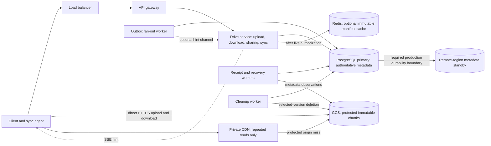
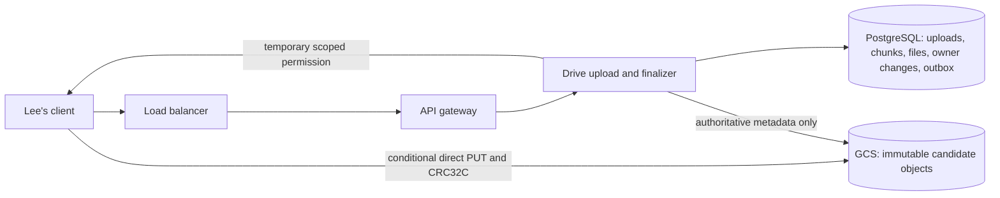
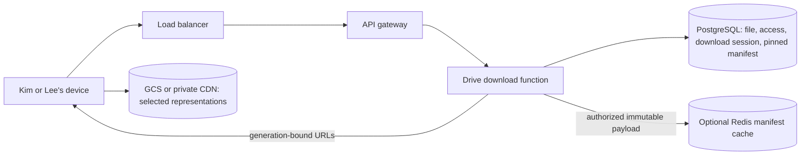
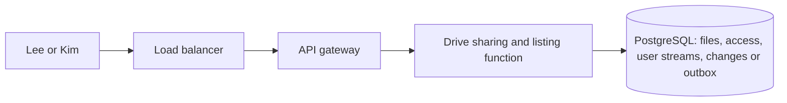
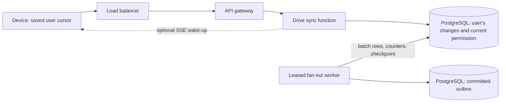

# Final design flow — Google Drive / Dropbox study

Updated 2026-11-01 after all five steps and local implementation. This is the consolidated design reference. Sections 1–13 describe the production proposal; section 14 records the actual tested local system.

These original diagrams follow the feature-by-feature interview shape of [Hello Interview](https://www.hellointerview.com/learn/system-design/problem-breakdowns/dropbox). The service names, PostgreSQL schemas, GCS choices, and safety rules are this session's design.

## 1. Scope and main choices

| Area | Selected behavior |
| --- | --- |
| Features | Upload, download, named sharing and shared-file listing, automatic device sync |
| Content | Ordinary externally edited files, up to 50 GB; independent immutable chunks in the delta path |
| Byte path | Client directly to GCS; private CDN for repeated downloads |
| Metadata | PostgreSQL owns file state, sessions, grants, replay, receipts, outbox, and retirement |
| Discovery | Per-user changes feed; SSE hints, reconnect replay, periodic safety checks |
| Verification | Storage validates CRC32C; Drive compares authoritative metadata with the frozen plan |
| Conflicts | Atomic baseRevision check; explicit private conflict copy; last-write-wins is a comparison |
| Reuse | Same-owner verified references; independent logical files; no automatic global hash deduplication |
| Large sharing | Publication and source outbox commit together; leased worker appends recipient rows |
| Deletion | Logical tombstone first; collect content only after live-root and retirement checks |
| Region failure | Required content protection and durable remote metadata precede ready in production |

Built-in editing, preview, user-visible history, malware scanning, profile management, and per-user storage quotas remain excluded. Identity comes from an existing identity provider.

Numbers are study assumptions unless a source says otherwise. The normal design assumes 10 million DAU and approximate peak starts of 1160 uploads/s and 2900 downloads/s. The tenfold shock is 11600 and 29000. Starts are not chunk-operation counts. The 200 ms metadata and two-second normal discovery targets need implementation measurements.

## 2. Overview




One logical Drive service contains the application functions. They need not be separate microservices. API instances stay stateless; authoritative work state survives in PostgreSQL.

GCS does not participate in the PostgreSQL transaction. Upload and verify bytes first. Publish metadata and durable work second.

## 3. Upload and publication




1. The client persists a random initial request key, then requests an upload attempt.
2. Drive authenticates Lee and stores the frozen creation parameters with that key.
3. The client prepares stable logical chunks, optional per-chunk gzip, and stored-byte checksums.
4. Drive freezes the chunk plan. Authorized reuse can pin owned source references instead of uploading bytes.
5. The client transfers only required chunks directly to storage.
6. Drive compares provider size, CRC32C, identity, and generation with the expected representation.
7. The finalizer serializes on the attempt and atomically checks the base revision.
8. One SQL transaction publishes the manifest and file, owner's replay, source outbox, and saved upload result.
9. The production acknowledgment also requires the selected remote durability boundary. It does not wait for recipient devices.

```text
POST /v1/uploads -> 201 {
  uploadId, fileId, mode: "independent-chunks", status: "uploading"
}
Headers: validated session; Idempotency-Key: <one stable key>
Body: { name, sizeBytes, mimeType, fileId?, baseRevision?, mode }
Same owner/key and identical canonical parameters return the original attempt.
Changed parameters return 409 { code: "idempotency_key_reused" }.

PUT /v1/uploads/{uploadId}/manifest -> 200 {
  uploadId, manifestHash,
  chunks: [{ ordinal, chunkId, uploadRequired }], status: "uploading"
}
Body: {
  chunking: { algorithm, version, parameters },
  chunks: [<new entry or reuse entry>]
}
New entry: {
  ordinal, logicalSizeBytes, storedSizeBytes, encoding,
  storedCrc32c, declaredStoredSha256?
}
Reuse entry: {
  ordinal, reuseFrom: { fileId, manifestId, ordinal }
}
Reuse is owner-scoped in the lab; Drive derives source metadata and protects references.
A changed frozen plan returns 409 { code: "plan_changed" }.

POST /v1/uploads/{uploadId}/chunk-upload-urls -> 200 {
  uploadId, chunks: [{ ordinal, url, headers, expiresAt }]
}
Body: { ordinals }
Only planned new destinations receive upload permission.

PUT {url} -> provider success and receipt headers
Body: <one stored chunk representation>
Headers: required provider checksum and create-only conditions
GCS 412 means inspect the existing object; it is not proof of matching bytes.

POST /v1/uploads/{uploadId}/chunks/{ordinal}/complete -> 200 {
  uploadId, ordinal, chunkId, state: "verified",
  verificationMethod: "provider_crc32c", sha256Verified: false
}
Body: { etag?, generation? }
Client fields are hints. Drive reads authoritative metadata.
Pending checks return 202. A mismatch returns 409.

POST /v1/uploads/{uploadId}/reconcile -> 202 {
  uploadId, reconciliation: "pending"
}
Body: {}
Meaning: retain recovery work, inspect planned destinations, and update receipts.

GET /v1/uploads/{uploadId} -> 200 {
  uploadId, fileId, status, reconciliation, totalSizeBytes,
  totalStoredSizeBytes, storedBytes, verifiedStoredBytes, verifiedLogicalBytes,
  missingOrdinals, pendingOrdinals, result
}
Body: none
Meaning: authorize attempt ownership and return durable progress.

POST /v1/uploads/{uploadId}/complete -> 200 {
  fileId, revision, manifestId, status: "ready", updatedAt,
  completionKind: "normal",
  discovery: { eventId, state: "pending", mode: "outbox-fanout" }
}
Body: {}
202 means durably accepted verification is pending.
409 means incomplete plan or stale revision.
503 { code: "metadata_unavailable", retryable: true } means publication is unconfirmed.
Retries use the same uploadId and return its saved completed result.
```


Existing verified receipts do not require a mandatory 50 GB SHA reread. Optional strong verification records its method separately. A custom SHA metadata label is not provider-computed proof.

The study CDC bounds are 1–8 MiB with nominal target 4 MiB and a stable 64-byte rolling policy. Those are study parameters. Keep boundary settings and prepared bytes stable during resume.

Gzip objects use application/gzip without HTTP Content-Encoding. Provider size and CRC32C describe stored encoded bytes. The client verifies, decodes with bounded output, and checks logical length.

## 4. Download and resume




1. Validate current file permission and select committed content.
2. Create a bounded download session that pins one manifest.
3. The client saves its session, selected revision, and durable verified-chunk set.
4. Fetch and validate missing stored chunks. Decode and reconstruct only that selected file state.
5. Install atomically, then advance applied revision. Do not overwrite dirty local edits.
6. Refresh expired URLs only while current authorization and retained session permit it.

```text
POST /v1/downloads -> 201 {
  downloadId, fileId, revision, manifestId, mode,
  totalSizeBytes, leaseExpiresAt
}
Body: { fileId }

GET /v1/downloads/{downloadId}/manifest -> 200 {
  downloadId, fileId, revision, manifestId, totalSizeBytes,
  chunks: [{
    ordinal, chunkId, generation, logicalSizeBytes, storedSizeBytes,
    encoding, storedCrc32c, storedSha256?, storedSha256Verified
  }]
}
Body: none
Authorize the session before using a cache keyed by manifestId and page.

POST /v1/downloads/{downloadId}/chunk-download-urls -> 200 {
  downloadId, revision,
  chunks: [{ chunkId, generation, delivery: "storage" | "cdn", url, expiresAt }]
}
Body: { chunkIds }
Check current permission, session, pinned membership, and retained content.

GET {chunkUrl} -> 200 <selected stored chunk bytes>
Body: none
Provider/CDN validates scoped permission; client validates the bytes.

POST /v1/downloads/{downloadId}/complete -> 200 {
  downloadId, revision, status: "completed"
}
Body: {}
A client acknowledgment does not independently prove the phone's stored bytes.

Whole-object comparison:
POST /v1/downloads/{downloadId}/download-url -> 200 {
  downloadId, fileId, revision, generation, totalSizeBytes, crc32c, url, expiresAt
}
Body: {}
GET {url} with optional Range -> 200 <whole object> or 206 <requested range>
Body: none
Check Content-Range before append. The whole-object baseline stays identity-encoded.
```


Study limits: session at most 24 hours; URL at most five minutes and no longer than the lease. Expired retention returns 410 revision_expired. Current access denial returns 403. Missing protected content returns retryable 503 content_unavailable.

A valid signed URL is a bearer credential. Credential expiry controls request admission; it is not a guaranteed cutoff for all in-flight bytes.

## 5. Share, list, revoke, and logical delete




Lee grants Kim reader access. Kim lists shared files through the recipient-leading access key. File access never comes from possession of a guessed chunk hash.

```text
POST /v1/files/{fileId}/shares -> 200 {
  fileId, recipientId, role: "reader"
}
Body: { recipientId, role: "reader" }
Authorize owner; commit canonical grant and required discovery together.

GET /v1/files?scope=owned|shared&cursor={cursor} -> 200 {
  files: [{ fileId, name, sizeBytes, revision }], nextCursor
}
Body: none
Filter to the authenticated user's authorized files.

DELETE /v1/files/{fileId}/shares/{recipientId} -> 204
Body: none
Authorize owner; remove grant with durable discovery.
Repeated removal creates no duplicate logical event.

DELETE /v1/files/{fileId} -> 204
Body: none
Authorize owner; tombstone the file and commit deletion discovery.
Physical chunk deletion occurs later.

New session for a deleted file:
POST /v1/downloads -> 404 { code: "file_deleted" }
Body: { fileId }
Existing retained content remains protected under its bounded policy.
```


Grant removal denies new signed permissions. Previously issued URLs keep their bounded validity. This selected policy does not bind every content GET to Kim's independently authenticated session.

New logical copies are private by default in this lab. They do not inherit source grants. Same-owner chunk reuse does not merge logical file identities.

## 6. Automatic sync and large-recipient discovery




For small recipient sets, required changes can share the source transaction. The large-recipient path commits the owner change and source outbox, then materializes recipient rows in batches.

The worker writes a row for every eligible reader, including offline readers. It can skip live hints for disconnected devices. It does not send file bytes.

```text
GET /v1/changes?cursor={cursor}&limit=100 -> 200 {
  changes: [{ cursor, fileId, revision, type }], nextCursor, hasMore
}
Body: none
Read the authenticated user's committed journal appends; apply current disclosure rules.

GET /v1/events -> 200, Content-Type: text/event-stream
Body: none
Event: data: {"type":"changes_available"}
Meaning: pull changes; the hint itself is not the reliable record.
```


Example: one plan-file update can be Lee's seq 41, Kim's seq 73, and Ada's seq 9. user_id names the discovery recipient, not the editor.

Cursor order is journal-append commit order within one user. Asynchronous source publications from different files need not retain a global order. Preserve per-file event order and prevent stale content regression.

Checkpoint and recipient rows commit together. Unique recipient/event keys make retries safe. A fenced lease prevents a replaced worker from continuing. Fan-out completion does not wait for clients to acknowledge.

Persist pending client work before advancing discovery. If a cursor outlives journal retention, perform an authorized metadata resync.

## 7. Conflicts, reuse, cleanup, and recovery

### Concurrent edits

Two devices from base revision 7 can upload different valid candidates. One finalizer publishes revision 8. A conditional update rejects the stale candidate.

```text
POST /v1/uploads/{uploadId}/complete -> 409 {
  code: "revision_conflict", fileId, baseRevision, currentRevision,
  uploadId, candidateState: "conflicted", candidateExpiresAt,
  allowedResolution: "save_conflict_copy"
}
Body: {}

POST /v1/uploads/{uploadId}/conflict-copy -> 201 {
  uploadId, fileId, originalFileId, revision: 1, status: "ready",
  completionKind: "conflict_copy", name
}
Headers: validated session; Idempotency-Key: <stable resolution key>
Body: { name? }
Repeat resolution returns the same created file.
Expired candidate returns 410; unauthorized resolution returns 403.
```


The phone keeps its local edit. It does not silently change baseRevision and retry. A conflict copy reuses protected candidate bytes, not another 50 GB upload.

### Chunk retirement

Trace live roots: current files, active upload plans, protected download manifests, and safe-release guards. Old changes, unrooted manifests, and idempotency receipts do not retain historical content forever.

Mark candidates, apply grace, then lock and recheck a chunk registry row. Commit deleting before issuing storage DELETE. New reference acquisition uses the same lock and rejects deleting or deleted identities.

```text
DELETE https://storage.googleapis.com/storage/v1/b/{bucket}/o/{encodedKey}
       ?generation={recordedGeneration}&ifGenerationMatch={recordedGeneration}
       -> 204
Caller: cleanup service identity
Body: none
Select only the intended generation; reconcile uncertain results.
The S3-compatible lab must use its own verified object-identity mechanism.
```


Retry the same deletion intent after a crash. Pause reference-based cleanup if authoritative PostgreSQL is unavailable. Reconcile late orphan writes; never reopen retired identities for new uploads.

### Region failure

Production ready requires the stated content protection and durable metadata commit in another independent region. The metadata transaction includes the attempt result and source outbox. Recipient delivery remains asynchronous.

Select a failover candidate with acknowledged history, replay its log, prevent the old primary from writing, and promote one authority. A stale asynchronous replica cannot redefine a confirmed upload as failed. A retry of the same upload retrieves its saved result.

The local lab must not claim region-loss durability from a single database or one machine.

## 8. Services and jobs

| Service or function | When it runs | Responsibility |
| --- | --- | --- |
| Load balancer | Each control request | Route across API instances |
| API gateway | Before application handlers | Validate identity, route, enforce bounded admission |
| Upload function | Create, plan, sign, reconcile | Retain attempt state and authorize expected destinations |
| Receipt verifier | Completion hints or recovery | Inspect provider metadata; persist selected validation evidence |
| Finalizer | Ready publication or conflict resolution | Checked atomic publication, durable event, and repeat-safe result |
| Download function | Session and URL requests | Check live permission, retain a selected manifest, sign scoped content |
| Sharing/listing function | Grant, revoke, list, delete | Canonical metadata changes and discovery |
| Sync function | Replay and SSE | Return user journal records and manage optional hints |
| Fan-out worker | Committed outbox events | Leased recipient batches, idempotent append, durable checkpoint |
| Recovery worker | Interrupted pending work | Reconcile existing evidence and rerun the same finalizer |
| Cleanup worker | Expired or unreachable candidates | Trace roots, mark retirement, delete exact storage identities |
| Redis cache | Cache-enabled read path | Immutable payloads after authorization |
| Hint backplane | Optional multi-instance SSE path | Best-effort routing; never durable work storage |
| Private CDN | Repeated read variant | Validate signed permission, serve cached representation, protect origin |
| Identity provider | Login/session establishment | Supply identity; profile management is outside this product |
| Failover controller | Production region or primary failure | Safe leader selection, fencing, promotion, and routing |
| Optional SHA worker | Explicit stronger validation variant | Read selected bytes and establish an additional trusted digest |

## 9. PostgreSQL schema

This is a design schema, not an applied migration. IDs can be UUIDs; external user IDs can be text. Sizes, revisions, and sequences use big integers. Times use timezone-aware timestamps. JSON fields hold structured parameters. Examples like u123 are readable labels.

### files

Primary key: file_id.

Columns: owner_id, name, mime_type, total_logical_size_bytes, status, revision, current_manifest_id, created_at, updated_at, deleted_at.

Indexes: owner_id with a stable listing key; current_manifest_id for root tracing. Status distinguishes pending, ready, and deleted. Fresh publication rejects a deleted target. Pending new files start without a readable content pointer.

### uploads

Primary key: upload_id. Unique key: owner_id, idempotency_key.

Columns: owner_id, file_id, mode, base_revision, expected_logical_size_bytes, idempotency_key, create_request JSON, state, chunking_policy JSON, manifest_hash, plan_frozen, created_at, expires_at, completed_at.

Recovery columns: reconciliation_state, next_retry_at, last_error, lease_owner, lease_until, lease_epoch.

Result columns: result_file_id, result_revision, result_manifest_id, result_event_id, result_updated_at, completion_kind.

Conflict columns: conflict_current_revision, resolution_key, resolution_request JSON. One accepted resolution result belongs to the attempt. Store canonical parameters for changed-key-intent rejection.

State includes uploading, verifying, completed, conflicted, cancelled, and expired. Retain creation mapping and terminal result for the supported retry window.

### upload_chunks

Primary key: upload_id, ordinal. Foreign key: chunk_id to chunk_objects.

Expected columns: logical_size_bytes, stored_size_bytes, encoding, expected_crc32c, declared_stored_sha256.

Reuse audit: source_file_id, source_manifest_id, source_ordinal, upload_required.

Receipt columns: observed_generation, observed_size_bytes, observed_crc32c, verification_method, verified_sha256, sha256_verified, state, verified_at, last_error.

Worker columns: available_at, lease_owner, lease_until, lease_epoch. Frozen expected fields remain separate from observed evidence. Repeated verification updates one ordinal.

### chunk_objects

Primary key: chunk_id. Unique storage destination: bucket, object_key.

Columns: owner_id, bucket, object_key, object_generation, logical_size_bytes, stored_size_bytes, encoding, stored_crc32c, verified_sha256, sha256_verified, verification_method, created_at.

Lifecycle columns: state, unreferenced_since, protect_until, delete_token, delete_started_at, deleted_at.

Planned objects may have no generation until storage observation. Usable staged/live entries can be pinned. Deleting/deleted entries cannot acquire new references. New protection resets unreferenced_since.

### manifests

Primary key: manifest_id.

Columns: owner_id, file_id, total_logical_size_bytes, total_stored_size_bytes, chunking_algorithm, chunking_version, chunking_parameters JSON, source_upload_id, created_at.

A published manifest is immutable. Another logical file has its own manifest. Its entries can reuse the same chunk objects.

### manifest_chunks

Primary key: manifest_id, ordinal. Foreign key: chunk_id.

Columns: logical_size_bytes, stored_size_bytes, encoding, stored_crc32c, object_generation, stored_sha256, stored_sha256_verified.

Order defines reconstruction. Logical offsets sum logical lengths. A protected generation and representation match the selected verified chunk. Retired unrooted metadata does not authorize fresh reuse.

### access

Primary key: user_id, file_id.

Columns: role, created_at, updated_at. Role is reader in the initial design.

Reverse index: file_id, user_id. Canonical access is checked for disclosure and new signed permissions. Owner permission comes from files.owner_id.

### download_sessions

Primary key: download_id.

Columns: user_id, file_id, selected_revision, manifest_id, mode, whole_object_identity JSON when applicable, created_at, lease_expires_at, status, latest_url_expires_at, protect_until, completed_at.

Status includes active, completed, cancelled, and expired. Content retention and credential guards remain explicit. Session existence does not override current authorization.

### user_streams

Primary key: user_id.

Columns: last_seq, retention_floor_seq, updated_at.

Allocate through a locked transactional counter. Do not use an ordinary global sequence as a guarantee of commit ordering. The floor supports cursor-expiry detection.

### changes

Primary key: user_id, seq. Unique key: user_id, source_event_id.

Columns: file_id, revision, type, source_event_id, actor_id when useful for audit, created_at, minimal payload JSON.

Types include created, updated, shared, access_removed, and deleted. user_id identifies the recipient. Payload remains subject to current disclosure rules. A record is not a content-retention lease.

### outbox

Primary key: event_id. Unique source_upload_id for a content publication when present.

Columns: source_upload_id, owner_id, file_id, revision, event_type, state, created_at, last_recipient_id, attempts, available_at, last_error, lease_owner, lease_until, lease_epoch, completed_at.

Index pending/eligible work. Claim one active source event per file in source order. Batch recipient appends and checkpoints commit together. Retain unfinished events for retry or explicit repair.

Individual grant changes can write their affected user records synchronously. Large content or deletion discovery uses the selected outbox path.

### Optional production replica evidence

Only needed if content replication is application-managed rather than guaranteed by the selected storage contract.

Possible key: chunk_id, replica_id. Fields: region, bucket, object_key, version_id, validation_method, validation_state, verified_at, durable_policy.

This is shock-path evidence, not an implemented second store. It must not be confused with a new file revision or a provider's internal replication schema.

## 10. Other state stores

### GCS content objects

Key: planned immutable object_key within bucket. The provider assigns object_generation.

Value: the stored chunk representation. Provider metadata includes stored length and validated checksum. Upload uses supported integrity and create-only conditions. Read and deletion select the intended version.

Default provider encryption is transparent to application checksums. Provider key material is not stored in PostgreSQL or sent to users.

### Redis, optional

Cache key: manifest:{manifestId}:format:{version}:page:{page}. Value: serialized immutable manifest payload.

Bound memory, payload size, and TTL. Live permission and session checks precede payload use. Cache failure has a bounded SQL fallback budget.

Optional Pub/Sub channel: drive:hints:{userId}. Message: changes_available. This channel has no replay or durable acceptance role.

### CDN, repeated-read variant

Cache identity includes origin object, generation, and stored representation. Authorization is validated independently on each protected request.

Byte retention can exceed signed-credential lifetime. Keep the origin private and prevent unsigned bypass. No shared caching of personalized access responses.

### Client durable store

| Table or collection | Key | Fields |
| --- | --- | --- |
| local_jobs | local_job_id | user, operation kind, initial key, uploadId or downloadId, source locator, frozen request/plan, state |
| local_job_chunks | local_job_id, ordinal | selected chunk identity/version, lengths, encoding, checksum, durable byte locator, verification state |
| local_files | user_id, file_id | applied revision, local locator, dirty flag, local base revision |
| pending_changes | user_id, source cursor | file, change type, target revision, processing state |
| stream_state | user_id, device_id | durable discovery cursor and resync state |

The browser lab can use IndexedDB. Native clients can use a local database and filesystem. Durable bytes must precede a completed local-chunk mark. Installation must not mix manifests or overwrite unsynced local work.

## 11. Transaction and retention rules

| Operation | Atomic SQL boundary |
| --- | --- |
| Initial upload creation | Pending file when needed, uploads row, key and canonical intent |
| Freeze plan or reuse | Expected chunk plan and protected references |
| Receipt | Observed evidence and one verified ordinal |
| Small-list publication | Manifest, current pointer, all required replay/counters, completed result |
| Large-list publication | Manifest, current pointer, owner replay/counter, outbox, completed result |
| Fan-out batch | Recipient deduplication, rows, counters, checkpoint |
| Grant/revoke | Canonical grant change and required discovery |
| Conflict copy | New private file, manifest, required discovery, resolution result |
| Download selection | Authorized pinned state and lease with protection coordination |
| Logical delete | Tombstone and durable deletion discovery |
| Retirement mark | Locked final root recheck and deleting state |
| Retirement completion | Confirmed selected-generation removal and registry completion |

Network storage calls stay outside the SQL publication transaction. Durable intermediate state closes crash gaps.

Study defaults: five-minute maximum signed permission, 24-hour maximum download session, bounded adaptive client concurrency starting at two and capped at eight, and explicit grace before deletion. Grace, journal retention, and retry-result retention need documented implementation settings. No silent infinite history follows from these notes.

## 12. Lab boundaries and comparisons

The local product lab must run frontend, FastAPI, PostgreSQL, and an S3-compatible storage stand-in. Redis and a private cache edge support selected variants. No cloud accounts are created.

| Lesson | Selected path | Comparison or limit |
| --- | --- | --- |
| Byte routing | Direct storage | Proxy comparison |
| Chunk boundaries | Stable bounded CDC | Fixed boundaries and whole-object baseline |
| Compression | Selective per-chunk gzip | Identity and always-compress comparison |
| Concurrency | Bounded adaptive | Sequential and fixed counts |
| Integrity | Provider validation plus metadata | Additional application hashing only when selected |
| Reuse | Authorized same-owner references | Separate stored copies; no global hash deduplication |
| Discovery | SSE hints plus replay | Poll-only |
| Recipient expansion | Durable outbox worker | Small synchronous list |
| Conflicts | Base check and conflict copy | Server-order last-write-wins |
| Metadata cache | Authorized immutable payload | Cache disabled |
| Content delivery | Direct or private cached path | Cold versus reused content |
| Cleanup | Trace roots and fenced retirement | Age-only failure on disposable demo data |
| Region durability | Production acknowledgment policy | Clearly labeled model until real replicas are verified |

TLS, encrypted local storage, provider checksum support, object-version semantics, and browser codec support require implementation checks. An ordinary plaintext local container proves none of those cloud guarantees. Local behavior and limitations must be stated precisely.

Setup, 12 integration scenarios, 4 functional checks, and browser checks now pass. The regional comparison remains a labeled one-database model.

## 13. Sources and companion notes

- [Hello Interview — Dropbox](https://www.hellointerview.com/learn/system-design/problem-breakdowns/dropbox): interview shape and minimum deep-dive topics.
- [GCS validation](https://docs.cloud.google.com/storage/docs/data-validation), [metadata](https://docs.cloud.google.com/storage/docs/metadata), and [preconditions](https://docs.cloud.google.com/storage/docs/request-preconditions): provider-specific evidence.
- [PostgreSQL transactions](https://www.postgresql.org/docs/current/tutorial-transactions.html), [locking](https://www.postgresql.org/docs/current/explicit-locking.html), and [synchronous replication](https://www.postgresql.org/docs/current/warm-standby.html#SYNCHRONOUS-REPLICATION).
- [Transactional outbox pattern](https://docs.aws.amazon.com/prescriptive-guidance/latest/cloud-design-patterns/transactional-outbox.html).
- [Dropbox historical blocklists and namespaces](https://dropbox.tech/infrastructure/streaming-file-synchronization): historical evidence, not today's exact schema.
- Alex Xu, System Design Interview, Vol. 1, chapter 15. The official chapter content remains unverified in this session.

See [FLOW.md](FLOW.md) for the interview sequences, [COMPONENTS.md](COMPONENTS.md) for component roles, [FAQ.md](FAQ.md) for full teaching, and [high-level-design-comparision.md](high-level-design-comparision.md) for source comparisons.

## 14. Applied local implementation — 2026-11-01

The earlier schemas are the production proposal. This section records the actual lab. The applied DDL is [src/schema.sql](src/schema.sql). All 12 integration scenarios and 4 functional checks pass. Browser upload, download, named sharing, per-user replay, and boundary comparison were checked.

### Local service map

| Role | Compose service | Actual behavior |
| --- | --- | --- |
| Gateway | gateway, HTTPS 8420 | Nginx verifies the app certificate and resolves the app by Docker DNS |
| Drive | app | FastAPI control APIs, bounded admission and eight SQL connections |
| Jobs | worker | Durable fan-out claims, fenced batches, and requested receipt reconciliation |
| Metadata | postgres | One PostgreSQL instance; verified TLS; local volume |
| Cache and hints | redis | Verified TLS; immutable manifest payloads, hint counters, fault/clock controls, metrics |
| Object provider stand-in | storage, HTTPS 8421 | Trusted local CRC32C verifier, signed create-only permissions, metadata receipts, envelope encryption |
| Object store | minio | Versioned ciphertext objects; its S3 VersionId stands in for an immutable storage version |
| Private delivery cache | edge, HTTPS 8422 | Check signed permission before each hit or miss; encrypted disk cache |
| Device | browser | IndexedDB jobs, persistent operation keys, pending replay work, and installed revisions |
| Remote region | no independent service | replica_model is in the same database; explicitly a simulation |

Production GCS generation values and MinIO VersionId are different provider fields. The local response calls the selected immutable version `generation` in a download entry for teaching continuity. Do not treat this as GCS API compatibility. The storage adapter computes CRC32C over actual stored-representation bytes before accepting them. Its metadata is authoritative within this mock provider boundary. The ordinary Drive verifier does not reread bytes. Optional SHA mode does reread and records a trusted digest separately.

### Applied PostgreSQL tables

The lab stores some proposed columns together in JSONB. Times use double-precision Unix seconds so the accelerated clock can be inspected. These are teaching choices.

| Table | Key and important fields | Meaning |
| --- | --- | --- |
| files | id; owner, name, mime, revision, manifest_id, size, deleted_at, created_at, updated_at | Independent logical file and current pointer |
| uploads | id; UNIQUE(owner, idem_key); file_id, request, state, plan_hash, policy, result, conflict_revision, resolution_key, resolution_request, reconcile_requested, created_at, expires_at | Attempt identity, frozen intent, retry result, conflict candidate |
| upload_chunks | PRIMARY KEY(upload_id, ordinal); chunk_id, expected, state, receipt, last_error | Expected content and verified observation |
| chunk_objects | id; UNIQUE(object_key); owner, version, meta, state, created_at, protect_until, unreferenced_since, delete_token, deleted_at | Immutable storage representation and retirement boundary |
| manifests | id; file_id, owner, policy, size, created_at | Immutable file plan |
| manifest_chunks | PRIMARY KEY(manifest_id, ordinal); chunk_id | Ordered chunk references |
| access | PRIMARY KEY(user_id, file_id); role | Current reader grant; reverse index(file_id,user_id) supports fan-out |
| user_streams | user_id; last_seq, floor_seq | Per-recipient committed journal allocator and retention floor |
| changes | PRIMARY KEY(user_id,seq); UNIQUE(user_id,source_event_id); file_id, revision, type, created_at | Replayable recipient row |
| outbox | id; source_upload_id UNIQUE, owner, file_id, revision, type, cursor, processed, state, lease_owner, lease_until, lease_epoch, created_at | Durable source event, batch checkpoint and claim fencing |
| download_sessions | id; user_id, file_id, manifest_id, revision, expires_at, protect_until, state, created_at | Pinned selected content and bounded protection |
| replica_model | upload_id; result | Simulated acknowledgment comparison only |

`uploads.request` contains name, sizeBytes, mimeType, mode, optional fileId/baseRevision, verificationMode, conflictPolicy, and fanoutMode. `policy` contains chunking algorithm/version/parameters. `result` contains the exact ready response, including event identity.

`upload_chunks.expected` and initial `chunk_objects.meta` contain logicalSizeBytes, storedSizeBytes, encoding, storedCrc32c, ordinal, and an optional client-declared stored SHA-256. A declared SHA is not evidence of validation. A verified receipt contains provider key, version, size, CRC32C, opaque ETag, method, and sha256Verified. Strong verification also records a trusted SHA in object metadata so readers can verify it. Reused chunks inherit their stored representation and trusted flags.

The exact applied DDL follows. It is the source for constraints and indexes.

```sql
CREATE TABLE IF NOT EXISTS files (
 id text PRIMARY KEY, owner text NOT NULL, name text NOT NULL, mime text NOT NULL,
 revision bigint NOT NULL DEFAULT 0, manifest_id text, size bigint NOT NULL DEFAULT 0,
 deleted_at double precision, created_at double precision NOT NULL, updated_at double precision NOT NULL
);
CREATE INDEX IF NOT EXISTS files_owner ON files(owner, id);
CREATE TABLE IF NOT EXISTS uploads (
 id text PRIMARY KEY, owner text NOT NULL, file_id text NOT NULL REFERENCES files(id),
 idem_key text NOT NULL, request jsonb NOT NULL, state text NOT NULL DEFAULT 'uploading',
 plan_hash text, policy jsonb, result jsonb, conflict_revision bigint,
 resolution_key text, resolution_request jsonb, reconcile_requested boolean NOT NULL DEFAULT false,
 created_at double precision NOT NULL, expires_at double precision NOT NULL,
 UNIQUE(owner, idem_key)
);
CREATE TABLE IF NOT EXISTS chunk_objects (
 id text PRIMARY KEY, owner text NOT NULL, object_key text UNIQUE NOT NULL,
 version text, meta jsonb NOT NULL, state text NOT NULL DEFAULT 'staged',
 created_at double precision NOT NULL, protect_until double precision NOT NULL DEFAULT 0,
 unreferenced_since double precision, delete_token text, deleted_at double precision
);
CREATE INDEX IF NOT EXISTS chunk_gc ON chunk_objects(state, unreferenced_since);
CREATE TABLE IF NOT EXISTS upload_chunks (
 upload_id text REFERENCES uploads(id), ordinal integer NOT NULL, chunk_id text NOT NULL REFERENCES chunk_objects(id),
 expected jsonb NOT NULL, state text NOT NULL DEFAULT 'planned', receipt jsonb, last_error text,
 PRIMARY KEY(upload_id, ordinal)
);
CREATE TABLE IF NOT EXISTS manifests (
 id text PRIMARY KEY, file_id text NOT NULL REFERENCES files(id), owner text NOT NULL,
 policy jsonb NOT NULL, size bigint NOT NULL, created_at double precision NOT NULL
);
CREATE TABLE IF NOT EXISTS manifest_chunks (
 manifest_id text REFERENCES manifests(id), ordinal integer NOT NULL,
 chunk_id text NOT NULL REFERENCES chunk_objects(id), PRIMARY KEY(manifest_id, ordinal)
);
CREATE INDEX IF NOT EXISTS manifest_chunk_lookup ON manifest_chunks(chunk_id);
CREATE TABLE IF NOT EXISTS access (
 user_id text NOT NULL, file_id text NOT NULL REFERENCES files(id), role text NOT NULL DEFAULT 'reader',
 PRIMARY KEY(user_id, file_id)
);
CREATE INDEX IF NOT EXISTS access_reverse ON access(file_id, user_id);
CREATE TABLE IF NOT EXISTS user_streams (user_id text PRIMARY KEY, last_seq bigint NOT NULL DEFAULT 0, floor_seq bigint NOT NULL DEFAULT 0);
CREATE TABLE IF NOT EXISTS changes (
 user_id text NOT NULL, seq bigint NOT NULL, source_event_id text NOT NULL,
 file_id text NOT NULL, revision bigint NOT NULL, type text NOT NULL, created_at double precision NOT NULL,
 PRIMARY KEY(user_id, seq), UNIQUE(user_id, source_event_id)
);
CREATE TABLE IF NOT EXISTS outbox (
 id text PRIMARY KEY, source_upload_id text UNIQUE, owner text NOT NULL, file_id text NOT NULL,
 revision bigint NOT NULL, type text NOT NULL, cursor text NOT NULL DEFAULT '',
 processed integer NOT NULL DEFAULT 0, state text NOT NULL DEFAULT 'pending',
 lease_owner text, lease_until double precision NOT NULL DEFAULT 0, lease_epoch bigint NOT NULL DEFAULT 0,
 created_at double precision NOT NULL
);
CREATE INDEX IF NOT EXISTS outbox_pending ON outbox(state, created_at);
CREATE TABLE IF NOT EXISTS download_sessions (
 id text PRIMARY KEY, user_id text NOT NULL, file_id text NOT NULL REFERENCES files(id),
 manifest_id text NOT NULL REFERENCES manifests(id), revision bigint NOT NULL,
 expires_at double precision NOT NULL, protect_until double precision NOT NULL,
 state text NOT NULL DEFAULT 'active', created_at double precision NOT NULL
);
CREATE TABLE IF NOT EXISTS replica_model (
 upload_id text PRIMARY KEY, result jsonb NOT NULL
);
```

### Other actual state

| Store | Actual records | Retention or authority |
| --- | --- | --- |
| Redis | manifest:{manifestId}:format:1:page:0 → immutable chunk JSON | 600-second cache; every manifest API still checks current SQL authorization |
| Redis | lab:hint:{user} counter | Optional SSE wake signal; never a durable change record |
| Redis | lab:faults, lab:offset, lab:region, lab:metrics, lab:batch | Teaching controls and counters; not upload publication authority |
| MinIO | uploads/{uploadId}/{ordinal}, native VersionId, ciphertext | Current provider object is create-only; exact native version used for reads/deletion |
| MinIO metadata | plaintext length, validated CRC32C, encoding, nonces, wrapped data key | Provider adapter writes it after checking actual bytes |
| Edge disk | hash(objectKey + version) → AES-GCM ciphertext file | One-hour teaching cache; signed permission checked on every request |
| IndexedDB jobs | id, kind, owner, operation key/request, uploadId or downloadId, policy, manifestId, revision, chunk bytes/receipts, state, result | Device recovery state persists across reloads |
| IndexedDB pending | account:cursor, fileId, revision, type, state | Saved before the discovery cursor advances; empty server polls still retry unfinished work |
| IndexedDB settings | cursor:{account} → cursor | Discovery checkpoint only |
| IndexedDB files | account:fileId, installed revision, blob, dirty/removed flags | Applied file state; never combine bytes from two manifests |
| Browser localStorage | selected mock account | Demo preference; not trusted identity proof |

Local limits: 64 MiB per file, 16 MiB per chunk, 1000 chunks per plan, 30-second URLs, 180-second download sessions, 900-second uploads. The whole baseline uses one identity chunk and therefore has a 16 MiB limit. Preparation buffers the small bounded file; only uploads use the parallel worker comparison. Native resumable-session and multipart providers remain documented alternatives. No full object inventory sweep, production shard routing, real regional replication, or Google KMS is claimed.

PostgreSQL metadata is not encrypted at rest by this lab. Object content and edge files are actually encrypted. Fixed local keys demonstrate separation of key and ciphertext storage, not production key management. Reset clears application state but leaves old encrypted MinIO objects. Stop keeps volumes.

### Lab-only request contracts

These supplement the product feature contracts above. The page traces actual requests and responses. All lab administration requires Lee's mock classroom token.

| Method and path | Body or headers | Response and state effect |
| --- | --- | --- |
| POST /v1/lab/login | {user:"lee"} | {user,accessToken}; mock bearer token and secure cookie |
| GET /v1/lab/state | none | {postgres,counts,redis,faults,regionModel,limits,evidence,clock}; inspector snapshot |
| POST /v1/lab/reset | {} | Empty SQL/Redis application state and edge cache; browser clears its IndexedDB |
| POST /v1/lab/faults | {drop_completion_reply:true} or another displayed fault | Saved fault map; no real cloud fault |
| POST /v1/lab/advance | {seconds:40} | Accelerated logical clock; tests token/session/lease expiry |
| POST /v1/lab/recipients | {fileId:"f1",count:100} | Adds synthetic reader grants for the fan-out lesson |
| POST /v1/lab/fanout/run | {batch:25} | {eventId,processed,done,leaseEpoch} or idle/crash/fenced result |
| POST /v1/lab/gc/run | {grace:0,markOnly:true} | {marked,deleted,kept}; durable retirement or selected-version deletion |
| GET /v1/lab/storage-proof/{chunkId} | none | Cipher prefix, algorithm, ciphertext/plain length; no key |
| POST /v1/lab/region | {mode:"sync",secondary:"down"} or {action:"replay"/"failover"} | Labeled simulation result; ready can be blocked or lost-history risk reported |
| GET storage /v1/meta/{key} | internal header; optional version | Authoritative local provider size/CRC/version/ETag |
| GET storage /v1/objects/{key}?ticket=… | optional Range: bytes=4-7 | 200 whole, 206 selected range with Content-Range, or 416; exact pinned version |
| GET edge /chunk?ticket=… | scoped edge-get token | 200 stored bytes, X-Cache MISS/HIT, or 403 expired/invalid |
| DELETE storage /v1/objects/{key}?version=… | internal header | 204; deletes the selected native object version |

Repeated download completion returns the same session result. A reload with all verified chunks can finish installation without fetching another manifest. An incomplete expired session returns 410 rather than silently selecting a newer revision. Production cursor-retention compaction is outside the lab; the API floor check exists, but there is no periodic journal pruning job.


### Local certificate trust — 2026-11-01

`scripts/prepare-tls.sh` creates the CA signing key under host-only `.local-ca/`. Only `.certs/` is mounted into containers. It contains the CA certificate, a separate non-CA server certificate, and its server key. Service trust stores use `/certs/ca.crt`; the server presents `/certs/public.crt`. The browser can use the exact server certificate SSL trust entry in the current user Keychain, installed by `scripts/trust-local-cert.sh`. Setup does not install this trust entry automatically. Git and Docker ignore both private certificate directories. All normal hostname and certificate checks remain enabled.

Chromium skips macOS trust settings that contain a hostname-specific policy string. Its verifier does support explicitly trusted server certificates. The helper therefore trusts the non-CA leaf for SSL. Certificate renewal needs another explicit trust step. Source: [Chromium macOS trust interpretation](https://chromium.googlesource.com/chromium/src/+/main/net/cert/internal/trust_store_mac.cc).
