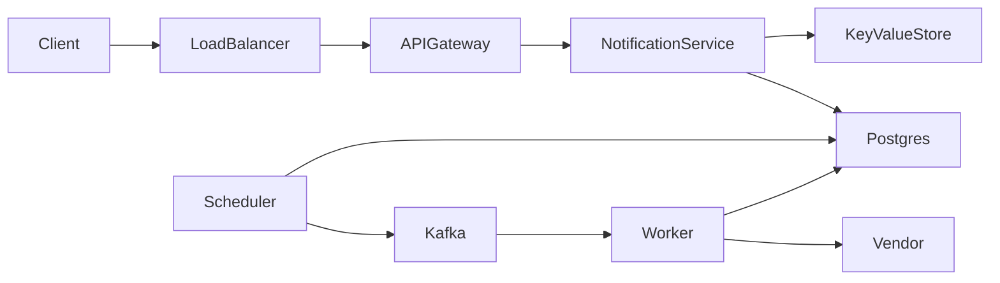
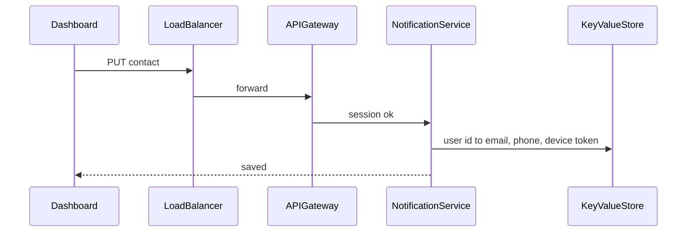
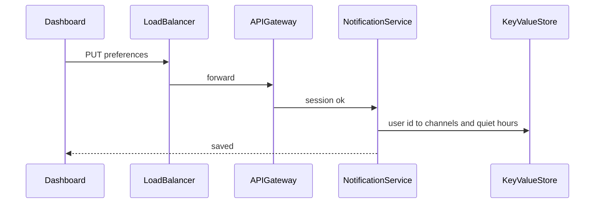
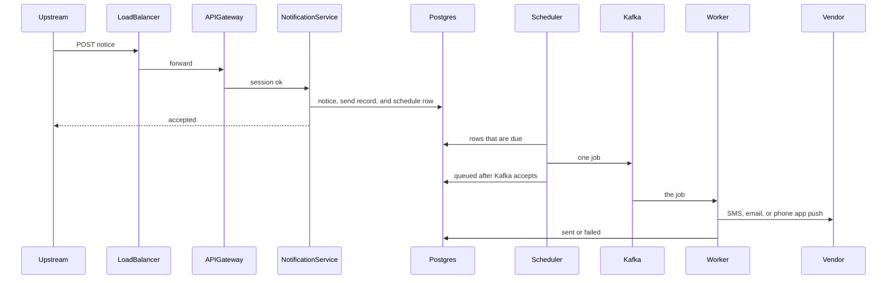
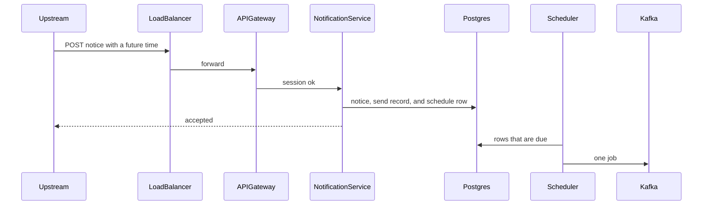
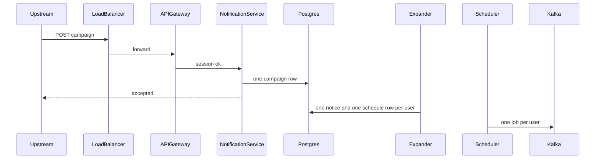
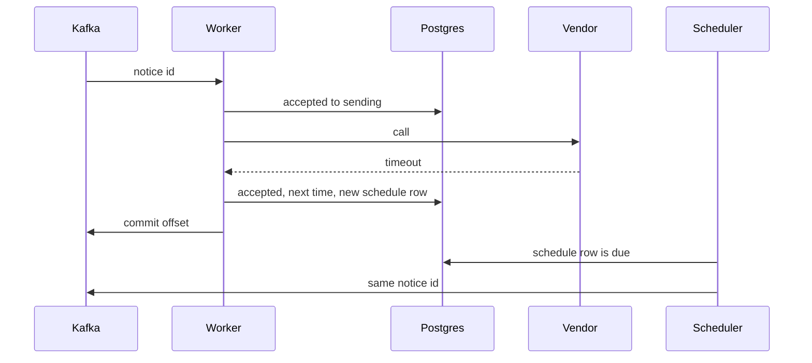

# System flow — Notification System

Each chart runs from the client to the load balancer, the gateway, the service, and the database. The interview sequences are here. Schemas wait for the deep dive.

## Overview



## Save contact

```
PUT /v1/users/{userId}/contact -> 200 OK { userId }
Body: {
  email,
  phone,
  deviceToken
}
```



## Save preferences

```
PUT /v1/users/{userId}/preferences -> 200 OK { userId }
Body: {
  push,          // true | false
  email,         // true | false
  sms,           // true | false
  quietStart,    // optional, "22:00"
  quietEnd       // optional, "07:00"
}
```



## Send one notice now

```
POST /v1/notices -> 202 Accepted { id, status }
Body: {
  userId,
  channel,       // push | email | sms
  content,       // { title, body }
  priority,      // high | low, defaults to low
  scheduledAt,   // optional, defaults to now
  idempotencyKey // caller-generated. The same key returns the first notice
}
```



## Send one notice later

Same path as a notice for now. `scheduledAt` is a future time. The schedule row waits until that time. The response is still `202 Accepted { id, status }`.

```
POST /v1/notices -> 202 Accepted { id, status }
Body: {
  userId,
  channel,       // push | email | sms
  content,       // { title, body }
  priority,      // high | low, defaults to low
  scheduledAt,   // future time
  idempotencyKey // caller-generated. The same key returns the first notice
}
```



The worker path after Kafka is the same as a notice for now.

## Campaign

```
POST /v1/campaigns -> 202 Accepted { id, status }
Body: {
  userIds,
  channel,       // push | email | sms
  content,       // { title, body }
  scheduledAt,   // optional, defaults to now
  idempotencyKey // caller-generated. The same key returns the first campaign
}
```



A future campaign stays in the schedule table until the scheduler starts the expander.

## Vendor timeout

The API has already returned. This path starts at the worker.


