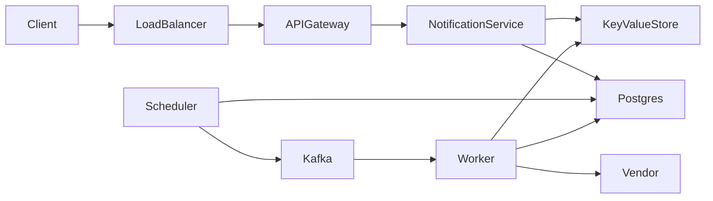

# Notification System

**Status:** Implemented  
**Sources:** Hello Interview; Alex Xu Vol 1 Ch 10  
**Slug:** `notification-system`

Practice in the five-step interview pattern. Keep notes original; link to Hello Interview / cite Alex Xu instead of copying write-ups.

## 1. Requirements and design scope

### Problem

Other services ask this system to tell a user about an event. The notice can go by phone app notification, email, or SMS. A phone app notification is a push. The user can turn a channel off. A **channel** is the path the notice takes.

Hello Interview: [Notification System](https://www.hellointerview.com/learn/system-design/problem-breakdowns/notification-system). Alex Xu volume 1, chapter 10.

### Functional requirements

- [x] Save the user's email, phone number, and device token. A **device token** is the address a phone vendor gives one app install. A phone app notification needs that token. SMS needs the phone number. Email needs the email address.
- [x] The user sets preferences. A preference can turn off one channel. A preference can also set quiet hours. **Quiet hours** are a clock range when this user does not want a notice.
- [x] An upstream service sends one notice to one user, now or at a future time. An **upstream service** is another service in the company, such as the news feed.
- [x] An upstream service sends one campaign. A **campaign** is the same notice to many users, now or at a future time.
- [x] The system records that a notice was sent or that it failed.

Priority is not a fifth feature. A **priority** is which notice a worker sends first. A login code is high. A campaign is low. Hello Interview's three core lines do not add this as its own product action. We teach it in the deep dive, because a 5,000-notice surge can otherwise delay the login code.

### Non-functional requirements

- [x] 2 million daily active users. About 1 million notices a day. That average is about 12 notices per second.
- [x] The design point is a campaign surge of 5,000 notices per second. Hello Interview uses that peak. One million notices in 5 minutes is about 3,300 per second. 5,000 per second is the senior target.
- [x] The caller gets a response after the notice is saved. The caller does not wait for the phone. A single notice reaches an allowed channel within 2 minutes. A high notice, such as a login code, should reach the vendor within 5 seconds during a campaign. Hello Interview uses that 5-second bar. A large campaign uses the surge window. It does not have to finish in 2 minutes for every user.
- [x] Durability: after the API accepts a notice, a crash does not drop it. The notice is stored before the API returns.
- [x] Availability: intake stays up when a vendor is down. Delivery waits and retries. The caller's request still succeeds.
- [x] Consistency: delivery is at least once. A retry may reach the vendor twice. The send record stops a second try from looking like a new notice. Exactly once is not the promise.

### Below the line

Hello Interview puts these out of scope:

- Template management and rich content authoring.
- Delivery analytics dashboards, such as open rate and click-through.
- In-app notification feeds and badge counts.
- Frequency capping across notification types.

This session also cuts user onboarding. We do not build the phone vendor or the email vendor. We call them.

**In:** Contacts, preferences, one-user send, scheduled send, campaign, and a send record. Channels are phone app notification, email, and SMS.

### Core entities

| Entity | Description |
| --- | --- |
| Contact | Email, phone number, and device token for one user |
| Preference | Which channels are on, and the quiet hours |
| Notice | One message for one user, with a channel and a send time |
| Campaign | One message and the list of users who should get it |
| Send record | Sent or failed, for one notice on one channel |

### APIs

`push` is the phone app notification.

```
PUT /v1/users/{userId}/contact -> 200 OK { userId }
Body: {
  email,
  phone,
  deviceToken
}
```

```
PUT /v1/users/{userId}/preferences -> 200 OK { userId }
Body: {
  push,          // true | false
  email,         // true | false
  sms,           // true | false
  quietStart,    // optional, "22:00"
  quietEnd       // optional, "07:00"
}
```

```
POST /v1/notices -> 202 Accepted { id, status }
Body: {
  userId,
  channel,       // push | email | sms
  content,       // { title, body }
  priority,      // high | low, defaults to low
  scheduledAt,   // optional, defaults to now
  idempotencyKey // caller-generated. The same key returns the first notice
}
```

```
POST /v1/campaigns -> 202 Accepted { id, status }
Body: {
  userIds,       // list of user ids
  channel,       // push | email | sms
  content,       // { title, body }
  scheduledAt,   // optional, defaults to now
  idempotencyKey // caller-generated. The same key returns the first campaign
}
```

```
GET /v1/notices/{id} -> 200 OK { id, status, channel }
```

```
GET /v1/campaigns/{id} -> 200 OK { id, status }
```

## 2. High-level design

The caller is an upstream service or Lee's dashboard. The path is client, load balancer, API gateway, Notification service, then a store. The API commits a schedule row. The scheduler publishes to Kafka. A worker calls the vendor. Details are in [FLOW.md](FLOW.md), [final-design-flow.md](final-design-flow.md), and [COMPONENTS.md](COMPONENTS.md).



A **key-value store** keeps one value under one key. The key for a contact is the user id. Postgres holds rows we must find by time or by notice id. Kafka is the queue. A login code uses the topic `notices-high`. A campaign uses `notices-low`.

### Save contact

1. Lee's dashboard calls `PUT /v1/users/{id}/contact` with email, phone number, and device token.
2. The gateway checks the session.
3. Notification service writes the contact in the key-value store under Lee's user id.
4. The call returns.

Signup may call this same API. This interview does not design signup.

| Choice | What happens | When it wins |
| --- | --- | --- |
| Key-value store by user id | One read loads email, phone, and token | This interview. Every send looks up one user |
| Postgres row | The same fields sit in a table | The team wants one database for every row |

### Save preferences

1. Lee's dashboard calls `PUT /v1/users/{id}/preferences` with channel switches and quiet hours.
2. Notification service writes that value under Lee's user id in the key-value store.
3. The call returns.

The worker reads this value again at send time. A channel that is off is skipped. Quiet hours are about the clock at send time, so the check sits in the worker. A high notice skips quiet hours. A login code that waits until morning is already useless.

### Send one notice

1. An upstream service calls `POST /v1/notices` with the user id, the channel, the text, and a send time.
2. Notification service inserts the notice, the send record, and a schedule row in one Postgres transaction, then returns. The caller does not wait for the phone. The API does not call Kafka.
3. `due_at` is now, or the caller's later time.
4. A scheduler reads due rows and puts those jobs on Kafka. The poll is about one second.
5. A worker reads the job, loads the contact and the preference, calls the vendor, and updates the send record.

The notice leaves our system at the vendor call. SMS uses a vendor such as Twilio. Email uses an email vendor. A phone app notification uses Apple's push service or Google's push service.

| Choice | What happens | When it wins |
| --- | --- | --- |
| Call the vendor inside the API | The caller waits. A crash can lose the notice after the call started | A few notices and a short demo |
| Store the row and the schedule row, then a scheduler publishes | The API returns after one Postgres commit. Kafka is derived from that row | This interview. The peak is 5,000 notices per second |
| Store, and a cron sends with no queue | The cron finds due rows and calls the vendor | The rate stays near 12 per second |

The send record key is the notice id plus the channel. The value moves from accepted, to sent, or to failed. **Sent** means the vendor accepted the call. It does not mean Lee opened the message. Open rate stays below the line.

### Send a campaign

1. An upstream service calls `POST /v1/campaigns` with the text, the channel, the user ids, and a send time.
2. Notification service stores one campaign row and returns.
3. An **expander** is a worker we run. It reads the saved user list from Postgres, one page at a time. For each user it writes one notice, one send record, and one schedule row due now, in one transaction. The notice points at the campaign. The text stays on the campaign row. The expander does not call Kafka. The scheduler publishes the notice id. A future campaign waits until the scheduler starts that expand.
4. The same workers call the vendors.

One request must not loop over a million users before it returns. The expander does that work after the API returns.

| Choice | What happens | When it wins |
| --- | --- | --- |
| The API enqueues every user before it returns | The caller waits for a large loop | A few dozen users |
| One campaign row, then one job per user | The API returns after one write. Workers send | This interview |
| One worker sends the whole campaign | One process holds the list | The list is small and a crash can restart from a saved cursor |

### Scheduler

A **scheduler** is a long-running service we run. It is not an Airflow task and it is not a vendor cron. The process sleeps about one second, then reads due rows. It publishes first. It sets `queued` only after Kafka accepts the id. A second copy can publish the same id if the first copy dies after the publish. The worker claim stops a second vendor call. The host restarts the process if it dies.

A one-user notice, now or later:

1. The API inserts `notices`, `send_records` as accepted, and `schedule` as waiting, in one transaction. `schedule.notice_id` is set. `schedule.campaign_id` is empty. Kafka gets nothing. The API returns 202.
2. About once a second the scheduler reads a page of `schedule` where status is waiting and `due_at` is now or earlier. It locks those rows.
3. It reads `notices.priority` and publishes each notice id. `high` goes to `notices-high`. `low` goes to `notices-low`.
4. After Kafka accepts the id, it sets that schedule row to queued.
5. The matching worker loads the notice, calls the vendor, and sets `send_records` to sent or failed.

A future campaign:

1. The API inserts `campaigns`, `campaign_users`, and `schedule`. `schedule.campaign_id` is set. `schedule.notice_id` is empty. There are no notice rows yet. Kafka gets nothing. The API returns 202.
2. The scheduler locks that schedule row when `due_at` is due.
3. It sets the campaign status to expanding only if it is still accepted, then starts the expander. It sets the schedule row to queued after that.
4. The expander writes one notice, one accepted send record, and one schedule row due now per user. It does not publish.
5. The scheduler publishes those notice ids to `notices-low`.
6. The low workers call the vendor and update each send record.

| Timer | What it sends | When it wins |
| --- | --- | --- |
| Cron calls the vendor from the schedule table | No Kafka | About 12 notices a second |
| Scheduler publishes due ids to Kafka | Workers call the vendor | This interview. A campaign still fans out |
| The API waits until `scheduledAt` and then calls the vendor | The caller holds the connection | The delay is a few seconds |

## 3. Low-level design and deep dive

### Data model

Postgres holds the send path. One key-value store holds contact and preference. Two keys, not two databases.

`notices` — primary key `id`

| Column | Role |
| --- | --- |
| id | Primary key. This is the Kafka message |
| user_id | Who receives it |
| channel | Phone app, email, or SMS |
| title | Short line. Empty when `campaign_id` is set |
| body | The message. Empty when `campaign_id` is set |
| campaign_id | Empty for a one-user notice. Set for a campaign notice |
| send_at | When it should go out |
| priority | high or low. The caller sets it. The default is low |
| idempotency_key | Unique. The same key on a retry returns the first notice |

`campaigns` — primary key `id`

| Column | Role |
| --- | --- |
| id | Primary key |
| channel | One channel for the blast |
| title | Short line, stored once |
| body | The message, stored once |
| send_at | When the expander should start |
| status | accepted, expanding, or done |
| idempotency_key | Unique. The same key on a retry returns the first campaign |

`campaign_users` — primary key `(campaign_id, user_id)`

| Column | Role |
| --- | --- |
| campaign_id | The blast |
| user_id | One recipient |

The expander reads this table one page at a time, in user id order. `notices` also has a unique pair `(campaign_id, user_id)` when `campaign_id` is set. A second insert for that pair fails, so a restarted expander does not create a second notice.

`send_records` — primary key `(notice_id, channel)`

| Column | Role |
| --- | --- |
| notice_id | The notice |
| channel | The channel |
| status | accepted, sending, sent, or failed |
| attempt_count | How many vendor calls have been tried |
| next_attempt_at | Empty until a temporary vendor failure. The next time a worker may call |

The expander, or the API for a one-user notice, inserts the row as accepted. The worker claims it by setting `sending` before the vendor call. A temporary failure sets `accepted` again and fills `next_attempt_at`.

`schedule` — primary key `id`. Index `(status, due_at)`

| Column | Role |
| --- | --- |
| id | Primary key |
| due_at | When the scheduler should publish. This is the time column |
| notice_id | Set for a future one-user notice. Empty for a campaign |
| campaign_id | Set for a future campaign. Empty for a one-user notice |
| status | waiting or queued |

A future campaign has no notice rows yet, so the schedule row points at `campaign_id`. Every one-user notice also has a schedule row. `due_at` is now, the caller's later time, or a retry backoff. The API and the expander do not publish. Only the scheduler does.

Key-value store. One store. Two keys.

| Key | Value |
| --- | --- |
| `contact:{user_id}` | Email, phone number, and device token |
| `preference:{user_id}` | Phone app on or off, email on or off, SMS on or off, quiet start, quiet end |
| `budget:{vendor}:high` | Tokens left for high notices. One key per vendor |
| `budget:{vendor}:low` | Tokens left for campaign notices. One key per vendor |

### Deep dives

1. **Priority.** Two Kafka topics. `notices-high` carries a login code. `notices-low` carries a campaign. A small worker group reads only the high topic. A larger group reads only the low topic. A campaign cannot occupy the high workers. A header on one topic does not reorder Kafka. The consumer would still walk the campaign backlog to find the login code. A shared vendor budget can still slow the high path. That limit is deep dive 4.

An **OTP** is that login code. The auth service creates the digits. This system only delivers them. The call is the same `POST /v1/notices` with `priority` high. There is no OTP table and no check of the digits. A channel that the user turned off still skips the send. Quiet hours do not.

2. **Vendor retry.** The worker claims `send_records` from `accepted` to `sending`, then calls the vendor. A bad address sets `failed` and stops. A timeout, a 500, or a 429 sets `accepted` again, adds one to `attempt_count`, and inserts a `schedule` row for the backoff. The worker then commits the Kafka offset. The scheduler publishes that same notice id later. A low notice gets five tries, then `failed`. A high notice gets two tries, then `failed`, because a login code dies in about a minute. If the worker dies while the row is `sending`, the scheduler resets it to `accepted` and inserts a schedule row. A high row resets after 15 seconds. A low row resets after 2 minutes. The worker sends the notice id as the vendor idempotency key when the vendor stores one. A crash after the vendor accepts can still deliver twice. At least once remains the promise. A sleep inside the worker would hold the Kafka partition. A tight re-read with no commit would hammer a down vendor.

3. **Accept and the queue.** Postgres and Kafka do not share one transaction. A crash after the insert and before the publish leaves a row that no message represents. The fix here is one commit that writes the notice, the send record, and a `schedule` row. The scheduler publishes from that committed row, then sets `queued`. Hello Interview prefers a single publish when the queue message is the whole notice and the request writes nothing else. This design still needs the row: the Kafka message is only the notice id, `GET` reads the row, and the idempotency key is unique in Postgres. A publish with no row cannot carry that id. The same rule covers the expander. It writes a schedule row per user and does not call Kafka.

4. **Provider budget.** Two worker groups do not create a second Twilio cap. Twilio, the email vendor, Apple, and Google each have their own contract rate. Call that rate R per second. This session reserves 100 sends per second for high. Low gets R minus 100. If R is under 100, high gets R and low gets 0. The reserve is this session's choice, because a login-code burst is far below 5,000 per second. A **provider budget** is that split. It is a token bucket in the key-value store. The bucket refills at the contract rate. One send spends one token. A worker takes one token before the vendor call. High may take a low token when the high key is empty. Low may not take a high token. No token means a short schedule row, and `attempt_count` stays the same. The scheduler also publishes low ids no faster than the low budget. The token check stays the hard gate, because a retry can still call the vendor. A 429 is still a vendor failure and uses the retry rules. A second vendor account would isolate the cap, and it would leave unused campaign room stranded.

5. **Duplicate delivery.** Three checks stop a second copy. The caller sends `idempotencyKey`. A unique column returns the first notice or the first campaign. The worker moves `send_records` from `accepted` to `sending` once, so a second Kafka copy of the same notice id does not call the vendor. The worker also sends that notice id as the vendor idempotency key when the vendor stores one. A crash after the vendor accepts and before `sent` is saved can still deliver twice. At least once stays the promise. A restarted expander hits the unique pair `(campaign_id, user_id)` and skips that user. Two real login codes use two keys. A match on user and text would drop the second code. That match is frequency capping, and it stays below the line.

## 4. Component questions and special situations

### Specific components

- **Scheduler dies.** Run two copies all the time. Each locks due rows, publishes, then sets `queued`. A second publish of the same id is safe because the worker claim stops the second vendor call. Intake still returns `202`. Due rows wait only when every copy is dead. The host restarts them. A spare that starts after a person notices the death leaves a gap.
- **Twilio is down for 10 minutes.** Open a circuit. Workers stop calling Twilio. `attempt_count` does not rise. Low rows stay on the schedule and resume when a probe call succeeds. A high notice older than about a minute is `failed`, because the code is already dead. Do not turn off the user's SMS preference. That switch would also block a later login code, and upstream services do not read the dashboard. A dashboard can show that SMS is delayed.

### Special situations

- **10x traffic.** 50,000 notices a second. Kafka and the schedule table hold the backlog. More workers help only until the token buckets are empty. Then the workers hammer `budget:twilio:low`. First, pay Twilio to raise R. Add a second SMS vendor only when one contract still cannot drain the campaign in an acceptable time. High tokens stay on the first vendor. The 9 a.m. blast of 5,000 per second is already the design point, so that rush hour does not need a new box.
- **Hot key.** `budget:twilio:low` is one key. At 5,000 takes a second, one key-value process can serve it. At 50,000, every worker waits on that key. Each worker leases 20 tokens in one call and spends them locally. The key then sees tens of calls a second, not one call per SMS. The extra spend is at most the worker count times 20, so the lease stays small.
- **One region of workers dies.** Run workers and one scheduler in each region on the same Kafka topics. The live region takes the partitions. Lag grows, then it drains. Keep at least one high worker in each region so a login code is not stuck with zero high workers. Postgres stays one primary. If that primary's region dies, intake stops. That is a larger shock than dead workers.

## 5. Summary and future improvements

- **What we designed:** A login code is one Postgres commit of `notices`, `send_records`, and `schedule`, then `202`. The scheduler publishes that id to `notices-high`. A high worker takes a high token and calls the vendor. A campaign commits one campaign row and returns `202`. The expander writes one schedule row per user. Those ids go to `notices-low`. Low workers use the low token bucket.
- **Main tradeoffs:** The API does not publish, so a crash cannot leave a row with no schedule. The cost is about one second of scheduler delay. Two topics keep high workers free. The token reserve keeps Twilio from spending the login-code budget on the blast. Delivery is at least once.
- **Risks left on the table:** A worker can die after the vendor accepts and before `sent` is saved. A later pass can call the vendor again. The vendor key stops the second text when the vendor stores that key. A vendor that does not store it can deliver twice.
- **With more time:** Cancel a campaign in the middle. `POST /v1/campaigns/{id}/cancel` sets `campaigns.status` to `cancelled`. The expander stops before the next page. A worker that still has a notice id sees `cancelled`, skips the vendor, and marks the send record `cancelled`. Rows already `sent` stay sent. The vendor cannot pull an SMS back.

## Local implementation

**Status:** Implemented

### What we implemented

The page at `http://localhost:8000` sends a high notice, a low notice, and a campaign. Each button shows the method, the path, the body, and the response. The notice table shows the topic and the status.

- Setup: `./scripts/setup.sh`
- Integration: `./scripts/run-scenarios.sh`
- Functional: `./scripts/run-functional.sh`
- Stop: `./scripts/stop.sh`

The lab keeps the interview path. The API commits Postgres, then a loop in the same process publishes to a Redis list. `notices-high` and `notices-low` are those lists. A second loop calls a vendor log. Twilio, Apple, and the email vendor are not real clients.

Cuts in this lab:

- One process runs the scheduler, the expander, and both worker groups.
- Redis lists stand in for Kafka.
- A vendor call writes a row. It does not leave the machine.
- Token buckets refill at 1,000 per second so the demo does not stall. High still reserves 100.
- Cancel is included. `POST /v1/campaigns/{id}/cancel` sets `cancelled`. Later sends skip the vendor.

Tests prove a high notice reaches `notices-high` and becomes `sent`, a second post with the same key returns one notice, SMS off becomes `skipped`, and a cancel marks the campaign notices `cancelled`.

### Session notes

- A duplicate can still happen if the worker dies after the vendor accepts.
- Campaign cancel is the first add we would keep. The lab already has that flag.
- 2026-10-11: The page was tested. Topic counts are the queue depth. The session closed here.

## Interview checklist

- [ ] 1. Requirements, numbers, and scope stated out loud
- [ ] 2. High-level design that actually works end-to-end
- [ ] 3. Low-level / deep dive with tradeoffs
- [ ] 4. Component probes and special situations (traffic, rush hour)
- [ ] 5. Summary and future improvements
- [ ] FAQ practiced out loud
