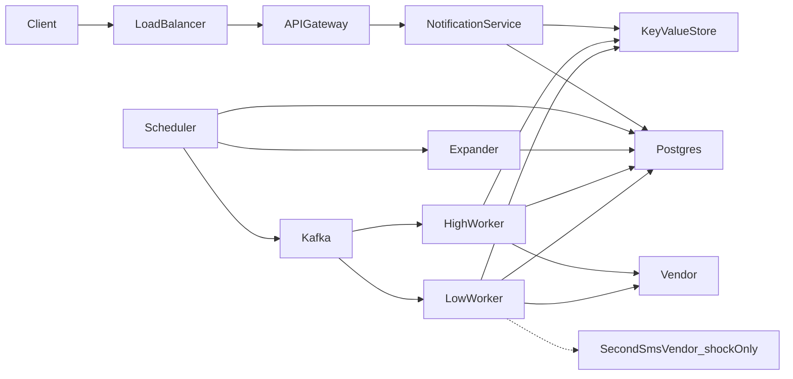
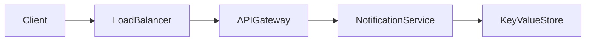
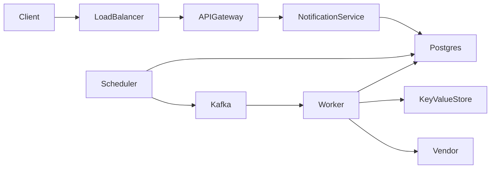
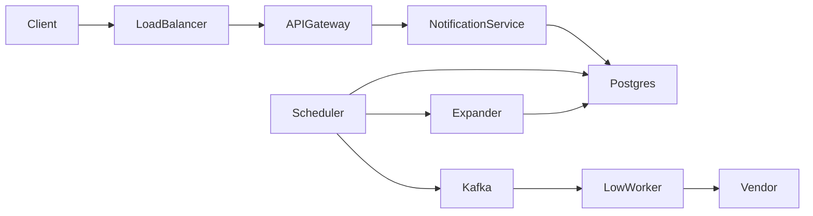
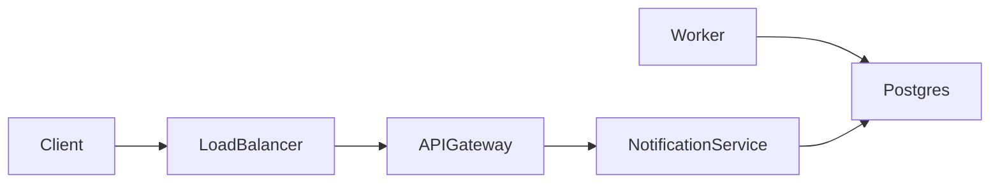

# Final design flow — Notification System

Redraw this at the end. The interview sequences stay in [FLOW.md](FLOW.md). Component roles stay in [COMPONENTS.md](COMPONENTS.md).

Hello Interview is the shape source. These notes are original.

## Overview

The client is Lee's dashboard or an upstream service. The second SMS vendor exists only when one contract cannot drain a 50,000-per-second blast. Every other box runs on the normal path. Two scheduler copies and one high worker in each region also run on the normal path.



## Save contact

```
PUT /v1/users/{userId}/contact -> 200 OK { userId }
Body: {
  email,
  phone,
  deviceToken
}
```



1. The dashboard calls the gateway.
2. Notification service writes `contact:{userId}` in the key-value store.
3. The call returns 200.

## Save preferences

```
PUT /v1/users/{userId}/preferences -> 200 OK { userId }
Body: {
  push,
  email,
  sms,
  quietStart,
  quietEnd
}
```


1. The dashboard calls the gateway.
2. Notification service writes `preference:{userId}` in the key-value store.
3. The call returns 200.
4. A worker reads this key again at send time.

## Send one notice

```
POST /v1/notices -> 202 Accepted { id, status }
Body: {
  userId,
  channel,
  content,
  priority,
  scheduledAt,
  idempotencyKey
}
```



1. The upstream service calls the gateway.
2. Notification service commits `notices`, `send_records`, and `schedule` in Postgres.
3. The same idempotency key returns the first notice.
4. The API returns 202. It does not call Kafka.
5. The scheduler publishes the notice id to `notices-high` or `notices-low`.
6. The worker takes a token, claims the send record, and calls the vendor.

`scheduledAt` in the future uses the same writes. `due_at` is that later time.

## Send a campaign

```
POST /v1/campaigns -> 202 Accepted { id, status }
Body: {
  userIds,
  channel,
  content,
  scheduledAt,
  idempotencyKey
}
```



1. The upstream service calls the gateway.
2. Notification service commits `campaigns`, `campaign_users`, and one `schedule` row.
3. The API returns 202.
4. The scheduler starts the expander when `due_at` is due.
5. The expander writes one notice, one send record, and one schedule row per user.
6. The scheduler publishes those notice ids to `notices-low`.
7. Low workers call the vendor.

## Send record

The worker writes the record. The caller reads it.

```
GET /v1/notices/{id} -> 200 OK { id, status, channel }
```



1. The worker sets `send_records` to sent or failed after the vendor answers.
2. A later GET reads that status through the gateway and Notification service.

## Services

| Name | When it runs | What it does |
| --- | --- | --- |
| Load balancer | Always | Sends each call to one healthy gateway |
| API gateway | Always | Checks the session and routes the call |
| Notification service | Always | Writes contact and preference. Commits a notice or a campaign. Reads status |
| Scheduler | Always, two copies | Publishes due notice ids. Starts the expander for a due campaign |
| Expander | When a campaign is due | Writes one notice and one schedule row per user |
| High worker | Always, at least one in each region | Reads `notices-high`, takes a high token, calls the vendor |
| Low worker | Always | Reads `notices-low`, takes a low token, calls the vendor |
| Vendor | Always, outside | Twilio, an email vendor, Apple, or Google |
| Second SMS vendor | Shock only. One contract cannot drain 50,000 per second | Takes part of the campaign. High tokens stay on the first vendor |

## Databases

### Postgres

`notices` — primary key `id`. Unique `idempotency_key`. Unique `(campaign_id, user_id)` when `campaign_id` is set.

| Column | Role |
| --- | --- |
| id | Primary key. This is the Kafka message |
| user_id | Who receives it |
| channel | push, email, or sms |
| title | Short line. Empty when `campaign_id` is set |
| body | The message. Empty when `campaign_id` is set |
| campaign_id | Empty for one user. Set for a campaign notice |
| send_at | When it should go out |
| priority | high or low. Default low |
| idempotency_key | Caller key. A retry returns this row |

`campaigns` — primary key `id`. Unique `idempotency_key`.

| Column | Role |
| --- | --- |
| id | Primary key |
| channel | One channel for the blast |
| title | Short line, stored once |
| body | The message, stored once |
| send_at | When the expander should start |
| status | accepted, expanding, or done |
| idempotency_key | Caller key. A retry returns this row |

`campaign_users` — primary key `(campaign_id, user_id)`.

| Column | Role |
| --- | --- |
| campaign_id | The blast |
| user_id | One recipient |

`send_records` — primary key `(notice_id, channel)`.

| Column | Role |
| --- | --- |
| notice_id | The notice |
| channel | The channel |
| status | accepted, sending, sent, or failed |
| attempt_count | Vendor calls so far |
| next_attempt_at | Empty until a temporary failure |

`schedule` — primary key `id`. Index `(status, due_at)`.

| Column | Role |
| --- | --- |
| id | Primary key |
| due_at | When the scheduler should publish |
| notice_id | Set for a one-user notice. Empty for a campaign start |
| campaign_id | Set to start a campaign. Empty for a one-user notice |
| status | waiting or queued |

### Key-value store

One store. The key is the primary lookup.

| Key | Value |
| --- | --- |
| `contact:{user_id}` | Email, phone, device token |
| `preference:{user_id}` | Channel switches and quiet hours |
| `budget:{vendor}:high` | Tokens left for high sends |
| `budget:{vendor}:low` | Tokens left for campaign sends |
| `vendor:{vendor}:open` | Shock only. Set while that vendor is down. Workers do not call |

### Kafka

| Topic | Message | Who reads it |
| --- | --- | --- |
| `notices-high` | Notice id only | High workers |
| `notices-low` | Notice id only | Low workers |

Interview sequences are in [FLOW.md](FLOW.md). Component roles are in [COMPONENTS.md](COMPONENTS.md).
