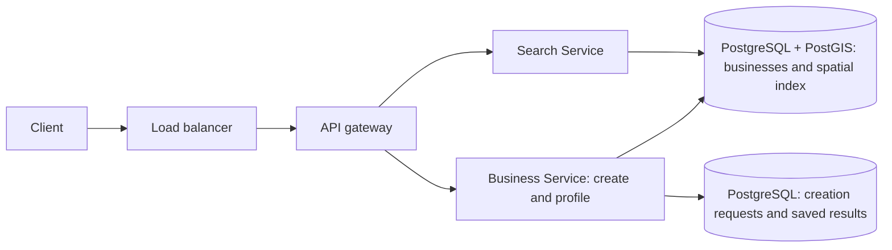

# FAQ — Proximity Service

Session started 2026-11-01. Practice follows the same five steps as README. Step 1 scope is resolved and recorded. Step 2 is taught; step 3 begins next.

## 1. Requirements and design scope

**Q: What scope did we choose after the learner's broader answer?**

A: Keep Proximity Service. Search within a radius of the current location or another selected point, return paginated results, and view a business profile. The learner later added authenticated owner registration on 2026-11-01. Reviews, ratings, name search, and category filtering remain deferred to Yelp.

**Q: What are the workload and quality targets?**

A: Retain the learner's 10 million businesses and 100 million daily active users. For capacity planning, assume five searches per user per day and a five-times peak. This gives about 5800 average searches/s and 29000 peak searches/s. These request assumptions are session choices. Proposed search latency is p95 at most 500 ms at the API. Proposed normal catalog visibility is five minutes. Read availability is preferred over immediate projection freshness. The authoritative catalog must survive application restarts.

**Q: What options and tradeoffs justify these choices?**

The full step 1 teacher review follows. It records the same requirements, alternatives, choices, exclusions, and proposed API contracts as README.

### Functional requirements

1. Search for businesses within a radius of a latitude/longitude point. The point can be the device location or another selected location. Return bounded pages, with distances and a continuation cursor.
2. Open a business profile by its stable business ID.
3. Let an authenticated business owner register a business with its profile fields and coordinates.

Search means geographic proximity in this chapter. Business-name search, category filters, ratings, and reviews are deferred to Yelp. A category can still be a displayed profile field. The geographic query does not need a category input. Named cities and addresses must first resolve to coordinates; that resolution service is outside the initial path.

### Non-functional requirements

The learner selected 10 million businesses, 100 million daily users, low search latency, high availability, and eventual consistency. We retain those numbers for this narrower scope. They are this session's chosen workload, not numbers supplied by the public ByteByteGo proximity guide.

| Area | Target or assumption | Meaning |
| --- | --- | --- |
| Catalog | 10 million businesses | Mostly static locations; business records change less often than searches |
| Users | 100 million daily active users | A user count does not establish requests per second |
| Search workload | Assume five searches per user per day | 500 million searches/day; about 5800 searches/s on average |
| Initial design peak | Assume five times average | About 29000 searches/s; not a measured production limit |
| Search latency | Proposed p95 at most 500 ms at the API | At least 95 percent of searches finish within this server-side budget at the design peak |
| Availability | Prioritize usable search and detail reads | A delayed catalog projection can remain usable; unavailable valid data yields an explicit retryable error |
| Freshness | Proposed visibility within five minutes under normal conditions | A recent catalog change can take time to appear; the target needs monitoring and later failure policy |
| Durability | Persist confirmed owner registrations and retain the catalog across restarts | Search indexes can be rebuilt from durable catalog data |
| Local lab | Small data and controlled failures | No claim that local Docker proves the production traffic or latency targets |

The five-search workload, peak factor, percentile, and five-minute freshness target are teacher proposals. They are explicit defaults for this session and can change if the learner requests it. Business-profile reads and retries add traffic beyond this search-only estimate. Owner registrations are a separate write workload. Its rate is not supplied yet; do not infer it directly from daily search users.

#### Traffic: plan for a peak, not only the average

Suppose Lee performs five nearby searches during a day. One hundred million users produce 500 million searches. Divide by 86400 seconds to get about 5800 searches/s. A five-times multiplier gives about 29000 searches/s. The multiplier is a session assumption. The source does not give this chapter's peak.

- **Option A — Size only for the average.** This keeps initial capacity costs lower. A busy period can exceed the budget and increase queues or errors. It fits a workload whose peaks are small or can wait.
- **Option B — Budget for the stated peak.** Test at about 29000 searches/s and measure queueing, errors, and tail latency. This costs capacity and load-test work. It fits the selected interactive search workload.

**We pick Option B.** The design point is about 29000 search requests/s. We will select components in step 2. Tenfold traffic and hotspots remain step 4 probes.

#### Latency: define what low means

Lee waits for one nearby result page. The API budget covers request handling and its dependencies. Device networking and rendering add to the caller's experience.

A percentile describes a share of requests. A p95 value is the time within which 95 percent of requests finish. An average can hide a slow minority.

- **Option A — Track only average latency.** The metric is simple. Many searches can still be slow while the average looks acceptable. It fits coarse reporting, not our full user-experience target.
- **Option B — Track latency percentiles at the design peak.** Use p95 at most 500 ms, error rate, and saturation metrics. This requires histograms and a realistic test workload. It fits interactive search.

**We pick Option B.** This session uses p95 at most 500 ms for the search API. We will not claim this target from an idle local request.

#### Availability and freshness: define what may lag

Lee can still search while a new business waits for the search view to catch up. Eventual consistency means the readable views converge after communication and update processing recover. It does not permit permanent missing updates.

An authoritative catalog holds the accepted business records. A search projection is a derived view used to answer queries. They can share one database; we have not selected their physical layout.

- **Option A — Require the newest catalog state on every read.** Lee immediately sees each committed change once the read can complete. This can couple reads to update work or an unavailable dependency. It wins when freshness matters more than read availability.
- **Option B — Allow a prior committed view while updates catch up.** This can keep reads usable. Lee can briefly miss a new shop or see an older location. It needs a freshness target and recovery process. It fits mostly static businesses.

**We pick Option B.** The proposed normal visibility target is five minutes. That value is a session choice. It would not fit live driver tracking. We will cover stale closures, moves, and index updates in the deep dive.

High availability still needs redundancy and failure handling in the design. If we cannot serve a valid result, the API returns a clear error. Empty matches and a failed query are different outcomes.

#### Durability: distinguish catalog data from a rebuildable index

Losing an application process must not erase the business catalog. A lookup structure can be temporary if we can rebuild it from durable records.

- **Option A — Keep the only catalog copy in process memory.** This is easy for a disposable demonstration. A restart loses the data or needs a complete reload. It does not meet the catalog durability target.
- **Option B — Keep durable catalog records and rebuildable lookup state.** This adds persistence, backup, and recovery work. It fits the ten-million-business design and a lab whose data survives application restart.

**We pick Option B.** We will choose the database in step 2. Owner registration now supplies catalog records through the product API. Existing imports and lab fixtures can also supply records. Edits, deletion, and an administrative console remain deferred.

#### Owner registration: distinguish saved from searchable

Lee owns Sunny Coffee and submits its name, address, display category, and coordinates. The service validates the owner identity and fields. It durably saves the business and returns its stable ID. Registration cannot succeed only in application memory.

The creation response confirms saved catalog state. Search visibility is a separate contract. The business profile can read the authoritative catalog; a derived search view may catch up later.

- **Option A — Require immediate search visibility before success.** The new listing appears in nearby queries when creation succeeds. This can couple registration to index work and its availability. It fits a simple database with a transactional spatial index, or a stricter visibility requirement.
- **Option B — Allow search visibility to follow durable creation.** Lee receives a saved business ID while a separate search view can lag. This needs reliable propagation if the design uses separate stores. It fits the accepted eventual-consistency requirement.

**We pick Option B as the API guarantee.** The existing normal visibility target is five minutes. This does not require a queue or worker. One database can update its own index in the same transaction and make the listing visible sooner. Step 2 will choose the physical path.

Creation retries need an idempotency key: an identifier for one requested creation attempt. A lost response must not create another business for that same attempt. Detecting two independently submitted listings for the same real business is a different product problem and remains deferred.

### Scope

These are this session's exclusions. The standalone public proximity guide has no formal below-the-line list. Hello Interview's separate Yelp list does not govern this chapter.

| Excluded feature | Why it stays outside this chapter |
| --- | --- |
| Reviews, comments, ratings, and rating averages | They add a separate user-write and aggregation path; cover them in Yelp |
| Business-name search and category filters | They add query matching and filter combinations; cover them in Yelp |
| Business edits, deletion, and an administrative console | Owner creation is now included; the remaining management features are deferred |
| Maps as a product UI | Nearby results can appear in a list; no map tiles or map SDK is required |
| Recommendations and relevance ranking | No personalization or learned ordering is needed |
| Dedicated spam detection and moderation | Defer the moderation platform; retain input validation on owner submissions |
| Detailed privacy/compliance system | Defer that platform; use public business data and retain basic transport protection |
| Live tracking, routes, and travel-time search | Moving entities and road routing belong to later questions |
| City/address resolution | The initial API receives coordinates for the selected location |

For pagination, the proposed result order is distance ascending with business ID as the tie-breaker. This is a basic ordering rule. It does not add personalized relevance or recommendation scoring. Cursor behavior under catalog changes remains a later design decision.

### Core entities

| Entity | Description |
| --- | --- |
| Business | Stable ID, owner ID, name, address, display category, coordinates, creation time, and last update time |
| Owner identity | Existing authenticated identity that owns the submitted listing; full account management is excluded |
| Nearby query | Center point, radius, page size, and optional continuation cursor |
| Search result | Business identity and summary, distance from the center, and page continuation |

### APIs

These are provisional contracts, not implemented routes. Step 2 selects the components and stores for geographic search, business profiles, and owner registration.

```http
GET /v1/nearby?latitude=37.7749&longitude=-122.4194&radiusMeters=3000&limit=20
Body: none
200 OK {
  businesses: [
    {businessId, name, latitude, longitude, distanceMeters}
  ],
  nextCursor
}
```

The client passes the returned cursor on the next request with the same query. The provisional bounds are 0 < radiusMeters <= 50000 and 1 <= limit <= 100. These bounds are session choices to limit work and response size. We will design cursor validity in the deep dive.

```http
GET /v1/businesses/{businessId}
Body: none
200 OK {
  businessId, name, category, address,
  latitude, longitude, updatedAt
}
```

```http
POST /v1/businesses
Authorization: Bearer <owner session>
Idempotency-Key: <key for this creation attempt>
Body: {
  name: "Sunny Coffee",
  category: "cafe",
  address: "100 Market Street",
  latitude: 37.7750,
  longitude: -122.4194
}
201 Created {
  businessId,
  status: "created",
  createdAt
}
```

The server takes ownerId from the authenticated identity. It does not accept a caller-selected ownerId as authority. Profile/account management and legal business-ownership verification are outside this interview. The lab can use mock owner identities.

A 201 response means the catalog record is durably saved. The business ID can identify the saved profile. Nearby search may lag within the proposed normal five-minute visibility target. If saving fails or remains uncertain, the client can retry the same attempt key. A repeat with the same owner, key, and payload returns the original business ID. Reusing the key with a different payload returns 409. Exact persistence and indexing mechanisms remain step 2 decisions.

A valid nearby query can return an empty businesses list. An invalid input returns 400. Missing owner authentication returns 401 for registration. A conflicting idempotency-key reuse returns 409. A missing business returns 404. An unavailable dependency can return 503 with retry guidance. These are proposed contracts to verify in the later lab.

### Source and scope review

The learner's original broader answer matched Yelp. The learner explicitly chose to keep Proximity Service and defer reviews and text search. The narrower requirements above supersede that broader feature list.

The public [ByteByteGo proximity guide](https://bytebytego.com/guides/proximity-service/) describes nearby search and business details, with business management as another path. The learner later added owner registration. We now include creation, while edits, deletion, and an administrative console remain deferred. Its public text provides no numeric traffic target or formal exclusion list. The author's [Volume 2 references](https://github.com/alex-xu-system/bytebytego/blob/main/system_design_links_vol2.md) identify the chapter. The full paid chapter is not a verified source in this session.

The related [Hello Interview Proximity Search article](https://www.hellointerview.com/learn/system-design/deep-dives/proximity-search) supplies later index comparisons. There is no separate matching product breakdown in the index we checked. The [Yelp breakdown](https://www.hellointerview.com/learn/system-design/problem-breakdowns/yelp) remains a later chapter. Do not attribute our added targets or exclusions to those sources.


## 2. High-level design

**Q: Is Search Service plus Business Service a sound high-level split, and when is a business searchable?**

A: Yes. The learner selected those responsibilities. The detailed teacher review, feature paths, options, costs, and default follow.

### Learner proposal and teacher review — 2026-11-02

The learner proposed two services: Search Service for location queries, and Business Service for registration and profile reads. A listing becomes searchable after its database record and index entry exist.

The split matches the public [ByteByteGo guide](https://bytebytego.com/guides/proximity-service/). The proposal still needs a concrete database, geographic query path, and publication boundary. A search index need not be a separate server or require a full rebuild after every registration.

### Shared components and database choice

- **Option A — One application with two logical modules.** This has fewer deployments and network boundaries. Both modules scale together. It fits a small initial deployment.
- **Option B — Two services with a shared catalog contract.** Search handles location queries. Business handles owner writes and profile reads. The application workloads can scale separately. Two deployments cost more, and sharing a database couples schema changes.

**We pick Option B**, following the learner's service split. The initial data store is PostgreSQL with PostGIS. PostGIS adds geographic types, query functions, and spatial indexing to PostgreSQL. The Business Service owns writes. The Search Service has read access to the business data required by its query.

Two services do not require two databases. This initial shared-database choice is deliberate. It does not remove a future database bottleneck. The 29000 search requests/s target remains a capacity goal to measure, not a demonstrated result for one PostgreSQL server.

| Component | Role |
| --- | --- |
| Client | Register a business, search near coordinates, and open a profile |
| Load balancer | Route across healthy application instances |
| API gateway | Route /v1/nearby to Search Service and /v1/businesses paths to Business Service |
| Search Service | Validate geographic queries, execute indexed radius lookup, and return a page |
| Business Service | Validate owner creation, save retry results, and load business profiles |
| PostgreSQL + PostGIS | Hold business rows, creation-attempt records, primary-key lookup, and the spatial index |
| Existing identity provider / lab mock | Supply the authenticated owner ID for registration |

The primary key supports profile reads by business ID. A GiST spatial index supports geographic candidate lookup. A spatial index organizes lookup work by geographic extent. It helps narrow the candidate set. Exact radius and distance calculations still determine the returned results.



P and R are roles in the same initial PostgreSQL database. They are not two independent database transactions.

### 2.1 Search for nearby businesses

Lee searches within 3000 meters of a selected point.

1. Client sends GET /v1/nearby through the load balancer and gateway.
2. The gateway routes the call to Search Service.
3. Search Service validates coordinates, radius, limit, and any continuation token.
4. Search Service queries PostgreSQL using the PostGIS spatial index.
5. The index narrows possible matches. The distance predicate tests the requested radius.
6. The query orders matches by distance, then business ID, and returns one bounded page.
7. Search Service returns business IDs, display summaries, distances, and a continuation cursor.

The initial query reads summary fields from business rows. It does not call Business Service once per search result. Profile navigation remains a separate Business Service request.

- **Option A — Calculate distance for every business.** This is easy to implement and serves as a correctness reference. Each query can inspect ten million rows. It fits small fixtures or offline checks, not the selected interactive design peak.
- **Option B — Use the database's geographic index.** PostgreSQL/PostGIS narrows candidates and checks the radius. This needs a spatial extension and an appropriate index. It avoids an application-level index copy. It fits mostly static businesses and our current feature scope.
- **Option C — Maintain a separate geographic search representation.** Geohash cells, another spatial store, or a search engine can serve geographic queries independently. This adds storage, propagation, reconciliation, and possible visibility delay. It wins when measured needs justify the separate read system.

**We pick Option B initially.** Ten million businesses and about 29000 peak searches/s make the full-scan path unsuitable as the production plan. The selected query needs load testing over realistic geographic density. Geohash and other structures remain deep-dive and lab comparisons.

For the proposed location column, use PostGIS geography for point coordinates. ST_DWithin accepts geography distance in meters and can use an available spatial index. We will select exact query, precision, pagination, and index-plan checks in step 3. See [ST_DWithin](https://postgis.net/docs/ST_DWithin.html) and [spatial query guidance](https://postgis.net/docs/using_postgis_query.html).

```http
GET /v1/nearby?latitude=37.7749&longitude=-122.4194&radiusMeters=3000&limit=20
Body: none
200 OK {
  businesses: [{businessId, name, latitude, longitude, distanceMeters}],
  nextCursor
}
```

### 2.2 View a business profile

Lee selects business b123 from the nearby list.

1. Client sends GET /v1/businesses/b123 through the load balancer and gateway.
2. The gateway routes it to Business Service.
3. Business Service reads the business row by primary key in PostgreSQL.
4. It returns the profile or 404 if the business does not exist.

The detail path uses the business ID. It does not run another nearby search.

- **Option A — Read the authoritative row by primary key.** This keeps one source for the profile and avoids cache invalidation. It uses a database read for each request. It fits the initial design.
- **Option B — Cache profiles by business ID.** Repeated reads can avoid some database work. Copies need expiry or invalidation, and can lag. It wins after measurements show enough repeated reads to justify the cache.

**We pick Option A initially.** Business-detail traffic is not quantified yet. We have no measurement that justifies a separate profile cache. Cache design, hot objects, and read replicas remain later component probes.

```http
GET /v1/businesses/b123
Body: none
200 OK {
  businessId, name, category, address,
  latitude, longitude, updatedAt
}
```

### 2.3 Owner registers a business and makes it searchable

Lee registers Sunny Coffee with a name, address, display category, and coordinates.

1. Client sends POST /v1/businesses with an owner session and a creation-attempt key.
2. The request passes through the load balancer and API gateway to Business Service.
3. Business Service validates the identity and fields. It uses the authenticated owner ID.
4. It checks the owner-scoped attempt key. An identical completed retry returns the saved business result.
5. In one PostgreSQL transaction, it saves the business row and the completed creation result.
6. PostgreSQL maintains the already-created spatial index as the row is inserted.
7. After the commit succeeds, Business Service returns 201 and the business ID.
8. A fresh matching search against this primary can now consider the committed row.

Database migrations create the index structure. Normal registration inserts update it incrementally. We do not rebuild all ten million index entries for each new business. PostgreSQL documents its automatic [index maintenance](https://www.postgresql.org/docs/current/indexes-intro.html).

A listing is searchable when it is eligible for matching queries. Radius filters, sort order, and page size still determine which page contains it.

- **Option A — Commit catalog data and the native index together.** One database maintains the index automatically. This gives an atomic publication boundary and needs no application-level dual write. Search and writes still share database capacity. It fits the initial PostGIS design.
- **Option B — Save the catalog and update a separate search system later.** This lets a separate search store evolve and scale independently. A reliable source event or equivalent change capture must survive the creation commit. A worker can then retry the derived update. This adds lag, recovery state, and operating cost.

**We pick Option A for the initial implementation path.** The five-minute freshness target permits delayed visibility; it does not require delay. The native-index path can provide visibility sooner. The earlier Option B in step 1 described the API's allowed visibility delay, not a mandatory asynchronous topology.

There is no outbox requirement just because we have two services. If we add a separate search projection later, catalog commit and durable propagation work need one recoverable boundary. That is a comparison path, not an extra primary-path write.

The saved attempt result and the business row commit together. If the reply is lost after commit, the same owner/key/payload retrieves the same business ID. A conflicting payload for a retained key returns 409. Detailed retention and concurrency checks remain deep-dive work.

```http
POST /v1/businesses
Authorization: Bearer <owner session>
Idempotency-Key: <creation-attempt key>
Body: {
  name: "Sunny Coffee",
  category: "cafe",
  address: "100 Market Street",
  latitude: 37.7750,
  longitude: -122.4194
}
201 Created {businessId, status: "created", createdAt}
```

### What this high-level choice establishes

- Two application services, with Business Service as the writer and Search Service as a reader.
- One initial PostgreSQL database, with a PostGIS spatial index and durable creation results.
- Geographic search returns candidate-filtered, distance-checked results. Profile reads use a primary key.
- Registration does not require a background index worker in the selected native-index path.
- Database choice and service roles are a teacher completion of the learner's sketch. Index mechanics, pagination under change, production scaling, and failure guarantees remain to teach.
- The local lab is not implemented. Do not mark the chapter complete or assume the stated production capacity is tested.

## 3. Low-level design and deep dive

**Q. Why choose this storage model?**

A. One PostgreSQL database can commit a business and its retry result together. The business primary key supports profile lookup. A PostGIS spatial index supports radius search. The [data model](README.md#data-model) gives the proposed columns. A separate search store can scale on its own and adds replication or outbox work.

**Q: Where is the bottleneck as traffic grows?**  
A: Search and profile reads share database capacity on the initial deployment. Two tables do not add server resources. Read replicas can add read capacity, with replication delay. See the dated read-pressure answer below and [the full comparison](search-approaches.md). Capacity tests and final replica/shard sizing remain pending.

**Q: Which source probes still need detailed teaching?**

A. Step 3 covered the related Hello Interview topics and the worked search examples. The README keeps the coverage matrix. Step 4 evaluates failures and scale.

## 4. Component questions and special situations

**Q. What happens if the PostgreSQL primary fails while a replica can still serve reads?**

A. The learner correctly chose the replica for search and service unavailable for registration. A profile created 30 seconds ago may be absent on the one-minute-behind replica. If the primary is down, return 503 when the replica misses the profile. A confirmed absence on the primary returns 404.

- **Option A — Fail all catalog calls.** This is simple and loses useful replica reads.
- **Option B — Serve replica reads within the freshness policy.** Search and available profiles can work. A profile miss that the service cannot confirm returns 503. Registration returns 503 and the client keeps the same key.
- **Option C — Promote a suitable standby.** This restores writes. Confirm that the candidate meets the durability policy and prevent the old primary from accepting writes before promotion.

**We pick Option B during the outage and Option C once promotion is safe.** One minute of lag fits the five-minute search target in the example. [PostgreSQL hot standby](https://www.postgresql.org/docs/current/hot-standby.html). [PostgreSQL failover](https://www.postgresql.org/docs/current/warm-standby-failover.html).

**Q. Would a cache help at tenfold traffic? How do we measure p95?**

A. Test a first-page result cache when many requests use the same center, radius, and page size. A hit avoids a spatial query. At 290,000 requests per second, a 90% hit rate leaves about 29,000 database requests per second if each miss makes one query. If most queries miss, read replicas can spread the work across servers. Keep cache age and replica lag within the freshness budget.

Measure each API request from send to response. Sort the times. With 1,000 measured requests, p95 is around the 950th value. Compare the same request mix and load before and after. Check p95 against 500 ms and report errors, timeouts, throughput, cache hits, and database CPU. [Prometheus percentile guide](https://prometheus.io/docs/practices/histograms/#quantiles).

**Q. What would you change for rush hour?**

A. The learner proposed caching nearby business lists and profiles. Cache identical searches directly. To reuse data across different search centers, cache cell candidates and check the exact radius per request. A profile cache helps detail reads.

- **Option A — Cache alone.** Repeated searches avoid database work. A spike of misses can still overload the database.
- **Option B — Cache plus bounded admission.** Serve hits and limit the database work for misses. Use a global in-flight limit and a per-area budget. A short queue lets brief bursts wait. Excess requests receive a retry response.

**We pick Option B.** The concert area can use its budget while other areas retain capacity. Return 429 when the area exceeds its limit. Return 503 for global overload. [Google SRE overload handling](https://sre.google/sre-book/handling-overload/). [HTTP 429](https://www.rfc-editor.org/rfc/rfc6585.html#section-4).

**Q. What happens when 500 identical searches miss the same expired cache key?**

A. Without grouping, each request can send the same query to PostgreSQL. With coalescing, one request refreshes the key and other callers share the result. The refresh writes the cache before it finishes. Waiting callers use a deadline.

- **Option A — Group requests per instance.** One refresh can serve all requests for that key on the same instance. Different instances can each start one.
- **Option B — Use a shared expiring claim.** One instance fills the cache while others wait briefly. The claim expires if its owner crashes. This adds coordination and failure handling.

**We pick Option A first.** Use Option B if duplicate fills across instances still exceed the database budget. Keep the spike limits in either case. [Go singleflight](https://pkg.go.dev/golang.org/x/sync/singleflight). [Redis lock guidance](https://redis.io/docs/latest/develop/clients/patterns/distributed-locks/).

**Q. What if a region fails before the remote standby receives a confirmed registration?**

A. A standby that is one minute behind may lack the business and its saved request key. If promoted immediately, it can treat Lee's retry as new and return a different business ID.

- **Option A — Acknowledge after a local commit.** This keeps the registration path fast but can lose recently confirmed rows after region loss.
- **Option B — Wait for a durable commit copy in another region.** This preserves the business and retry result across a single region loss. It adds network latency and requires a reachable standby for successful new registrations.

**We pick Option B for the regional durability exercise.** Verify the failover candidate, prevent the old primary from writing, and route traffic to the new primary when ready. Resume successful writes after restoring remote confirmation. Reads can continue within the freshness policy. [PostgreSQL synchronous replication](https://www.postgresql.org/docs/current/warm-standby.html#SYNCHRONOUS-REPLICATION). [PostgreSQL failover](https://www.postgresql.org/docs/current/warm-standby-failover.html).

## 5. Summary and future improvements

**Q: What are the biggest risks in this design?**  
A. Broad queries in dense areas can consume shared database capacity. A lagging replica can hide a recent registration. A region loss can lose a locally acknowledged transaction if the remote copy has yet to receive it.

**Q: What would you add with more time?**  
A. Measure peak query cost and cache reuse. Add search replicas for sustained miss load. Test failover separately against the regional durability target.

## Session questions

Questions you asked at the end of a practice session. Append new ones with a date. Do not delete old entries unless a later design change superseded them.

### 2026-11-01

The learner answered the scope prompt with nearby/selected-location search by name and category, business details/reviews, and review submission. The proposed scale is 10 million businesses and 100 million daily users. The learner selected low latency, high availability, and eventual consistency. Proposed cuts include recommendations/ranking, administration, map rendering, spam handling, and detailed privacy work.

This answer matches the broader Yelp question. A chapter-selection question is pending: practice Yelp now with these requirements, or retain the narrower Proximity Service scope. No architecture is selected. Teacher clarification so far: discovery and rating aggregates can lag, but a confirmed review must persist. DAU must be converted into query rates with explicit workload assumptions.

### 2026-11-01 — Scope decision

The learner chose to keep Proximity Service and defer reviews and text search. The earlier pending choice is now resolved. README section 1 records the selected scope and teacher defaults. No architecture is selected; the next answer is step 2.

### 2026-11-01 — Owner registration added

**Q: Can a business owner add their business to the service?**

A: Yes. The learner added this requirement after the initial scope discussion. An authenticated owner submits profile fields and coordinates. The service validates and durably saves the listing, then returns 201 with a business ID. Owner identity comes from authentication. A retry with the same attempt key returns the same listing. The nearby view can catch up within the proposed normal five-minute visibility target. README section 1 records immediate-versus-delayed visibility options and the API contract. Reviews, text search, edits, deletion, account management, and legal ownership verification remain deferred. No physical database or worker is selected yet.

### 2026-11-02 — High-level design follow-up

**Q: Do we need two services, with a business searchable once its record and index entry exist?**

A: The two logical services are a sound split. The initial selected database is PostgreSQL/PostGIS. A normal insert updates an already-created native index; it does not rebuild the whole index. The business row and retry result commit together. A fresh matching search against the primary can see the committed row. Separate search stores remain a comparison and need recoverable propagation. The exact index structures and paging semantics remain step 3 topics.

### 2026-11-02 — Read pressure and industry approaches

**Q: Search and profile reads use the same PostgreSQL table. Can read pressure become too high? Why not use two tables?**

A: Yes, shared read pressure can exceed capacity. Search uses the spatial index and returns summaries. A profile read uses the primary key and returns one row. These reads can run concurrently, but they share CPU, memory, storage, and connections.

Two same-server tables still share those resources. A compact search table can improve row density if the profile becomes wide. It introduces a join or duplicated summary fields. For example:

```text
business_profiles(business_id, owner_id, name, category, address, created_at)
business_search(business_id, location, name, category)
```

These are illustrative fields, not final schemas. Both tables can commit together in the same PostgreSQL transaction. Table separation alone does not require an outbox.

- **Option A — One indexed business table.** This keeps one authoritative row and simple writes. Reads share server capacity. It fits the initial lab and a workload that passes measurement.
- **Option B — Two same-server tables.** This can make search rows smaller. It adds a join or duplicate fields. It fits wide profiles when tests show less query work.
- **Option C — Dedicated search replicas.** Separate PostgreSQL servers supply additional read capacity. Replication can lag, and extra servers cost money. It fits read pressure when the native query still meets our needs.
- **Option D — Independent search projection.** A separate store supports its own schema and tuning. It needs durable propagation and recovery. It fits richer search or measured needs beyond the native-query deployment.

**We keep Option A for the initial lab. Option C is the first production read-capacity variant to evaluate.** Ten million businesses and about 29000 peak searches/s require realistic load tests. No fixed replica count is established.

Lee creates Sunny Coffee on the primary. A fresh matching primary query can see it after commit. A search replica sees it after replication catches up. Our normal five-minute freshness target permits that delay, but it needs monitoring. PostgreSQL replication supplies this copy process; an application outbox is not required. See [PostgreSQL hot standby](https://www.postgresql.org/docs/current/hot-standby.html).

**Q: How many search approaches does industry use, and how do they compare?**

A: There is no fixed count. Compare algorithms separately from database products. For this question, use six algorithm groups:

| Algorithm group | Main benefit | Main cost or limit |
| --- | --- | --- |
| R-tree family | Mature bounding-region lookup in spatial databases | Index maintenance; overlapping bounds can increase candidate work |
| Quadtree | Finer subdivision in dense areas | Depth, memory, updates, and custom recovery |
| k-d / BKD trees | Point partitioning and efficient point query implementations | Update/balance or block-build/merge policy |
| Geohash | Cell prefixes work in ordinary key indexes | Precision, neighbor boundaries, and complete cover |
| S2 | Hierarchical spherical cells and region covering | Cover construction and resolution choice |
| H3 | Mostly hexagonal cells; neighbor analysis and aggregation | Coverage, resolution, exceptional cells, and hierarchy details |

Full scan remains a small-data correctness baseline outside these six groups. A normal coordinate index can support some rectangular range filters. It does not alone implement the full circular query.

- **Option A — Native spatial database.** PostGIS supplies durable rows, native index maintenance, and radius queries. This avoids custom propagation on the initial path. Capacity planning remains necessary.
- **Option B — Cell-based projection.** Geohash, S2, or H3 maps cells to business IDs. This gives distribution control. It adds complete coverage, ordering, propagation, and recovery work.
- **Option C — Search engine.** Elasticsearch supplies geographic filters and broader search features. It fits a product with text search. Another cluster and projection are extra costs for our current scope.

**We retain Option A with PostGIS.** The current scope is geographic lookup over mostly static businesses. Ten million records do not by themselves prove another product is faster.

Product alternatives include MySQL spatial, MongoDB 2dsphere, Elasticsearch, Redis GEO, and a custom cell index in a chosen store. A cell library does not supply a complete database lifecycle. See [search-approaches.md](search-approaches.md) for the product table and primary sources.

Lee's 3 km search must inspect every overlapping candidate region required by the query. One cell or a fixed neighbor ring can miss nearby shops. Exact filtering removes outside candidates; it cannot recover omitted candidates. Full query exercises remain pending.

### 2026-11-02 — What PostgreSQL with PostGIS means

**Q: Does Option A mean regular PostgreSQL with PostGIS search functions?**

A: Yes. Use PostgreSQL with the PostGIS extension installed and enabled in the database. PostGIS supplies geographic data types, geographic query functions, and spatial index support. Our selected design uses a geographic point, a GiST spatial index, and ST_DWithin for the radius predicate. With geography inputs, the distance argument uses meters. Search Service sends SQL to PostgreSQL. PostgreSQL executes the geographic query through PostGIS. There is no separate PostGIS server.

Installing or enabling the extension alone does not create an index for every table. We must define the location column and its spatial index. PostgreSQL then maintains that index during normal writes. This clarification does not change the selected architecture.

Sources: [PostGIS setup](https://postgis.net/documentation/getting_started/), [spatial index setup](https://postgis.net/documentation/faq/spatial-indexes/), and [ST_DWithin](https://postgis.net/docs/ST_DWithin.html).

### 2026-11-02 — Rectangle candidates and radius results

**Q: Can we return both Sunny Coffee and Kim Bakery because both are inside the candidate rectangle? Does PostGIS check the actual 3 km distance?**

A: Keep both as candidates, but do not return both as final results. Sunny Coffee is 1 km north and qualifies. Kim Bakery is 2.5 km north and 2.5 km east. Its approximate direct distance is sqrt(2.5² + 2.5²), about 3.54 km. It does not qualify. This planar calculation explains the local example. The real query uses geographic distance.

The index selects possible matches. PostGIS applies the actual radius predicate. Search Service can send one SQL query; it does not need separate calls for each candidate.

- **Option A — Check every business's distance.** This can return correct results, but performs broad distance work across ten million rows. It fits small correctness fixtures.
- **Option B — Return the rectangle directly.** This omits the final radius test and includes corner businesses outside 3 km. It fits a rectangular viewport requirement, not this API.
- **Option C — Use indexed candidates and a geographic radius predicate.** This excludes nonmatching regions and rejects corner candidates. It costs index maintenance and candidate checks. It fits our radius requirement and catalog size.

**We pick Option C for this radius-check comparison.** It is the existing native PostGIS search choice. About 29000 peak searches/s remains a target, not a measured capacity result.

With geography inputs, ST_DWithin(location, center, 3000) tests the meter-based radius. It includes an index-aware bounding comparison. ST_Distance supplies meters for display and distance ordering. The stable business ID resolves equal-distance ordering. See [ST_DWithin](https://postgis.net/docs/ST_DWithin.html) and [ST_Distance](https://postgis.net/docs/ST_Distance.html).

README section 3 records the first-page SQL. A GiST index must exist on location. PostgreSQL chooses the physical plan. A limit of twenty returned rows does not guarantee only twenty distance calculations. Dense regions can still create substantial work. See [PostGIS indexing](https://postgis.net/workshops/postgis-intro/indexing.html).

The conceptual flow is index candidates → geographic radius test → distance order → page. The spatial-tree traversal probe is next. This answer does not finish every tree or encoded-cell deep dive.

### 2026-11-02 — Meaning of an index branch

**Q: What does "branch" mean in the spatial-index question?**

A: I used branch to mean a section of the index tree: a group and all smaller groups below it. A tree organizes entries in levels. The top level leads to groups, smaller groups, and finally entries that identify business rows.

```text
Spatial index
├── Group A: bounds around San Francisco
│   ├── Smaller group A1 → Sunny Coffee and other entries
│   └── Smaller group A2 → other entries
└── Group B: bounds around New York
    └── Smaller groups → New York entries
```

Group B and everything beneath it form the New York branch in this simplified example. Each group has a bounding region that contains the entries beneath it. If that region cannot contain a result for Lee's 3 km search, the query can skip the whole group. A possible overlap requires further checks; it does not prove every entry matches.

The city labels are teaching examples. PostgreSQL does not require us to create city branches or separate city tables. The native index maintains geographic groups. See [PostGIS indexing](https://postgis.net/workshops/postgis-intro/indexing.html).

This defines the term. Detailed traversal, overlap, and update mechanics remain part of the ongoing tree lesson. No design choice changed.

### 2026-11-07 — How much PostGIS detail should I know?

**Q. Do I need to know how PostGIS builds the index or calculates distance?**

A. For this system design interview, explain how we set up the index and how the query uses it. PostGIS is a PostgreSQL extension. We create a GiST spatial index on the business location column. PostgreSQL maintains the index as business rows change.

When the query uses the index, it can skip groups whose bounds rule out a match. PostGIS then checks which candidates are within 3,000 meters of Lee. For geography inputs, `ST_DWithin` takes the radius in meters. A dense area can still leave many candidates to check. [PostGIS indexing guide](https://postgis.net/workshops/postgis-intro/indexing.html). [ST_DWithin reference](https://postgis.net/docs/ST_DWithin.html).

Leave the tree-building algorithm and the geographic distance formula to the database. For this interview, the two useful steps are finding candidates and checking the radius.

### 2026-11-07 — Which Geohash cells should a radius query search?

**Q. Sunny Coffee is 50 meters away in another cell. How does the search find it?**

A. Searching Lee's cell alone misses it. Choose cells that together cover the whole 3 km circle. One way is to draw a geographic rectangle around the circle and select all cells that intersect the rectangle. Read candidates by their stored cell keys. Check each candidate's actual distance, then order and page the matches.

- **Option A — One cell.** One lookup suffices when the request is for that cell's contents. It misses nearby businesses across its boundary.
- **Option B — One ring of neighbors.** The query has a bounded number of keys. It works when the ring covers the entire circle. A 3 km circle can extend past one ring of cells that are about 1 km wide.
- **Option C — Compute the full cover.** Use the center, radius, and cell precision to choose the keys. This covers varying radii but can require more lookups. It fits the Geohash radius comparison.

**We pick Option C for Geohash.** A shorter key prefix covers a larger area. It can reduce lookups but return extra candidates. A longer prefix covers a smaller cell and can require more lookups. Use the stored coordinates for the final distance check. [PostGIS Geohash reference](https://postgis.net/docs/ST_GeoHash.html). [Firestore geographic query example](https://firebase.google.com/docs/firestore/solutions/geoqueries).

### 2026-11-07 — How do the spatial techniques work?

**Q. What are quadtree, Geohash, R-tree, k-d tree, BKD, S2, and H3?**

A. An R-tree groups entries under bounds. A quadtree subdivides crowded cells into four parts. A k-d tree splits points into two parts along one coordinate at a time. BKD stores points in leaf blocks. Geohash encodes rectangular cells with text prefixes. S2 uses four-sided cells on a sphere. H3 uses mostly hexagonal cells. The [technique walkthrough](search-approaches.md#how-each-technique-finds-candidates) explains how each finds candidates for Lee's 3 km search.

**Q. Should I split the quadtree cell with 5,000 businesses and keep the one with 5?**

A. Yes. With your target of 20 per leaf, split the first cell and keep the second.

- **Option A — Fixed cells.** Lookup stays simple. Dense cells can return many candidates.
- **Option B — Split by occupancy.** Dense cells get smaller subdivisions. This can improve narrow searches but costs nodes and insertion work.

**We pick Option B for the exercise.** Set a maximum depth and allow an overfull leaf when businesses share coordinates. Thirty businesses at one point stay together after a split. The target applies to each leaf. A radius search can visit many leaves. [D3 quadtree documentation](https://d3js.org/d3-quadtree).

### 2026-11-07 — Does a cursor solve paging during inserts?

**Q. Can I prefetch the results and use a database cursor to reach page 2?**

A. A prefetched list can show Ada Books if it already contains that row. A fresh query with an offset of two starts at Kim Bakery because the new café at 300 m moves into the first position.

- **Option A — Offset.** Simple page numbers, but inserts can shift the results.
- **Option B — Last-result cursor.** The token records the last returned distance and ID. The next query starts after that pair. A new result before the cursor appears on a fresh search.
- **Option C — Result snapshot.** Save the original ordered result list. Later pages stay stable. Prefetch costs transfer and client memory. A server snapshot costs storage and needs an expiry policy.

**We pick Option B for our page API.** Search Service creates the token after Kim Bakery at 800 m. The client sends it with the same search. SQL starts after Kim's sort pair, so Ada Books at 1,200 m comes first. The business ID resolves equal distances. The token preserves the actual sort distance. Each page can run through any pooled connection. [PostgreSQL LIMIT and OFFSET](https://www.postgresql.org/docs/current/queries-limit.html). [PostgreSQL row comparisons](https://www.postgresql.org/docs/current/functions-comparisons.html#ROW-WISE-COMPARISON).

### 2026-11-07 — What happens if the registration response is lost?

**Q. Can a client idempotency key and a database unique constraint return b123 on a retry?**

A. Yes. Reuse the key for the same attempt. The database enforces uniqueness on (owner_id, idempotency_key). The owner ID comes from the session.

- **Option A — Put the key on the business row.** This keeps the schema small. The retry data shares the business row's lifecycle.
- **Option B — Use a separate creation request row.** This costs one extra row. It keeps the request fingerprint and saved response separate from the profile.

**We pick Option B.** Claim the key, create b123, and save the response in one transaction. If a second request arrives during the first transaction, the unique insert waits for the outcome. After a commit, the retry reads the saved result and compares the request fields. The same fields return b123. Different fields return 409. A rollback releases the key and discards the business row. [PostgreSQL Read Committed behavior](https://www.postgresql.org/docs/current/transaction-iso.html#XACT-READ-COMMITTED).

### 2026-11-07 — Creation request fields and key lifetime

**Q. What does creation_requests store, and what should I use as the key?**

A. Store the owner ID, idempotency key, request fingerprint, business ID, response status, response body, and creation time. Use (owner_id, idempotency_key) as the composite primary key. The client creates a random UUIDv4 for one submission before it sends the request. It saves the UUID with the pending submission and reuses it on retry. The detailed field table is in the [registration section](README.md#creation-request-fields-and-new-submissions). [RFC 9562, UUID version 4](https://www.rfc-editor.org/rfc/rfc9562.html#section-5.4).

**Q. Can Lee submit Sunny Coffee again later?**

A. The same key and same fields replay b123 while the creation request row is retained. The same key with changed fields returns 409. A fresh key represents a separate submission. It can create a second listing for the same storefront under the current rules.

- **Option A — Allow distinct submissions.** A new key can create a new business. This keeps retry handling independent of storefront identity.
- **Option B — Enforce one listing per storefront.** Add a unique storefront identifier to the business catalog. This prevents duplicates across keys and requires a reliable way to identify the storefront.

**We pick Option A for this scope.** If Lee only wants to finish an earlier submission, the client resumes it with its saved key. A deleted request row can no longer replay its result.

### 2026-11-07 — Separate search index recovery

**Q. What should we save with b123, and should we fail the registration if indexing fails?**

A. With the native index, PostgreSQL maintains the index during the business insert. With a separate search store, save b123 and an outbox job in one PostgreSQL transaction. A worker reads the committed job. A failure after commit leaves the business registered and the job eligible for retry.

- **Option A — Native index.** One database handles the row and index. It fits the initial design.
- **Option B — Separate store with an outbox.** The job survives a service crash. This adds a worker and visibility delay. We pick this option for the separate-store exercise.

The worker upserts the document under b123. If it crashes after the write, it retries using that same ID. The write updates the same document. A successful write lets the worker mark the job complete. A rollback of the original PostgreSQL transaction discards both the business and the job. [AWS transactional outbox pattern](https://docs.aws.amazon.com/prescriptive-guidance/latest/cloud-design-patterns/transactional-outbox.html).

### 2026-11-07 — What can a regular coordinate index skip?

**Q. How does an index on latitude compare with a spatial index for Lee's search?**

A. A latitude index can narrow the catalog to the 50,000 businesses in the east–west strip. The longitude condition leaves 200 inside the rectangle. The distance check removes businesses beyond 3 km, including ones in the corners.

- **Option A — Index latitude.** Find the strip quickly. The longitude check still has to narrow the strip.
- **Option B — Index latitude and longitude in a compound B-tree.** Check both columns in the index. Latitude is the leading sort key, so a latitude range can still require a broad index scan. [PostgreSQL multicolumn indexes](https://www.postgresql.org/docs/current/indexes-multicolumn.html).
- **Option C — Index the location spatially.** Skip groups whose geographic bounds rule out a match. This can discard entire groups far east or west. It adds a spatial index to maintain. [PostGIS spatial indexing](https://postgis.net/workshops/postgis-intro/indexing.html).

**We pick Option C for the radius API.** PostGIS can narrow candidates and check the radius in the same query. The numbers in this exercise illustrate the work that pruning can save.

### 2026-11-07 — How does an S2 cover find smaller cells?

**Q. If the cover contains a large cell P and Sunny Coffee is stored under its smaller child B, does looking up P find it?**

A. An equality lookup for P finds only rows stored under P. Our example stores the fine child IDs A, B, C, and D.

- **Option A — Look up the children.** Read the four fine keys. This is simple for a small cover and can require many keys at finer levels.
- **Option B — Look up the range of descendant IDs.** S2 supplies inclusive bounds for P. Use an ordered index to fetch rows in that range.

**We pick Option B for the ordered-index exercise.** It fetches Sunny Coffee under B without listing every fine cell ID. Check the candidates' coordinates against Lee's 3 km radius. [S2 cell hierarchy and region covers](https://s2geometry.io/devguide/s2cell_hierarchy.html).

### 2026-11-07 — Does an H3 cell center have to be inside the circle?

**Q. How do we find Sunny Coffee at 2.9 km when its cell center is 3.2 km away?**

A. The center-based lookup skips the cell and misses the shop. A minimum overlap percentage can also omit a business in a small overlap.

- **Option A — Use cell centers.** This fits area reports that assign each cell by its center.
- **Option B — Set a minimum overlap.** This fits approximate reports that can omit edge cells.
- **Option C — Include every overlap.** This covers valid edge matches and can require more candidate reads.

**We pick Option C for the radius search.** Fetch candidates from overlapping cells, then check their actual coordinates. Sunny Coffee qualifies. [H3 region functions](https://h3geo.org/docs/api/regions/).

### 2026-11-07 — Can we rebuild the search index every 15 minutes?

**Q. Does the 9:00 tree find the 9:01 business, and how does a Lambda-style design help?**

A. The 9:00 tree contains the earlier snapshot. A 9:15 rebuild alone leaves about 14 minutes of waiting before build time. The five-minute target puts Sunny Coffee in search by 9:06.

- **Option A — Rebuild on a schedule.** The search reads one snapshot. The schedule and build time bound freshness.
- **Option B — Read a main tree and a recent-change index.** The worker adds Sunny Coffee to the smaller index soon after commit. Search reads both and combines results by business ID. When the new base is published, retain changes that it has yet to include.
- **Option C — Maintain the native index on insert.** The new row can become searchable on the primary after commit. The database does index work during the write.

**We pick Option B for the read-only tree exercise and Option C for the initial design.** The 15-minute schedule is the batch cadence in Option B. The worker determines when new businesses become searchable. Publish the base and its covered change position together. [Batch and speed layers](https://learn.microsoft.com/en-us/azure/architecture/databases/guide/big-data-architectures). [PostgreSQL index maintenance](https://www.postgresql.org/docs/current/indexes-intro.html).

### Where do the search indexes store business IDs?

The lab stores the business ID, exact location, and a generated four-character Geohash in each `businesses` row. Sunny Coffee and Ada Books both have key `9q8y` and have distinct IDs.

| Method | How it reaches the business ID |
| --- | --- |
| PostGIS | A GiST index on location can narrow the candidates. PostgreSQL checks distance and reads the ID from each matching row. |
| Geohash | A B-tree on geohash can find the rows for each selected cell. Several rows can have one cell key. PostgreSQL checks distance and reads the ID from each match. |
| Full scan | PostgreSQL reads the business rows and checks distance directly. |

The indexes reference table rows. The application reads the stable business ID from the row. Business Service uses a separate primary-key lookup when the client opens a profile. PostgreSQL maintains the indexes during writes. [PostgreSQL index storage](https://www.postgresql.org/docs/current/indexes-index-only-scans.html). [PostGIS spatial indexing](https://postgis.net/workshops/postgis-intro/indexing.html).

If a different deployment stored an independent cell index, a table keyed by `(cell_id, business_id)` could express the mapping directly. The lab keeps the cell key on the catalog row.

**Q. Does Geohash need an extra table in the lab?**

A. PostgreSQL computes and stores the four-character `geohash` column from `location`. A B-tree indexes that column. The default 3 km search looks up cells `9q8y` and `9q8z`. This finds Sunny Coffee, Ada Books, and Kim Bakery as candidates. The distance check removes Kim Bakery because it is more than 3 km away. All three rows come from `businesses`. See [the schema](src/schema.sql) and [the search query](src/main.py).

**Q. How do I turn latitude, longitude, and radius into a Geohash search?**

A. For latitude 37.7749, longitude -122.4194, and radius 3,000 m, use the same four-character precision as the stored rows.

1. Geohash divides the world into rectangular cells. To encode a point, alternate splitting the longitude range and latitude range in half. Record 0 for the lower half or 1 for the upper half. Each character encodes five of those choices. The center point falls in `9q8y`. [PostGIS Geohash reference](https://postgis.net/docs/ST_GeoHash.html).
2. Compute a rectangle that contains the 3 km circle. Its northern edge reaches about latitude 37.802. Cell `9q8y` ends near latitude 37.793, so the cover also needs the cell north of it, `9q8z`. The cover function selects both keys.
3. Look up business rows with either key. The B-tree on `geohash` can support this lookup.
4. Use the exact location on each candidate row to check the distance. Ada Books and Sunny Coffee are about 999 m away. Kim Bakery is about 3,535 m away. Return the first two and order the matches by distance.

The point determines a single cell. The radius determines a set of cells. See [the cover function](src/geohash_cover.py) for the calculation.

### Can one business table support 10 million businesses and 1 million users?

One indexed business table is a reasonable starting schema. Search Service reads it through PostGIS. Business Service reads profiles by primary key and writes new listings. Registration also writes a receipt to `creation_requests` in the same transaction.

If one million means daily active users, five searches per user per day give five million searches per day. That is about 58 searches per second on average. A peak at five times the average is about 290 searches per second. Count profile and registration traffic separately. The interview's earlier 100-million-daily-user scenario uses the same assumptions and estimates about 29,000 peak searches per second.

- **Option A — One catalog with a spatial index.** Use the existing schema and measure the query cost on the intended server. This fits an initial deployment when the measured throughput meets the target.
- **Option B — The same catalog with read replicas.** Send eligible searches to copies on separate servers. This adds read capacity and introduces lag. Use it when the primary is constrained by measured read load.

**We start with Option A.** Run a load test with ten million representative rows, realistic geographic density, and a mix of radii and profile reads. Check API p95 against 500 ms and inspect CPU, disk reads, and errors. A small local lab verifies behavior. Capacity still depends on data distribution, query shape, and hardware. [PostGIS radius predicate](https://postgis.net/docs/ST_DWithin.html). [PostgreSQL query plans](https://www.postgresql.org/docs/current/using-explain.html).

### When do advanced search methods add tables or services?

The [advanced lab](http://127.0.0.1:8430/advanced.html) runs the same search through PostGIS, Quadtree, k-d tree, S2, and H3. Quadtree and k-d tree add an in-memory index built from the catalog. In this lab, S2 and H3 share `business_cell_keys`, which stores the method, cell ID, and business ID. Business Service writes the two lookup rows in the same transaction as the business.

- **Option A — Keep geographic queries in the catalog.** PostGIS maintains its spatial index. This fits the current radius and profile API and keeps writes in one database.
- **Option B — Add cell keys or a separate search index.** Cell keys help when the system needs coverage by cells, neighbor queries, or routing by area. A separate engine can support text search with geographic filters. These approaches add index maintenance and candidate logic. A separate deployment also needs a reliable way to copy changes.

**We keep Option A as the interview default.** The lab exercises Option B using one lookup table in PostgreSQL. The [method comparison](search-approaches.md#algorithm-comparison) includes full scan, Geohash, PostGIS, Quadtree, k-d/BKD, S2, and H3.

### 2026-11-08 — Session closed

The learner confirmed that the advanced page looked good and asked to move forward. The index storage, Geohash, and advanced demo answers above complete this session.

## Local system

**Q: What did the simplified implementation teach you that the diagram did not?**  
A. You can compare the three query paths on the same data and inspect their actual HTTP results. The lost-reply exercise shows a committed business and request row before the client gets a successful response. Retrying recovers that saved result.
