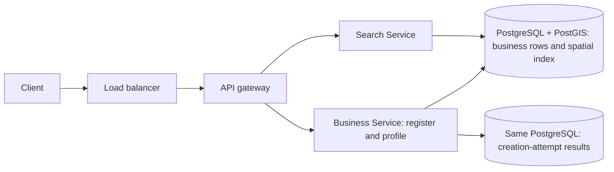
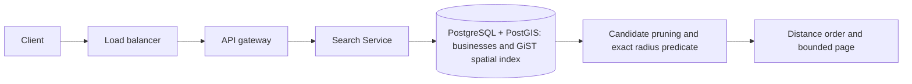
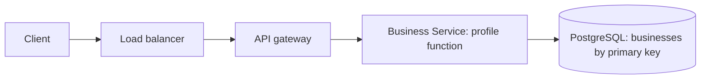
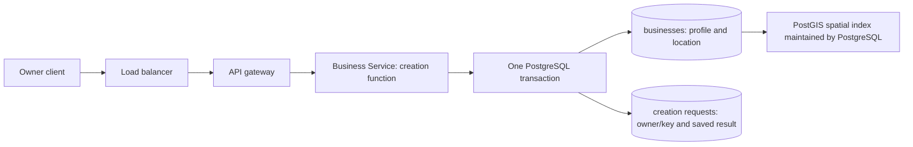
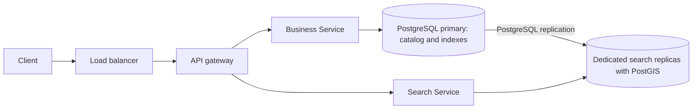

# System flow — Proximity Service

Updated 2026-11-08 after implementation. The local lab runs the three core API paths. The scale and recovery sections describe production variants.

The two-service shape follows the [ByteByteGo public proximity guide](https://bytebytego.com/guides/proximity-service/). The shared PostGIS database and atomic native-index path are this session's choices. The related [Hello Interview proximity article](https://www.hellointerview.com/learn/system-design/deep-dives/proximity-search) informs later index comparisons.

## Overview



Business Service writes the catalog. Search Service reads it. Both use the same initial database; the two state boxes show responsibilities. Owner identity comes from an existing provider or lab mock.

The [Step 3 data model](README.md#data-model) gives the two catalog tables. Business profiles read by primary key. Nearby search uses the spatial index on the stored location.

## 1. Nearby search



```http
GET /v1/nearby?latitude=37.7749&longitude=-122.4194&radiusMeters=3000&limit=20
Body: none
200 OK {
  businesses: [{businessId, name, latitude, longitude, distanceMeters}],
  nextCursor
}
```

Search Service validates the point, radius, limit, and cursor. It queries candidate matches through the spatial index and checks the actual radius. It returns summary fields from the business rows. It does not make a separate profile RPC for every result.

The radius lesson on 2026-11-02 clarifies that rectangle candidates are not final results. Kim Bakery, 2.5 km north and 2.5 km east, is approximately 3.54 km away. The 3 km query must exclude it. Search Service sends one SQL query; PostgreSQL/PostGIS performs candidate pruning and the actual radius predicate internally. ST_DWithin with geography inputs uses meters. ST_Distance supplies compatible geographic distance for display and ordering. LIMIT bounds returned rows, not all candidate work.

Distance ascending and business ID define the order. Search Service returns a cursor bound to the query and its last returned sort pair. The client sends it with the same search parameters. The next query resumes after that pair. The maximum radius is provisionally 50 km. The default page size is 20 and the maximum is 100.

The Geohash comparison uses the same API. Search Service computes a cover of the search circle, reads candidates by cell key, and checks their actual distances. It combines matches across the cells before ordering and paging. A shop across Lee's cell boundary appears if its cell is part of the cover and its distance is within the radius.

The quadtree exercise uses the same search inputs and results. Search starts at the top of the tree, skips cells whose bounds rule out a match, and opens the remaining cells until it reaches leaves. It applies the radius test to their entries. The [technique walkthrough](search-approaches.md#how-each-technique-finds-candidates) compares the candidate step for the other index types.

The coordinate-index comparison uses latitude to select a strip, longitude to narrow it to a rectangle, and geographic distance to qualify the results. The native spatial path can prune groups by geographic bounds before checking distances.

The S2 comparison covers the query with cells. When a cover cell is larger than the stored cells, use the descendant ID range to fetch candidates. Apply the radius check before ordering and paging.

The H3 comparison selects cells that overlap the search region. It reads candidates by the stored cell IDs. The final distance check can include a business whose cell center is outside the radius.

The advanced page uses the same nearby API with the lab header `X-Lab-Search-Mode`. It accepts `quadtree`, `kd-tree`, `s2`, and `h3` alongside the core modes. The response adds `diagnostics` for these four comparison modes. Trees report point and node counts. Cell lookups report sample keys or ranges.

```http
GET /lab/cells
Body: none
200 OK {
  table: "business_cell_keys",
  rows: [{method, cell_id, business_id, name}],
  totals: [{method, total}]
}
```

The browser inspector calls Business Service through the gateway. Business Service reads the cell table and joins it to the business catalog. It returns up to 20 keys per method.

The read-only tree comparison reads the batch index and the recent-change index. Merge candidates by business ID before final filtering and paging. Publish each new batch index together with its covered change position so recent registrations stay searchable during the handoff.

During a primary outage, the production replica variant can serve nearby search within the freshness policy. Business Service can return profiles present on the replica. If a profile miss cannot be confirmed on the primary, it returns 503. Registration returns 503 until a writable primary is available. The client keeps the same idempotency key for retry.

In the tenfold-traffic comparison, Search Service checks a first-page result cache with the full query inputs. A hit returns the cached result. A miss reads PostGIS and stores the result with an expiry within the freshness budget.

During a spike, cache misses pass through global and per-area limits before reaching PostgreSQL. Wait only within a short queue budget. An area limit returns 429. Global overload returns 503. Eligible cache hits can still return results within the freshness policy.

For identical misses, Search Service joins requests already refreshing that key on the same instance. The refresh leader passes through admission, queries PostGIS, and fills the cache. The waiting requests share the result or get a retry response when their deadline expires.

## 2. Business profile



```http
GET /v1/businesses/{businessId}
Body: none
200 OK {businessId, name, category, address, latitude, longitude, updatedAt}
```

The selected path reads the authoritative row by ID. Profile caching remains a later measured alternative. A missing ID returns 404.

## 3. Owner registration



```http
POST /v1/businesses
Authorization: Bearer <owner session>
Idempotency-Key: <creation-attempt key>
Body: {
  name: "Sunny Coffee", category: "cafe", address: "100 Market Street",
  latitude: 37.7750, longitude: -122.4194
}
201 Created {businessId, status: "created", createdAt}
```

The server validates fields and derives ownerId from authenticated identity. It checks the attempt key and persists the business and completion result together. PostgreSQL updates the native index during the write. After commit, a fresh matching query on the primary can see the row. We do not rebuild the complete index per registration.

The native index follows the business commit. In the separate search variant, the same transaction saves an outbox job with the business. A worker reads the job, upserts the search document by business ID, and marks the job complete after a successful write. If the worker crashes first, the job can be retried. The normal visibility target is five minutes.

The lab writes S2 and H3 lookup rows with the business and receipt in the same PostgreSQL transaction. This lets both pages search a new business immediately after commit.

## 4. Failure and retry path

```mermaid
sequenceDiagram
  participant C as Owner client
  participant L as Load balancer
  participant G as API gateway
  participant B as Business Service
  participant P as PostgreSQL and PostGIS
  C->>L: POST /v1/businesses with attempt key
  L->>G: route request
  G->>B: authenticated creation
  B->>P: save business plus attempt result; index maintained
  P-->>B: COMMIT succeeds
  Note over B,C: response is lost
  C->>L: repeat same key and body
  L->>G: route retry
  G->>B: repeated creation
  B->>P: load matching saved attempt result
  P-->>B: original business ID
  B-->>C: original creation result through gateway and load balancer
```

Business Service claims the unique owner/key pair, creates the business, and saves the response in one transaction. A simultaneous retry waits on the unique insert. After the winner commits, the retry reads the saved response from the primary and compares its request fingerprint. If the winner rolls back, the retry can claim the key. The retention period remains a policy choice.

The client generates one UUIDv4 per new submission and saves it with the pending request. A retry sends that UUID again. A deliberate new submission uses a fresh UUID, even if it names the same storefront. A storefront uniqueness policy would apply at the business catalog.

Invalid input returns 400. Missing owner authentication returns 401. Conflicting attempt-key reuse returns 409. Missing business returns 404. An unavailable dependency can return a retryable 503. A successful empty geographic match remains 200.

Sources: [PostgreSQL index maintenance](https://www.postgresql.org/docs/current/indexes-intro.html), [PostGIS radius predicate](https://postgis.net/docs/ST_DWithin.html). The diagrams are original.

## 5. Read-capacity variant — 2026-11-02

This is a production planning comparison, not an implemented topology or a capacity claim. The initial lab remains one database server with native indexing.



The existing API shapes remain the same. Registration and initial profile reads use the primary. Nearby searches use replicas in this variant. Replication adds a freshness delay; monitor it against the proposed normal five-minute target.

Two tables on the primary do not provide this separate server capacity. Native database replication also differs from a custom search projection. The latter requires its own reliable propagation path.

See [the read-capacity comparison](search-approaches.md) and [PostgreSQL standby behavior](https://www.postgresql.org/docs/current/hot-standby.html).

## 6. Region loss

For the production durability exercise, registration waits for the commit to reach durable storage in the primary region and a designated standby region. The transaction contains both the business and the saved creation request. Eligible reads can use a surviving replica. Fence the old primary and replay the surviving log before routing writes to the promoted database. Resume new successful registrations when the required remote confirmation is available. See the [final design flow](final-design-flow.md).
