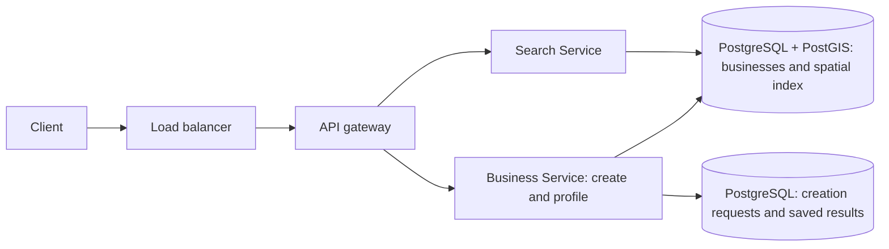

# Proximity Service

**Status:** Implemented

**Sources:** Alex Xu, System Design Interview, Vol. 2, Ch. 1; [ByteByteGo — Proximity Service](https://bytebytego.com/guides/proximity-service/); [Hello Interview — Proximity Search](https://www.hellointerview.com/learn/system-design/deep-dives/proximity-search) (related technical reference)
**Slug:** `proximity-service`

**Session started:** 2026-11-01. The interview, local lab, and follow-up questions are complete.

Notes use original sentences and follow [ASD-STE100](https://www.asd-ste100.org/). The five-step interview remains user-first.

## 1. Requirements and design scope

### Problem

Design a service that helps Lee find businesses near a location. For example, Lee searches for businesses within 3 km of a point in San Francisco.

**Step 1 prompt:** Give three lists: functional requirements, non-functional requirements, and features below the line. State assumptions for business count, query rate or daily users, search latency, availability, and how soon business changes must appear. The teacher will review the answer before step 2.

**Source boundary:** The public ByteByteGo guide covers nearby business search and business information. It does not provide traffic numbers or a below-the-line list. Session targets will be labeled as assumptions. The author's [Volume 2 reference list](https://github.com/alex-xu-system/bytebytego/blob/main/system_design_links_vol2.md) confirms the chapter title. The full paid chapter was not read in this turn.

No standalone Proximity Service product breakdown appeared in the Hello Interview index checked for this session. Its Proximity Search article supplies related technical material. Its Yelp product breakdown is a separate later question in this repo. Do not import Yelp's review requirements, exclusions, or traffic targets as this chapter's requirements.

### Functional requirements

1. Search for businesses within a radius of a latitude/longitude point. The point can be the device location or another selected location. Return bounded pages, with distances and a continuation cursor.
2. Open a business profile by its stable business ID.
3. Let an authenticated business owner register a business with its profile fields and coordinates.

Search means geographic proximity in this chapter. Business-name search, category filters, ratings, and reviews are deferred to Yelp. A category can still be a displayed profile field. The geographic query does not need a category input. Named cities and addresses must first resolve to coordinates; that resolution service is outside the initial path.

### Non-functional requirements

The learner selected 10 million businesses, 100 million daily users, low search latency, high availability, and eventual consistency. We retain those numbers for this narrower scope. They are this session's chosen workload, not numbers supplied by the public ByteByteGo proximity guide.

| Area | Target or assumption | Meaning |
| --- | --- | --- |
| Catalog | 10 million businesses | Mostly static locations; business records change less often than searches |
| Users | 100 million daily active users | A user count does not establish requests per second |
| Search workload | Assume five searches per user per day | 500 million searches/day; about 5800 searches/s on average |
| Initial design peak | Assume five times average | About 29000 searches/s; not a measured production limit |
| Search latency | Proposed p95 at most 500 ms at the API | At least 95 percent of searches finish within this server-side budget at the design peak |
| Availability | Prioritize usable search and detail reads | A delayed catalog projection can remain usable; unavailable valid data yields an explicit retryable error |
| Freshness | Proposed visibility within five minutes under normal conditions | A recent catalog change can take time to appear; the target needs monitoring and later failure policy |
| Durability | Persist confirmed owner registrations and retain the catalog across restarts | Search indexes can be rebuilt from durable catalog data |
| Local lab | Small data and controlled failures | No claim that local Docker proves the production traffic or latency targets |

The five-search workload, peak factor, percentile, and five-minute freshness target are teacher proposals. They are explicit defaults for this session and can change if the learner requests it. Business-profile reads and retries add traffic beyond this search-only estimate. Owner registrations are a separate write workload. Its rate is not supplied yet; do not infer it directly from daily search users.

#### Traffic: plan for a peak, not only the average

Suppose Lee performs five nearby searches during a day. One hundred million users produce 500 million searches. Divide by 86400 seconds to get about 5800 searches/s. A five-times multiplier gives about 29000 searches/s. The multiplier is a session assumption. The source does not give this chapter's peak.

- **Option A — Size only for the average.** This keeps initial capacity costs lower. A busy period can exceed the budget and increase queues or errors. It fits a workload whose peaks are small or can wait.
- **Option B — Budget for the stated peak.** Test at about 29000 searches/s and measure queueing, errors, and tail latency. This costs capacity and load-test work. It fits the selected interactive search workload.

**We pick Option B.** The design point is about 29000 search requests/s. We will select components in step 2. Tenfold traffic and hotspots remain step 4 probes.

#### Latency: define what low means

Lee waits for one nearby result page. The API budget covers request handling and its dependencies. Device networking and rendering add to the caller's experience.

A percentile describes a share of requests. A p95 value is the time within which 95 percent of requests finish. An average can hide a slow minority.

- **Option A — Track only average latency.** The metric is simple. Many searches can still be slow while the average looks acceptable. It fits coarse reporting, not our full user-experience target.
- **Option B — Track latency percentiles at the design peak.** Use p95 at most 500 ms, error rate, and saturation metrics. This requires histograms and a realistic test workload. It fits interactive search.

**We pick Option B.** This session uses p95 at most 500 ms for the search API. We will not claim this target from an idle local request.

#### Availability and freshness: define what may lag

Lee can still search while a new business waits for the search view to catch up. Eventual consistency means the readable views converge after communication and update processing recover. It does not permit permanent missing updates.

An authoritative catalog holds the accepted business records. A search projection is a derived view used to answer queries. Step 1 left the physical layout open. Step 2 below selects one PostgreSQL/PostGIS database initially.

- **Option A — Require the newest catalog state on every read.** Lee immediately sees each committed change once the read can complete. This can couple reads to update work or an unavailable dependency. It wins when freshness matters more than read availability.
- **Option B — Allow a prior committed view while updates catch up.** This can keep reads usable. Lee can briefly miss a new shop or see an older location. It needs a freshness target and recovery process. It fits mostly static businesses.

**We pick Option B.** The proposed normal visibility target is five minutes. That value is a session choice. It would not fit live driver tracking. We will cover stale closures, moves, and index updates in the deep dive.

High availability still needs redundancy and failure handling in the design. If we cannot serve a valid result, the API returns a clear error. Empty matches and a failed query are different outcomes.

#### Durability: distinguish catalog data from a rebuildable index

Losing an application process must not erase the business catalog. A lookup structure can be temporary if we can rebuild it from durable records.

- **Option A — Keep the only catalog copy in process memory.** This is easy for a disposable demonstration. A restart loses the data or needs a complete reload. It does not meet the catalog durability target.
- **Option B — Keep durable catalog records and rebuildable lookup state.** This adds persistence, backup, and recovery work. It fits the ten-million-business design and a lab whose data survives application restart.

**We pick Option B.** We will choose the database in step 2. Owner registration now supplies catalog records through the product API. Existing imports and lab fixtures can also supply records. Edits, deletion, and an administrative console remain deferred.

#### Owner registration: distinguish saved from searchable

Lee owns Sunny Coffee and submits its name, address, display category, and coordinates. The service validates the owner identity and fields. It durably saves the business and returns its stable ID. Registration cannot succeed only in application memory.

The creation response confirms saved catalog state. Search visibility is a separate contract. The business profile can read the authoritative catalog; a derived search view may catch up later.

- **Option A — Require immediate search visibility before success.** The new listing appears in nearby queries when creation succeeds. This can couple registration to index work and its availability. It fits a simple database with a transactional spatial index, or a stricter visibility requirement.
- **Option B — Allow search visibility to follow durable creation.** Lee receives a saved business ID while a separate search view can lag. This needs reliable propagation if the design uses separate stores. It fits the accepted eventual-consistency requirement.

**We pick Option B as the API guarantee.** The existing normal visibility target is five minutes. This does not require a queue or worker. One database can update its own index in the same transaction and make the listing visible sooner. Step 2 will choose the physical path.

Creation retries need an idempotency key: an identifier for one requested creation attempt. A lost response must not create another business for that same attempt. Detecting two independently submitted listings for the same real business is a different product problem and remains deferred.

### Scope

These are this session's exclusions. The standalone public proximity guide has no formal below-the-line list. Hello Interview's separate Yelp list does not govern this chapter.

| Excluded feature | Why it stays outside this chapter |
| --- | --- |
| Reviews, comments, ratings, and rating averages | They add a separate user-write and aggregation path; cover them in Yelp |
| Business-name search and category filters | They add query matching and filter combinations; cover them in Yelp |
| Business edits, deletion, and an administrative console | Owner creation is now included; the remaining management features are deferred |
| Maps as a product UI | Nearby results can appear in a list; no map tiles or map SDK is required |
| Recommendations and relevance ranking | No personalization or learned ordering is needed |
| Dedicated spam detection and moderation | Defer the moderation platform; retain input validation on owner submissions |
| Detailed privacy/compliance system | Defer that platform; use public business data and retain basic transport protection |
| Live tracking, routes, and travel-time search | Moving entities and road routing belong to later questions |
| City/address resolution | The initial API receives coordinates for the selected location |

For pagination, the proposed result order is distance ascending with business ID as the tie-breaker. This is a basic ordering rule. It does not add personalized relevance or recommendation scoring. Cursor behavior under catalog changes remains a later design decision.

### Core entities

| Entity | Description |
| --- | --- |
| Business | Stable ID, owner ID, name, address, display category, coordinates, creation time, and last update time |
| Owner identity | Existing authenticated identity that owns the submitted listing; full account management is excluded |
| Nearby query | Center point, radius, page size, and optional continuation cursor |
| Search result | Business identity and summary, distance from the center, and page continuation |

### APIs

These are the API contracts for geographic search, business profiles, and owner registration. Step 2 records their components and stores.

```http
GET /v1/nearby?latitude=37.7749&longitude=-122.4194&radiusMeters=3000&limit=20
Body: none
200 OK {
  businesses: [
    {businessId, name, latitude, longitude, distanceMeters}
  ],
  nextCursor
}
```

The client passes the returned cursor on the next request with the same query. The provisional bounds are 0 < radiusMeters <= 50000 and 1 <= limit <= 100. These bounds are session choices to limit work and response size. We will design cursor validity in the deep dive.

```http
GET /v1/businesses/{businessId}
Body: none
200 OK {
  businessId, name, category, address,
  latitude, longitude, updatedAt
}
```

```http
POST /v1/businesses
Authorization: Bearer <owner session>
Idempotency-Key: <key for this creation attempt>
Body: {
  name: "Sunny Coffee",
  category: "cafe",
  address: "100 Market Street",
  latitude: 37.7750,
  longitude: -122.4194
}
201 Created {
  businessId,
  status: "created",
  createdAt
}
```

The server takes ownerId from the authenticated identity. It does not accept a caller-selected ownerId as authority. Profile/account management and legal business-ownership verification are outside this interview. The lab can use mock owner identities.

A 201 response means the catalog record is durably saved. The business ID can identify the saved profile. Nearby search may lag within the proposed normal five-minute visibility target. If saving fails or remains uncertain, the client can retry the same attempt key. A repeat with the same owner, key, and payload returns the original business ID. Reusing the key with a different payload returns 409. Step 2 below records the initial persistence and indexing choice.

A valid nearby query can return an empty businesses list. An invalid input returns 400. Missing owner authentication returns 401 for registration. A conflicting idempotency-key reuse returns 409. A missing business returns 404. An unavailable dependency can return 503 with retry guidance. These are proposed contracts to verify in the later lab.

### Source and scope review

The learner's original broader answer matched Yelp. The learner explicitly chose to keep Proximity Service and defer reviews and text search. The narrower requirements above supersede that broader feature list.

The public [ByteByteGo proximity guide](https://bytebytego.com/guides/proximity-service/) describes nearby search and business details, with business management as another path. The learner later added owner registration. We now include creation, while edits, deletion, and an administrative console remain deferred. Its public text provides no numeric traffic target or formal exclusion list. The author's [Volume 2 references](https://github.com/alex-xu-system/bytebytego/blob/main/system_design_links_vol2.md) identify the chapter. The full paid chapter is not a verified source in this session.

The related [Hello Interview Proximity Search article](https://www.hellointerview.com/learn/system-design/deep-dives/proximity-search) supplies later index comparisons. There is no separate matching product breakdown in the index we checked. The [Yelp breakdown](https://www.hellointerview.com/learn/system-design/problem-breakdowns/yelp) remains a later chapter. Do not attribute our added targets or exclusions to those sources.

## 2. High-level design

### Learner proposal and teacher review — 2026-11-02

The learner proposed two services: Search Service for location queries, and Business Service for registration and profile reads. A listing becomes searchable after its database record and index entry exist.

The split matches the public [ByteByteGo guide](https://bytebytego.com/guides/proximity-service/). The proposal still needs a concrete database, geographic query path, and publication boundary. A search index need not be a separate server or require a full rebuild after every registration.

### Shared components and database choice

- **Option A — One application with two logical modules.** This has fewer deployments and network boundaries. Both modules scale together. It fits a small initial deployment.
- **Option B — Two services with a shared catalog contract.** Search handles location queries. Business handles owner writes and profile reads. The application workloads can scale separately. Two deployments cost more, and sharing a database couples schema changes.

**We pick Option B**, following the learner's service split. The initial data store is PostgreSQL with PostGIS. PostGIS adds geographic types, query functions, and spatial indexing to PostgreSQL. The Business Service owns writes. The Search Service has read access to the business data required by its query.

Two services do not require two databases. This initial shared-database choice is deliberate. It does not remove a future database bottleneck. The 29000 search requests/s target remains a capacity goal to measure, not a demonstrated result for one PostgreSQL server.

| Component | Role |
| --- | --- |
| Client | Register a business, search near coordinates, and open a profile |
| Load balancer | Route across healthy application instances |
| API gateway | Route /v1/nearby to Search Service and /v1/businesses paths to Business Service |
| Search Service | Validate geographic queries, execute indexed radius lookup, and return a page |
| Business Service | Validate owner creation, save retry results, and load business profiles |
| PostgreSQL + PostGIS | Hold business rows, creation-attempt records, primary-key lookup, and the spatial index |
| Existing identity provider / lab mock | Supply the authenticated owner ID for registration |

The primary key supports profile reads by business ID. A GiST spatial index supports geographic candidate lookup. A spatial index organizes lookup work by geographic extent. It helps narrow the candidate set. Exact radius and distance calculations still determine the returned results.



P and R are roles in the same initial PostgreSQL database. They are not two independent database transactions.

### 2.1 Search for nearby businesses

Lee searches within 3000 meters of a selected point.

1. Client sends GET /v1/nearby through the load balancer and gateway.
2. The gateway routes the call to Search Service.
3. Search Service validates coordinates, radius, limit, and any continuation token.
4. Search Service queries PostgreSQL using the PostGIS spatial index.
5. The index narrows possible matches. The distance predicate tests the requested radius.
6. The query orders matches by distance, then business ID, and returns one bounded page.
7. Search Service returns business IDs, display summaries, distances, and a continuation cursor.

The initial query reads summary fields from business rows. It does not call Business Service once per search result. Profile navigation remains a separate Business Service request.

- **Option A — Calculate distance for every business.** This is easy to implement and serves as a correctness reference. Each query can inspect ten million rows. It fits small fixtures or offline checks, not the selected interactive design peak.
- **Option B — Use the database's geographic index.** PostgreSQL/PostGIS narrows candidates and checks the radius. This needs a spatial extension and an appropriate index. It avoids an application-level index copy. It fits mostly static businesses and our current feature scope.
- **Option C — Maintain a separate geographic search representation.** Geohash cells, another spatial store, or a search engine can serve geographic queries independently. This adds storage, propagation, reconciliation, and possible visibility delay. It wins when measured needs justify the separate read system.

**We pick Option B initially.** Ten million businesses and about 29000 peak searches/s make the full-scan path unsuitable as the production plan. The selected query needs load testing over realistic geographic density. Geohash and other structures remain deep-dive and lab comparisons.

| Search option | Main cost | Best fit |
| --- | --- | --- |
| A: Full scan | Distance work across the catalog | Small correctness fixtures |
| B: Native spatial index | Extension, index storage, and query tuning | Initial geographic search |
| C: Separate projection | Propagation, storage, and recovery | Measured need for independent search capacity |

For the proposed location column, use PostGIS geography for point coordinates. ST_DWithin accepts geography distance in meters and can use an available spatial index. We will select exact query, precision, pagination, and index-plan checks in step 3. See [ST_DWithin](https://postgis.net/docs/ST_DWithin.html) and [spatial query guidance](https://postgis.net/docs/using_postgis_query.html).

```http
GET /v1/nearby?latitude=37.7749&longitude=-122.4194&radiusMeters=3000&limit=20
Body: none
200 OK {
  businesses: [{businessId, name, latitude, longitude, distanceMeters}],
  nextCursor
}
```

### 2.2 View a business profile

Lee selects business b123 from the nearby list.

1. Client sends GET /v1/businesses/b123 through the load balancer and gateway.
2. The gateway routes it to Business Service.
3. Business Service reads the business row by primary key in PostgreSQL.
4. It returns the profile or 404 if the business does not exist.

The detail path uses the business ID. It does not run another nearby search.

- **Option A — Read the authoritative row by primary key.** This keeps one source for the profile and avoids cache invalidation. It uses a database read for each request. It fits the initial design.
- **Option B — Cache profiles by business ID.** Repeated reads can avoid some database work. Copies need expiry or invalidation, and can lag. It wins after measurements show enough repeated reads to justify the cache.

**We pick Option A initially.** Business-detail traffic is not quantified yet. We have no measurement that justifies a separate profile cache. Cache design, hot objects, and read replicas remain later component probes.

| Profile option | Main cost | Best fit |
| --- | --- | --- |
| A: Primary-key read | One database lookup per request | Initial profile path |
| B: Cache by ID | Another copy with expiry or invalidation | Measured repeated reads |

```http
GET /v1/businesses/b123
Body: none
200 OK {
  businessId, name, category, address,
  latitude, longitude, updatedAt
}
```

### 2.3 Owner registers a business and makes it searchable

Lee registers Sunny Coffee with a name, address, display category, and coordinates.

1. Client sends POST /v1/businesses with an owner session and a creation-attempt key.
2. The request passes through the load balancer and API gateway to Business Service.
3. Business Service validates the identity and fields. It uses the authenticated owner ID.
4. It checks the owner-scoped attempt key. An identical completed retry returns the saved business result.
5. In one PostgreSQL transaction, it saves the business row and the completed creation result.
6. PostgreSQL maintains the already-created spatial index as the row is inserted.
7. After the commit succeeds, Business Service returns 201 and the business ID.
8. A fresh matching search against this primary can now consider the committed row.

Database migrations create the index structure. Normal registration inserts update it incrementally. We do not rebuild all ten million index entries for each new business. PostgreSQL documents its automatic [index maintenance](https://www.postgresql.org/docs/current/indexes-intro.html).

A listing is searchable when it is eligible for matching queries. Radius filters, sort order, and page size still determine which page contains it.

- **Option A — Commit catalog data and the native index together.** One database maintains the index automatically. This gives an atomic publication boundary and needs no application-level dual write. Search and writes still share database capacity. It fits the initial PostGIS design.
- **Option B — Save the catalog and update a separate search system later.** This lets a separate search store evolve and scale independently. A reliable source event or equivalent change capture must survive the creation commit. A worker can then retry the derived update. This adds lag, recovery state, and operating cost.

**We pick Option A for the initial implementation path.** The five-minute freshness target permits delayed visibility; it does not require delay. The native-index path can provide visibility sooner. The earlier Option B in step 1 described the API's allowed visibility delay, not a mandatory asynchronous topology.

| Publication option | Main cost | Best fit |
| --- | --- | --- |
| A: Native index in the catalog database | Shared database read/write capacity | Initial atomic publication |
| B: Separate search projection | Reliable propagation and visibility lag | Independently operated search store |

There is no outbox requirement just because we have two services. If we add a separate search projection later, catalog commit and durable propagation work need one recoverable boundary. That is a comparison path, not an extra primary-path write.

The saved attempt result and the business row commit together. If the reply is lost after commit, the same owner/key/payload retrieves the same business ID. A conflicting payload for a retained key returns 409. See the concurrent registration retry design in step 3.

```http
POST /v1/businesses
Authorization: Bearer <owner session>
Idempotency-Key: <creation-attempt key>
Body: {
  name: "Sunny Coffee",
  category: "cafe",
  address: "100 Market Street",
  latitude: 37.7750,
  longitude: -122.4194
}
201 Created {businessId, status: "created", createdAt}
```

### What this high-level choice establishes

- Two application services, with Business Service as the writer and Search Service as a reader.
- One initial PostgreSQL database, with a PostGIS spatial index and durable creation results.
- Geographic search returns candidate-filtered, distance-checked results. Profile reads use a primary key.
- Registration does not require a background index worker in the selected native-index path.
- Database choice and service roles are a teacher completion of the learner's sketch. Index mechanics, pagination under change, production scaling, and failure guarantees remain to teach.
- The local lab tests the behavior on small fixtures. Production capacity needs its own load test.

## 3. Low-level design and deep dive

### Data model

The proposed catalog uses these two tables. The examples use readable business IDs such as b123. Use a generated UUID for the actual business ID.

| Table | Columns | Keys and indexes |
| --- | --- | --- |
| businesses | business_id UUID, owner_id text, name text, category text, address text, location geography(Point, 4326), created_at timestamptz, updated_at timestamptz | Primary key on business_id. GiST index on location. |
| creation_requests | owner_id text, idempotency_key UUID, request_fingerprint bytea, business_id UUID, response_status smallint, response_body jsonb, created_at timestamptz | Primary key on (owner_id, idempotency_key). Business ID references businesses. |

Store the location as one point. The API converts latitude and longitude to that point for inserts and returns coordinates from it for reads. The business fields in the table are required. Business Service can stage a creation request with empty result fields while its transaction is open. It fills the business ID, status, and body before committing the business and request together.

Profile reads use the primary key. Nearby search uses the spatial index and checks geographic distance. The continuation token carries the last distance and business ID. Search Service validates it against the search parameters. Begin with one catalog and use Step 4 to decide when to add replicas or partition data.

### Deep dives

### Follow-up: shared reads and search alternatives — 2026-11-02

The learner asked whether search and profile reads overload one PostgreSQL server. The learner also requested an industry comparison.

Two tables on one server still share CPU, memory, storage, and connections. A compact search table can reduce work if profiles are wide. It does not add server capacity. A separate read replica adds read capacity but can lag. A separate search projection adds independent tuning and reliable-propagation work.

The initial lab retains one business table with primary-key and spatial indexes. Dedicated PostgreSQL search replicas are the first production read-capacity variant to evaluate. No replica count or single-server capacity is proven at the estimated 29000 peak searches/s. Business creation remains on the primary. A fresh primary search can see the commit; a replica search can lag.

Read [Geographic search approaches and read capacity](search-approaches.md) for full labeled options, illustrative two-table fields, a replica flow, six algorithm groups, product comparisons, and sources. FAQ records both questions. The six groups are R-trees, quadtrees, k-d/BKD trees, Geohash, S2, and H3. These are a study grouping, not a fixed industry count.

This is an overview. It does not replace the detailed probes below. The later radius lesson records the learner's answer and correction.

### Radius correctness: rectangle candidates versus final results — 2026-11-02

The learner said to return both businesses, use PostGIS to check 3 km, and avoid all ten million distance comparisons.

The second and third points are correct. The first needs a correction. A candidate is a possible match, not a final result. A containing rectangle includes corners outside the requested circle.

| Business | Position relative to Lee | Approximate direct distance | Return for a 3 km query? |
| --- | --- | --- | --- |
| Sunny Coffee | 1 km north | 1 km | Yes |
| Kim Bakery | 2.5 km north and 2.5 km east | 3.54 km | No |

For this small local illustration, the Pythagorean calculation gives sqrt(2.5² + 2.5²), about 3.54 km. It explains the corner error. Production queries use geographic distance, not this planar approximation or road travel distance.

#### Full query path

1. Client sends the selected point and radius to Search Service.
2. Search Service sends one SQL query to PostgreSQL/PostGIS.
3. The spatial index can exclude regions that cannot contain a match.
4. The radius predicate checks the remaining candidates.
5. The query orders matching businesses by geographic distance, then stable business ID.
6. The query returns the first bounded page.

These are logical query responsibilities, not a forced execution order for every PostgreSQL plan. The optimizer selects the physical plan.

For geography inputs, ST_DWithin uses meters and defaults to spheroidal distance. The function includes an index-aware bounding comparison. We do not need an application request for a rectangle followed by another request for each candidate. See [ST_DWithin](https://postgis.net/docs/ST_DWithin.html).

#### Radius-check options

- **Option A — Calculate the distance for every business.** This returns correct circular results when the distance calculation is correct. It avoids a spatial index, but repeats broad work over ten million records. It fits small reference fixtures.
- **Option B — Return rectangle candidates directly.** This saves the final radius test. Kim Bakery incorrectly appears in Lee's 3 km result. It fits a product that requests a rectangle, such as a map viewport, rather than our radius requirement.
- **Option C — Use the spatial index, then the geographic radius predicate.** This narrows candidates and rejects rectangle-corner matches. It costs index storage, write maintenance, and candidate checks. It fits our ten-million-business catalog and radius API.

**We pick Option C for this radius-check comparison.** It implements the native PostGIS search choice from step 2. The planning peak remains about 29000 searches/s. Query selectivity and capacity still need measurement.

| Radius option | Correct for a 3 km circle? | Work or cost |
| --- | --- | --- |
| A: Full distance scan | Yes | Broad distance work across the catalog |
| B: Rectangle only | No | Cheap filter, but includes outside businesses |
| C: Indexed candidates plus radius check | Yes | Index maintenance and distance checks for candidates |

#### First-page SQL shape

This is a design example, not an implemented endpoint. The location column is geography(Point, 4326). Parameter $1 is Lee's geography point.

```sql
SELECT business_id,
       name,
       ST_Distance(location, $1::geography) AS distance_meters
FROM businesses
WHERE ST_DWithin(location, $1::geography, 3000)
ORDER BY distance_meters, business_id
LIMIT 20;
```

ST_DWithin tests whether the business qualifies. ST_Distance supplies the distance for display and ordering. For geography, both use compatible meter-based geographic distance defaults. See [ST_Distance](https://postgis.net/docs/ST_Distance.html).

The index belongs on the stored location column with USING GIST. An available index does not force every query to use it. Check representative plans and maintain statistics. See [PostGIS indexing](https://postgis.net/workshops/postgis-intro/indexing.html).

LIMIT 20 limits the returned page. It does not guarantee that PostgreSQL calculates distances for only twenty candidates. A dense area or broad radius can still create substantial filtering and ordering work.

The API remains GET /v1/nearby with no body. Its response is 200 with business summaries and nextCursor. The example above covers the first page only. Continuation-token details remain a separate probe.

### Geohash coverage — 2026-11-07

The learner correctly said that searching only Lee's cell misses Sunny Coffee. The shop is 50 meters away in the next cell. To make “all nearby cells” precise, select cells whose union covers the full 3 km search circle.

At registration, derive the Geohash from the business coordinates. Store the cell key and keep the coordinates for the final radius check. A shorter Geohash prefix identifies a larger cell. A longer prefix identifies a smaller cell inside it. A fixed-length indexed key supports equality lookups. With longer hashes stored, a shorter prefix can select a group of hashes through a key range. [PostGIS Geohash reference](https://postgis.net/docs/ST_GeoHash.html).

1. Build a geographic bounding rectangle that contains Lee's search circle.
2. At the chosen precision, select every cell that intersects that rectangle.
3. Read candidates through those cell keys. Combine the results and remove duplicates if key ranges overlap.
4. Check actual distance. Order matches by distance and business ID, then return a page.

The rectangle is a conservative cover. It includes the full circle and can include extra area. A shop in a selected cell can still be outside 3 km. The distance check removes it. For a global catalog, the cover must account for longitude wrap and queries near the poles. [Firestore geographic query example](https://firebase.google.com/docs/firestore/solutions/geoqueries).

- **Option A — Query Lee's cell only.** This needs one cell lookup. It misses Sunny Coffee. It fits a request for one cell's contents.
- **Option B — Query Lee's cell and its eight immediate neighbors.** This keeps the cell count bounded. It works for a radius query when those cells cover the full circle. With cells about 1 km wide, the circle can extend past an immediate neighbor.
- **Option C — Compute the full cover from the query radius and cell precision.** This includes cell B and any other cells needed for Lee's 3 km search. More cells can mean more key lookups. It fits a radius API with variable search distances.

**We pick Option C for the Geohash comparison.** The radius decides which cells to look up. Smaller cells can reduce extra candidate rows but increase the number of keys. Larger cells can reduce lookups but return more outside candidates. Compare both costs on dense and sparse locations. The interview default is still the native PostGIS search selected in step 2.

### Technique walkthrough and quadtree choice

The learner asked for a definition and walkthrough of each technique. The [search approaches guide](search-approaches.md#how-each-technique-finds-candidates) explains R-trees, quadtrees, k-d and BKD trees, Geohash, S2, and H3 using Lee's radius request.

The learner chose to split the cell with 5,000 businesses and keep the cell with 5. They proposed a target of 20 businesses in each leaf, which is a cell with no children.

- **Option A — Fixed cells.** Look up the same cell size everywhere. This simplifies addressing. Dense cells can return many extra candidates.
- **Option B — Split dense cells.** Split a leaf into four children when it exceeds 20. Continue within a maximum depth. A leaf can hold more than 20 when points share coordinates. This can reduce candidate work for a narrow downtown search. It adds nodes and insertion work.

**We pick Option B for the quadtree exercise.** Apply the target to each leaf. One search can visit multiple leaves. A depth limit keeps subdivision bounded. The 20-business target is an exercise value for the 5,000-versus-5 example. [D3 quadtree documentation](https://d3js.org/d3-quadtree).

### Paging while a business is added

Page 1 contains Sunny Coffee at 500 m and Kim Bakery at 800 m. Ada Books at 1,200 m comes next. A new café at 300 m appears before page 2. A fresh query now orders the new café, Sunny Coffee, Kim Bakery, and Ada Books. An offset of two starts again at Kim Bakery. A saved local copy can show Ada Books if the first request fetched it.

- **Option A — Offset.** Skip the first two rows of the current result. This supports direct page numbers. An insert near the start shifts the positions and can repeat a result.
- **Option B — Cursor based on the last result.** Search Service sends a token that records the last returned distance and business ID. The next query starts after that pair in sort order. This supports sequential pages with independent requests. New results before the cursor appear on a fresh search.
- **Option C — Prefetch or save a result snapshot.** Keep a copy of the original ordered results so later pages show that list. This provides a stable view. It costs extra transfer and client memory, or server storage with an expiry policy.

**We pick Option B.** It returns bounded pages for this search API. It avoids the repeat in the 300 m insertion example. Lee sees Ada Books on page 2. The contract permits a fresh query to see new catalog entries, so a frozen result list is optional. [PostgreSQL LIMIT and OFFSET](https://www.postgresql.org/docs/current/queries-limit.html).

Search Service issues an opaque token that binds the normalized search center and radius to the last sort pair. It validates the token when the client sends it back. The next query applies the same radius predicate and then compares the pair (distance_meters, business_id) with the last pair using greater-than. Sort in that same order. Preserve the actual sort distance in the token. The displayed rounded distance can hide ties or place the boundary at the wrong position. When distances tie, the business ID gives a stable order. [PostgreSQL row comparisons](https://www.postgresql.org/docs/current/functions-comparisons.html#ROW-WISE-COMPARISON).

Each request runs a fresh query through the connection pool. Read up to the page size plus one to detect another page. Use the last returned row to create the next token. The cursor tracks position in the order, and the data can change between requests.

### Registration retries after a lost response

The learner proposed a client idempotency key and database uniqueness. The client creates one key for the registration attempt and reuses it after a timeout. Business Service takes the owner ID from the authenticated session. PostgreSQL enforces uniqueness for the pair (owner_id, idempotency_key).

- **Option A — Store the key on the business row.** A unique owner/key pair and a request fingerprint on that row can identify the original business. This saves a table and fits a single creation operation. Retry history and the business record share a lifecycle.
- **Option B — Store a creation request separately.** Keep the owner/key pair, a fingerprint of the normalized request fields, the business ID, and the original response. This uses another row per creation. It keeps retry data separate from the profile.

**We pick Option B for owner registration.** Commit the creation request and the business together. Use the primary for the write and the retry lookup.

1. Lee submits the Sunny Coffee request with key register-7.
2. Business Service starts a PostgreSQL Read Committed transaction and tries to insert the owner/key pair into creation_requests. Use INSERT ON CONFLICT DO NOTHING RETURNING to tell whether it claimed the key.
3. The transaction that claims the key creates b123 and saves the response in the request row. The result fields can be empty while the transaction is open. The service fills them before commit.
4. After commit, Business Service returns the saved 201 result. If the response is lost, the client resends the same key and fields.
5. A competing insert for the same owner/key waits for the first transaction to finish. If the first commits, the retry reads the completed request in a separate SQL statement. Matching fields replay the saved result. Different fields return 409.
6. If the first transaction rolls back, it loses both its claim and the business row. Another request can claim the key and create the business.

The unique constraint resolves simultaneous requests. A separate SELECT after a conflicting INSERT gets a fresh statement snapshot in Read Committed mode. Keep the creation transaction short and use a bounded wait. If the outcome is unclear, the client can retry with the same key. Key retention defines the period during which the server can replay the result. Its exact duration remains a policy choice. [PostgreSQL unique constraints](https://www.postgresql.org/docs/current/ddl-constraints.html#DDL-CONSTRAINTS-UNIQUE-CONSTRAINTS). [PostgreSQL Read Committed behavior](https://www.postgresql.org/docs/current/transaction-iso.html#XACT-READ-COMMITTED).

#### Creation request fields and new submissions

The following row shows a completed Sunny Coffee submission.

| Column | Example | Purpose |
| --- | --- | --- |
| owner_id | lee | Owner from the authenticated session |
| idempotency_key | 550e8400-e29b-41d4-a716-446655440000 | Client-generated UUID for one submission |
| request_fingerprint | SHA-256 of the normalized request | Detect changes to the submitted fields |
| business_id | b123 | Reference to the created business |
| response_status | 201 | Original status for an identical retry |
| response_body | JSON with businessId, status, and createdAt | Original response to replay |
| created_at | Time of the first attempt | Record the age of the retained request |

Use (owner_id, idempotency_key) as the composite primary key. Use PostgreSQL's uuid type for the key and the catalog's business ID type for business_id. Business Service fills the result fields before it commits the transaction that creates the business. A later retry can replay the saved response while the row is retained.

The client generates a random UUIDv4 before sending a new submission. It keeps that UUID with the pending submission and reuses it after timeouts. A deliberate new submission gets a fresh UUID. If Lee is trying to finish an earlier submission, resume it with its saved key. [RFC 9562, UUID version 4](https://www.rfc-editor.org/rfc/rfc9562.html#section-5.4).

- **Option A — Accept new submissions with new keys.** A second key starts a separate creation. This supports multiple locations and leaves real-world duplicate detection outside the retry mechanism. Two fresh submissions for the same storefront can both succeed.
- **Option B — Enforce one listing per storefront.** Use an authoritative storefront identifier and a uniqueness constraint in the business catalog. A duplicate creation can return a conflict and direct the owner to the existing listing when authorized. This requires a policy for establishing storefront identity. A name alone is insufficient because a chain can use it at several addresses.

**We pick Option A for this scope.** The retry promise applies to the same owner and retained key. A product rule for duplicate storefronts would use Option B in addition to the retry key.

### Recovery when the search index is a separate store

The learner proposed saving the index and the business record together. Compare where the index lives and what the transaction can commit.

- **Option A — Use PostgreSQL's native index.** PostgreSQL maintains the spatial index during the business insert. The committed row is available to a matching query on the primary. This keeps publication in one database.
- **Option B — Use a separate index with a durable job.** Store the business and an indexing job in the same PostgreSQL transaction. A worker publishes the job to the search store afterward. This provides separate search capacity and introduces propagation delay and retry work.

**We pick Option B for the separate-store exercise.** Option A is our initial search design.

An outbox is a table that stores work to send after commit. The transaction creates b123, saves the registration result, and inserts an outbox row with an event ID, business ID b123, event type BusinessCreated, and creation time. The worker can find the committed row even if Business Service crashes before it sends a notification. [AWS transactional outbox pattern](https://docs.aws.amazon.com/prescriptive-guidance/latest/cloud-design-patterns/transactional-outbox.html).

The worker writes a search document with b123 as its unique key. Use an upsert, which inserts the document if absent and updates the same document if present. For this creation event, each retry writes the same fields. The worker records completion after the search store confirms the write.

| Failure point | Catalog state | Recovery |
| --- | --- | --- |
| Transaction rolls back | Business and job are absent | Client retries the registration with the same request key |
| Business Service crashes after commit | Business and job exist | Worker reads the pending job |
| Worker crashes after index write but before completion | Business exists and job is pending | Worker retries the upsert with b123 |

Lee can open the committed profile while nearby search waits for publication. Track the age of pending jobs against the normal five-minute visibility target. Allow retries after a worker crash, with a claim that can expire if workers process jobs concurrently.

### Coordinate indexes versus a spatial index

In the exercise, the latitude range contains 50,000 of the ten million businesses. The longitude condition narrows those 50,000 to 200 in the bounding rectangle. The numbers illustrate the query path.

- **Option A — B-tree on latitude.** The index orders entries by latitude. The query jumps to the lower bound and scans the matching latitude range. This selects the 50,000 businesses in the east–west strip. Applying longitude separately leaves 200. This can fit a workload with a small latitude range result.
- **Option B — B-tree on latitude and longitude.** This orders entries by latitude first, then longitude within a given latitude. PostgreSQL can check longitude in the index and avoid some table reads. A range on the leading latitude column can still make the index scan broad. The actual scan depends on the plan and the data. [PostgreSQL multicolumn indexes](https://www.postgresql.org/docs/current/indexes-multicolumn.html).
- **Option C — Spatial index on location.** The index organizes bounds in space. The query can skip groups that are too far east or west even if they have matching latitude. This can save candidate work for Lee's radius query. It costs spatial index storage and maintenance. [PostGIS spatial indexing](https://postgis.net/workshops/postgis-intro/indexing.html).

**We pick Option C for our radius API.** The example has many businesses in the latitude strip and far fewer in the rectangle. The 200 rectangle candidates still need the distance check. Corners can extend past 3 km. With geography inputs, ST_DWithin can use the spatial index and apply the geographic radius test in one SQL query. [ST_DWithin reference](https://postgis.net/docs/ST_DWithin.html).

Compare plans on representative dense and sparse data. Check index use, candidate work, and buffer reads. The sample counts do not predict the actual work for a particular PostgreSQL plan.

### S2 parent and child lookups

For the S2 comparison, store businesses under fine cell IDs. A cover for Lee's radius can include a coarse cell P with four children A, B, C, and D. An equality lookup for P misses Sunny Coffee under B.

- **Option A — Expand the cover cell into child keys.** Look up all four keys in this example. This works in an equality-only store. A large gap between levels increases the key count.
- **Option B — Read the descendant ID range.** Use S2's inclusive ID bounds for P. One ordered range can retrieve the stored rows for its descendants. The store must preserve the ID ordering.

**We pick Option B for this ordered-index exercise.** Keep original coordinates for the final radius check. The [S2 walkthrough](search-approaches.md#worked-lookup-when-the-cell-sizes-differ) includes the fixed-level example and covers queries that produce finer cells than the storage level.

### H3 cell centers and boundary overlaps

The learner proposed measuring how much of a cell intersects the circle. The amount of overlap can inform a report. For a radius search, a business in even a small overlap can qualify. Sunny Coffee is 2.9 km away while the cell center is 3.2 km away.

- **Option A — Select cells by center.** This gives a simple assignment for an area report. It misses Sunny Coffee in this case.
- **Option B — Require a minimum overlap percentage.** This can reduce candidate reads for an approximate result. It can miss a business in a small overlap.
- **Option C — Include every overlapping cell.** Use a cover of the whole search region. This may read extra businesses along the edge. The distance test then removes outside candidates.

**We pick Option C for the H3 exercise.** Query overlapping cells at the storage resolution, then apply the geographic radius check. [H3 region functions](https://h3geo.org/docs/api/regions/).

### Index updates and the five-minute freshness target

The learner proposed a Lambda-style model with a 15-minute batch index. The 9:00 tree cannot find Sunny Coffee, which Lee registers at 9:01. A short delay is acceptable. The normal target puts Sunny Coffee in search by 9:06. Waiting until a 9:15 rebuild starts takes about 14 minutes before build and publication time.

- **Option A — Rebuild the read-only index on a schedule.** Readers use the old snapshot until a new one is ready. This keeps the read path simple. It fits the freshness target only if the schedule, build, and publication fit within the allowed delay.
- **Option B — Keep a batch index and a small index of recent changes.** The batch job rebuilds the main tree every 15 minutes. A worker reads committed registration jobs and indexes new businesses soon after commit. Search queries both indexes, merges matches by business ID, checks distance, and orders the results. This fits the faster freshness target if the worker keeps up. It adds a second lookup and a handoff between generations.
- **Option C — Maintain the native spatial index on each insert.** PostgreSQL updates the spatial index during registration. A fresh matching primary query can see the row after commit. This fits our catalog and radius API. Each insert pays the index maintenance cost.

**We pick Option B for the read-only tree exercise and Option C for our initial design.** The 15-minute batch cadence can coexist with a five-minute freshness target when the recent-change index handles the gap. [Batch and speed layers](https://learn.microsoft.com/en-us/azure/architecture/databases/guide/big-data-architectures). [PostgreSQL index maintenance](https://www.postgresql.org/docs/current/indexes-intro.html).

For the handoff, build the new base from a consistent snapshot with a matching position in the durable change stream. Publish the new base and that position together. Keep later changes in the recent index. Keep the old generation available to readers that already started. For example, if the new base includes changes through 9:15, a business registered at 9:16 stays in the recent index. Use the recorded change position to decide what the base covers. The clock times in this example illustrate the order.

R-tree searches follow all groups whose bounds can overlap the query. An insertion can enlarge an affected group's bounds or split a full node. Native maintenance handles that work without rebuilding the complete index per registration. With a Lucene BKD index, new documents can form new index segments and become visible after a reader refresh. Later segment merges combine smaller segments. A separate search deployment must also account for the delivery delay from the catalog to the index. [PostGIS spatial indexing](https://postgis.net/workshops/postgis-intro/indexing.html). [Lucene IndexWriter](https://lucene.apache.org/core/10_3_1/core/org/apache/lucene/index/IndexWriter.html).

### Source coverage to teach before closing

There is no matching standalone Hello Interview product breakdown in the index checked for this session. The related [Proximity Search article](https://www.hellointerview.com/learn/system-design/deep-dives/proximity-search) provides this minimum technical coverage. These headings are not marked taught merely because they appear here.

| Source heading | Session coverage and decision |
| --- | --- |
| Custom Spatial Trees | Traversal by bounds and lifecycle compared with native maintenance and a read-only base plus recent changes |
| Quadtrees | Adaptive splitting, leaf target, depth limit, and coincident points taught; measured tuning pending |
| k-d Trees and BKD Trees | Axis splits, leaf blocks, new segments, reader refresh, and merges taught |
| R-trees | Bounds, overlapping groups, insert maintenance, and node splits explained |
| Encoded Keys | Fixed keys, prefix and descendant ranges, and complete coverage taught with Geohash, S2, and H3 |
| Geohash | Covered prefixes, precision, boundaries, complete cover, and final distance filtering |
| S2 | Spherical hierarchy, complete cover, and coarse-to-fine lookup taught with equality and range options |
| H3 | Hexagonal grid, logical hierarchy, and overlap coverage taught with a center-versus-edge example |
| Which Should You Use? | Choose native PostGIS for the radius API and catalog transaction. Compare full scans and encoded cells in the lab. Evaluate the measured workload and scaling alternatives in Step 4. |

Step 3 also covered coordinate indexes, exact radius and distance order, paging during inserts, retryable owner creation, and separate index recovery. Step 4 covers dependency failures, 10x traffic, rush hour, hotspots, and regional failure. The lab will compare the important feasible variants.


## 4. Component questions and special situations

### Specific components

What happens if this piece fails, is slow, or is wrong? Point at [COMPONENTS.md](COMPONENTS.md).

#### Primary outage with a readable replica

The learner chose replica search, a missing response for a new profile, and service unavailable for registration. Replica search and temporary write failure fit this case. A replica miss cannot establish that a business registered 30 seconds ago is absent when the replica is one minute behind.

| Request | Behavior while the primary is down |
| --- | --- |
| Nearby search | Read a healthy replica within the accepted freshness budget. Return matches from that view. |
| Business profile | Return a profile the replica can serve. If the row is absent and the primary is unreachable, return 503. Return 404 when an authoritative lookup confirms the row is absent. |
| Business registration | Return 503 until a writable primary is available. The client keeps its idempotency key and retries. |

- **Option A — Fail all catalog requests.** This keeps the outage policy simple. It discards useful read capacity and fits cases that require fresh reads for every operation.
- **Option B — Serve eligible reads and defer writes.** Use replica data for nearby search and available profiles. Treat an unconfirmed profile miss as temporary. This keeps browsing available within the accepted lag and adds routing and lag monitoring.
- **Option C — Promote a standby.** Restore writes after verifying the candidate meets the durability policy and preventing the old primary from accepting writes. A lagging asynchronous standby may lack acknowledged commits. Failover adds coordination and verification.

**We pick Option B while the primary is unavailable and Option C when failover is safe.** The one-minute search lag is inside the five-minute normal target in this scenario. As the outage continues, check the available replica against the read policy. A short outage does not turn an unconfirmed miss into a 404. [PostgreSQL hot standby](https://www.postgresql.org/docs/current/hot-standby.html). [PostgreSQL failover](https://www.postgresql.org/docs/current/warm-standby-failover.html).

### Special situations

#### Tenfold search traffic and p95

The exercise raises nearby traffic from 29,000 to 290,000 searches per second. Search Service CPU is 35% and PostgreSQL CPU is 95%. Search p95 exceeds 500 ms. The learner proposed a cache and measuring the request-to-response time.

- **Option A — Cache repeated search results.** Check the cache before querying PostgreSQL. Cache a first page under its normalized center, radius, and page size. Serve hits from the cache. On a miss, query PostgreSQL and store the result briefly. This helps if requests repeat and adds a cache lookup on misses. Allocate cache age and replica lag within the freshness budget. [Cache-aside and expiry](https://docs.aws.amazon.com/AmazonElastiCache/latest/dg/Strategies.html).
- **Option B — Add search read replicas.** Spread indexed queries across additional database servers. This helps when requests have many different locations and the cache hit rate is low. Replicas cost capacity and can lag. Benchmark each replica with the actual query mix.

**We test Option A first for the learner's workload hypothesis.** At 290,000 requests per second, a 90% hit rate would leave about 29,000 misses per second if each miss makes one query. This is an illustration. Measure the hit rate and the database's sustainable miss load. Favor Option B when misses dominate or still exceed safe capacity. If we cache geographic candidates by cell instead, check the exact center and radius per request.

Measure elapsed time from API request to response. For 1,000 measured requests sorted by time, p95 is around the 950th value. Compare before and after at the same offered load and with the same mix of locations, radii, and repeated requests. Test warm and cold caches. Track achieved throughput, p95, error and timeout rates, hit rate, database query rate, and database CPU. The change meets the latency goal when p95 is at most 500 ms at the target load with acceptable errors and freshness. [Prometheus percentile guide](https://prometheus.io/docs/practices/histograms/#quantiles).

#### Rush hour and sudden overload

The learner proposed caching the business list for a location and caching individual profiles. An exact result cache helps requests with the same inputs. At the concert, people have different search centers, so many queries still miss. A profile cache helps profile views. The nearby query already returns summaries in one spatial query.

- **Option A — Rely on cached results.** Serve repeated requests cheaply. If search centers differ, cache candidate businesses for geographic cells instead. Read cells that cover each request and check the exact distance before sorting. This reuses candidates across nearby requests and can read extra rows. Cold and unique searches still need database capacity.
- **Option B — Combine caching with limits on database work.** Serve eligible cache hits. Give cache misses a global in-flight limit and a per-area budget. Use a short bounded queue and reject excess work when the budget is used. Keep capacity for other areas. This adds admission logic and some requests receive a retry response. It protects latency for accepted requests while replicas start.

**We pick Option B for the spike.** Use the search center to assign a request to an area for admission. This area groups demand. The radius and candidate cover still control the geographic result. Return 429 when the area exhausts its budget and 503 when the service reaches its global overload limit. The client can retry after a short delay. Watch queue wait, accepted and rejected request rates, and p95 by area. [Google SRE overload handling](https://sre.google/sre-book/handling-overload/). [HTTP 429](https://www.rfc-editor.org/rfc/rfc6585.html#section-4).

#### Hot cache key at expiry

The learner correctly counted 500 copies of the same spatial query if every miss goes to PostgreSQL. They proposed grouping the requests. This is request coalescing, also called singleflight.

1. Look up the cache key for the exact query.
2. On a miss, check whether a refresh for that key is in progress. One caller starts the refresh. The other callers join it.
3. Run the query within the database work budget. Save the result in the cache before the refresh completes. Give the waiting callers the same result.
4. Bound wait time. If the refresh fails or takes too long, return a retry response. Keep the admission limits in force for any later refresh.

- **Option A — Group requests inside each instance.** A burst of 500 misses on one instance can use one query. With ten instances, each may start one query for that key. This is simple and reduces duplicates without shared coordination. [Go singleflight](https://pkg.go.dev/golang.org/x/sync/singleflight).
- **Option B — Coordinate across instances with a shared lease.** One instance acquires an expiring claim for the key and checks the cache again before it queries PostgreSQL. Other instances wait briefly for the cache fill. Expiry permits another instance to take over after a crash. This adds coordination and can still allow overlapping refreshes during failures. Only the current owner should publish a fill or release the claim. Keep the query deadline within the lease and retain database limits. [Redis lock guidance](https://redis.io/docs/latest/develop/clients/patterns/distributed-locks/).

**We pick Option A as the initial cache policy.** Measure duplicate fills across the fleet. Use Option B if that remaining work threatens the database budget.

#### Region loss and confirmed registrations

The primary returns 201 for Sunny Coffee at 9:01. The region fails 30 seconds later. A standby one minute behind can lack both b123 and its saved creation request. If the service promotes that copy and accepts Lee's retry, it can create a different business ID. The original acknowledged listing and retry result can be lost together.

- **Option A — Acknowledge after a local commit and replicate asynchronously.** This gives faster registrations and lets writes continue during a cross-region link failure. It accepts the possible loss of recent acknowledged changes during failover.
- **Option B — Wait for durable replication to a standby in another region.** Save the business and creation request in one transaction. Return 201 after the commit is durable in the primary region and the designated failover region. This meets the exercise's durability requirement. It adds network latency and delays or blocks successful registrations when the required standby is unavailable. [PostgreSQL synchronous replication](https://www.postgresql.org/docs/current/warm-standby.html#SYNCHRONOUS-REPLICATION).

**We pick Option B when 201 must survive one region loss.** PostgreSQL synchronous commit with a named remote standby can wait for durable log flush there. That confirmation is sufficient for durability. A search read can still wait for the standby to replay the change. Keep the normal five-minute search target separate from the write confirmation. [PostgreSQL synchronous commit modes](https://www.postgresql.org/docs/current/runtime-config-wal.html#GUC-SYNCHRONOUS-COMMIT).

Serve eligible reads from a surviving region. Verify the standby has the confirmed history, fence the old primary, replay the durable log, and then route writes to the new primary. Restore the remote confirmation path before returning new 201 responses under the same two-region policy. During uncertainty, return a retryable response and keep the client's key. If a retry finds a locally committed result with uncertain remote confirmation, verify that result on the standby before replaying 201. [PostgreSQL failover](https://www.postgresql.org/docs/current/warm-standby-failover.html).

The [final design flow](final-design-flow.md) records the services, schemas, and failure paths.

## 5. Summary and future improvements

Search Service queries PostgreSQL with PostGIS. It returns business IDs and summaries in distance order. The client opens a full profile by ID through Business Service. Registration saves the business and creation request together. A retry with the same owner, key, and fields returns the saved result.

For more search capacity, test cache reuse first. Add read replicas if query misses still dominate. Use another region for regional failover or geographic latency. If a 201 must survive one region loss, confirm the transaction durably in both regions before returning it.

Measure dense and sparse queries, replica lag, and peak capacity before choosing replica counts or a partition plan. The [final design flow](final-design-flow.md) records the API paths and schemas.

## 6. What we implemented

The browser UI uses an nginx gateway, two FastAPI services, and one PostgreSQL database with PostGIS. Compare PostGIS, full scan, and Geohash with the same query. Open a result to load its profile. Each action shows the HTTP request and response.

The registration form saves a client-generated UUID with the submission. The lost-reply control returns a simulated 503 after commit. Retry the saved submission to recover the same business ID. The inspector shows recent rows in both PostgreSQL tables. Load examples to add five sample businesses. Remove examples deletes only those sample rows.

The local stack uses mock owners and one database. The cache, replicas, regional failover, and alternate search deployment remain production design exercises.

Eight integration scenarios and three functional tests passed. They cover geographic boundaries, matching results across methods, candidate metrics, pagination, concurrent registration retries, and recovery after a lost reply. Browser verification covered search comparison, profile lookup, and both table inspectors.

### Advanced search comparison

Open the [advanced page](http://127.0.0.1:8430/advanced.html). It runs one radius query with PostGIS, Quadtree, k-d tree, S2, and H3. Each card shows the candidate method, results, and the HTTP trace. The page includes a method chooser. The [search approaches guide](search-approaches.md#algorithm-comparison) covers the mechanisms and product options.

- **Quadtree and k-d tree** build in Search Service memory from up to 5,000 catalog points. The cards show nodes visited and candidates. The reported time includes reading and building the tree on each request.
- **S2 and H3** use a PostgreSQL lookup table named `business_cell_keys`. It has one key per business and method. Business Service fills missing keys on startup and saves keys with new businesses in the registration transaction.
- **S2** stores level 13 IDs and reads ordered descendant ranges for cover cells. **H3** stores resolution 7 IDs and reads cells that overlap the search cover. The H3 demo uses PostGIS for covers that touch a pole or cross the date line and labels that path.
- **BKD** appears in the chooser as a search engine design option. A production search engine can keep its own index and receive catalog updates through a worker.

The lab uses one database and its existing services. The extra table lets you inspect the cell-to-business mapping for two schemes without duplicating business profiles. Each search uses the stored coordinates for the final radius check.

## Local implementation

Run these commands from the Proximity Service question directory.

```bash
./scripts/setup.sh
./scripts/run-scenarios.sh
./scripts/run-functional.sh
```

Open the [local lab](http://127.0.0.1:8430/). Run `./scripts/stop.sh` to stop the services and keep the PostgreSQL volume.

## Interview checklist

- [x] 1. Requirements, numbers, and scope reviewed
- [x] 2. High-level design documented for each functional requirement
- [x] 3. Low-level / deep dive with tradeoffs
- [x] 4. Component probes and special situations (traffic, rush hour)
- [x] 5. Summary and future improvements
- [x] 6. What we implemented (after tests)
- [x] 7. User questions at the end, recorded in FAQ/README
- [x] 8. Stack stopped with `./scripts/stop.sh`
- [ ] FAQ practiced out loud

## Session notes

### 2026-11-01

- Began the next learning-path question after Google Drive. Read HANDOFF, AGENTS, all numeric rules, and the existing topic documents. Confirmed a clean worktree with no local commits ahead of origin/main.
- Prepared the nearby-business example and asked the learner for the three scope lists. Step 1 answer is pending. No solution or database was chosen.
- Reviewed the official ByteByteGo proximity guide and author reference list. Opened Hello Interview's related Yelp and Proximity Search pages. Source-specific scope and performance numbers must remain distinct.
- Step 1 answer received: the learner proposed nearby or selected-location search by name/category, business details with reviews, and review submission. The learner selected 10 million businesses, 100 million daily users, low search latency, high availability, and eventual consistency. Proposed exclusions include recommendations/ranking, business administration, map rendering, spam handling, and detailed privacy work.
- These proposed features match the broader Yelp question. Asked whether to practice Yelp now or retain the narrower Proximity Service scope. Chapter selection is pending; do not treat either scope as locked or advance to high-level design yet.

- Scope resolved: the learner chose Proximity Service and deferred reviews and text search. The base query uses coordinates and radius; name search, category filters, ratings, and reviews stay in Yelp. Business administration remains excluded.
- Step 1 teacher review covers average and peak requests, latency percentiles, read availability, catalog freshness, durability, and each exclusion. Explicit teacher defaults: five searches/user/day, five-times peak, p95 500 ms, normal visibility within five minutes, radius at most 50 km, and page size at most 100.
- Wrote proposed search/profile contracts and logical flow charts. No database or deployment split is selected. Step 2 now awaits the learner's search and business-detail request paths.

- Scope amendment: the learner added business-owner registration. The product now has nearby search, business profiles, and authenticated owner creation. This supersedes the earlier read-only/catalog-fixture-only scope. Other management operations remain deferred.
- Creation returns 201 after durable catalog save. Nearby visibility can lag within the proposed five-minute normal target. The owner comes from trusted identity. Retries use a stable attempt key and return the same business ID. The physical index/propagation mechanism remains a step 2 choice.
- Step 2 now requires one happy path for each of the three features, including registration and how a saved business becomes searchable.

### 2026-11-02 — High-level design

- Learner proposed Search Service and Business Service. Search owns geographic queries; Business owns owner registration and profile reads.
- Teacher selected PostgreSQL/PostGIS with a native GiST spatial index as the initial default. The two services share a deliberate catalog contract. No full-index rebuild occurs for each registration.
- Taught one happy path and labeled options per functional requirement. Native-index maintenance and the saved creation result belong to the registration transaction. A fresh matching query on the primary can see a committed row. Eventual visibility allowance does not force asynchronous propagation.
- Recorded full scan, separate geographic projection, and profile cache alternatives. One database meeting 29000 searches/s is not a tested claim.
- Wrote high-level-design-comparision.md with verified-source limits and Uber H3 production evidence. Listed the related Hello Interview index headings as pending deep-dive coverage.
- Step 3 next: explain why storing latitude/longitude alone is insufficient for efficient radius search, and how a candidate filter followed by exact distance should work. Implementation has not started.

### 2026-11-02 — Read pressure and geographic search choices

- Answered the learner's shared-table concern. Separated schema layout from physical capacity. Compared one indexed table, two same-server tables, dedicated read replicas, and an independent search projection.
- Retained the initial native-index lab default. Added search replicas as the first production read-capacity variant to evaluate. Replica searches can lag; primary reads retain the earlier visibility rule. No capacity or fixed replica count is claimed.
- Recorded six geographic algorithm groups and product choices in search-approaches.md and FAQ. These are not a market-share survey or a fixed count of all possible approaches.
- Clarified that a cell library is not a complete database. Candidate coverage must not omit matching businesses. Exact distance filtering cannot repair an incomplete cover.
- Full index mechanics, pagination, failure, scale, and region probes remain pending. No code or infrastructure changed.
- Follow-up clarification: Option A means PostgreSQL with the PostGIS extension installed and enabled. Search Service sends geographic SQL to that database. We must create the location column and spatial index; enabling PostGIS alone does not create table indexes. No separate PostGIS server is required. FAQ records the answer.

### 2026-11-02 — Radius correctness

- Learner correctly identified PostGIS radius checking and the cost of scanning ten million businesses. Corrected the proposed final inclusion of both rectangle candidates: Sunny Coffee is 1 km away; Kim Bakery is approximately 3.54 km away and must be excluded.
- Taught full scan, rectangle-only results, and indexed candidates plus a geographic radius predicate. Picked Option C within this radius-check comparison. This implements the existing native PostGIS default.
- Recorded one-query SQL with geography inputs, ST_DWithin for qualification, ST_Distance for display/order, and a stable business-ID tie-breaker. The first-page limit does not cap candidate work at twenty.
- Candidate filtering and final checking run inside PostgreSQL/PostGIS. No per-candidate application RPC is needed. Exact geographic distance differs from the local planar teaching calculation and from road travel distance.
- Next user-first probe: explain why a spatial-tree branch covering distant New York can be skipped for Lee's San Francisco query. Other spatial variants and remaining deep dives still need detailed teaching.
- Term clarification: the learner asked what branch means. Defined it as a section of the index tree, including a group and its descendants. Added a geographic grouping example and explained bounding-region exclusion. City labels are illustrative, not manual partitions. Full tree mechanics remain in progress; FAQ records the explanation.

### 2026-11-07 — PostGIS interview depth

- Explain how to create the spatial index and how a radius query uses it. PostgreSQL maintains the index as rows change. The index narrows the candidates. PostGIS checks the requested radius for those candidates. Leave the tree-building algorithm and distance formula to the database. The FAQ records this distinction.

### 2026-11-07 — Geohash boundary search

- The learner identified that Sunny Coffee is missed by a home-cell lookup and proposed searching nearby cells. Defined nearby cells by complete coverage of the 3 km circle.
- Compared one cell, a fixed neighbor ring, and a cover based on radius and precision. Picked the full cover for the Geohash comparison. Recorded how key lookups, candidate filtering, and cell size affect query work.

### 2026-11-07 — Spatial technique walkthrough

- The learner asked how the six techniques work. Expanded the existing search approaches guide with the shared 3 km example, mechanics, and tradeoffs.
- The learner chose to split the 5,000-business quadtree cell and keep the five-business cell. Adopted 20 as the exercise target per leaf. Added a maximum depth and an exception for points that share coordinates.

### 2026-11-07 — Search paging

- The learner proposed using local results and sending a cursor. Explained that a prefetched list can show Ada Books, while a fresh offset query repeats Kim Bakery after the 300 m insertion.
- Chose a cursor based on distance and business ID for sequential pages. Each request uses the same search parameters and continues after the last returned pair. Compared a frozen result snapshot for callers that require a stable list.

### 2026-11-07 — Registration retry

- The learner proposed a client idempotency key and database uniqueness. Chose an owner-scoped unique key in creation_requests. The transaction that claims the key saves the business and the result together. An identical retry returns the saved response for b123.
- Compared a key on the business row with a separate creation request. Recorded concurrent inserts, rollback, and a 409 response for reuse with different fields.
- Added the creation request fields and a client-generated UUIDv4. Distinguished retrying a saved submission from starting a new submission for the same storefront. A storefront uniqueness rule would belong in the catalog.
- Compared a native index with a separate search store. For the separate store, save an outbox job with the business and retry the search upsert by business ID after a worker crash.

### 2026-11-07 — Coordinate indexes

- The learner asked how a regular index differs from the spatial index. Compared a latitude-only scan, a compound coordinate index, and a spatial index using the 50,000 versus 200 example. The 200 rectangle candidates still require the 3 km distance test.

### 2026-11-07 — S2 lookup

- The learner asked how a larger S2 cover cell finds businesses stored under smaller IDs. Compared enumerating child keys with an ordered descendant range. Chose the range for the S2 ordered-index exercise.

### 2026-11-07 — H3 overlap

- The learner proposed using an overlap percentage. Compared center selection, minimum overlap, and complete overlap. Chose complete overlap before the final distance test so the shop at 2.9 km appears even when its cell center is 3.2 km away.

### 2026-11-07 — Index freshness

- The learner proposed a 15-minute Lambda-style index. Clarified that the 9:00 tree misses the 9:01 registration and a scheduled rebuild alone misses the five-minute target. The base plus recent-change variant queries both indexes and hands off by a recorded change position.
- Compared the custom index lifecycle with native PostGIS maintenance and Lucene segment refresh and merges. Retained the native index for the initial design.
- Consolidated the catalog tables and indexes at the end of Step 3. Proposed UUIDs for business IDs. Started Step 4 with an outage of the primary and a reachable read replica.
- Chose replica reads during a primary outage. An unconfirmed profile miss returns 503. Registration returns 503 until writes recover, and retries reuse the original key. Resume writes after a safe failover.
- Compared a search result cache with read replicas for tenfold traffic. Explained p95 using request-to-response time. Test the cache at the same offered load and measure misses, database CPU, errors, and freshness.

### 2026-11-08 — Rush hour

- The learner proposed caching area lists and profiles. Compared exact result caching with shared cell candidates. Chose cache hits plus bounded admission for misses. Global and per-area limits leave room for searches outside the concert area.
- The learner counted 500 identical queries at one cache expiry and proposed grouping them. Compared in-process coalescing with a shared lease. Chose in-process coalescing first.
- Reviewed the region-loss case as the learner moved to the recap. For the exercise that requires survival of one region loss, chose durable cross-region confirmation before 201. Wrote the final design flow and opened Step 5.

### Local lab and index storage

- Built and verified the local lab. The three search methods read the same business rows. PostGIS can use a GiST index on location. Geohash can use a B-tree on a generated cell key. The full scan checks row distances directly.
- Answered how a cell leads to a business ID. Sunny Coffee and Ada Books share Geohash `9q8y`. The index can find both rows. Search reads each business ID from its row. See the [FAQ](FAQ.md#where-do-the-search-indexes-store-business-ids).
- Reviewed the shared table for ten million businesses and one million daily active users. At five searches per user per day and a five-times peak, estimate about 290 peak searches per second. Validate the chosen server and query mix before adding read replicas. The FAQ keeps this scenario separate from the 100-million-user interview estimate.
- Added the advanced page at the learner's request. Compared Quadtree, k-d tree, S2, and H3 with the PostGIS default. Added the cell-key table inspector and a method chooser. Backfilled the existing businesses.

### 2026-11-08 — Session closed

- The learner verified the advanced page and closed the chapter. End-of-session questions cover index storage, the shared catalog, Geohash coverage, and the advanced method chooser. Nearby Friends is next in the learning path.
- Ran the stop script and verified that the named PostgreSQL volume remained.
