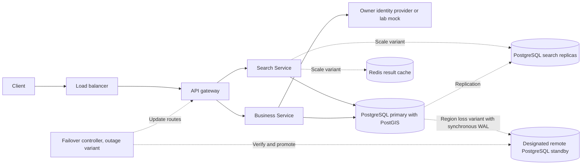
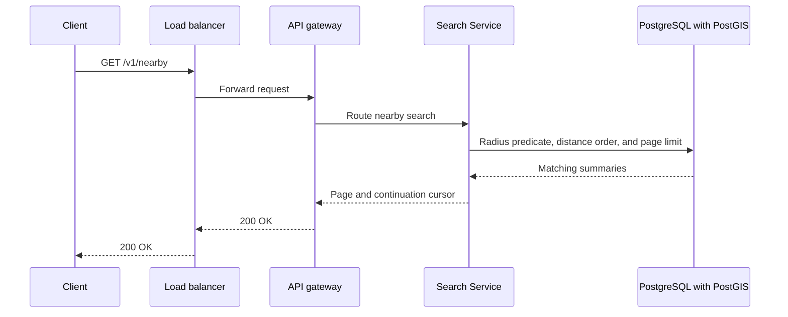
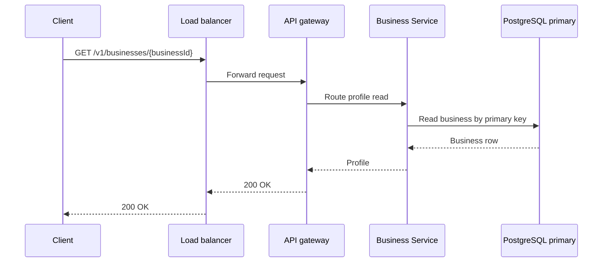
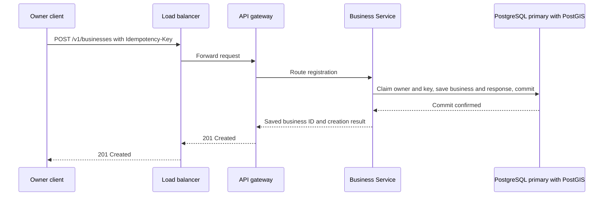

# Proximity Service final design flow

Steps 1 through 4, recorded 2026-11-08. The core design uses a shared PostgreSQL catalog with PostGIS. The scale and failover variants add the boxes marked in the overview. The local lab uses one PostgreSQL server for the catalog.

The service split follows the public [ByteByteGo proximity guide](https://bytebytego.com/guides/proximity-service/). The search comparisons use the topics in [Hello Interview's proximity search article](https://www.hellointerview.com/learn/system-design/deep-dives/proximity-search). The diagrams describe our design.

## Overview



The normal search target is p95 at most 500 ms. The normal visibility target is five minutes. Use the estimated 29,000 peak searches per second as a planning input and 290,000 for the tenfold exercise. Measure those targets on representative data.

## Nearby search



```http
GET /v1/nearby?latitude=37.7749&longitude=-122.4194&radiusMeters=3000&limit=20
Body: none
200 OK {businesses: [{businessId, name, latitude, longitude, distanceMeters}], nextCursor}
```

The client can pass `cursor` for the next page with the same search center and radius. Validate the coordinates and limit the radius to 50 km. Use a default page size of 20 and a maximum of 100. The cursor records the last distance and ID. The next query continues after that pair. An empty match set returns an empty list.

PostGIS uses spatial candidates and `ST_DWithin` for the final radius test. Order matches by `ST_Distance` and business ID. In the scale variant, try a first-page result cache and send misses to eligible read replicas. Coalesce identical fills per instance. Bound database work globally and by area during spikes. [PostGIS radius predicate](https://postgis.net/docs/ST_DWithin.html).

## Business profile



```http
GET /v1/businesses/{businessId}
Body: none
200 OK {businessId, name, category, address, latitude, longitude, updatedAt}
```

A confirmed absence returns 404. During a primary outage, Business Service can return a profile found on an eligible replica. An unconfirmed miss returns 503.

## Owner registration



```http
POST /v1/businesses
Authorization: Bearer <owner session>
Idempotency-Key: <client-generated UUIDv4>
Body: {name, category, address, latitude, longitude}
201 Created {businessId, status: "created", createdAt}
```

Business Service validates the fields and derives the owner ID from the session. PostgreSQL maintains the native spatial index during the insert. A retry sends the original key and request. A match returns the saved response. A key with changed fields returns 409. The production regional variant requires durable confirmation from the designated remote standby before returning 201.

## Services

| Name | When it runs | What it does |
| --- | --- | --- |
| Load balancer | Each HTTP request | Sends traffic to a healthy application entry point |
| API gateway | Each HTTP request | Routes nearby requests to Search Service and profile and registration requests to Business Service |
| Search Service | Nearby search | Validates parameters, fetches candidates, and returns distance order and a cursor |
| Business Service | Profile and registration requests | Reads the profile and commits the business with its saved retry result |
| Owner identity provider or lab mock | Authenticated registration | Establishes the owner ID |
| PostgreSQL replication | Production read scaling and regional durability variants | Copies database changes to standbys for reads and failover |
| Failover controller | Outage variant | Verifies standby readiness, blocks writes on the former primary, and changes the writer route |

## Stores and schemas

### PostgreSQL catalog with PostGIS

| Table | Columns | Primary key and indexes |
| --- | --- | --- |
| businesses | business_id UUID, owner_id text, name text, category text, address text, location geography(Point, 4326), created_at timestamptz, updated_at timestamptz | Primary key on business_id. GiST on location. |
| creation_requests | owner_id text, idempotency_key UUID, request_fingerprint bytea, business_id UUID, response_status smallint, response_body jsonb, created_at timestamptz | Primary key on (owner_id, idempotency_key). business_id references businesses. |
| business_cell_keys, lab comparison | method text, cell_id text, business_id UUID | Primary key on (method, cell_id, business_id). Unique (business_id, method). business_id references businesses. |

The result fields in creation_requests can be empty inside the transaction that claims the key. Fill them before commit. The committed response and business are stored together.

The production read replicas and remote standby have the same schemas and indexes. The remote standby confirms durable log flush for the region-loss policy. A read requires replay before it can see the new row. If the remote outcome of an earlier local commit is uncertain, confirm the matching creation request remotely before replaying 201. [PostgreSQL synchronous replication](https://www.postgresql.org/docs/current/warm-standby.html#SYNCHRONOUS-REPLICATION).

### Redis result cache for the scale experiment

| Key | Value | Lifetime |
| --- | --- | --- |
| nearby:first:v1:<normalized center, radius, limit> | Business summaries, continuation sort pair, and freshness metadata | Expires within the remaining visibility budget after source lag |

Search Service uses one in-flight fill per key on each instance. The cache stores data derived from the catalog. Use a global admission budget and an area budget for misses. During overload, return 429 for the area limit or 503 for the global limit.

### Comparison paths

The lab compares full scan and spatial lookup against the same catalog. Its encoded-cell comparison adds a stored `geohash text` column derived from location and a B-tree on that column. The point remains available for the radius check. A separate search store and outbox are alternate deployments described in the interview flow.

The advanced page compares in-memory Quadtree and k-d tree lookup with S2 and H3 on `business_cell_keys`. Business Service saves the lookup keys with the business. The separate search deployment remains a production comparison.

See [FLOW.md](FLOW.md) for the interview sequences and [COMPONENTS.md](COMPONENTS.md) for component responsibilities.
