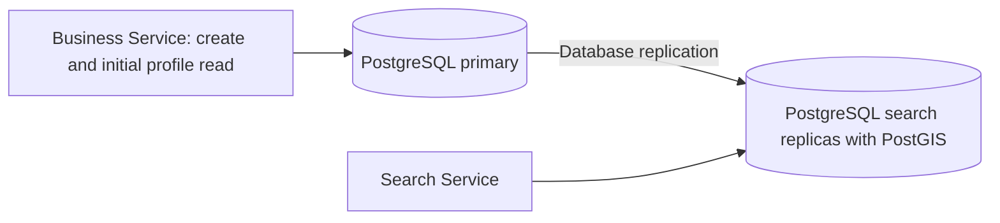

# Geographic search approaches and read capacity

Study follow-up started 2026-11-02. These notes compare search approaches. The core lab exercises PostGIS, full scan, and Geohash. The [advanced page](http://127.0.0.1:8430/advanced.html) adds Quadtree, k-d tree, S2, and H3 and shows what each method maintains.

## 1. Does one table create too much read pressure?

It can. The relevant limit is database capacity, query cost, and concurrency. The number of tables alone does not establish that limit.

The two requests use different access paths:

| Request | Access path | Result |
| --- | --- | --- |
| Lee searches within 3 km | Spatial index, radius check, and distance order | One bounded page of summaries |
| Lee opens business b123 | Primary-key lookup | One profile |

These reads can run concurrently. They do not take turns merely because they read the same table. They still share CPU, memory, storage throughput, and database connections.

The primary-key index supports the profile lookup. The spatial index supports candidate lookup. An index is a database-managed structure; it is not another application table.

Selecting fewer columns reduces result data and application work. PostgreSQL can still read table pages for candidate rows. A narrow SELECT alone does not guarantee an index-only query.

### Separate tables versus separate capacity

| Change | What it can improve | What it does not provide |
| --- | --- | --- |
| Two tables on one PostgreSQL server | Smaller search rows; separate indexes and schema responsibilities | Independent CPU, memory, or storage capacity |
| Two logical databases on one PostgreSQL instance | Namespace and access boundaries | Independent database-server resources |
| Read replica on another server | Additional read capacity; a separate cache and connections | More primary write capacity or automatically faster individual queries |
| Independent search store | Separate search model, tuning, and capacity | Automatic consistency with the catalog |

For example, a two-table design could use these fields:

```text
business_profiles(business_id, owner_id, name, category, address, created_at)
business_search(business_id, location, name, category)
```

These are illustrative field groups, not final schemas. Search summaries duplicate name and category in this example. If the search table contains only ID and location, search needs a join or batch lookup for summaries.

Two tables in the same PostgreSQL database can be updated in one transaction. They do not require an outbox. An independent search store needs reliable propagation or equivalent recovery.

A smaller search table can help if profile rows become large. It also adds another structure to maintain. We need measurements before we claim a benefit.

### Read-capacity choices for this session

- **Option A — One business table with two suitable indexes.** Keep one authoritative row. This minimizes write and consistency work. Both request types share capacity. It fits the initial lab and a measured workload that fits one database deployment.
- **Option B — Two tables on the same database server.** Store a compact location/search representation separately from profile fields. This can improve row density for search. It adds joins or duplicated summary fields. It fits wide profiles when measurements show a benefit.
- **Option C — Dedicated search replicas.** Keep the catalog model and native spatial index. Route nearby queries to PostgreSQL read replicas on separate servers. This adds read capacity and operating cost. Replication can lag. It fits read pressure when the same query model still works.
- **Option D — Independent search projection.** Copy searchable fields into a dedicated store. This provides independent tuning and deployment. It adds durable propagation, retries, reconciliation, and visibility lag. It fits richer search or capacity needs that justify another system.

**We retain Option A for the initial lab. Option C is the first production capacity variant to evaluate.** Option B does not by itself solve server saturation. Option D remains available if the native-query approach does not meet the workload.

The workload is ten million businesses and about 29000 peak search requests/s. No measurement proves that one primary, or any fixed replica count, meets this target.

For production planning, test realistic geographic density, radius, page size, and concurrent requests. Measure p95, CPU, storage reads, candidate counts, connections, and replica lag. Tune queries before selecting replica count.

### Replica request path



Lee registers Sunny Coffee on the primary. Business Service returns 201 after the selected durable commit. A search replica can miss that row until replication catches up.

This delay fits our eventual-consistency allowance if it meets the normal five-minute visibility target. Replication does not guarantee that target without monitoring and a failure policy.

PostgreSQL performs the replication. This path does not require an application outbox worker. Physical replicas retain the primary's database layout and indexes.

Profiles can remain on the primary initially. A later design can route eligible profile reads to replicas too. That decision needs its own freshness policy.

See [PostgreSQL hot standby](https://www.postgresql.org/docs/current/hot-standby.html) for read-only queries and replication delay.

## 2. How many geographic search approaches exist?

There is no fixed industry count. Separate the index algorithm from the product that implements it.

An **index algorithm** determines how the system organizes locations. A **database product** supplies storage, query APIs, concurrency, and recovery around its indexes.

For this interview, compare six useful algorithm groups. This grouping combines k-d trees and BKD trees. It is a study map, not an exhaustive taxonomy.

### Algorithm comparison

| Approach | How it narrows candidates | Strength | Cost or limit | Useful case |
| --- | --- | --- | --- | --- |
| R-tree family | Group objects under bounding regions; skip non-overlapping branches | Mature database spatial queries; points and other shapes | Index storage and maintenance; overlapping bounds can increase work | Native spatial database for our business catalog |
| Quadtree | Split a two-dimensional area into four smaller areas recursively | Dense areas can subdivide more finely | Custom depth, memory, concurrency, persistence, and recovery work | A specialized regional point index or teaching demo |
| k-d tree / BKD | Partition points by coordinate dimensions; BKD stores blocks of points | Point range and nearest-neighbor operations; mature search implementations | Plain trees need update/balance policy; persistent BKD implementations add build/merge work | Existing search libraries or specialized point workloads |
| Geohash | Encode a latitude/longitude cell as a sortable key or prefix | Fits key-range and prefix lookup in ordinary stores | Precision and boundary handling; nearby points can have different prefixes | A distributed cell-to-business index |
| S2 | Cover a spherical region with hierarchical quadrilateral cells | Global geography, region covers, and cell ranges | Covering logic, resolution, and storage design | A worldwide cell-based index with rich region operations |
| H3 | Map locations to a hierarchy of mostly hexagonal cells | Neighbor analysis and geographic aggregation | Cell coverage, resolution, distortion, and exceptional pentagons | Neighborhood statistics, density analysis, and a custom candidate index |

Full scan is the baseline outside this list. It checks every location and is useful for small correctness fixtures. It is not our production plan for ten million rows.

A normal B-tree on latitude/longitude can support some coordinate range filters. It does not by itself implement an exact circular search. Compound-key order affects how much work a range query avoids.

The [coordinate-index exercise](README.md#coordinate-indexes-versus-a-spatial-index) compares a latitude strip with 50,000 entries and a rectangle with 200. A spatial index can skip groups outside the search area before the radius check.

Sources for the algorithm facts: [PostGIS spatial indexes](https://postgis.net/documentation/faq/spatial-indexes/), [D3 quadtree](https://d3js.org/d3-quadtree), [Lucene BKD](https://lucene.apache.org/core/10_3_1/core/org/apache/lucene/util/bkd/BKDWriter.html), [Redis GEO encoding](https://redis.io/docs/latest/commands/geoadd/), [S2 cells](https://s2geometry.io/devguide/s2cell_hierarchy.html), and [H3 introduction](https://h3geo.org/docs/). Fit and cost judgments are this session's design analysis.

### How each technique finds candidates

Use the same request for all six groups. Lee searches for businesses within 3 km. Each index helps find possible matches. The query checks their geographic distance before returning results.

#### R-tree family

Group nearby entries and store a bounding region for each group. Group those bounds again at higher levels. During a search, skip a group when its bounds rule out a match. Open each group whose bounds can overlap Lee's search area. Two groups can have overlapping bounds, so the search may need to open both.

The groups come from the indexed entries. The database maintains the index as rows change. PostGIS uses the PostgreSQL GiST framework for this style of spatial pruning. This fits our database choice. Broad queries and overlapping bounds can increase candidate work. [PostGIS indexing guide](https://postgis.net/workshops/postgis-intro/indexing.html).

#### Quadtree

Start with one rectangle on a local map. When a cell has too many businesses, split it at the horizontal and vertical midpoints. Redistribute the points to the four children. A leaf is a cell with no children. Dense areas can have many levels. Sparse areas can stay shallow.

The learner proposed splitting the cell with 5,000 businesses and keeping the cell with 5. Use 20 as the target per leaf for this exercise. For example, the first split might produce children with 3,200, 1,400, 380, and 20 businesses. Check each child against the same rule.

Set a maximum depth. If 30 businesses share one coordinate, every split places them in the same child. Keep them together in a leaf that can exceed the target. For a radius search, skip cells that cannot overlap the search area. Check points in the visited leaves. The leaf target applies to each leaf. A single search can visit many leaves.

- **Option A — Use one fixed cell size.** The lookup is simple and predictable. The same size applies to the downtown cell and the outskirts. Dense cells can return many candidates, while small cells can increase key lookups.
- **Option B — Split cells by occupancy.** Keep the five-business leaf and split the 5,000-business leaf. Continue when a child exceeds 20 and can still be subdivided within the depth limit. This can reduce candidate work for narrow searches in dense areas. It adds tree nodes and insertion work.

**We pick Option B for the quadtree exercise.** The 20-business target is the learner's example. Use candidate counts, visited nodes, memory, and query latency to tune it. An in-memory implementation can rebuild from the durable catalog after a restart. It needs a policy for serving traffic while the rebuilt tree becomes ready. [D3 quadtree documentation](https://d3js.org/d3-quadtree).

#### k-d tree and BKD tree

A k-d tree splits the point set into two parts using one coordinate at a time. For a two-dimensional example, first split by longitude. Then split each side by latitude. Choosing a median split can keep the number of points on each side similar. For Lee's query, skip parts whose bounds rule out a match.

BKD means block k-d tree. A BKD tree stores groups of points in blocks at its leaves. A search can skip blocks or inspect points in blocks that cross the query boundary. Lucene provides a BKD implementation. Custom k-d trees need a balance and update policy. A block-based search engine also has index build and merge work. [Lucene BKD documentation](https://lucene.apache.org/core/10_3_1/core/org/apache/lucene/util/bkd/BKDWriter.html).

#### Geohash

Encode latitude and longitude as a string. The prefix identifies a rectangular cell. A short prefix identifies a large cell. Adding characters identifies smaller cells inside it. With a fixed prefix length, an ordinary key index can look up businesses in each selected cell.

Sunny Coffee is 50 meters away in the next cell. Select cell keys that together cover the full circle, then check distance. Coarse cells can return more candidate rows. Fine cells can increase the number of keys to read. This fits a store that already supports key lookup or key ranges. [PostGIS Geohash reference](https://postgis.net/docs/ST_GeoHash.html). [Firestore geographic query example](https://firebase.google.com/docs/firestore/solutions/geoqueries).

#### S2

Project six cube faces onto a sphere and subdivide each face into four-sided cells. Each cell has an ID and can be subdivided again. An S2 region coverer can cover a search area with a set of cells, including cells of different sizes.

Store a cell ID for each business. When the cover includes a coarse cell and storage uses fine IDs, read the range of descendant IDs. Use a cover that contains the full search region for the selected distance model. Then check the stored coordinates. S2 suits spherical coverage and searches that benefit from a mix of cell sizes. The service must choose storage levels and handle the resulting key ranges. [S2 cell hierarchy and region covers](https://s2geometry.io/devguide/s2cell_hierarchy.html).

##### Worked lookup when the cell sizes differ

Suppose the business table stores cell IDs at level 13. The cover for Lee's 3 km search includes a larger level 12 cell P. P has four children at level 13. Label them A, B, C, and D. Sunny Coffee is stored under B. The labels illustrate the hierarchy.

Looking up cell_id = P finds zero rows in this example because storage uses level 13 IDs. P still describes the area that contains A, B, C, and D.

- **Option A — Expand P into child keys.** Query A, B, C, and D with an equality list. This works with an equality-only store and is easy for four keys. A larger gap between levels can require many keys.
- **Option B — Read the descendant ID range.** S2 supplies inclusive bounds through range_min and range_max. An ordered index can read stored IDs between those bounds. This avoids enumerating every fine cell and requires storage that preserves S2 ID order. [S2 cell hierarchy](https://s2geometry.io/devguide/s2cell_hierarchy.html).

**We pick Option B for the ordered S2 index exercise.** For a cover cell finer than the storage level, use its ancestor at the storage level as the lookup key. Merge results from the cover, deduplicate overlapping lookups, and check actual distance. A large cell can cover more than the requested area.

#### H3

Divide the globe into cells that are mostly hexagons. Each cell has an ID and a resolution. This grid supports queries such as counting businesses by cell or finding neighboring cells. For radius search, choose cells that overlap a region covering the circle, read candidates by cell ID, and check the stored coordinates.

A cell can overlap the circle even when its center is outside. A center-only polygon fill can miss that cell. Use a cover that includes overlaps. H3's hierarchy defines logical parent cells. The geometric edges of children can cross a parent's outline. Keep that distinction when using coarse cells to route searches. [H3 overview](https://h3geo.org/docs/). [H3 region functions](https://h3geo.org/docs/api/regions/).

##### Worked lookup at the edge of an H3 cell

Lee searches within 3 km. A cell center is 3.2 km away. Sunny Coffee is in the same cell at 2.9 km. A lookup based on cell centers omits the cell and misses Sunny Coffee.

- **Option A — Select cells by center.** This gives a simple cell assignment for area reports. An edge cell can contain matching businesses even when its center is outside.
- **Option B — Require a minimum percentage of overlap.** This can limit extra cells in an approximate report. Any positive threshold can omit a valid business in a small overlap.
- **Option C — Include every cell that touches or overlaps a covering region.** For a polygon API, use a polygon that contains the whole search circle. This can read more cells and candidates. It gives complete coverage for the radius check.

**We pick Option C for the H3 radius exercise.** After fetching candidates by cell ID, check distance to each stored business location. Sunny Coffee qualifies at 2.9 km. [H3 region functions](https://h3geo.org/docs/api/regions/).

### Product comparison

| Product or implementation | Geographic support | Benefit for this case | Added cost or constraint |
| --- | --- | --- | --- |
| [PostgreSQL + PostGIS](https://postgis.net/documentation/faq/spatial-indexes/) | Spatial types, GiST-supported spatial lookup, radius predicates | Catalog and index can share one transaction; mature SQL tools | Query tuning and database capacity planning |
| [MySQL spatial](https://dev.mysql.com/doc/refman/8.0/en/spatial-type-overview.html) | Spatial types and spatial indexes | Fits an existing MySQL catalog | Verify geographic predicates, coordinate system, and index plans for the selected version |
| [MongoDB 2dsphere](https://www.mongodb.com/docs/manual/geospatial-queries/) | Spherical geographic queries on documents | Fits a document-based catalog | Different data model and operational choices; not automatically faster than PostGIS |
| [Elasticsearch](https://www.elastic.co/docs/reference/query-languages/query-dsl/geo-queries) | Geographic filters plus search features | Useful if text search and richer filters enter scope | Another projection and cluster if PostgreSQL remains authoritative |
| [Redis GEO](https://redis.io/docs/latest/commands/geosearch/) | Radius or box queries over geographic members | An in-memory geographic candidate index | Memory, persistence/rebuild policy, and key-based partitioning; basic GEO does not store full profiles |
| Custom Geohash/S2/H3 index | Cell-to-business records in a chosen store | Control over cell partitioning and query routing | Build coverage, ordering, propagation, recovery, and hotspot handling |

Redis GEO accepts a restricted latitude range. Verify coverage before selecting it for a worldwide catalog. One global Redis GEO key also concentrates work on its owning shard. Multiple keys need geographic partitioning and query merging.

PostGIS and Elasticsearch are products. Geohash and H3 are index schemes. They are not mutually exclusive choices at the same layer. A system can store H3 cells in PostgreSQL, for example.

### What the advanced page stores

Quadtree and k-d tree load catalog points and build in memory for each request. They report how many nodes the query visits and how many candidates remain. Production use would need an update or rebuild policy and a warm index.

S2 and H3 read the same `business_cell_keys` table. It stores `method`, `cell_id`, and `business_id`. Its primary key uses all three columns. A second uniqueness constraint allows one cell per business and method. S2 reads ordered ID ranges. H3 reads a set of overlapping cell IDs. Both fetch exact locations from the business table for the final distance check.

This arrangement adds two lookup rows per listing. We use it so the UI can inspect both key schemes in one place. A service could also store one scheme as a column on the catalog, as the core page does for Geohash. A dedicated search deployment adds a store and a change delivery path.

### What every candidate approach must preserve

Lee asks for every eligible result within 3 km, subject to paging. A containing cell or rectangle can include businesses outside that radius.

1. Select candidates with a complete geographic cover.
2. Remove candidates outside the requested distance.
3. Order the remaining businesses by distance and stable ID.
4. Return a bounded page.

Do not query only Lee's Geohash cell. A shop across its boundary can be one meter away. Do not assume one fixed neighbor ring covers every supported radius.

Exact filtering removes false positives. It cannot restore a business omitted by an incomplete candidate cover. H3 cell-center containment alone is not a complete intersection cover; see [H3 region semantics](https://h3geo.org/docs/api/regions/).

### Search-family choices for this session

- **Option A — Use an existing native spatial database.** PostgreSQL/PostGIS handles durable rows, index maintenance, and radius queries. This avoids a custom geographic service. It retains shared database capacity planning.
- **Option B — Build a cell-based projection.** Geohash, S2, or H3 maps cells to business records. This gives control over distributed routing. It requires complete coverage, propagation, ordering, and recovery.
- **Option C — Use a search engine.** Elasticsearch supplies geographic queries with text-search features. It fits a broader Yelp-style product. The present scope excludes text search, so that feature set alone does not justify another cluster.

**We retain Option A with PostGIS.** Ten million businesses need an efficient candidate index. That number alone does not establish which product is fastest. Our narrow geographic scope favors the simpler lifecycle initially.

The lab must compare important feasible alternatives. Full scan and an encoded-cell path are useful comparisons with the native index. These notes do not commit us to running every listed database product.

## 3. Coverage status

This guide records table separation, read capacity, and the mechanics of the six technique groups. Continue the detailed query and lifecycle probes in the README. They include overlapping tree bounds, spherical edge cases, nearest ordering, paging under inserts, updates and recovery, and measured capacity.
