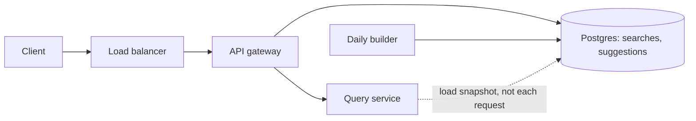
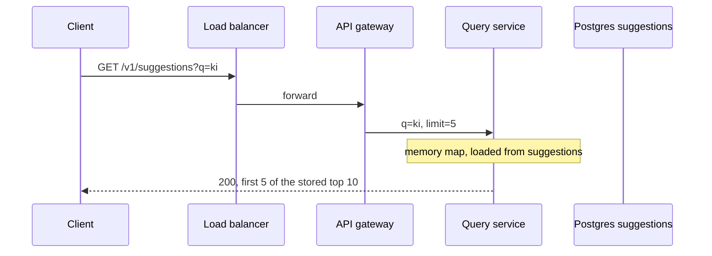
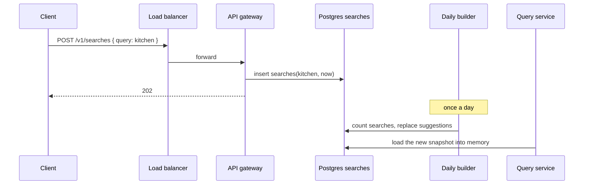
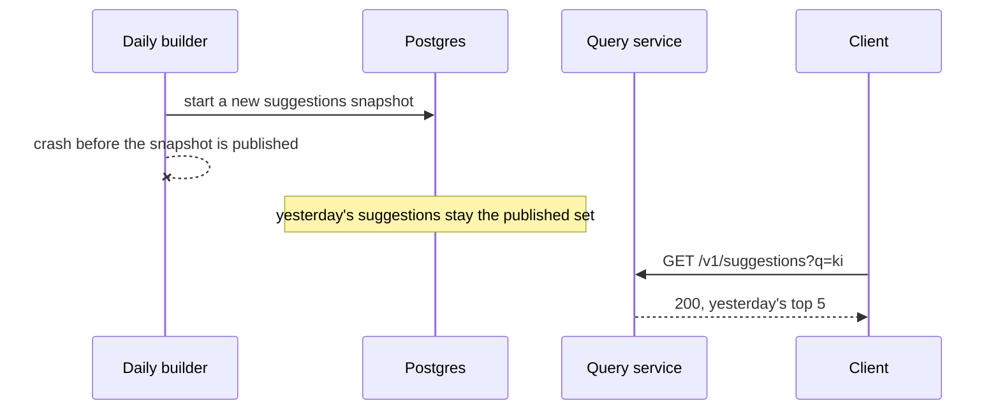

# System flow — Search Autocomplete

The read path and the record path are different speeds. The read uses yesterday's snapshot. The record only appends. Alex Xu Volume 1, chapter 13, is the shape source. These notes are original.

## Overview



## Return the top suggestions

```
GET /v1/suggestions?q=ki&limit=5 -> 200 { suggestions: [{ text, frequency }] }
```



The arrow from the query service to Postgres is not on this request. The service loaded `suggestions` at startup and after each daily build.

## Record a finished search

```
POST /v1/searches -> 202 Accepted { status }
Body: { query }
```



## Failure path: the builder does not finish



Kim still gets a list. The frequencies are one more day old. The `searches` rows she added are still in the log for the next build.
