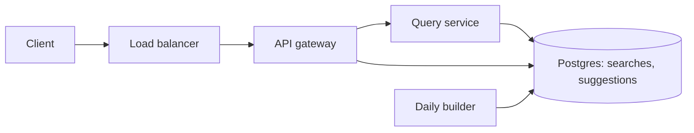
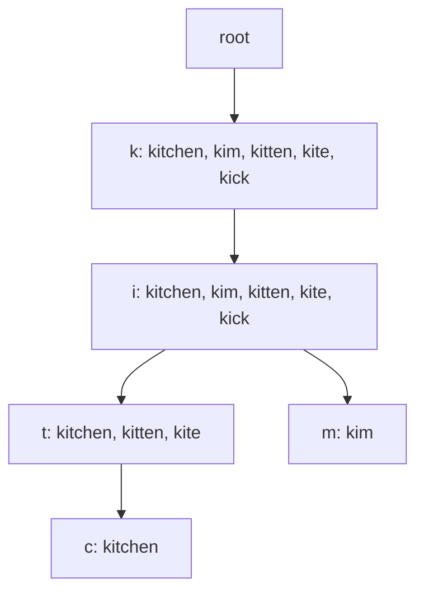

# Search Autocomplete

**Status:** Implemented  
**Sources:** Alex Xu Vol 1 Ch 13. Hello Interview has no problem breakdown for this question.  
**Slug:** `search-autocomplete`

Practice in the five-step interview pattern. Keep notes original; link to Hello Interview / cite Alex Xu instead of copying write-ups.

## 1. Requirements and design scope

### Problem

Kim types in a search box. After she pauses, the box shows the most common full searches that start with what she typed. She types `ki` and sees `kim`, `kitchen`, and `kiosk`.

### Functional requirements

- [x] Return the top suggestions for the characters Kim has typed. The match is the start of the query. The returned text is the full query.
- [x] Return 5 suggestions. The caller may ask for up to 10.
- [x] Sort by how often people have searched that query. Break a tie by alphabetical order, so the order is stable.
- [x] The client waits about 0.5 s after the last key before it calls. The server does not wait.
- [x] Record a finished search, so the frequency can change later. Kim records a search when she presses Enter.

### Non-functional requirements

Alex Xu Volume 1, chapter 13, supplies the scale. The 10 million daily users match this session. The other figures are the chapter's assumptions.

| | Number | Where it comes from |
| --- | --- | --- |
| Daily users | 10 million | This session, and the chapter |
| Searches per user per day | 10 | The chapter |
| Characters per search | 20 | The chapter: 4 words, 5 characters each |
| Requests if every character calls | About 24,000 a second average, about 48,000 at peak | 10 million x 10 x 20 / 86,400, then x 2 |
| Requests if the client calls once per search | About 1,200 a second average, about 2,300 at peak | The 0.5 s pause makes this the common case |
| Time to show the list | About 100 ms after the request | The chapter, from a public note on Facebook's autocomplete |
| New query text per day | About 0.4 GB | The chapter: 20% of queries are new, 20 bytes each |
| Availability | The suggestion call stays up | A list from yesterday is acceptable |
| Consistency | A search Kim just finished need not appear in the next list | Frequency can lag |
| Durability | The log of finished searches survives a crash | The suggestion structure can be rebuilt from that log |

The interview sizes the service for about 48,000 requests a second. That is the per-character peak. The 0.5 s pause is headroom, because a client we do not control can still send every character.

### Below the line

Hello Interview has no problem breakdown for this question, so this list is the chapter's cuts plus this session's cuts.

- **Spell check.** The session and the chapter leave it out. A wrong spelling gets no suggestion, or only queries that share the typed prefix.
- **Languages other than English.** The chapter uses lowercase English. Other languages can wait until the end, if time remains.
- **Characters other than `a` to `z` and space.** The client lowercases letters. It drops digits, punctuation, and emoji before the call.
- **A match in the middle of a query.** The chapter matches only the start. `kit` does not find `my kitchen`.
- **A personal list.** The rank is global frequency. Kim's own history does not change her list. This session's cut.

### Core entities

| Entity | Description |
| --- | --- |
| Query | A finished search string, plus how many times people have searched it |
| Prefix | The characters Kim has typed. It selects the queries |
| Suggestion | One full query returned for a prefix, with its frequency |

### Interface

```
GET /v1/suggestions?q=ki&limit=5 -> 200 { suggestions: [{ text, frequency }] }
```

`q` is the prefix, lowercase `a` to `z` and spaces. `limit` defaults to 5. The maximum is 10. `text` is the full query. `frequency` is the sort key.

### Sort key (session question)

Kim types `ki`. Four queries match.

| Query | Times searched, all time | Times searched, last hour |
| --- | --- | --- |
| kitchen | 5,000,000 | 200 |
| kim | 4,000,000 | 100 |
| kitten | 3,000,000 | 50 |
| kiosk | 20,000 | 15,000 |

- **Option A: Frequency, then alphabetical.** `kitchen`, `kim`, `kitten`. The order is known before the request. Cost: `kiosk` stays off the list while a news event is hot. Wins at 48,000 requests a second, because the top 5 are stored with the prefix.
- **Option B: Alphabetical only.** `kim`, `kitchen`, `kitten`, `kiosk`. Cheap and stable. Cost: a rare query outranks a common one. Wins for a dictionary, not for a search box.
- **Option C: The last hour only.** `kiosk` is first. Cost: yesterday's common searches disappear, and the list changes every build. Wins for a news search.
- **Option D: Kim's own past searches first.** Her list differs from Ada's. Cost: one top-5 list per user, and we cut personal rank in step 1. Wins for a signed-in box, as a later pass.
- **Option E: Frequency plus a recency weight.** A query searched many times this hour moves up, and `kitchen` stays near the top. Cost: a second number to store, and a rule for the weight. Wins when both history and a spike matter.

We pick Option A. The top 5 for `ki` are written when the counts are built. The request only reads them. Option E is the later change if a spike must surface the same day. Option D stays below the line.

```
POST /v1/searches -> 202 Accepted { status }
Body: { query }
```

The call records a finished search. It does not change the suggestion list inside this call. A later build does that.

## 2. High-level design

Two services share one database. The query service only reads. The builder writes a new suggestion snapshot once a day. Alex Xu Volume 1, chapter 13, uses the same split: a data-gathering path and a query path. The chapter rebuilds weekly. This session rebuilds daily, from yesterday's log. The comparison is in [high-level-design-comparision.md](high-level-design-comparision.md).



The query service keeps `suggestions` in memory. A `GET` does not ask Postgres.

### Return the top suggestions

Kim types `ki` and pauses 0.5 s.

1. The client calls `GET /v1/suggestions?q=ki&limit=5`.
2. The load balancer picks a query machine.
3. The query service looks up `ki` in its memory map. The value is the top 10 full queries, already sorted by frequency.
4. It returns the first 5. The call does not sort and does not read Postgres.

| | What the request does | When it wins |
| --- | --- | --- |
| A: Sort in Postgres on the request | `WHERE text LIKE 'ki%'` then order by frequency | A few requests a second |
| B: Postgres row per prefix, top 10 stored | One row read per request | The row is small, and the database can take the rate |
| C: That same row, loaded into memory on each query machine | The request reads RAM | About 48,000 requests a second. This session |
| D: Cache only the hot prefixes | `ki` is fast, a rare prefix still sorts | A few prefixes are most of the traffic |

We pick C. One prefix is about 10 strings, a few hundred bytes. The whole snapshot is rebuilt from about 0.4 GB of new query text a day, so it fits in memory on every query machine. Option B is the same data before the load. Option A does not finish in 100 ms at this rate.

### Record a finished search

Kim presses Enter on `kitchen`.

1. The client calls `POST /v1/searches` with `kitchen`.
2. The gateway appends one row to `searches`. It returns 202.
3. The in-memory map does not change.
4. Once a day the builder counts `searches`, writes a new `suggestions` snapshot, and the query machines load it. Until that load, Kim still sees yesterday's list.

Finished searches are about 1,200 a second on average and about 2,300 at the peak. That is one row per search, not one row per character. One Postgres table can append that.

The last-hour rank stays out of this path. The builder is the place to add it later. The request still only reads a stored list.

## 3. Low-level design and deep dive

Hello Interview has no breakdown, so the probes are the chapter's. The two layouts below are both kept. The interview drawing is the trie. The lab will show the trie and the hash map side by side.

### Data model

`searches`: one row per Enter. Primary key `id`. Columns `query`, `searched_at`.

`suggestions`: the daily snapshot, and the hash map. Primary key (`prefix`, `position`). Columns `text`, `frequency`. `position` is 1 to 10. The list is already sorted.

The query service loads `suggestions` and can build a trie from the same rows. A `GET` uses whichever layout that machine is running. It does not read Postgres.

### The hash map

Kim types `ki`. The key is the whole prefix. The value is the ten queries.

| Prefix | Top queries, by frequency |
| --- | --- |
| `k` | kitchen, kim, kitten, kite, kick |
| `ki` | kitchen, kim, kitten, kite, kick |
| `kit` | kitchen, kitten, kite |
| `kitc` | kitchen |
| `kim` | kim |

The lookup hashes `ki` and returns that row. There is no walk. Postgres already stores this shape, so the load is a copy.

Cost: the key `kitc` repeats the characters that `kit` already has. Each prefix stores its own list, even when the list is the same as its parent. A rebuild writes one row per prefix.

### The trie

A **trie** is a tree of characters. Strings that share a start share the nodes. `kitchen` and `kim` both pass through `k` then `i`. The chapter uses this tree. Each node also stores the top 10 queries that pass through it, so the request stops at the node. It does not visit the children.



Kim types `ki`. The walk is root, `k`, `i`. Two steps. The node `i` already holds the list. The service returns the first 5.

- **Option A: Walk every child and sort.** The node stores no list. The request collects `kitchen`, `kim`, and the rest, then sorts. Cost: more work as the tree under `k` grows. It puts the sort back on the 48,000-request path.
- **Option B: Store the top 10 on the node.** The build writes the list. The request reads it. Cost: extra memory on every node, about 10 short strings. Wins at 48,000 requests a second.

We pick Option B for the trie. It is the chapter's optimization.

### Which drawing the interview uses

| | Lookup | Memory | Fits the snapshot table |
| --- | --- | --- | --- |
| Hash map | One hash of `ki` | The prefix string is stored again at every key | Yes. `suggestions` is this map |
| Trie | One step per character | The character is stored once on the path. The top 10 is still stored on each node | Built in memory when the snapshot loads |

- **Option A: Hash map only.** Easy to read in a table. Cost: repeated prefix strings, and it is not the picture the chapter expects.
- **Option B: Trie only.** One insert of `kitchen` fills `k`, `ki`, `kit`, and the rest in one walk. Cost: harder to inspect than a table.
- **Option C: Both.** Postgres keeps the map. Each query machine builds the trie from those rows at load time. The lab shows the same `ki` lookup in both.

We pick Option C for this session, because the goal is to see both. The interview drawing is Option B. The request still does not sort. A daily load rebuilds both from `searches`.

### The trie is larger than one machine

A split by the leading characters is the right move. The walk for `kitchen` must stay on one machine. If `k` is on machine A and `ki` is on machine B, the walk breaks.

The first character is not an even split. More English queries start with `s` than with `z`. The `s` machine holds more of the tree and more of the 48,000 requests a second.

- **Option A: One bigger machine.** No split. Cost: the tree has a hard ceiling. Wins while the snapshot still fits in RAM.
- **Option B: One shard per first character.** 26 shards. `kitchen` stays on the `k` machine. Cost: `s` is much larger than `z`.
- **Option C: One shard per first two characters.** `ki` and `s` are different machines. `kitchen` still stays on the `ki` machine, because every longer prefix starts with `ki`. Finer than 26, still one walk. Cost: some pairs are almost empty.
- **Option D: Hash the whole prefix.** `k` and `ki` can land on different machines. The walk is impossible. This option loses.

We pick Option C, plus a second copy of each shard. One dead `ki` machine must not blank every `ki` query. The other copy serves yesterday's snapshot, which is already the freshness rule.

### A prefix with no stored query

Kim types `kitchenx`. No stored query starts with `kitchenx`. The service returns an empty list. That part is right.

A long prefix is not the same case. This session stops the walk at 20 characters, the chapter's average query length. The node at depth 20 still holds the top 10 full strings.

Kim types `kitchenaid mixer` (21 characters). The walk stops at the first 20 characters. The service keeps the stored strings that still start with the full text. It does not return empty only because the walk stopped.

- **Option A: Return empty past 20 characters.** Simple. Cost: a real query that is longer than 20 characters disappears.
- **Option B: Filter the list stored at character 20.** The request stays one node read, then a check of 10 strings. Cost: a query that was not in that top 10 is missing, which is already true at every node.
- **Option C: Keep walking with no cap.** The tree holds every extra character. Cost: memory for prefixes people almost never type.

We pick Option B. Option A is only for a prefix that no stored query starts with, such as `kitchenx`.

### The browser already has the shorter prefix

Kim pauses on `k`. The server returns 5 queries, which is a full list.

| Query | Starts with `ki`? |
| --- | --- |
| karate | no |
| kangaroo | no |
| kraft | no |
| kitchen | yes |
| kim | yes |

She types `i`. Only `kitchen` and `kim` remain. That is 2, and she asked for 5. The browser must call. `kitten` can be 6th under `k` and still be 3rd under `ki`, so it was not in the cached 5.

A later pause, on `ki`, returns `kitchen`, `kim`, `kitten`, `kite`, `kick`. She types `t`. All 5 still start with `kit`. Those 5 are the top 5 for `kit`. Any other `kit` query also starts with `ki`, and it already lost to these 5. The browser shows them and does not call.

- **Option A: Always call.** Correct. Cost: a request for every pause, including ones the browser could answer. This is still the capacity plan, about 48,000 a second, because a client may not skip.
- **Option B: Filter the previous list and never call.** Cost: Kim sees 2 rows and misses `kitten`. Wrong when the filtered count is below 5 and the previous list was full.
- **Option C: Call only when the filtered count is below 5 and the previous list was full.** A short list from the server was already everything. Filtering it is safe, even down to empty. A full list that still has 5 matches is safe. Otherwise call.

We pick Option C in the client. The first prefix, `k`, always calls. The server is still sized for Option A. A client we do not control can call every time.

One more case. Kim deletes back to `k`. The `ki` list cannot rebuild the `k` list. `karate` does not start with `ki`, so it was never in that response. The browser uses the `k` response it stored earlier, or it calls.

## 4. Component questions and special situations

### The `ki` machine dies

Kim is typing `kitchen`. The load balancer sends her to the other `ki` machine. That machine already has the trie in memory. She still gets the five rows. A replacement machine loads `suggestions` from Postgres in the background and builds its trie. Her request does not wait for that load, and it does not read Postgres.

- **Option A: Read the hash map in Postgres for this request.** The data is there. Cost: the live path becomes a database read, which step 2 removed so 48,000 requests a second can finish in 100 ms.
- **Option B: Fail over to the second copy.** The copy is already warm. Cost: one copy now carries the whole `ki` shard until the new machine finishes loading.
- **Option C: Return an empty list until the trie is rebuilt.** Simple. Cost: every `ki` dropdown goes blank.

We pick Option B. Option A is how a new machine gets the snapshot, not how Kim gets a list.

### `ki` gets most of the traffic

A memory lookup of the whole 48,000 requests a second is about 10 MB a second of small lists. One machine can do that. The hot-shard problem at today's rate is RAM. The `ki` tree may not fit, while `qz` is tiny.

- **Option A: A cache in front of Postgres.** The trie machines already hold the snapshot. This cache does not shrink the `ki` tree.
- **Option B: Split `ki` one character further.** `kit` and `kim` become different machines. The walk still stays together. Cost: a rule for which pairs get a third character.
- **Option C: More copies of the `ki` trie.** This adds read capacity. It does not shrink the tree. Each copy must still fit the tree in RAM.

We pick Option B at 48,000 requests a second. Option C is the pick when the tree fits and the request rate does not, which is the 10x case below.

### The builder does not finish

The dropdown keeps serving yesterday's snapshot. It is one extra day stale. The `searches` rows are still in the log. The next build that finishes counts both days, so no search is dropped. Reads stay up the whole time.

### Ten times the traffic

About 480,000 suggestion requests a second. The list is the same for every user, and it changes once a day.

- **Option A: More trie copies only.** Works. Cost: origin machines take every repeated `ki` call.
- **Option B: Cache the GET at the edge, then add copies for misses.** The cache key is the prefix. The entry lives until the next snapshot. A repeated `ki` never reaches the trie. Cost: a prefix that nobody has asked yet is a miss.
- **Option C: A cache only in front of Postgres.** Misses the hot path. The hot path is the trie, which is already memory.

We pick Option B. The browser skip stays a client help. The edge cache is the shared one. Copies of the hot shards absorb the misses. Postgres stays off the request.

## 5. Summary and future improvements

### What we designed

Kim types `ki` and pauses 0.5 s. The browser calls only if it cannot answer from a cached shorter list. The gateway sends the call to the `ki` shard. That machine reads the trie in memory and returns the first 5 of the stored top 10. It does not read Postgres on this call. Postgres holds the snapshot the machine loaded.

Kim presses Enter on `kitchen`. One row is appended to `searches`. The trie does not change. The next daily build counts the log, writes `suggestions`, and the query machines load a new trie.

### Main tradeoffs

| Choice | What it gives | What it costs |
| --- | --- | --- |
| Daily snapshot, not a live update | The read stays a memory lookup at about 48,000 a second | A search today is missing until tomorrow |
| Trie in memory, hash map in Postgres | The chapter's walk, and a table we can inspect | A load step that builds the trie |
| Top 10 stored on the node | The request does not sort | 10 strings of memory on every node |
| Shard by two characters, two copies | The walk stays on one machine, and one death is survivable | `s` pairs are fatter than `qz` pairs |
| Browser skip | Some pauses never call | A client that skips wrong hides a real query |
| Edge cache only at 10x | Repeated `ki` calls stay off the trie | One more cache to expire when the snapshot swaps |

### Risks left

The session had no risk in mind. The one that matches the design is a same-day spike. `kiosk` can be searched all day and stay off the list until tomorrow. The edge cache and the browser can also keep a list after a new snapshot is published, unless the cache key includes the snapshot id.

### With more time

Frequency is already the popularity rank. The new work is to fold in today's counts without putting a rebuild on the request.

A **lambda** layout is two paths into one answer. The **batch layer** is the daily snapshot. The **speed layer** is today's counts, folded in every couple of minutes. The **serving layer** reads both.

- **Option A: Wait for the daily build.** The GET stays 100 ms. Cost: today's spike is invisible. This is the interview path.
- **Option B: Rebuild the whole trie every few minutes.** Today's counts show up. Cost: the full log is counted all day, for a small change.
- **Option C: Add today's count onto yesterday's frequency for queries that changed, every 2 minutes.** Only those prefixes get a new top 10. The GET still reads a stored list. Cost: after the daily build includes today, those counts must leave the speed layer or they are added twice.

We keep Option A for the interview. Option C is the add. The couple of minutes is how often the speed layer folds in. It is not the GET latency. The GET stays about 100 ms. Personal rank stays below the line.

## 6. What we implemented

The lab is at http://localhost:8410. Postgres holds yesterday's frequency and the search log. The process keeps a hash map and a trie in memory. A GET reads memory. A POST only appends.

### What you can do

1. Type `ki` and pause 0.5 s. The list is `kitchen`, `kim`, `kitten`, `kite`, `kick`. The hash map and the trie walk are side by side. They agree.
2. Press **POST one search**. The row shows up as pending. The list does not change.
3. Press **Record kiosk 4500 times**, then **Fold now**. `kiosk` moves into the top 5. That is today's count added onto yesterday's 100.
4. Press **Daily build**. Those 4500 move into yesterday. A second fold does not add them again.
5. Card 5 lists prefixes. The seed builds 488 of them.

The design folds every 2 minutes. The lab folds every 20 seconds, and **Fold now** runs the same step at once. Shards, the second copy, and the edge cache are not in the lab. One process holds the whole trie.

### API

```
GET /v1/suggestions?q=ki&limit=5 -> 200 { suggestions: [{ text, frequency }], snapshot, hashMap, trie, layoutsAgree }

POST /v1/searches -> 202 Accepted { status, query, count, folded }
Body: { query, count }  // count defaults to 1. The lab allows a spike.
```

`hashMap` and `trie` are lab fields so the page can draw both layouts.

### Tests

`./scripts/run-scenarios.sh` (4): yesterday's order, no change until fold, `kiosk` rises after the fold, the daily build does not double-count, trie and hash map agree, 488 prefixes.

`./scripts/run-functional.sh` (3): the page has both layouts, GET and POST shapes, a query with no letters is rejected.

### How to run

```bash
./scripts/setup.sh
open http://localhost:8410
./scripts/run-scenarios.sh
./scripts/run-functional.sh
./scripts/stop.sh
```

### Session questions

Recorded in the FAQ: the sort key, hash map and trie, the shard split, a prefix that matches nothing, when the browser skips, a dead `ki` machine, a hot `ki`, a missed build, and the lambda speed layer.

## Interview checklist

- [x] 1. Requirements, numbers, and scope stated out loud
- [x] 2. High-level design that actually works end-to-end
- [x] 3. Low-level / deep dive with tradeoffs
- [x] 4. Component probes and special situations (traffic, rush hour)
- [x] 5. Summary and future improvements
- [x] 6. What we implemented (after tests)
- [ ] 7. User questions at the end, recorded in FAQ/README
- [ ] 8. Stack stopped with `./scripts/stop.sh`
- [ ] FAQ practiced out loud
