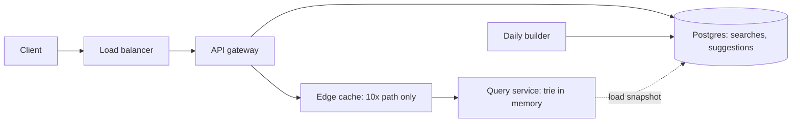
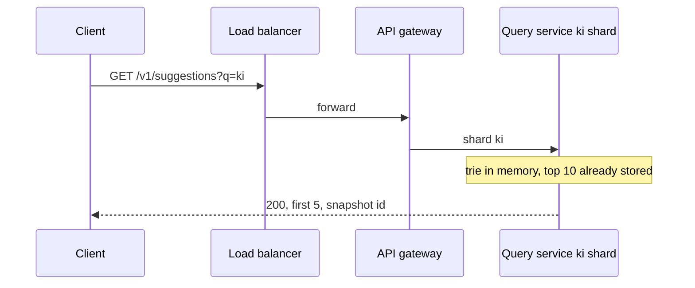
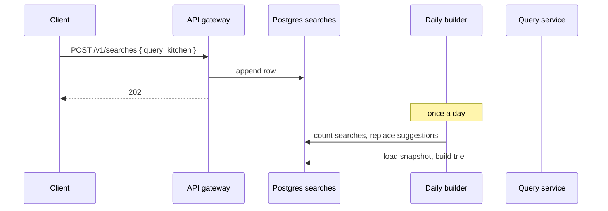

# Final design flow — Search Autocomplete

Redraw this at the end. Interview sequences stay in [FLOW.md](FLOW.md). Component roles stay in [COMPONENTS.md](COMPONENTS.md). Alex Xu Volume 1, chapter 13, is the shape source. These notes are original.

## Overview



The edge cache exists for the 10x case. The interview path at 48,000 requests a second does not need it.

## Return the top suggestions

```
GET /v1/suggestions?q=ki&limit=5 -> 200 { suggestions: [{ text, frequency }], snapshot }
```



## Record a finished search

```
POST /v1/searches -> 202 Accepted { status }
Body: { query }
```



## Services

| Name | When it runs | What it does |
| --- | --- | --- |
| Client | On a pause of 0.5 s, and on Enter | Skips GET when a cached full list still has 5 matches. Records a finished search |
| Load balancer | Every call | Sends `ki` to a live `ki` machine |
| API gateway | Every call | Routes GET to the shard. Appends POST to `searches` |
| Query service | Always, two copies of each two-character shard | Serves the trie from memory. Loads a new snapshot after each build |
| Daily builder | Once a day | Counts the log and publishes `suggestions` |
| Edge cache | Only when traffic is about 10x | Stores a GET until the next snapshot id |

## Databases

### Postgres

`searches`, primary key `id`: `query`, `searched_at`. One row per Enter. About 2,300 inserts a second at the peak.

`suggestions`, primary key (`prefix`, `position`): `text`, `frequency`, `snapshot`. `position` is 1 to 10. This table is the hash map. Query machines build the trie from it. A GET does not read the table.

### Trie, in memory, not a database

Each node is one character. It stores the top 10 full queries that pass through it. The walk for `kitchen` stays on the `ki` shard. The walk stops at 20 characters. A longer prefix filters those 10 strings.

### Speed layer, not built

A later lambda layout adds a small map of today's counts. It is merged every 2 minutes. It is not in the interview path.

Interview sequences are in [FLOW.md](FLOW.md). Component roles are in [COMPONENTS.md](COMPONENTS.md).
