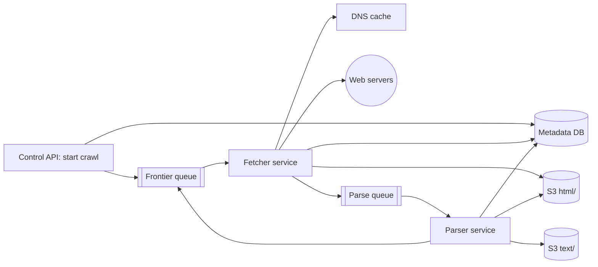
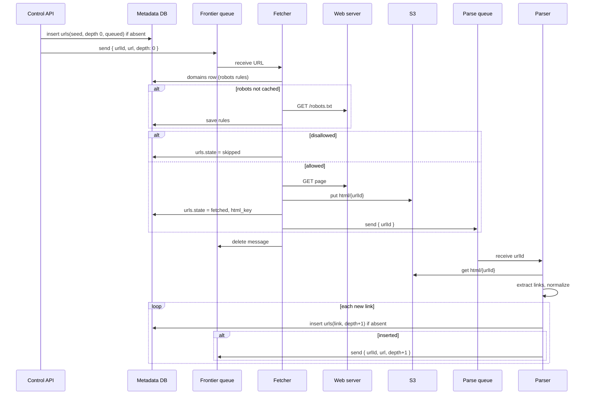
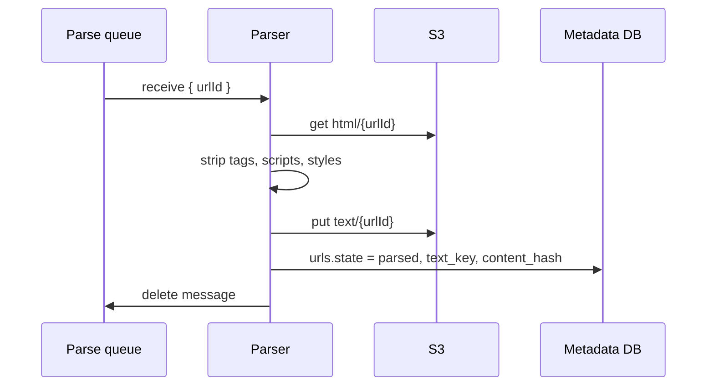
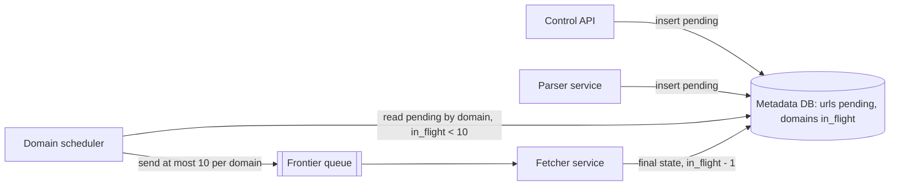
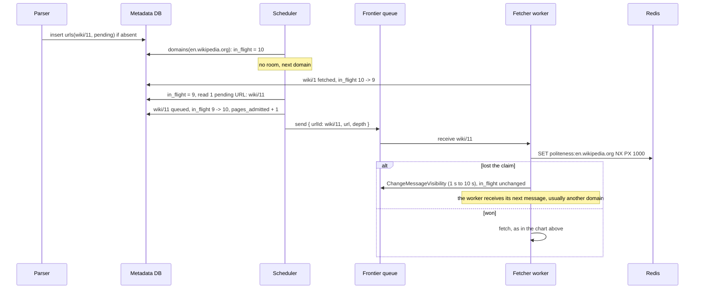
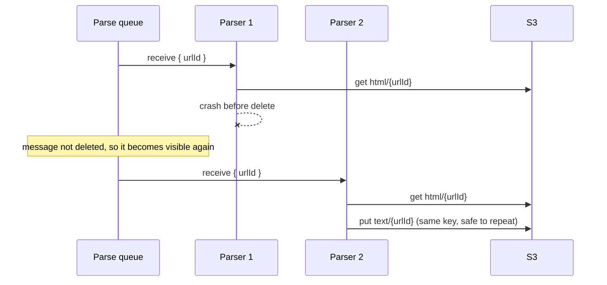

# System flow — Web Crawler

The crawler has no user-facing API. Each chart runs from the input (seed URLs, or the lab's control API), through the frontier and the two services, into the named store. Hello Interview is the shape source. These notes are original.

## Overview



## Crawl from seed URLs

```
POST /v1/crawls -> 202 Accepted { crawlId, status }
Body: { seeds, maxPages }

Frontier message -> { urlId, url, depth }
Parse message    -> { urlId }
```



## Extract and store the text

```
Parse message -> { urlId }
Output: S3 text/{urlId}, and the urls row (state parsed, text_key, content_hash)
```



## Step 4 change: the domain scheduler feeds the frontier

The two charts above are the step 2 path: the parser sends each new link straight to the frontier. Step 4 (situation 2, one huge domain) changes that. The parser and the control API only write `pending` rows. The scheduler is the only writer to the frontier, with at most 10 URLs for each domain in flight. Step 5 lowers that to a rate-based limit (about 2 at 1 request a second), because of the SQS in-flight quota. The final picture is in [final-design-flow.md](final-design-flow.md).



```
Scheduler -> frontier message { urlId, url, depth }
Fetcher, on a final state -> urls.state = fetched | failed | skipped | dead, domains.in_flight - 1
```



## Failure path: the parser dies after the fetch



The web server is not asked again. The HTML is already in S3.
