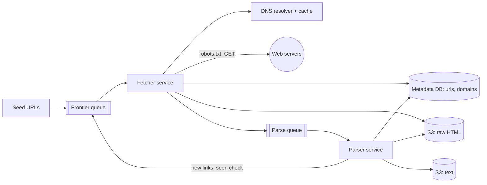

# Web Crawler

**Status:** Implemented  
**Sources:** [Hello Interview: Web Crawler](https://www.hellointerview.com/learn/system-design/problem-breakdowns/web-crawler); Alex Xu Vol 1 Ch 9 (Design a Web Crawler)  
**Slug:** `web-crawler`

Practice in the five-step interview pattern. Keep notes original; link to Hello Interview / cite Alex Xu instead of copying write-ups.

## 1. Requirements and design scope

### Problem

Design a web crawler that collects text from the web to train a large language model. It starts from seed URLs, fetches pages, follows their links, and stores each page's text for a downstream team. Hello Interview uses the same purpose. The purpose matters: a search engine would also rank and index pages, but this crawler only collects text.

### Functional requirements

- [x] Crawl the web, starting from a given set of seed URLs.
- [x] Extract the text from each page and store it for later processing.

Hello Interview uses the same two. "The web" means most of the reachable web, not every page. Small, unlinked sites are never found, and the interviewer should agree to that.

### Non-functional requirements

- [x] **Scale.** About 10 billion pages, about 2 MB each to transfer (Hello Interview). The HTML alone is about 30 KB. The session's first number, 100 million pages, was 100 times too small.
- [x] **Efficiency: finish in 5 days** (Hello Interview). This is a deadline for the whole crawl, not a per-request latency. 10 billion pages / 432,000 s is about **23,000 pages a second**, all the time.
- [x] **Politeness.** Obey `robots.txt` (the paths a site disallows, and its crawl delay). Send at most about 1 request a second to one domain, the standard Hello Interview uses.
- [x] **Fault tolerance.** A crash of any machine loses no progress. The crawl resumes where it stopped and does not start over.

The numbers this session derives:

| Quantity | Value | How |
| --- | --- | --- |
| Pages a second | About 23,000 | 10 billion / (5 days × 86,400 s) |
| Bytes transferred | About 20 PB | 10 billion × 2 MB (Hello Interview) |
| Download bandwidth | About 46 GB/s, about 370 Gbps | 20 PB / 432,000 s |
| Raw HTML kept | About 300 TB | 10 billion × 30 KB |
| Extracted text kept | About 100 TB | Assumption: about 10 KB of text a page |
| Domains in flight at once | At least 23,000 | 23,000 pages a second at 1 request a second per domain |

The politeness rule and the deadline pull against each other. At 1 request a second per domain, the crawler must keep tens of thousands of domains busy at the same time.

### Below the line

From Hello Interview (functional):

- Processing the text, for example cleaning it or training the model.
- Non-text data: images, video.
- Dynamic content: pages built by JavaScript.
- Pages behind a login.

From Hello Interview (non-functional):

- Security against malicious actors.
- Cost.
- Legal compliance and privacy rules.

This session's extra cuts:

- Recrawling for freshness (this is a one-time crawl).
- Ranking pages (no PageRank).
- Detecting near-duplicate pages. Exact duplicates stay in scope.

The session's "clean JSON formatting" belongs to text processing, which is cut. Extracting the plain text from HTML stays in scope, because it is requirement 2.

### Core entities

| Entity | Description |
| --- | --- |
| URL (frontier entry) | A URL waiting to be crawled: the URL, its domain, its depth from a seed, its state, and attempts so far |
| Domain | The politeness state of one site: its `robots.txt` rules, its crawl delay, and the next time a request is allowed |
| Page | One fetched page: the URL, fetch time, HTTP status, a content hash, and the keys of its stored HTML and text |
| Seed | A starting URL given as input |

### Interface

The crawler is a batch pipeline, not a user-facing API. Hello Interview defines its interface as input and output:

- **Input:** a list of seed URLs.
- **Output:** the extracted text of each page, stored in object storage and keyed by the URL. A metadata row per page gives the URL, the fetch time, the status, and the content hash.

The lab adds a small control API, so the page can start a crawl and show progress:

```
POST /v1/crawls -> 202 Accepted { crawlId, status }
Body: {
  seeds,    // list of URLs
  maxPages  // a stop limit for the lab
}
```

```
GET /v1/crawls/{crawlId} -> 200 OK { crawlId, status, pagesFetched, frontierSize, domains }
```

## 2. High-level design

The crawler is a pipeline of two stages joined by queues. A **fetcher** downloads pages. A **parser** extracts text and links. Durable stores hold all the progress, so any machine can die. Sequences are in [FLOW.md](FLOW.md). Roles are in [COMPONENTS.md](COMPONENTS.md).



### Crawl the web from seed URLs

1. A loader puts each seed URL into the frontier queue at depth 0, and inserts its `urls` row (`queued`).
2. A fetcher takes a URL from the frontier. It reads the domain's `robots.txt` rules from the `domains` table, fetching and saving the file the first time. A disallowed URL is marked `skipped`.
3. The fetcher resolves the host through a DNS cache, then sends `GET`.
4. It writes the raw HTML to S3 at `html/{urlHash}`, sets the `urls` row to `fetched` with the S3 key, and puts the URL's id on the parse queue. Only then does it remove the URL from the frontier.
5. The parser reads the HTML from S3 and extracts every link. It **normalizes** each one (lowercase host, drop the `#fragment` and the default port, resolve relative paths).
6. For each link, the parser inserts a `urls` row **only if it does not exist** (a conditional put keyed by the URL hash). Only a link that wins the insert goes into the frontier, at depth + 1. Two parsers that find the same link at the same moment cannot both queue it.

| Choice | Option | What happens | When it wins |
| --- | --- | --- | --- |
| Stages | A: One crawler service does fetch and parse | Simple. A parser crash refetches the page. Network-bound and CPU-bound work scale together | A small crawl |
| | **B: Fetcher and parser, with a queue between (pick, Hello Interview)** | A parse failure retries from the stored HTML, not from the web. Each stage scales on its own | 23,000 pages a second |
| Frontier store | A: Kafka (the session's first answer) | A durable log. Retry with backoff and "come back later for this domain" must be built by hand (a retry topic, offsets) | Very high throughput, simple order |
| | B: SQS | A visibility timeout returns a message that a dead fetcher held. A changed timeout defers a URL. A dead-letter queue catches repeated failures | Per-message retry and deferral. Decided in deep dive 1 |
| Seen check | A: Check only when a URL is fetched | The same popular link is queued millions of times while it waits | Never |
| | **B: Conditional insert when a link is queued (pick)** | Each URL enters the frontier once. The insert decides the race | Always |
| | C: A Bloom filter in memory | Small and fast. A false positive skips a new URL forever | Memory is the limit. Deep dive 3 |

We pick B for the stages, B for the seen check, and decide the queue technology in deep dive 1. At 10 billion URLs, the seen set is about 1 TB (assumption: about 100 bytes a row), so it lives in a partitioned key-value store, keyed by the URL hash.

### Extract and store the text

1. The parser takes a URL id from the parse queue and reads `html/{urlHash}` from S3.
2. It strips tags, scripts, and styles, and keeps the visible text.
3. It writes the text to S3 at `text/{urlHash}`, and sets the `urls` row to `parsed` with the text key and a content hash.
4. It removes the message from the parse queue.

| Choice | Option | What happens | When it wins |
| --- | --- | --- | --- |
| Raw HTML | A: Drop it after extraction (the session's first answer) | Saves about 300 TB. An extraction bug, or a new request such as "include image alt text," means refetching 10 billion pages: another 5 days and 20 PB | Never at this scale |
| | **B: Keep it in S3 (pick, Hello Interview)** | About 300 TB, less when compressed. Re-run extraction any time without touching the web | Always |
| Text store | A: A database column | 100 TB of blobs make the database heavy and slow | Small corpora |
| | **B: S3, one object per page (pick)** | Cheap, durable, and the training team reads it in bulk | 100 TB |
| Queue payload | A: The HTML inside the queue message | Queues are not built for 30 KB to 2 MB messages | Never |
| | **B: Only the URL id; the bytes stay in S3 (pick)** | Small messages, and the HTML is read from S3 | Always |

We pick B, B, B. Keeping 300 TB of HTML is much cheaper than a second 20 PB crawl.

### Interface used between the stages

```
Frontier message -> { urlId, url, depth }
urlId: hash of the normalized URL. depth: hops from a seed (0 for a seed)
```

```
Parse message -> { urlId }
The HTML is read from S3 at html/{urlId}
```

See [high-level-design-comparision.md](high-level-design-comparision.md) for Hello Interview, Alex Xu, this session, and production side by side.

## 3. Low-level design and deep dive

### Data model

Metadata DB, a partitioned key-value store such as DynamoDB. Postgres works for the lab.

`urls`, keyed by `url_hash` (the SHA-256 of the normalized URL), about 10 billion rows:

| Field | Role |
| --- | --- |
| url_hash | Partition key. Also the frontier message's `urlId` and the S3 key suffix |
| url | The normalized URL |
| domain | The host. It links to `domains` |
| depth | Link hops from a seed. The crawler-trap limit uses it |
| state | `queued`, `fetched`, `parsed`, `duplicate` (same text as another page), `skipped` (robots, depth, or domain cap), `failed` (permanent), or `dead` (gave up after retries) |
| attempts | Fetch attempts so far |
| http_status, last_error | The last result |
| html_key, text_key | `html/{url_hash}` and `text/{url_hash}` in S3 |
| content_hash | SHA-256 of the extracted text, for content dedupe (deep dive 3). A row whose hash already exists is marked `duplicate` |
| fetched_at | When the fetch finished |

`content_hashes`, keyed by `hash`, about 500 GB at 10 billion rows:

| Field | Role |
| --- | --- |
| hash | SHA-256 of the normalized extracted text. Partition key |
| first_url_hash | The first page that had this text. Later pages with the same hash are duplicates |

`domains`, keyed by `domain`:

| Field | Role |
| --- | --- |
| domain | Partition key |
| robots_rules | The parsed `Disallow` and `Allow` lines for our user agent |
| crawl_delay_sec | From `robots.txt`, or 1 by default |
| robots_fetched_at | When the rules were read. Read the file again after 24 hours (RFC 9309) |
| robots_status | `ok`, `unavailable` (4xx: everything allowed), or `unreachable` (5xx or network error: everything disallowed for now) |
| next_allowed_at | Only for politeness Option A, the database claim. With the Redis claim (the pick), the Redis key is the only timing state, and this column is not used |
| last_fetch_at | For dashboards only. Written after a fetch. Never used to decide whether to fetch |

### Deep dives

Hello Interview's deep dives for this question, and this session's choice:

| Hello Interview deep dive | This session's choice |
| --- | --- |
| 1. Fault tolerance: never lose progress | Two stages with ids in the messages. Classify each fetch result. Retry with exponential backoff and jitter, give up after 5 attempts into a dead-letter queue. A fetch message is removed only after the HTML is stored. SQS for the frontier. Below |
| 2. Politeness and robots.txt | Fetch and parse `robots.txt` once per domain, cache it for 24 hours, and follow RFC 9309. Each fetch atomically claims the domain's next slot (the gap is 1 s, or a longer `Crawl-delay`). A fetcher that loses the claim defers the message with jitter and takes the next URL. Below |
| 3. Scale to 10 billion pages in 5 days | Size fetchers by bandwidth × utilization: about 10 network-optimized machines (Hello Interview: 3,750 pages a second each), each holding thousands of async connections. A DNS cache on every fetcher plus several upstream providers. Content dedupe with a conditional insert on the text hash. Trap guards: depth 20, a per-domain page cap, URL length, and parameter normalization. Below |

#### Deep dive 1: Fault tolerance

**What can fail.** A fetch is the step most likely to fail. The site is down, slow, moved, or gone. A fetcher or parser process can also die mid-task, and so can the whole machine.

**Classify the result first.** Not every failure deserves a retry.

| Result | Example | Action |
| --- | --- | --- |
| Success | 200 | Store the HTML, queue the parse, remove the message |
| Temporary failure | Timeout, connection reset, 500, 502, 504 | Retry with backoff |
| The site asks you to slow down | 429, or 503 with `Retry-After` | Defer by `Retry-After`, and slow the whole domain (deep dive 2). Not counted as a failure |
| Permanent failure | 404, 410, 403 | `state = failed`. No retry |
| Redirect | 301, 302 | Treat the target as a new link: normalize it, then the conditional insert |
| Disallowed | `robots.txt` | `state = skipped` |

**Backoff.** The delay is 30 s × 2^(attempt − 1), plus a random jitter of up to 20%: about 30 s, 1 min, 2 min, 4 min, 8 min. After 5 attempts (Hello Interview's limit), the URL goes to the dead-letter queue and `state = dead`. Jitter spreads out retries that failed at the same moment, so they do not all return together.

**Where the retry waits.**

- **Option A: An in-memory timer in the fetcher.** Simple. A crash loses the timer, and the URL is lost with it.
- **Option B: Kafka with retry topics (the session's answer).** A failed URL is published to `retry-30s`, then `retry-2m`, and so on, then to a dead-letter topic. Each retry consumer waits until a message is due. Uber's engineering blog describes this pattern. It works. Kafka reads each partition in order and commits one offset per partition, so per-message delay, per-domain deferral, and the dead-letter step are all your own code. Each delay tier is another topic and another consumer group.
- **Option C: SQS (pick, Hello Interview).** A fetcher receives a URL, and the message is hidden for its visibility timeout. On a temporary failure, the fetcher calls `ChangeMessageVisibility` with the backoff delay, and the message returns at that time. (Changed in step 5: a long backoff sends the body again with `DelaySeconds` instead, because a hidden message counts against the in-flight quota.) `ApproximateReceiveCount` gives the attempt number. A redrive policy with `maxReceiveCount = 5` moves the message to the dead-letter queue automatically.
- **Option D: A scheduled table.** Each `urls` row carries `next_attempt_at`, and fetchers claim due rows (`FOR UPDATE SKIP LOCKED`). Scheduling and per-domain fairness are easy. At about 23,000 claims a second, the table becomes the bottleneck unless it is sharded.

We pick Option C. Per-message delay is the primitive this crawler needs: for retries here, and for "this domain is busy, come back in 1 second" in deep dive 2. SQS standard queues scale far past 23,000 messages a second. The 5-day crawl fits inside the 14-day maximum message retention. Kafka (Option B) is the right answer when the team already runs it, at the cost of building the retry tiers.

**A fetcher dies mid-page.** Do the steps in this order, so a crash at any point is safe:

1. Fetch the page.
2. Write `html/{urlId}` to S3. Writing the same key again is safe.
3. Set `state = fetched` and `html_key`.
4. Send `{ urlId }` to the parse queue.
5. Delete the frontier message, as the last step.

A crash before step 5 leaves the message in the queue, and it becomes visible again after its timeout. Set the timeout above the slowest fetch, for example 60 s. Another fetcher receives the URL and reads `state = fetched`. It skips the fetch, makes sure the parse message exists, and deletes the frontier message. The cost of a crash is at most one repeated fetch, or none.

**A parser dies.** Its parse message comes back after the timeout. The text write to `text/{urlId}` is safe to repeat. The link inserts are conditional, so a repeat queues nothing new. Parse failures that repeat (bad HTML) go to the parse dead-letter queue.

**What is durable.** The frontier and parse queues, the `urls` and `domains` tables, and S3. A fetcher or parser holds nothing that another machine cannot rebuild. A replacement process simply starts receiving messages.

#### Deep dive 2: Politeness and robots.txt

**What robots.txt is.** A site puts a plain text file at `https://site/robots.txt`. It tells crawlers what they must not fetch. The format is a standard, RFC 9309 (2022). An example:

```
User-agent: *
Disallow: /private/
Allow: /private/press/
Crawl-delay: 10
```

- `User-agent: *` starts a group of rules for every crawler. A group can also name one crawler, for example `User-agent: GPTBot`. The crawler uses the group that names it, or else the `*` group.
- `Disallow: /private/` forbids every path that starts with `/private/`.
- `Allow: /private/press/` permits a path inside the forbidden one.
- When several rules match a path, the longest rule wins. A tie goes to `Allow`. If no rule matches, the path is allowed.
- `Crawl-delay: 10` asks for 10 seconds between requests. It is not part of RFC 9309, and some big crawlers ignore it. This design obeys it, to be polite.

For that example:

| Path | Result | Why |
| --- | --- | --- |
| `/blog/post-1` | Allowed | No rule matches |
| `/private/salaries` | Disallowed | `Disallow: /private/` |
| `/private/press/2026` | Allowed | `Allow: /private/press/` is longer, so it wins |

Python's built-in `urllib.robotparser` gives exactly these answers, and it reads `Crawl-delay` too.

**When the robots.txt fetch itself fails (RFC 9309).**

| Fetch result | Meaning | Crawler behavior |
| --- | --- | --- |
| 200 | Rules found | Obey them. Cache for up to 24 hours |
| 4xx (for example 404) | "Unavailable": the site has no rules | Everything is allowed |
| 5xx or a network error | "Unreachable": the rules are unknown | Fetch nothing from that site. Try `robots.txt` again later |

The crawler reads at most 500 KiB of the file, the minimum limit the RFC sets.

**Where it runs.** The fetcher receives a URL and reads the `domains` row. If the rules are missing or more than 24 hours old, it fetches `robots.txt` first. That request counts against the domain's rate limit too. Then it checks the path. A disallowed URL becomes `skipped`, and its message is deleted.

**The rate limit, across many fetchers.** A domain gets at most one request each `gap` seconds, where `gap = max(1 s, Crawl-delay)`. With 30 fetchers, a counter inside each fetcher does not hold: two fetchers working on `example.com` would each send 1 a second.

The session's idea was a table with the last fetch time, and wait if under 1 second. The table is right. It needs two fixes:

1. **Read-then-write races.** Fetchers F1 and F2 both read `last = 10:00:00.0` at 10:00:01.2. Both decide "more than 1 s ago" and both fetch. The site gets 2 requests in the same instant. The check and the update must be one atomic step: a claim.
2. **Do not sleep.** A fetcher that waits holds a worker slot that could fetch another site. 23,000 pages a second needs every slot busy. A fetcher that loses the claim puts the URL back for later and takes the next one.

**The atomic claim.**

- **Option A: A conditional update in the domain table.** `UPDATE domains SET next_allowed_at = now + gap WHERE domain = d AND next_allowed_at <= now`. It changes one row, or none. DynamoDB uses a condition expression, and Postgres uses `UPDATE ... WHERE ... RETURNING`. One store holds all the state. It costs a database write per fetch, about 23,000 a second.
- **Option B: A Redis key with a TTL (Hello Interview).** `SET politeness:{domain} {fetcherId} NX PX {gap_ms}`. Exactly one fetcher wins, and the key expires after the gap. It is fast and simple. The state disappears if Redis restarts, which is harmless here: the next fetch only goes a little early.
- **Option C: Give each domain one owner (Mercator, Alex Xu's back queues).** The frontier is split by domain: Kafka partitions by domain hash, or one queue per host. Each fetcher owns a set of domains, keeps a heap of "next time each domain is allowed," and pops the earliest. There are no locks and no wasted receives. Partitions become uneven when one domain has millions of URLs. A dead fetcher stalls its domains until they are reassigned.

**A URL for a domain that is not ready.** The fetcher loses the claim. It reads `PTTL politeness:{domain}` (for example 700 ms left) and computes the wait in its own code: the time left plus a random jitter of up to 30% of the gap. It calls `ChangeMessageVisibility` with that wait and moves on. Nothing is stored: SQS keeps the message hidden until then. SQS counts the visibility timeout in whole seconds, so a 0.7 s wait becomes 1 s, and a domain with a 1 s gap sees its next URL after 1 to 2 s. The jitter matters. Without it, every waiting fetcher retries at the same instant, one wins, and the rest lose again together.

**One trap with SQS.** Every receive raises `ApproximateReceiveCount`, including a politeness deferral. A big domain's URLs can be deferred 20 times, reach `maxReceiveCount = 5`, and land in the dead-letter queue without ever failing. Count real fetch failures in `urls.attempts` instead. Set the queue's `maxReceiveCount` high (for example 100), as a safety net only.

**The limit politeness sets.** One request a second is 86,400 pages a day for one domain, or 432,000 in 5 days. A site with 60 million pages cannot finish inside the deadline. That is accepted: the crawl collects what fits, and the throughput comes from crawling many domains at once (deep dive 3).

We pick Option B for the claim, with deferral plus jitter, and the receive-count fix. Redis takes about 23,000 `SET NX` calls a second easily, and the fetchers stay stateless. Option C is the scale step if deferral churn grows. Many URLs for a few big domains would make fetchers receive and defer the same messages again and again.

#### Deep dive 3: Scale to 10 billion pages in 5 days

**How many fetcher machines.** The work is network-bound. One machine's rate is its bandwidth times the fraction it really uses, divided by the page size. The whole crawl needs about 23,150 pages a second.

```
pages per second per machine = bandwidth × utilization / page size
machines = 23,150 / pages per second per machine, plus headroom for retries and slow sites
```

| Machine | Pages a second each | One machine alone | Machines for 5 days |
| --- | --- | --- | --- |
| 2 GB/s (16 Gbps), 100% used (the session's first math) | 1,000 | About 116 days | 23.1, so 20 is not enough |
| 2 GB/s, 30% used | 300 | About 386 days | About 78 |
| 200 Gbps network-optimized, 30% used (Hello Interview) | 3,750 | About 31 days | 6.2 |

The session's first answer had 10^8 s. The right value is 2 × 10^10 MB / 2,000 MB/s = 10^7 s, about 116 days, which matches the session's "about 100 days." 100% of the bandwidth is never used. Responses are slow, there are DNS lookups, politeness waits, and retries. Hello Interview assumes 30%.

We pick 200 Gbps network-optimized machines at 30%. That is 6.2 machines, and with about 50% headroom, 10 machines. They finish in about 3 to 4 days.

**Concurrency, not raw speed.** A page takes about 1 s to arrive, and one domain allows 1 request a second. So 3,750 pages a second on one machine means about 3,750 requests in flight at once, each to a different domain. Fetchers use async I/O (an event loop), not one thread per request. The frontier must offer at least about 23,000 different ready domains at any moment.

**The 2 MB is a worst case.** It includes images, scripts, and styles. This crawler keeps text only (non-text is below the line), so it fetches only the HTML document, about 30 KB. At 30 KB, the whole crawl needs only about 5.6 Gbps. The limit then moves from bandwidth to connections, DNS, and politeness. Planning at 2 MB keeps the estimate safe.

**Parsers.** Parsing about 30 KB of HTML takes a few milliseconds of CPU (assumption: about 5 ms). 23,000 pages a second is about 115 busy cores, a small fleet. It scales on the parse queue depth, as Hello Interview suggests.

**DNS.** Every new domain needs a lookup, and a lookup can take several network round trips. Hello Interview cites the Mercator paper: before it built its own resolver, DNS took up to 70% of each thread's time. At about 23,000 pages a second, a DNS provider's rate limits also become a real limit.

- **Option A: The default resolver on each fetch.** No work, and every URL pays the lookup. The provider throttles at this rate.
- **Option B: A cache on every fetcher (pick).** A local caching resolver, plus an in-process map that keeps each answer for its DNS TTL. All URLs on one domain share one lookup.
- **Option C: Several upstream DNS providers, round robin (Hello Interview).** No single provider's rate limit caps the crawl.
- **Option D: Resolve ahead.** Look up a domain when its first URL is queued, so the answer is cached before a fetcher needs it.

We pick B plus C. The session's "DNS caching" is the main fix. Several providers remove the last single limit.

**Duplicate content.** URL normalization (step 2) already joins `https://Example.com/a#top` and `https://example.com/a`. Different URLs can still serve the same text: `http` and `https`, `www` and the bare host, mirrors, and copied articles.

- **Option A: No content dedupe.** The corpus holds the same text many times. That wastes storage and parse time, and it skews the training data.
- **Option B: A hash table with a conditional insert (pick, Hello Interview's index).** The parser hashes the extracted text after it normalizes whitespace, and inserts `content_hashes(hash -> first urlHash)` only if absent. A hit marks the row `duplicate` and skips storing the text. Links of a duplicate are the same links, so they are skipped too.
- **Option C: A Bloom filter.** Small and fast. A false positive drops a unique page. Hello Interview calls it overkill.
- **Option D: Near-duplicate detection, such as SimHash.** It catches pages that differ only in an ad or a date. This is below the line.

We pick Option B. Hash the extracted text, not the raw HTML. Two copies of an article differ in their HTML (ads, timestamps) but have the same text. Use SHA-256. MD5 also works for dedupe, but it can be made to collide on purpose. 10 billion rows of about 48 bytes (a 32-byte hash and a 16-byte URL id) is about 500 GB, a partitioned key-value table.

**Crawler traps.** A trap generates links without end: a calendar with "next month" forever, `/a/b/a/b/a/...`, or session ids in every link.

- **Option A: A depth limit (pick, Hello Interview).** Depth is the number of link hops from a seed, not the number of `/` in the path. A link found on a depth-7 page is depth 8. Hello Interview uses 15 to 20. The session's first idea, 5 to 7, is too shallow: most of the web lies within about 15 to 20 links of popular seeds, so a low cap stops the crawl early.
- **Option B: A per-domain page cap.** For example, 100,000 pages per domain. Politeness already caps a domain at 432,000 pages in 5 days.
- **Option C: URL hygiene.** Skip URLs longer than about 2,000 characters. Skip paths that repeat a segment many times. Strip tracking and session parameters (`utm_*`, `sessionid`, `sid`) during normalization, so the same page does not look new.

We pick A plus B plus C, with depth 20. Each guard catches what the others miss. A calendar trap is shallow but endless, so the per-domain cap stops it. A session-id trap is stopped by normalization.

**Large and non-HTML files.** The fetcher sends `Accept: text/html` and checks `Content-Type` and `Content-Length` before it reads the body. It stops after about 10 MB. Hello Interview's extra deep dive suggests a `HEAD` request first. Reading the headers of the `GET` and closing early saves that extra round trip.

## 4. Component questions and special situations

Component roles are in [COMPONENTS.md](COMPONENTS.md). The final picture, with every service and schema, is in [final-design-flow.md](final-design-flow.md). The deadline has headroom: about 10 machines finish in about 3 to 4 days of a 5-day budget, so short outages are affordable.

### 1. Redis, the politeness store, is down for 10 minutes

- **Option A: Stop fetching (fail closed, the session's answer).** Polite and safe. Nothing is lost: URLs wait in the frontier. 10 minutes is 0.14% of the 5-day budget.
- **Option B: Keep fetching with no limit (fail open).** Fastest. Fetchers that share a big domain hit it many times a second. Sites block the crawler, and some go down.
- **Option C: Fall back to a local limit.** Each fetcher limits each domain to 1 request every `gap × fetcher count` seconds. With 10 fetchers, that is 1 every 10 s per fetcher, so the domain still gets at most 1 a second. Throughput drops, and politeness holds.
- **Option D: A Redis replica with automatic failover** (Sentinel or a managed Redis). The outage becomes seconds.

We pick D, plus A for the seconds of failover. C is for an outage that lasts hours. Losing a few minutes costs little, and failing open costs the sites.

### 2. One huge domain floods the frontier

50 million Wikipedia URLs arrive early, ahead of other domains in the queue. Politeness lets Wikipedia take 1 request a second. Fetchers keep receiving Wikipedia URLs, losing the claim, and deferring them. Most of the 23,000 receives a second become deferrals, so real fetches fall far below the target. Politeness also means Wikipedia can give at most 432,000 pages in 5 days, so 50 million can never finish.

- **Option A: One queue plus deferral.** Simple. Deferral churn starves every other domain.
- **Option B: A separate queue for big domains (the session's answer).** Small domains are protected: a bulkhead. The big-domain queue still churns, and the system must know which domains are big before they flood.
- **Option C: Limit what each domain may have in the frontier.** New URLs go to the `urls` table as `pending`. A scheduler moves at most about 10 URLs per domain into the frontier, refills a domain only as its URLs finish, and stops a domain at the page cap (100,000). The frontier always holds many different domains. Hello Interview's extra deep dive adds a URL scheduler like this.
- **Option D: One queue per domain** (Mercator, and Alex Xu's back queues). Each fetcher pops the domain whose next allowed time is earliest. There is no churn. It is the most complex option.

We pick C plus the page cap. Two million different domains at 10 queued URLs each is a frontier of about 20 million messages with no domain blocking the rest. Option B is a quick first step. D is the step after C.

#### Wikipedia does not finish in 5 days (session question)

At 1 request a second, 50 million pages take 50 million seconds, about 579 days. 5 days is 432,000 seconds, so politeness allows at most 432,000 pages. To fetch 50 million pages in 5 days, the crawler needs about 116 requests a second to one site. The design does not try to finish Wikipedia by crawling.

- **Option A: Accept the cap, and crawl the best pages first.** The crawler takes 100,000 pages and stops. Breadth-first order from the seeds reaches the most-linked pages first. Cost: most of the site is missing. Wins for every big site that has no other source.
- **Option B: Raise the rate when the site allows it.** If `robots.txt` has no `Crawl-delay` and the server stays fast, raise the rate slowly. Back off on errors or slow answers. Google's crawler adapts its rate to the server's health ([crawl budget guide](https://developers.google.com/search/docs/crawling-indexing/large-site-managing-crawl-budget)). Cost: risk to the site. Even 10 a second gives only 4.3 million pages.
- **Option C: Use the bulk export.** Wikipedia publishes full database dumps ([dumps.wikimedia.org](https://dumps.wikimedia.org/)). One download gives all the article text, with no load on the web servers. Cost: one special importer for each such source. Wins for the few huge sites that publish dumps.
- **Option D: Cut the URL count first.** Most of the 50 million URLs are not articles: edit links, history pages, and talk pages. `robots.txt` rules and URL hygiene remove many of them. English Wikipedia has about 7 million articles.

We pick C for Wikipedia, and A plus D for other big sites. Option B stays off for this design, because politeness is a hard requirement.

#### How the scheduler works (Option C, step by step)

SQS cannot show what is inside it, and it cannot reorder messages. So the design keeps most URLs out of SQS. The scheduler decides which URLs go in.

New state and fields:

- `urls.state = pending` means the URL is known but not in the frontier.
- An index on `pending` URLs by domain lets the scheduler read "the next N pending URLs of domain X."
- `domains.in_flight` is the number of that domain's URLs now in the frontier or being fetched.
- `domains.pages_admitted` counts toward the page cap.

The steps:

1. A parser finds a new link. It inserts the `urls` row as `pending`. It does not send to SQS.
2. The scheduler loops over domains that have pending URLs. For each domain with `in_flight < 10` and `pages_admitted < 100,000`, it takes up to `10 - in_flight` pending URLs.
3. For each URL, it sets `state = queued`, adds 1 to `in_flight` and `pages_admitted`, and sends `{ urlId, url, depth }` to SQS.
4. A fetcher finishes the URL as `fetched`, `failed`, `skipped`, or `dead`. It subtracts 1 from `in_flight`. A deferral does not change `in_flight`, because the URL is still in the frontier.
5. On the next loop, the scheduler sees room for that domain and admits the next URL.

A walk-through for Wikipedia:

| Time | What happens | Wikipedia `in_flight` | Wikipedia URLs in SQS |
| --- | --- | --- | --- |
| 0 s | Parsers insert 50 million Wikipedia rows as `pending` | 0 | 0 |
| 0 s | The scheduler admits `wiki/1` to `wiki/10` | 10 | 10 |
| 0 s | Fetcher A wins the claim for `wiki/1`. Fetchers B to J lose and defer by 1 s to 10 s | 10 | 10 |
| 1 s | `wiki/1` is fetched. `in_flight` drops to 9. The scheduler admits `wiki/11` | 10 | 10 |
| 5 days | 100,000 pages admitted. The scheduler stops. The rest stay `pending` | 0 | 0 |

Without the scheduler, SQS holds 50 million Wikipedia URLs. Thousands of receives a second become deferrals. With it, Wikipedia costs about 10 receives a second, and the other receives of the 23,000 a second go to other domains.

#### Why 10 receives a second instead of thousands (session question)

One rule explains both numbers. Wikipedia's receive rate is the smaller of two limits:

1. **Its share of the queue.** SQS hands out visible messages with no regard to domain. If Wikipedia is 83% of the visible messages, about 83% of all receives return a Wikipedia URL.
2. **How many of its messages become visible each second.** A message that loses the claim is hidden for at least 1 s, because SQS visibility is whole seconds. So N Wikipedia messages can be received at most about N times a second.

Example numbers for this session: the frontier holds 60 million messages, and 50 million are Wikipedia. Fetchers make about 23,000 receives a second in total.

| | Without the scheduler | With the scheduler |
| --- | --- | --- |
| Wikipedia messages in SQS | 50 million | 10 |
| Limit 1: share of receives | 83% of 23,000 = about 19,000 a second | 10 of millions of messages: almost 0% |
| Limit 2: messages visible each second | Up to 50 million (no limit) | At most 10 (each hidden at least 1 s) |
| Wikipedia receives a second (smaller limit) | About 19,000 | At most 10 |
| Real Wikipedia fetches a second | 1 (politeness) | 1 (politeness) |
| Wasted receives a second (deferrals) | About 19,000 | At most 9 |
| Receives left for other domains | About 4,000 a second | About 23,000 a second |

Without the scheduler, the supply of Wikipedia messages never runs out. A deferred URL comes back after about 1 s, and 50 million others wait behind it. Each wasted receive also costs a `ChangeMessageVisibility` call. Real fetches for all other domains fall from 23,000 to about 4,000 a second.

With the scheduler, the supply is fixed at 10. Fetcher A receives `wiki/1`, wins, and fetches it. Fetchers B to J receive `wiki/2` to `wiki/10`, lose, and hide them for 1 s to 10 s. In the next second, at most those 10 come back. One wins again, and the rest hide again.

The limit can be smaller for slow domains. A domain allowed 1 request a second needs only about 2 URLs in flight to stay busy. Then it wastes at most 1 receive a second. The design keeps 10 as one simple number for all domains.

#### A fetcher that loses the claim is not idle (session question)

"Fetcher A" to "Fetcher J" above are fetcher workers. A worker is one async task slot on a fetcher machine. 10 machines with about 3,750 connections each give about 37,500 workers. They do not belong to Wikipedia. Any worker can receive any message.

A lost claim costs a worker a few milliseconds, then the worker moves on:

1. Worker B receives `wiki/2`.
2. Worker B runs `SET politeness:en.wikipedia.org NX PX 1000`. Redis answers nil, because worker A holds the key.
3. Worker B calls `ChangeMessageVisibility` to hide `wiki/2` for 1 s to 10 s.
4. Worker B receives its next message at once. That message is almost always another domain, such as `kim.blog/a`. Worker B fetches it.

Wikipedia is 10 of the millions of messages in the frontier. So a worker rarely receives a Wikipedia URL twice in a row. The fleet wastes at most 9 short attempts a second, out of about 23,000 receives a second. That is about 0.04% of the receives. No worker waits for Wikipedia to finish.

- **Option A: One limit of 10 for every domain (pick).** At most 9 wasted attempts a second for a 1-request-a-second domain. One number to run.
- **Option B: A limit from the domain's rate.** About 2 for 1 request a second, more for a domain with a higher allowed rate. At most 1 wasted attempt a second. The scheduler must read each domain's rate.
- **Option C: One ready queue per domain, released at the allowed time** (Mercator). No wasted attempts. The most machinery.

We pick A. 0.04% waste does not change the 10-machine count. B is the tuning step if the waste ever shows in the metrics.

**Changed in step 5.** The SQS in-flight quota (about 120,000) makes B the pick. Deferred messages count as in flight, and 10 for every domain gives about 207,000 of them. See step 5, risk C.

The scheduler is one small service, split by domain hash when one copy is not enough. If it stops, the frontier drains, and no URL is lost, because the `pending` rows stay in the table.

### 3. A fetcher machine dies with about 3,750 requests in flight

Its in-flight messages were never deleted. They become visible again after the 60-second visibility timeout, and other fetchers take them. A page that was stored before the crash has `state = fetched`, so it is not fetched again. A page that was mid-download is fetched again. No URL is lost.

- **Option A: Replace the machine by hand.** Hours of lower throughput.
- **Option B: An auto scaling group with health checks (pick).** A new machine starts in minutes. The crawl runs at 90% for those minutes.
- **Option C: Headroom.** 10 machines where 6.2 are needed, so one loss does not threaten the deadline.

We pick B plus C. The session's "replace it" is right, and B does it without a person.

### 4. The metadata store is the bottleneck

The load is about 23,000 conditional URL inserts a second plus about 23,000 content-hash inserts, and much more when one page yields 50 links (most are duplicates the conditional insert rejects). The data is about 1 TB of `urls` and 480 GB of hashes. Keys are SHA-256 hashes, so they spread evenly with no hot partition. The one hot read is a big domain's `domains` row, read on every fetch. Fetchers cache the `robots.txt` rules in memory for minutes.

- **Option A: One Postgres.** 10 billion rows and tens of thousands of writes a second do not fit one primary.
- **Option B: Postgres sharded by hash.** Transactions stay. You run the sharding.
- **Option C: Cassandra (the session's answer).** Writes are fast and spread by hash. A plain write is an upsert, so "insert only if absent" needs a lightweight transaction, `IF NOT EXISTS`. That runs Paxos, about four round trips, and it is slow under contention. Cassandra still works if the design accepts a rare double queue. Two parsers that find the same new link at the same instant may both queue it. The second fetch sees `state = fetched` and stops, so the cost is one extra fetch, not wrong data.
- **Option D: DynamoDB (Hello Interview).** A conditional put (`attribute_not_exists`) is a normal, cheap write. It is partitioned by key and managed.

We pick D, or C without lightweight transactions if the team runs Cassandra. Dedupe here only has to be almost exact, because a repeated fetch is harmless.

#### Why a DynamoDB conditional put is cheap (session question)

Two parsers, P1 and P2, find the link `https://kim.blog/a` at the same instant. Both send this request:

```
PutItem
{
 TableName: "urls",
 Item: { url_hash: "9f2c...", url: "https://kim.blog/a", domain: "kim.blog", depth: 3, state: "pending" },
 ConditionExpression: "attribute_not_exists(url_hash)"
}
P1 -> 200 {}                                    // new URL: P1 owns it
P2 -> 400 ConditionalCheckFailedException       // seen: P2 does nothing
```

What happens inside DynamoDB ([DynamoDB paper, USENIX ATC 2022](https://www.usenix.org/conference/atc22/presentation/elhemali)):

1. The key `9f2c...` hashes to one partition. Three replicas in three zones hold that partition.
2. One replica is the leader. The replicas elect it with Multi-Paxos only when the leader changes, not on each write.
3. Every write to that key goes to the leader, one at a time.
4. The leader reads the item, checks the condition, and writes the item in one step.
5. The leader replicates the write. It answers when two of the three replicas have it.

The order is fixed by the one leader, so no consensus round runs for each write. A conditional put costs the same as a plain put: one write unit for each 1 KB, single-digit milliseconds. A failed condition also uses one write unit.

Cassandra has no leader for a key. Any of the three replicas accepts a write, and the last write wins. No replica can say "I saw the key first." So `IF NOT EXISTS` must run Paxos for each write: prepare, read, propose, commit. That is about four round trips, and retries when writers collide.

- **Option A: Cassandra with `IF NOT EXISTS`.** Exact. About four round trips for each insert, and slower under contention.
- **Option B: Cassandra with a plain write.** One round trip. Two parsers can both queue `kim.blog/a`. The second fetch sees `state = fetched` and stops. The cost is a rare extra fetch.
- **Option C: DynamoDB conditional put (pick, Hello Interview).** Exact, at the price of a plain write. Managed, and split by key.
- **Option D: Postgres `INSERT ... ON CONFLICT DO NOTHING`, sharded by hash.** The same leader idea: the primary for each shard checks and writes in one step. You run the shards.

We pick C for the interview. The lab uses DynamoDB too, through DynamoDB Local (session decision, 2026-10-25).

**What the lab shows.** DynamoDB Local is Amazon's free, offline copy of DynamoDB, in the Docker image `amazon/dynamodb-local`. It accepts the same `PutItem` request with the same `ConditionExpression`. It returns the same `ConditionalCheckFailedException`. A race panel sends the same new URL from two parsers at once, side by side:

- **DynamoDB conditional put:** one parser gets 200, the other gets the exception, and one message is queued.
- **DynamoDB plain put (Cassandra style, last write wins):** both parsers get 200, and both queue the URL.
- **Postgres `INSERT ... ON CONFLICT DO NOTHING`:** one parser inserts 1 row, the other inserts 0 rows.

**What the lab cannot show.** DynamoDB Local is one process on one disk. It has no partitions, no three replicas, and no leader election. The lab shows the API behavior and the race result. The leader and replica steps above stay as notes from the DynamoDB paper.

One cost remains. Each page has many links, and most are repeats, such as menu links on every page. Each repeat still uses one write unit. A small cache of recent URL hashes in each parser drops most repeats before they reach DynamoDB.

### 5. The deadline becomes 1 day, or the web is 100 billion pages

| Change | Pages a second | Fetcher machines (3,750 each, plus 50%) |
| --- | --- | --- |
| Today | About 23,000 | About 10 |
| 1-day deadline | About 116,000 | About 47 |
| 100 billion pages in 5 days | About 231,000 | About 93 |

Fetchers scale in a straight line, so adding them is the session's first answer, and it is right. These limits follow:

- **Domains in flight.** At 1 request a second per domain, 116,000 pages a second needs about 116,000 ready domains at once. The seeds must be broad, and the per-domain frontier limit (situation 2) keeps them diverse.
- **DNS.** Five to ten times more lookups. Add DNS providers, and resolve ahead.
- **The metadata store.** Five to ten times the conditional writes. Add partitions or capacity.
- **Where the fetchers run.** Fetchers in several regions crawl sites near them, which cuts latency for each request. Alex Xu's chapter suggests crawl servers spread by geography.

The order of change: fetchers and DNS first, then the metadata store, then domain diversity, then regions.

### Bloom filter for content dedupe

The session asked whether a Bloom filter can dedupe the page text. A Bloom filter is a bit array that answers "definitely not seen" or "probably seen." For 10 billion pages:

| False-positive rate | Memory | Unique pages wrongly dropped |
| --- | --- | --- |
| 1% | About 12 GB | About 100 million |
| 0.1% | About 18 GB | About 10 million |
| 0.01% | About 24 GB | About 1 million |

The hash table is about 480 GB.

- **Option A: The hash table only (pick, Hello Interview).** Exact, so no unique page is lost. About 480 GB in a partitioned store.
- **Option B: A Bloom filter only (the session's answer).** It fits in one machine's memory. It silently drops 1 million to 100 million unique pages. It cannot delete an entry, and it does not say which page came first.
- **Option C: A Bloom filter in front of the table.** "Definitely not seen" means the page is new: write the text and insert into both, with no table read. "Probably seen" is checked against the table, so no unique page is lost. Most pages are new, so most table reads are skipped.

We pick A. C is the speed-up if the table's read rate becomes the limit. A Bloom filter alone trades lost training data for memory, and 480 GB is not a problem for a partitioned store.

**Lab choice (session decision, 2026-10-25).** The lab runs Option C on its main path, so the user can see how a Bloom filter works. The lab page shows A, B, and C side by side for the same pages:

- **A:** table reads, and duplicates found.
- **B:** unique pages wrongly dropped.
- **C:** table reads skipped, and false positives that the table caught.

The lab uses a small bit array on purpose, so false positives happen with only a few hundred pages. The interview default stays A.

## 5. Summary and future improvements

### What we designed: one URL from seed to text

The session's walk-through had the right order: metadata table, scheduler, frontier, fetch, parse queue, parse, metadata update. The full retell names the checks at each step. Example: the seed `https://kim.blog/`.

1. **Control API.** It inserts `kim.blog/` into `urls` as `pending`, depth 0, with a conditional put.
2. **Scheduler.** `kim.blog` has room (`in_flight` under its limit, under the 100,000 cap). The scheduler sets `queued` and sends `{ urlId, url, depth }` to the SQS frontier.
3. **Fetcher worker, checks.** It reads the cached `robots.txt` rules for `kim.blog`. It checks the depth (at most 20) and the domain cap.
4. **Fetcher worker, politeness.** It runs `SET politeness:kim.blog NX PX 1000` in Redis. If it loses, it hides the message for the remaining time plus jitter, and takes the next message.
5. **Fetcher worker, fetch.** It resolves DNS through the cache and sends `GET`. It stores the HTML at S3 `html/{urlHash}` and sets `state = fetched`. It sends `{ urlId }` to the parse queue. It deletes the frontier message last.
6. **Fetcher worker, failure.** A timeout or 503 adds 1 to `attempts`, and hides the message for 30 s × 2^(n−1) plus jitter. After 5 attempts, the URL goes to `dead` and the dead-letter queue.
7. **Parser, dedupe.** It reads the HTML, extracts the text, and hashes it with SHA-256. It puts the hash into `content_hashes` with a conditional put. If the hash exists, the page is a `duplicate` and stops here.
8. **Parser, output.** It writes the text to S3 `text/{urlHash}` and sets `state = parsed`.
9. **Parser, links.** It normalizes each link and inserts it as `pending`, depth + 1, with a conditional put. The scheduler takes them from there, at step 2.

### The main tradeoffs

| Choice | What it gives | What it costs |
| --- | --- | --- |
| SQS, not Kafka (the session's answer) | One message can wait (backoff, politeness) and not block others. A dead-letter queue is built in | No replay. A quota on in-flight messages (risk 2 below) |
| DynamoDB conditional puts (the session's answer) | Exact URL and content dedupe at the price of a plain write | One write unit for each repeated link |
| Keep the raw HTML in S3 | Parse again without a refetch | About 300 TB of storage |
| Two stages, fetcher and parser | Each scales on its own limit: network or CPU | One more queue |
| Redis politeness key for each domain | One shared clock for all fetchers | Fail closed when Redis is down |
| Per-domain scheduler | One huge domain cannot starve the rest | One more service, and `in_flight` counts to keep right |
| Exact hash table, not a Bloom filter alone | No unique page is lost | About 480 GB, against 12 GB to 24 GB |

The session named the first two. In an interview, name at least three, each with its cost.

### Risks left

The session named harmful text. That is a real risk for training data. Step 1 put malicious content below the line, so the crawler stores it and a later stage filters it. The design also has three risks of its own:

- **Option A: Harmful or low-quality text (the session's answer).** Spam, hate, and private data enter the output. Fix: a filter stage after the parser, which can run again because the HTML is kept. A domain blocklist in the scheduler skips known bad sites cheaply.
- **Option B: Politeness failure.** A bug or a Redis fallback hits a site too fast. The site blocks the crawler, or complains. That costs more than any missed page. Fix: fail closed, a per-domain error budget, and back off on 429 and 503.
- **Option C: The SQS in-flight quota.** A standard SQS queue allows about 120,000 in-flight messages ([SQS quotas](https://docs.aws.amazon.com/AWSSimpleQueueService/latest/SQSDeveloperGuide/quotas-messages.html)). A deferred message is in flight, because it was received and not deleted. About 23,000 busy domains × up to 9 deferred each is about 207,000. Add 37,500 fetches in progress. That passes the quota.
- **Option D: Deadline risk from too few domains.** 23,000 pages a second needs at least 23,000 domains ready at once. Narrow seeds, or a crawl stuck in a few big sites, misses 5 days. Fix: broad seeds, and a dashboard of ready domains.

We rank C first, because it breaks the design at the target rate. B is next, because it does harm outside the system. A and D come after.

**The fix for the SQS in-flight quota.** This changes the scheduler limit picked in step 4:

- **Option A: Keep 10 for every domain.** About 207,000 deferred messages: over the quota.
- **Option B: A limit from the domain's rate.** About 2 for a domain at 1 request a second. At most 1 deferred for each domain: about 23,000, plus 37,500 fetches, about 60,000 in total. Under the quota.
- **Option C: Several frontier queues, split by domain hash.** Each queue has its own quota. More queues to run.
- **Option D: Defer by delete and send again with `DelaySeconds`.** A delayed message is not in flight. It costs one more call, and the delay is at most 15 minutes.

We pick B, plus C with 4 queues for headroom. The step 4 choice of 10 for every domain changes to the rate-based limit, because of this quota.

#### What "in flight" means, and where 23,000 comes from (session question)

The quota is not on the number of messages in the queue. A standard SQS queue holds an almost unlimited backlog of visible messages. The quota is on **in-flight** messages: received by a worker, and not yet deleted. A message is in flight in three cases:

1. A worker is fetching it now.
2. A worker lost the politeness claim and hid it with `ChangeMessageVisibility` (a deferral).
3. A worker hid it for a retry backoff with `ChangeMessageVisibility`.

A hidden message stays in flight, because the worker received it and did not delete it.

**23,000 is not a count of hot pages.** It comes from the target rate. 10 billion pages in 5 days is about 23,000 pages a second. Politeness allows 1 request a second to each domain. So at any moment, at least 23,000 different domains must be busy. A busy domain is one with a URL being fetched or waiting in the frontier.

The in-flight count for each busy domain:

| Limit per domain | Being fetched (whole fleet) | Hidden after a lost claim | In flight in total |
| --- | --- | --- | --- |
| 10 (step 4) | Up to 37,500 | Up to 9 × 23,000 = 207,000 | About 245,000, over the quota |
| 2 (step 5) | Up to 37,500 | Up to 1 × 23,000 = 23,000 | About 60,500, under the quota |

The fleet has about 37,500 workers, and each holds at most one message, so "being fetched" is at most 37,500. The 60,500 is that ceiling plus the hidden deferrals. It is not 23,000 × 2 plus 37,500.

With a limit of 2, each busy domain has two messages in SQS. One is being fetched, and at most one is hidden. The one being fetched is already inside the 37,500, because a worker holds it. Adding 23,000 × 2 on top of 37,500 would count those fetches twice.

| | Messages |
| --- | --- |
| Hidden deferrals, 1 per busy domain | 23,000 |
| Being fetched, 1 per busy domain, inside the 37,500 worker slots | 23,000 |
| In flight at the target rate | About 46,000 |
| In flight if every worker is busy | 23,000 hidden + 37,500 fetching = 60,500 |

The other URLs of a domain are `pending` rows in DynamoDB. They are not in SQS, so they do not count.

**Retries count too.** With `ChangeMessageVisibility`, a URL in backoff stays in flight for up to 30 + 60 + 120 + 240 = 450 s. Example (this session's number, not a measured one): if 1% of fetches fail for a time, 230 URLs a second enter backoff. 230 × 450 s ≈ 103,500 in flight, from retries alone.

So the design now uses two tools:

- **A politeness deferral (about 1 s)** stays `ChangeMessageVisibility`. It is short, and the rate-based limit bounds it to 1 per domain.
- **A retry backoff (30 s to 240 s)** uses Option D: send the same body again with `DelaySeconds`, then delete the old message. A delayed message is not in flight. The URL's attempt count is in `urls.attempts`, so a new message loses nothing. The delay is at most 900 s, which covers 240 s.

If the worker dies between the send and the delete, the URL has two messages. The second one sees `state = fetched` and is deleted, so the cost is one extra receive. The lab does this. Its queue card shows retrying messages under "delayed," not "in flight."

### With more time

The session named three: dynamic pages, images and video, and pages behind a login. Hello Interview also names monitoring, large files, re-crawls, and priority.

- **Dynamic pages.** Some pages are an empty shell that JavaScript fills. A headless browser pool renders them. It costs seconds of CPU and hundreds of MB of memory for each page, against milliseconds to parse HTML. Send only pages whose text is nearly empty to that pool.
- **Images and video.** Out of scope for text output. Store their URLs in the `urls` row, and do not fetch them. A later crawl can fetch them with a size limit.
- **Pages behind a login.** Below the line. Crawling them needs accounts, and it breaks most sites' terms. Skip a 401 or 403, and mark the URL `skipped`.
- **Monitoring.** Watch:
  - fetches a second;
  - the share of deferrals;
  - errors for each domain;
  - dead-letter queue depth;
  - the age of the oldest frontier message;
  - ready domains.
- **Re-crawl for freshness.** Fetch again with `If-None-Match` or `If-Modified-Since`, so an unchanged page costs a 304 and no body. Re-crawl often-changing pages more often.
- **Priority.** Admit pages from high-quality or well-linked domains first, in the scheduler.

## What we implemented

A working crawler over a fake local web, at http://localhost:8400. It uses the same stores and the same calls as the design: DynamoDB, SQS, S3, and Redis, all as local containers. The lab never touches the real internet.

### What runs

| Container | Role in the design | Code |
| --- | --- | --- |
| `app` | Control API (`POST /v1/crawls`, `GET /v1/crawls/{id}`), the lab page, and the lab endpoints | `src/main.py` |
| `scheduler` | The only writer to the frontier when it is on. It admits pending URLs while `in_flight < limit` and `pages_admitted < cap` | `src/scheduler.py` |
| `fetcher` × 2 | 6 worker threads each, so 12 workers: robots check, depth check, the Redis politeness claim, DNS cache, `GET`, HTML to S3, retries and the DLQ | `src/fetcher.py` |
| `parser` | 2 worker threads: text extraction, Bloom filter then `content_hashes`, text to S3, link normalization, conditional inserts | `src/parser.py` |
| `fakeweb` | One server for 7 sites, chosen by the `Host` header. It measures the gap between requests to each site | `fakeweb/app.py` |
| `dynamodb` | DynamoDB Local: `urls` (with the sparse index `pending_by_domain`), `content_hashes`, `domains`, `race_urls` | |
| `elasticmq` | The SQS API: `frontier`, `parse`, `frontier-dlq` | |
| `minio` | The S3 API: bucket `crawl`, keys `html/{urlHash}` and `text/{urlHash}` | |
| `redis` | `politeness:{domain}`, `bloom:content`, lab counters and events | |
| `postgres` | Only the race panel's `ON CONFLICT` variant | |

The fake web:

- **`kim.test`**:
  - `robots.txt` with `Disallow: /private/` and `Allow: /private/open`, for the longest match;
  - a PDF;
  - a 2 MB page;
  - links to every other site.
- **`mirror.test`** has the same text as `kim.test`. Its HTML differs in scripts, comments, and attributes.
- **`wiki.test`** has 200 articles and `Crawl-delay: 1`. It is the huge domain.
- **`trap.test`** is an endless calendar, with `sid` and `utm_` links.
- **`flaky.test`** answers 503 twice for each page, then 200. Its `/slow` page always times out.
- **`dead.test`** answers 503 forever.
- **`closed.test`** answers 500 for `robots.txt`, which means disallow all.

### The lab page, card by card

1. **Start a crawl.**
   - The interview body is `{ seeds, maxPages }`.
   - Lab fields: `domainCap` (default 20), `maxDepth` (default 4), `scheduler` (on or off), `limit` (default 2), `politeness` (the mode when Redis is down).
2. **API trace.** Each button's method, path, body, and response.
3. **Pipeline.** Queue depths, URL states, receives, deferrals, retries, pauses, DNS hits, and S3 counts.
4. **Scheduler on vs off.** A history of runs, so the same crawl can be compared with and without the scheduler.
5. **Content dedupe, three variants.** A (table only, the interview default), B (Bloom only), C (Bloom, then table, the lab path), and the 128-bit array.
6. **`domains`.** Robots status, gap, `in_flight`, `pages_admitted`, pending, receives, deferrals, and the gap that each fake site measured.
7. **Redis.** Live `politeness:{domain}` keys with their PTTL.
8. **SQS and S3.** Visible, in flight, and delayed for each queue.
9. **Race.** Two parsers insert one new URL at the same instant, in three variants.
10. **`urls`** and the **event log.**

Failure buttons:

- crash the next fetch (after the `GET`, before the S3 write);
- crash the next parse (after the text write, before the state update);
- take the Redis politeness store down in one of three modes: fail closed (the default), a local limit, or fail open.

### API shapes the lab sends

```
POST /v1/crawls -> 202 Accepted { crawlId, status }
Body: {
 seeds,          // ["http://kim.test/"]
 maxPages,       // 500
 domainCap,      // lab: 20
 maxDepth,       // lab: 4
 scheduler,      // lab: true | false
 limit,          // lab: 2 URLs per domain in flight
 politeness      // lab: fail-closed | local | fail-open, used when Redis is down
}

GET /v1/crawls/{crawlId} -> 200 { crawlId, status, pagesFetched, frontierSize, domains }

POST /v1/lab/race -> 200 { variant, url, parsers: [{ parser, request, response, queued, ms }], queuedCount, storedItem, verdict }
Body: { variant } // dynamo-conditional | dynamo-plain | postgres

POST /v1/lab/politeness-store -> 200 { down, mode }
Body: { down, mode }

POST /v1/lab/crash-fetcher -> 200 { armed }
POST /v1/lab/crash-parser  -> 200 { armed }
POST /v1/lab/reset         -> 200 { ok, cleared }
GET  /v1/lab/state         -> 200 { status, queues, domains, urls, bloom, redis, stats, events, runs, ... }
GET  /v1/lab/text/{urlId}  -> 200 text/plain
```

### What was scaled down, and why

| Design | Lab | Why |
| --- | --- | --- |
| Gap 1 s, or `Crawl-delay` | 500 ms default, `wiki.test` 1 s | A crawl finishes in under a minute |
| Visibility timeout 60 s | 10 s | A crash comes back in seconds |
| Backoff 30 s × 2^(n−1) | 1 s × 2^(n−1) | 5 attempts take about 20 s, not 15 minutes |
| Depth 20, page cap 100,000 | Depth 4, cap 20 | Tiny sites |
| Size limit 10 MB | 1 MB | The test page is 2 MB |
| Bloom filter sized for 1% | 128 bits, k = 3 | False positives appear after a few dozen pages |
| 4 frontier queues by domain hash | 1 queue | 12 workers are far below the SQS in-flight quota |
| Many fetcher machines | 2 containers × 6 threads | Enough to prove that one shared Redis clock holds |
| Auto scaling, Redis replica, regions | Not built | Notes only (step 4) |
| Re-crawl, priority, headless browser | Not built | Step 5 "with more time" |

### What the tests prove

`./scripts/run-scenarios.sh` (16 integration tests, about 2 minutes):

- **The happy path.** About 40 pages parsed, with the text in S3 for each and the tags stripped.
- **`robots.txt`.**
  - `Allow: /private/open` beats `Disallow: /private/` (the longest match).
  - A 500 on `robots.txt` means disallow all. A 404 means allow all.
- **Limits.** The PDF is skipped as "not html." The 2 MB page is skipped as "too large."
- **Retries.** `flaky.test/p1` succeeds on attempt 3, after 2 recorded failures. `dead.test` goes dead after 5 attempts and lands in the DLQ. A timeout is retried too.
- **Content dedupe.** Each kim/mirror pair keeps exactly one copy, though the raw HTML differs.
- **The trap.** It stops at depth 5. No stored URL has `sid=`, `utm_`, or `#`.
- **Politeness, measured by the server.** 12 workers on 2 machines, and every site saw at least its gap.
- **The scheduler.** `wiki.test` stops at the cap with pages still pending, and every `in_flight` returns to 0.
- **The Bloom counters add up:** table checks + checks skipped = pages.
- **Scheduler on vs off.** The same 8 Wikipedia pages cost 21 receives with the scheduler and 331 without.
- **A fetcher crash.** The message returns after the visibility timeout, and the page finishes.
- **A parser crash.** The re-parse writes the same S3 key, and the page is not marked a duplicate of itself.
- **Redis down, fail closed.** No fetch happens while it is down. The crawl resumes when it returns.
- **The race.** A conditional put queues the URL once (one 200, one `ConditionalCheckFailedException`). A plain put queues it twice. Postgres `ON CONFLICT` queues it once.

`./scripts/run-functional.sh` (5 functional tests):

- the page has every panel;
- `POST /v1/crawls` returns 202 `{ crawlId, status }`;
- `GET` returns the status shape, and an unknown id returns 404;
- the text link works;
- bad input returns 422;
- reset empties every store.

### What the lab taught that the diagram did not

- **SQS visibility counts whole seconds.** Every site saw a gap of about 1 s, even with a 500 ms gap. A deferral rounds up to 1 s. At scale, a domain at 1 request a second is fine, but a domain allowed 5 a second cannot be served by deferral alone. It needs the per-domain queue from step 4, Option D.
- **A GSI doubles the write cost.** A `urls` put that also writes `pending_by_domain` used 2 write units, not 1. A GSI (global secondary index) is a second copy of the table with a different key. The sparse index costs a write when a URL enters `pending`, and another when it leaves.
- **With DynamoDB, the Bloom filter saves reads, not writes.** A conditional put already checks and writes in one call. Option C pays off when the check is a separate read, which the lab models with a `GetItem`. In one crawl, C skipped 36 of 50 table reads and caught 4 false positives that Option B would have lost.
- **A retry must not count against the cap again.** The first build counted each retry as a new page with the scheduler off, so `flaky.test` hit its cap. The fix is a one-time `admitted` flag on the `urls` row, set with a conditional update.
- **A retry backoff must not stay in flight.** A backoff hidden with `ChangeMessageVisibility` counts against the SQS in-flight quota. The fetcher now sends the body again with `DelaySeconds` and deletes the old message. The queue card shows retries under "delayed," with 0 in flight.
- **DynamoDB `UpdateItem` creates a missing item.** A worker still busy from the last crawl updated a row that the reset had deleted. That made a partial row with no `state`, and the state page failed. Every update now has `attribute_exists` on the key, so a missing row stays missing.
- **An idempotent re-parse needs "the first URL is me."** After a parser crash, the hash row already names this page. The conditional put allows `first_url_hash = :me`, so the page is not a duplicate of itself.

### How to run

```bash
./scripts/setup.sh           # builds and starts 11 containers, waits for health
open http://localhost:8400
./scripts/run-scenarios.sh   # integration tests
./scripts/run-functional.sh  # functional tests
./scripts/stop.sh            # docker compose down (DynamoDB Local is in memory, so its tables reset)
```

A good first click path:

1. Press **Start crawl** with the defaults.
2. Watch `wiki.test` stop at its cap, and `dead.test` go to the DLQ.
3. Set the scheduler to **off**, and start again.
4. Compare the two rows in card 3.
5. Press the three **race** buttons.

## Local implementation

- Setup: `./scripts/setup.sh`
- Integration: `./scripts/run-scenarios.sh`
- Functional: `./scripts/run-functional.sh`
- Stop: `./scripts/stop.sh`

## Interview checklist

- [x] 1. Requirements, numbers, and scope stated out loud
- [x] 2. High-level design that actually works end-to-end
- [x] 3. Low-level / deep dive with tradeoffs
- [x] 4. Component probes and special situations (traffic, rush hour)
- [x] 5. Summary and future improvements
- [ ] FAQ practiced out loud
