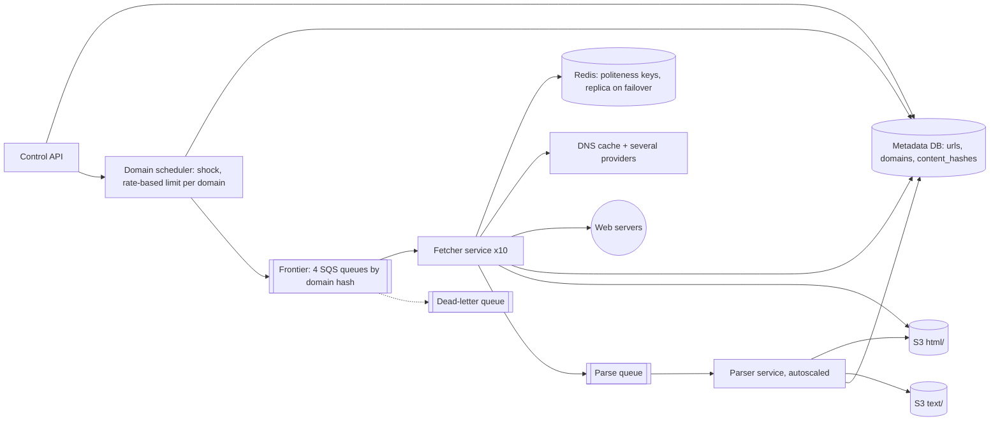
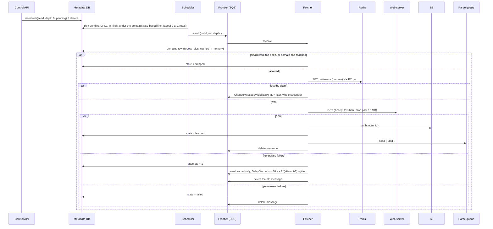
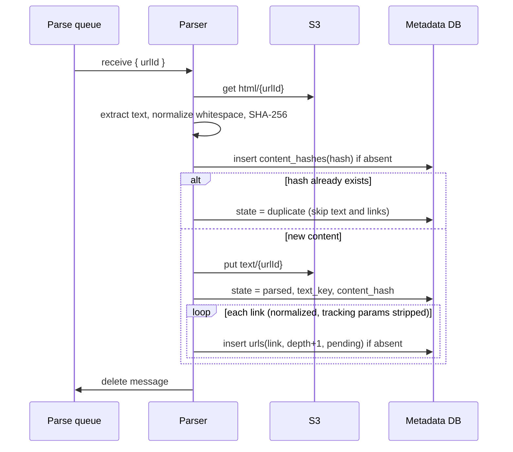

# Final design flow — Web Crawler

Redraw this at the end. Interview sequences stay in [FLOW.md](FLOW.md). Component roles stay in [COMPONENTS.md](COMPONENTS.md). Hello Interview is the shape source. These notes are original.

## Overview

The crawler is a pipeline. The control API (the lab's input) puts seeds in. A per-domain scheduler feeds the frontier. Fetchers download, parsers extract, and durable stores keep all progress. Boxes marked `shock` come from the step 4 situations.



## Crawl from seed URLs

```
POST /v1/crawls -> 202 Accepted { crawlId, status }
Body: { seeds, maxPages }

Frontier message -> { urlId, url, depth }
```



## Extract and store the text

```
Parse message -> { urlId }
Output: S3 text/{urlId}, urls.state = parsed or duplicate, new links inserted and scheduled
```



## Services

| Name | When it runs | What it does |
| --- | --- | --- |
| Control API | At crawl start, and for status | Inserts seed rows. Reports pages fetched, frontier size, and domains |
| Domain scheduler | Continuously | Moves `pending` URLs into the frontier, up to a rate-based limit for each domain (about 2 at 1 request a second), up to the domain page cap. Sends to one of 4 frontier queues by domain hash, to stay under the SQS in-flight quota |
| Fetcher service | Always, about 10 machines with async I/O | `robots.txt` check, depth and cap check, Redis politeness claim, DNS through the cache, `GET`, HTML to S3, retries with backoff, parse message |
| Parser service | Always, autoscaled on the parse queue | Text extraction, content-hash dedupe, link extraction and normalization, conditional URL inserts |
| DNS cache | On every fetch | Local caching resolver, plus several upstream providers |
| Redis | On every fetch | Holds `politeness:{domain}` keys with a TTL of the gap. A replica takes over on failure |

## Databases

### Metadata DB (DynamoDB, or Cassandra without lightweight transactions)

`urls`, key `url_hash`: `url`, `domain`, `depth`, `state` (pending, queued, fetched, parsed, duplicate, skipped, failed, dead), `attempts`, `http_status`, `last_error`, `html_key`, `text_key`, `content_hash`, `fetched_at`. About 10 billion rows, about 1 TB.

`content_hashes`, key `hash`: `first_url_hash`. About 480 GB.

`domains`, key `domain`: `robots_rules`, `crawl_delay_sec`, `robots_fetched_at`, `robots_status`, `in_flight` (URLs now in the frontier, under the rate-based limit), `pages_admitted` (for the cap), and `last_fetch_at` (dashboards only).

Index `pending_by_domain`, key `(domain, url_hash)` for rows with `state = pending`. The scheduler reads the next N pending URLs of one domain from this index.

New URLs are written with `PutItem` and `attribute_not_exists(url_hash)`. The lab runs the same call on DynamoDB Local.

### Redis

| Key | Value | TTL |
| --- | --- | --- |
| `politeness:{domain}` | The fetcher id that claimed the slot | The gap: 1 s, or the `Crawl-delay` |

### SQS

| Queue | Message | Settings |
| --- | --- | --- |
| Frontier, 4 queues split by domain hash | `{ urlId, url, depth }` | Visibility timeout 60 s. A politeness deferral (about 1 s) uses `ChangeMessageVisibility`. A retry backoff sends the body again with `DelaySeconds` and deletes the old message, because a delayed message is not in flight (quota about 120,000 for each queue). `maxReceiveCount` 100 as a safety net. Real failures counted in `urls.attempts` |
| Parse | `{ urlId }` | Visibility timeout 60 s. A dead-letter queue for HTML that keeps failing |

### S3

| Key | Holds |
| --- | --- |
| `html/{urlHash}` | Raw HTML, kept for re-extraction |
| `text/{urlHash}` | Extracted text, the output |

Interview sequences are in [FLOW.md](FLOW.md). Component roles are in [COMPONENTS.md](COMPONENTS.md).
