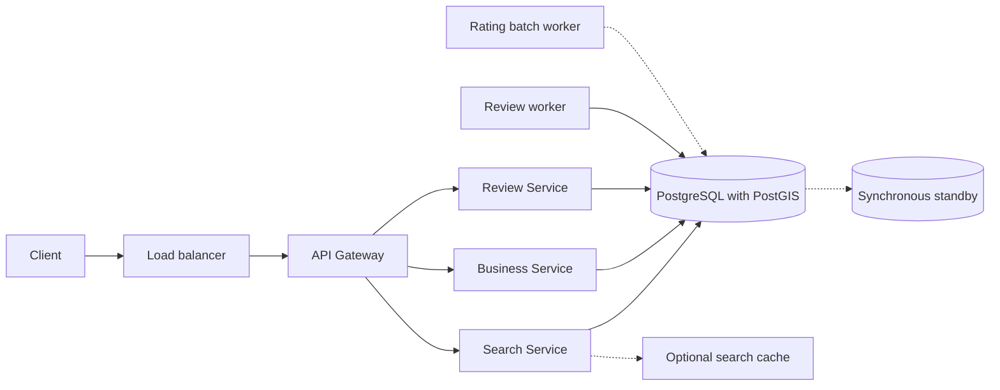
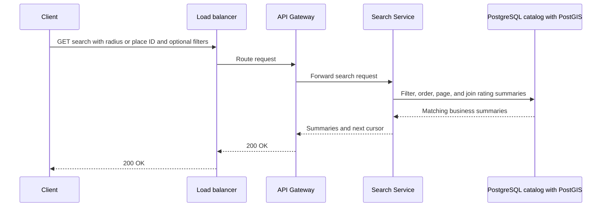
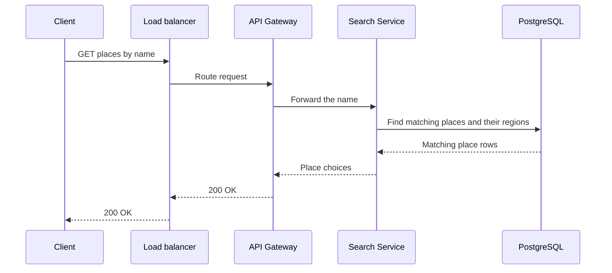
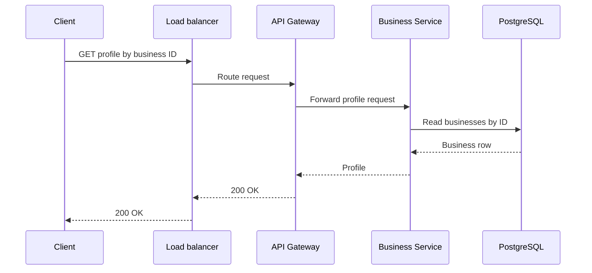
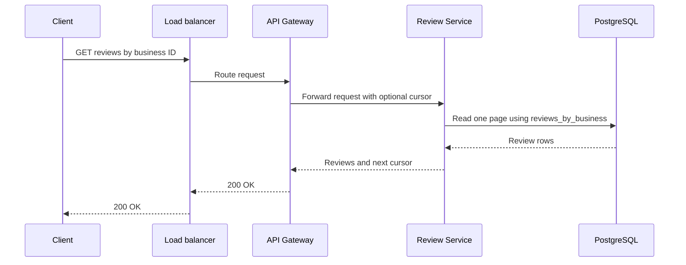
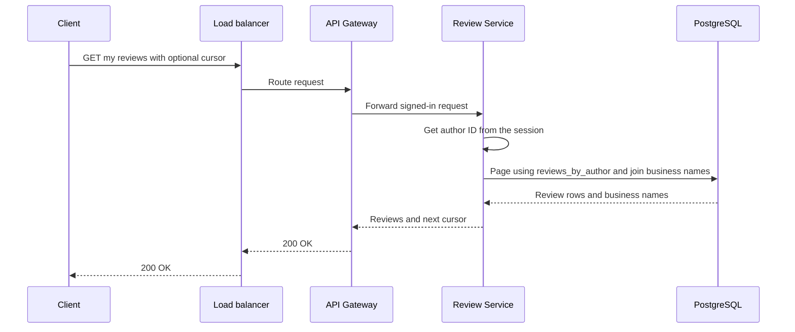
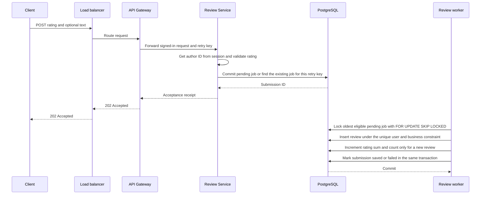
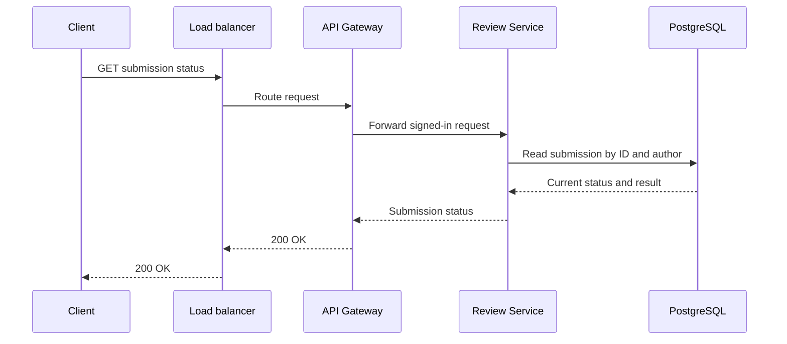
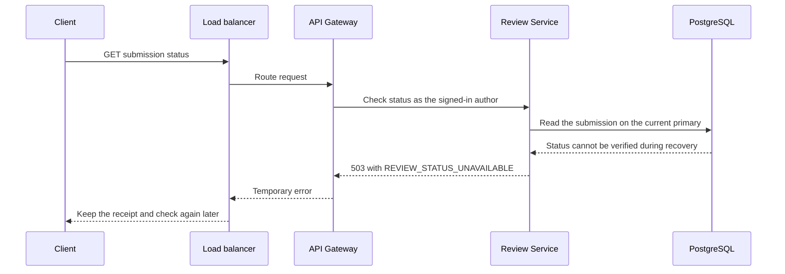

# System flow — Yelp

The [Hello Interview Yelp prompt](https://www.hellointerview.com/learn/system-design/problem-breakdowns/yelp) provides the search, profile, and review feature split. These sequences describe this session's design.

## Overview



The cache, rating batch worker, and synchronous standby support the scenarios in Step 4. The load balancer and gateway are separate roles that one local proxy can fill.

## Request paths

A cursor marks where to continue a result list. The service gets the author from the signed-in session. The client reuses the same idempotency key when it retries the same submission.

### Search businesses

```text
GET /v1/businesses/search -> 200 OK { businesses: [{ businessId, name, category, distanceM, averageRating, reviewCount }], nextCursor }
Query: { name?, category?, cursor?, placeId?, areaMode?, nameMode?, cacheMode? }
Radius mode also requires: { lat, lon, radiusM }
Body: none
```



Use either a place ID or coordinates and a radius. With a place ID, the query filters business points by the place boundary and measures distance from the stored center.

### Find a named place

```text
GET /v1/places -> 200 OK { places: [{ placeId, name, region, kind, centerLat, centerLon }] }
Query: { name }
Body: none
```



### Read a business profile

```text
GET /v1/businesses/{businessId} -> 200 OK { businessId, name, category, address }
Body: none
```



### Read a business's reviews

```text
GET /v1/businesses/{businessId}/reviews -> 200 OK { reviews: [{ reviewId, rating, text, createdAt }], nextCursor }
Query: { cursor? }
Body: none
```



When the client opens a search result, it can start the profile and review requests together. Both use the business ID already present in the search result.

### Read my reviews

```text
GET /v1/me/reviews -> 200 OK { reviews: [{ reviewId, businessId, businessName, rating, text, createdAt }], nextCursor }
Query: { cursor? }
Body: none
```



### Submit a review

```text
POST /v1/businesses/{businessId}/reviews -> 202 Accepted { submissionId, status: "accepted" }
Query: { mode? }  // queued (default) | queued-batch | direct
Header: Idempotency-Key
Body: { rating: 1–5, text? }
Direct mode: 200 OK { reviewId, status: "saved" }
Temporary overload: 503 Service Unavailable { errorCode: "REVIEW_QUEUE_BUSY" }
Response header on overload: Retry-After
```



The worker runs independently once the job commits. It can save the review before the acceptance response reaches the client.

In direct mode, the Review Service saves the review and increments the rating totals in one transaction. It returns the saved review ID after commit. In queued-batch mode, the review worker saves a rating event with the review, then the rating batch worker applies the event. The local client uses `X-Demo-User` on signed-in requests.

### Check submission status

```text
GET /v1/review-submissions/{submissionId} -> 200 OK { submissionId, status, reviewId?, errorCode? }
Status: pending | saved | failed
Body: none
Temporary recovery error: 503 Service Unavailable { errorCode: "REVIEW_STATUS_UNAVAILABLE" }
```

If a different submission already saved this user's review for the business, return `failed` with `errorCode: REVIEW_ALREADY_EXISTS`.



## Failure / overload path

If the acceptance response is lost, retry with the same key and payload. The Review Service returns the original submission ID, including while intake is paused. If the worker crashes before commit, the review insert, rating summary update, and status change roll back together. The job can run again. If the queue is unavailable or exceeds its limit, return a temporary error for new submissions. Keep previously accepted jobs and serve status requests while PostgreSQL is healthy.

During database recovery, return a temporary error when the service cannot verify status. In the replicated design, require a durable copy on the standby before acknowledging acceptance. Serve status after replay on the promoted standby.


