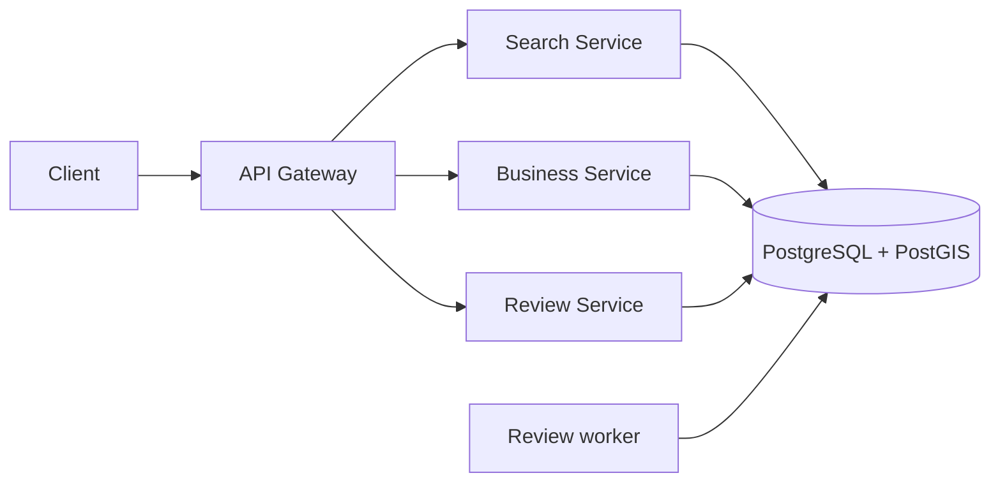

# Yelp

**Status:** Implemented
**Sources:** [Hello Interview: Yelp](https://www.hellointerview.com/learn/system-design/problem-breakdowns/yelp). Related: Alex Xu Vol 2, Proximity Service.

**Slug:** `yelp`

Practice in the five-step interview pattern. Keep notes original; link to Hello Interview / cite Alex Xu instead of copying write-ups.

## 1. Requirements and design scope

### Interview prompt

Design Yelp for 100 million daily active users and 10 million businesses. A user wants to find a ramen restaurant, decide where to eat, and share their experience afterward. What must the user be able to do? What quality targets matter for search and review submission? What is out of scope?

### Problem

Help people find businesses by location, name, and category. Let them read business details and reviews, and leave a star rating with optional text.

### Functional requirements

- Search by coordinates and radius, with optional name and category filters. The named-area extension searches inside a selected city or neighborhood.
- Read a business profile and page through its reviews.
- Read the reviews written by the signed-in user.
- Submit a review for a business. A signed-in user must give a rating from one to five stars. Review text is optional.

### Non-functional requirements

- **Scale:** 10 million businesses and 100 million daily active users. Assume five searches per user per day and a peak at five times the average. That gives 500 million searches per day, about 5,800 per second on average, and about 29,000 per second at peak. The search rate and peak factor are our assumptions. Estimate review writes separately.
- **Search latency:** Target a p95 below 500 ms at peak. At least 95% of search API calls should complete within that time. Measure review submission latency separately.
- **Availability and freshness:** Search and profile reads should remain available if the rating update path is behind. An older average is acceptable during a short delay. The review write can fail if durable storage is unavailable.
- **Durability and retries:** Return an acceptance receipt after the submission is stored durably. Report `saved` after the public review row commits. A retry of the same request returns the same submission ID without creating a duplicate review.

**Option A — Require immediate visibility.** Confirm the review only when search and profiles can both show the change. This reduces stale reads. A slow search update can delay review submission. Use this when immediate public visibility is a hard requirement.

**Option B — Acknowledge the submission after durable acceptance.** Lee can see pending while Kim still sees the previous average. Search can continue to serve reads. The worker later saves the review and updates its summary.

**Allow the public rating to lag.** Search freshness and the choice to queue review submission are separate decisions. The search traffic estimate does not establish the review write rate.

### Scope

- **In:** Business search, profiles, and reviews.
- **Business administration:** Start with an existing catalog. Skip owner registration and admin tools for adding, changing, and removing listings.
- **Map display:** Return a list. Location still limits which businesses match.
- **Personalized recommendations:** Match the user's query. Skip suggestions based on user history or preferences.
- **Detailed data protection and GDPR workflows:** Skip a separate privacy design. Use basic sign-in to identify a review author.
- **Broad fault tolerance:** Skip a separate region recovery design. Keep the availability and durability goals above.
- **Spam and abuse:** Skip detecting fake reviews and bad listings. Still check that ratings are in range.

### Core entities

| Entity | Description |
| --- | --- |
| Business | A catalog entry with an ID, name, category, and coordinates. |
| User | The signed-in author of a review. |
| Review | An author's rating and optional text for one business. |

### APIs

Working API shapes for Step 2. A cursor marks where to continue a result list. The service gets the author from the signed-in session. The client reuses the same idempotency key when it retries the same submission.

#### Search businesses

```text
GET /v1/businesses/search -> 200 OK { businesses: [{ businessId, name, category, distanceM, averageRating, reviewCount }], nextCursor }
Query: { name?, category?, cursor?, placeId?, areaMode?, nameMode?, cacheMode? }
Radius mode also requires: { lat, lon, radiusM }
Body: none
```

Use either a place ID or coordinates and a radius. For a place ID, distance is measured from the stored place center.

#### Find a named place

```text
GET /v1/places -> 200 OK { places: [{ placeId, name, region, kind, centerLat, centerLon }] }
Query: { name }
Body: none
```

#### Read a business profile

```text
GET /v1/businesses/{businessId} -> 200 OK { businessId, name, category, address }
Body: none
```

#### Read a business's reviews

```text
GET /v1/businesses/{businessId}/reviews -> 200 OK { reviews: [{ reviewId, rating, text, createdAt }], nextCursor }
Query: { cursor? }
Body: none
```

#### Read my reviews

```text
GET /v1/me/reviews -> 200 OK { reviews: [{ reviewId, businessId, businessName, rating, text, createdAt }], nextCursor }
Query: { cursor? }
Body: none
```

#### Submit a review

```text
POST /v1/businesses/{businessId}/reviews -> 202 Accepted { submissionId, status: "accepted" }
Query: { mode? }  // queued (default) | queued-batch | direct
Header: Idempotency-Key
Body: { rating: 1–5, text? }
Direct mode: 200 OK { reviewId, status: "saved" }
Temporary overload: 503 Service Unavailable { errorCode: "REVIEW_QUEUE_BUSY" }
Response header on overload: Retry-After
```

#### Check submission status

```text
GET /v1/review-submissions/{submissionId} -> 200 OK { submissionId, status, reviewId?, errorCode? }
Status: pending | saved | failed
Body: none
Temporary recovery error: 503 Service Unavailable { errorCode: "REVIEW_STATUS_UNAVAILABLE" }
```

Only the author can check the status. Return the review ID when the status is `saved` and an error code when it is `failed`. A submission that conflicts with an existing review returns `failed` with `REVIEW_ALREADY_EXISTS`.

## 2. High-level design

The Search Service and Business Service follow the [Proximity Service design](../proximity-service/README.md). Yelp adds a Review Service for review reads and submissions and a worker for saving accepted reviews. The services start with one PostgreSQL database with PostGIS. The three core tables are `users`, `businesses`, and `reviews`. The `review_submissions` table holds durable jobs and their status. The `business_rating_stats` table holds rating totals for search.

See the [request flows](FLOW.md), [component roles](COMPONENTS.md), [design comparison](high-level-design-comparision.md), and [final design flow](final-design-flow.md).



### Search businesses

1. The client sends coordinates, a radius, and any name or category filters to the Search Service through the API gateway.
2. The Search Service queries the PostgreSQL business catalog. PostGIS handles the distance condition. The query applies all supplied filters before it orders and pages the results.
3. The Search Service reads the rating summary for each business on the page and returns the results and a cursor. If the user opens a result, the client uses its business ID to request the full profile from the Business Service.

| Option | Behavior and tradeoff |
| --- | --- |
| A — Find nearby IDs, then filter | This works if the service filters the full nearby candidate set before paging. It is simple for a small set. A large set costs extra reads and data transfer. Filtering only the first 20 nearby results can miss matches outside those 20. |
| B — Search each filter separately | Get candidate IDs for distance and for name or category, then keep the IDs that match both. This can work with separate indexes or stores. It adds calls and merge work. A page from either list alone is not enough for a complete intersection. |
| C — Apply all filters in one search | Let the Search Service apply all the conditions in the catalog query before paging. Return the fields needed for the list from the same query. This keeps a single search API and avoids one Business Service call per result. |

**Pick Option C as the starting design for the interview and the lab.** Both the location and list fields are in the same catalog. At an estimated 29,000 peak searches per second, avoid adding up to 20 downstream calls for every 20-result page. This is a starting request path. It does not establish that one database server can handle the target. If search later returns only IDs, load details for the selected page in one batch and preserve search order.

### Read a business profile and its reviews

1. The client sends the business ID to the Business Service through the gateway. The service reads `businesses` and returns the profile.
2. The client sends the same ID to the Review Service through the gateway. The service reads one page from `reviews`, newest first, and returns a cursor for the next page. The client can start the first two requests together.

| Option | Behavior and tradeoff |
| --- | --- |
| A — Return the profile and first review page in one response | The client makes one call. This fits a screen that always needs both. The profile response can wait on a slow review read unless the API supports partial results. |
| B — Give the profile and reviews separate read endpoints | The client can show the profile as soon as it arrives and fetch more reviews on demand. The client manages two requests when the first screen shows both. |

**Pick Option B for the interview and the lab.** A profile needs one business row. A review list can grow, so it has its own page size and cursor.

### Read my reviews

1. The client calls the Review Service through the gateway.
2. The service gets the author ID from the signed-in session. It reads one page from `reviews` for that author, newest first.
3. It joins the selected page to `businesses` to return the business name for each review. It returns the page and its next cursor.

Use the same `reviews` table with a separate index that starts with the author ID. This adds index maintenance on each insert and lets the query fetch the author's latest page in order.

### Submit a review

1. The signed-in client sends the business ID, rating, optional text, and a retry key to the Review Service through the gateway.
2. The service uses the signed-in user ID as the author and validates the input. It stores a pending job in `review_submissions`. After commit, it returns `202 Accepted` and the submission ID. The client displays `pending`. A retry with the same key and payload for that author returns the same receipt.
3. A worker claims a pending job. In one transaction it inserts the rating and optional text into `reviews`, updates the rating summary if the insert succeeds, and marks the job `saved` with the new review ID. If the worker crashes before commit, all changes roll back and the job is available again.
4. The client polls the status endpoint. The Review Service returns `pending`, `saved`, or `failed` to the author. Retry temporary errors in the worker and use `failed` for a terminal error.

| Option | Behavior and tradeoff |
| --- | --- |
| A — Save the review in the request | Save the review, rating summary, and retry information in one transaction. Return the review ID and saved status after commit. This is the simpler path when PostgreSQL can meet the write latency target at peak. A burst reaches the review write path immediately. |
| B — Queue the submission for a worker | Return `202 Accepted` after the pending job commits. Workers control the rate of publication and can resume jobs after a restart. The app polls for the result. The queue adds another transaction, polling traffic, worker operations, and a delay before publication. |

**Use Option A as the production starting point if it passes a peak review write test.** The 29,000 requests per second estimate is for search. The 50 review submissions per second figure is a failure exercise, not a measured workload. Estimate review submissions separately. Test write latency and error rate during peak traffic, including bursts at one business and concurrent searches.

**Keep Option B as the chosen Yelp study and lab path.** It teaches durable acceptance, worker recovery, and status polling. A production queue is also useful when temporary bursts exceed the safe publication rate and users can tolerate a short pending period. The PostgreSQL queue still needs the same database to accept work and adds database operations. Watch queue depth and oldest pending age. Limit new intake during sustained overload.

## 3. Low-level design and deep dive

### Data model

The lab uses one PostgreSQL database. It has six core tables and two tables for variants: `business_places` for precomputed place membership and `rating_outbox` for batched rating updates.

| Table | Key fields | Purpose |
| --- | --- | --- |
| `users` | `user_id` (primary key), `display_name` | Identifies a review author. |
| `businesses` | `business_id` (primary key), `name`, `category`, `address`, `location` (PostGIS point) | Holds the business profile and the fields that search filters. |
| `reviews` | `review_id` (primary key), `user_id`, `business_id`, `rating`, `text` (optional), `created_at`, `direct_retry_key` (optional) | Holds each saved review. The author and business IDs are required foreign keys, and their pair is unique. Direct submissions use `direct_retry_key` to find the original review on retry. |
| `review_submissions` | `submission_id` (primary key), `user_id`, `business_id`, `idempotency_key`, `rating`, `text` (optional), `status`, `review_id` (when saved), `error_code` (when failed), `created_at`, `next_attempt_at`, `attempt_count`, `batch_rating` | Holds the worker's input, retry schedule, and the status that the author can check. The `batch_rating` flag selects a deferred update to the rating summary. |
| `business_rating_stats` | `business_id` (primary key and foreign key), `rating_sum`, `review_count` | Holds one summary row per rated business. Search divides the sum by the count. |
| `places` | `place_id` (primary key), `name`, `region`, `kind`, `center` (PostGIS point), `boundary` (PostGIS multipolygon) | Holds the names, reference points, and boundaries of supported cities and neighborhoods. |
| `business_places` | `place_id`, `business_id` (composite primary key, both foreign keys) | Stores which businesses fall within each place for the precomputed search variant. |
| `rating_outbox` | `review_id` (primary key and foreign key), `business_id`, `rating`, `created_at`, `applied_at` (optional) | Records the rating from each saved review in the batch variant. The worker updates the rating summary and marks those rows as applied in one transaction. |

Keep `(user_id, idempotency_key)` unique in `review_submissions` so that a retry with the same key and payload finds the original submission. For example, the API inserts submission `s17` as pending when Lee submits five stars for Sunny Ramen. The worker inserts public review `r42` and updates `s17` to saved with `review_id = r42` in one transaction. The public review list reads `reviews`. The status endpoint reads `review_submissions`.

#### Review list indexes

```sql
CREATE INDEX reviews_by_business
    ON reviews (business_id, created_at DESC, review_id DESC);
CREATE INDEX reviews_by_author
    ON reviews (user_id, created_at DESC, review_id DESC);
```

Both lists return the latest reviews first. A cursor carries the last row's `created_at` and `review_id`. The second field breaks ties when two reviews have the same timestamp. The next page adds `(created_at, review_id) < (cursor_time, cursor_id)` with bound parameters. An index that matches the filter and sort can find the first page without sorting all reviews for that business or author. The unique constraint on `(user_id, business_id)` enforces the posting rule separately. [PostgreSQL indexes and ordering](https://www.postgresql.org/docs/current/indexes-ordering.html) and [row comparisons](https://www.postgresql.org/docs/current/functions-comparisons.html#ROW-WISE-COMPARISON).

### Deep dives

The interesting internals of *this* problem (the ones an interviewer will probe):

1. Combine business name, category, and distance filters.
2. Allow one review per user and business.
3. Update the average rating and show it in search.
4. Search by a city or neighborhood name.

**Step 3 opening prompt.** Lee searches for ramen restaurants within 3 km. There are 5,000 businesses in the radius and 300 businesses with ramen in the name across the whole catalog. Assume both filters have usable indexes. Which candidate set would you start with, and which conditions must the result pass before you return the first page?

#### Combine name, category, and distance filters

The learner chose the 300 name matches as the starting set. With comparable lookup costs, this leaves fewer rows to check. The Search Service sends one query to PostgreSQL with the name, category, and distance conditions. The query checks all conditions, orders the matches by distance and business ID, then returns up to 20 rows. The business ID breaks distance ties.

- **Option A — Start from the name index.** A `pg_trgm` index supports a case-insensitive substring such as `ILIKE '%ramen%'`. From the 300 name matches, check category and the 3 km radius. This fits selective name searches. A common name fragment can leave many candidates. [PostgreSQL trigram indexes](https://www.postgresql.org/docs/current/pgtrgm.html).
- **Option B — Start from the spatial index.** Use PostGIS to find candidates and check the radius with `ST_DWithin`. Then check name and category. This fits a tight radius or a search without a name. In the example, 5,000 businesses pass the radius check. [PostGIS distance predicate](https://postgis.net/docs/ST_DWithin.html).
- **Option C — Let PostgreSQL choose or combine indexes.** Provide the name and spatial indexes. PostgreSQL can scan one index and filter the remaining conditions. It can also intersect candidate row locations from multiple indexes before reading table rows. Each index scan costs work. The planner estimates whether that cost is worth paying. [PostgreSQL index combination](https://www.postgresql.org/docs/current/indexes-bitmap-scans.html).

**Pick Option C for the starting interview design and the lab.** The 300 vs. 5,000 comparison favors name first in this example, but a tight radius or a broad name fragment can reverse the choice. Use `EXPLAIN (ANALYZE, BUFFERS)` on representative queries to inspect the plan, actual row counts, and reads. Measure peak latency separately. If the catalog cannot meet the 500 ms p95 target after tuning, compare a dedicated search index. It can scale search separately but adds a second store to update and can return stale data.

#### Choose an index for each filter

The earlier exercise chose which candidate set to start from. The [Hello Interview Yelp breakdown](https://www.hellointerview.com/learn/system-design/problem-breakdowns/yelp) also prompts a separate choice about which index serves each filter. All three indexes can live on the PostgreSQL catalog.

| Filter | PostgreSQL choice | What it does |
| --- | --- | --- |
| Location | PostGIS GiST spatial index | Finds nearby candidates. PostGIS implements an R-tree on GiST and checks the exact radius or place boundary. Geohash and quadtree are other ways to find candidates. [PostGIS spatial indexes](https://postgis.net/docs/using_postgis_dbmanagement.html#spatial_indexes) |
| Name by word | GIN on a `tsvector` | An inverted index maps a term such as `ramen` to rows that contain it. A search for the partial string `ram` has different semantics. [PostgreSQL text indexes](https://www.postgresql.org/docs/current/textsearch-indexes.html) |
| Name by substring | GIN with `pg_trgm` | Supports the current `ILIKE '%ramen%'` behavior. Use the substring mode when the user can type part of a business name. [PostgreSQL trigrams](https://www.postgresql.org/docs/current/pgtrgm.html) |
| Category | B-tree on `category` | Supports equality such as `category = 'restaurant'`. The planner may skip the index if most rows match or another filter is cheaper. [PostgreSQL index types](https://www.postgresql.org/docs/current/indexes-types.html) |

#### PostgreSQL or Elasticsearch for business search

- **Option A — Query PostgreSQL with all filters.** Let PostGIS and the SQL indexes do the work. Use trigram search for the existing name-contains behavior and compare word search with a GIN full-text index. This is simple to operate and searches the source rows. Search competes for PostgreSQL resources with profile reads and review writes.
- **Option B — Add a separate Elasticsearch read index.** Keep PostgreSQL as the source of truth. Copy one search document per business with its ID, analyzed name, exact category, point, and rating summary. The Search Service sends the name match, category, and spatial filter to Elasticsearch in one query. For radius use a geo-distance filter. For a named area pass its boundary as a geo-shape filter. Apply filters before ranking and paging. This lets search scale separately and supports richer name matching, at the cost of another service and index lag. Default word matching is different from substring search. Configure the text fields to match the product requirement. [Elasticsearch match](https://www.elastic.co/docs/reference/query-languages/query-dsl/query-dsl-match-query), [boolean filters](https://www.elastic.co/docs/reference/query-languages/query-dsl/query-dsl-bool-query), [distance](https://www.elastic.co/docs/reference/query-languages/query-dsl/query-dsl-geo-distance-query), and [shapes](https://www.elastic.co/docs/reference/query-languages/query-dsl/query-dsl-geo-shape-query).

**Pick Option A for the initial design.** Compare the name modes on the same inputs. Test at the 29,000 searches per second estimate with realistic radii, text terms, and concurrent review writes. Consider Option B if PostgreSQL misses the p95 target after tuning or if the product needs richer relevance. Start the separate index with a catalog backfill. Then apply committed business and rating changes through change data capture or a transactional outbox. Upsert by business ID and reject stale versions. Search can see the old name or rating until the index catches up. Business profiles and reviews still come from their authoritative stores. [Elasticsearch refresh behavior](https://www.elastic.co/docs/manage-data/data-store/near-real-time-search).

#### Allow one review per user and business

The learner put the rule in `reviews`. Lee can submit a five-star review for Sunny Ramen from a phone and a four-star review from a laptop. Two different retry keys produce two jobs. Only one job can create a public review.

- **Option A — Check for a review before inserting.** The worker reads by user and business ID. If it finds a review, it can fail the job early. A single writer could enforce the rule this way. With two workers, both reads can see no row before either worker inserts. A check alone does not protect the table.
- **Option B — Add `UNIQUE (user_id, business_id)` to `reviews`.** Each worker attempts the insert. The first successful insert wins, which can differ from submission order. Use `ON CONFLICT (user_id, business_id) DO NOTHING RETURNING review_id`. A returned ID means the worker can mark the submission saved. If the insert returns no row, mark the submission failed with `REVIEW_ALREADY_EXISTS` and keep the original review. Commit the result and job status in the same transaction. [PostgreSQL unique constraints](https://www.postgresql.org/docs/current/ddl-constraints.html#DDL-CONSTRAINTS-UNIQUE-CONSTRAINTS) and [conflict handling](https://www.postgresql.org/docs/current/sql-insert.html).

**Pick Option B for the interview and the lab.** Two concurrent jobs can use different retry keys, so deduplication at submission time does not enforce the public review rule. A retry with the same key still returns the original submission ID. A distinct submission that loses the insert gets a terminal status and does not change the public review.

#### Update the average rating and show it in search

The learner proposed a summary row per business. Keep the exact integer sum and count in that row. If Sunny Ramen has 4,200 total stars across 1,000 reviews, Lee's five-star review changes the totals to 4,205 and 1,001. The average is about 4.2008. It still displays as 4.2 at one decimal place. Round for display.

- **Option A — Calculate the average when reading.** Read the saved review ratings and calculate the average. This is easy to build and returns the current value. It works for a small number of infrequent reads. A search page with 20 popular businesses can make the database read many review rows each time.
- **Option B — Maintain the sum and count when saving a review.** After a successful review insert, add the rating to `rating_sum` and one to `review_count` with an atomic database update. Use an upsert to create the summary for the first review. Commit the review, totals, and submission status together. If a duplicate insert is skipped, leave the totals alone. Each search result needs at most one summary row. Concurrent writes for the same business must take turns updating that row. [PostgreSQL upsert](https://www.postgresql.org/docs/current/sql-insert.html).
- **Option C — Update the summary from a durable stream of review changes.** A separate worker can batch changes by business. This can help if the summary row causes write delays. Search can show older totals, and the worker must handle retry and replay without double counting.

**Pick Option B for the starting interview design and the lab.** At an estimated 29,000 peak searches per second, reuse totals instead of scanning reviews on each page. Join the summary rows for the selected page in one query. A business without a summary has a count of zero and a null average. Publication is already asynchronous from the POST because of the submission queue. A later search cache or separate index can catch up after the worker commits.

#### Search by city or neighborhood name

The learner proposed resolving San Francisco to a latitude and longitude, then using the radius query from Proximity Service. That works for a search near a named place. For a search in a city, the search region is the city's boundary. For example, a restaurant can be 6 km from the center and still be in the city. A 5 km circle would miss it. A circle can also cross a city boundary and include restaurants in another city.

- **Option A — Use a center and radius.** Look up the place center and pass it to the existing radius query. This is simple and fits near-center searches. The radius only approximates city membership.
- **Option B — Use the place boundary.** Resolve the name against the `places` table. If several places share a name, show the choices with region labels and send the selected ID to search. PostGIS uses `ST_Covers(boundary, business.location)` to check membership, including points on the boundary. Keep the name and category filters before paging. Order by distance to the stored center, then by business ID. This matches the named-area request and needs valid boundary data. [PostGIS boundary check](https://postgis.net/docs/ST_Covers.html).

**Pick Option B for named-area search.** Show Option A in the lab with the same place center so the learner can compare the result sets. The location of Lee's device does not set the search area once Lee chooses San Francisco. A place lookup can use the seeded catalog, so the lab needs no external geocoder.

#### Compute place membership at search time or ahead of time

Both paths start with the same imported boundaries in `places`. GeoJSON is a format for transferring the polygon. A stable `place_id` identifies the area after the user selects its name.

- **Option A — Check the polygon during each search.** PostgreSQL can use `ST_Covers` on business points. Elasticsearch can use a `geo_shape` polygon query against a business's `geo_point` field. A bounding box is a rectangle. It can find candidates, but it can include points outside an irregular neighborhood. Use the polygon for membership. This path uses current boundaries in PostgreSQL and supports shapes that users have just specified. [PostGIS polygon coverage](https://postgis.net/docs/ST_Covers.html), [Elasticsearch shape query](https://www.elastic.co/docs/reference/query-languages/query-dsl/query-dsl-geo-shape-query), and [bounding box query](https://www.elastic.co/docs/reference/query-languages/query-dsl/query-dsl-geo-bounding-box-query).
- **Option B — Precompute place membership.** When a business enters the catalog or moves, test its point against the supported place polygons. For example, business `123` can belong to `bay-area`, `sf-ca`, and `sf-mission`. Store those memberships as rows in PostgreSQL `business_places(place_id, business_id)`, keyed by both fields, or project the IDs into an Elasticsearch `keyword` field named `place_ids`. Searching the Mission then looks up `sf-mission` by exact ID. Apply name and category filters before paging. [Elasticsearch multi-value fields](https://www.elastic.co/docs/reference/elasticsearch/mapping-reference/array) and [exact term query](https://www.elastic.co/docs/reference/query-languages/query-dsl/query-dsl-term-query).

**Start with Option A in PostgreSQL.** Consider Option B for busy searches over a fixed catalog of cities and neighborhoods. It moves the polygon check to catalog updates and replaces repeated shape checks with indexed lookups. If a boundary changes, recompute memberships for businesses in the old or new area so obsolete tags are removed. Memberships can lag until the update finishes. A custom radius still uses the stored coordinates. Compare both paths on the same boundaries and business points before choosing based on latency.

### Session notes — 2026-11-08

The learner chose to practice all five steps, starting with requirements and scope. Save the combined search exercise for Step 3: search for `ramen`, category `restaurant`, within 3 km. Compare a ramen restaurant 1 km away, a ramen restaurant 5 km away, and a bookstore called Ramen Books 500 m away. Which results should appear? How would the Search Service combine the filters without scanning the full catalog?

Step 1 complete. The learner proposed the three core features, the search latency and scale targets, and eventual consistency. We agreed that an accepted review must survive a crash and that the public average can lag. Step 2 prompt: trace search, profile and reviews, and review submission. Name the service and store each request uses, and identify when the client sees success.

Step 2 complete. The learner proposed finding nearby business IDs, then getting business information. The starting design applies all filters before paging and reads the list fields from the catalog. The learner added a Review Service and separate user, business, and comment tables. The learner chose to queue review submissions to smooth bursts. The Review Service confirms durable acceptance, and the worker later saves the review and updates its status in one transaction.

## 4. Component questions and special situations

**Opening prompt.** The review workers are down for ten minutes. PostgreSQL and the Review Service are healthy, and the service receives 50 new submissions per second. What should Lee see after submitting a review? How should we decide when to stop accepting new jobs, and how should the workers catch up after recovery?

### Review worker outage

The learner proposed accepting durable jobs while there is room. After the queue row commits, Lee gets `202 Accepted` and sees pending. Workers resume unfinished jobs after recovery. A retry with the same key returns the existing receipt, even when the service has paused new intake.

- **Option A — Pause intake as soon as workers stop.** New submissions get a temporary error. This protects the publication delay when the allowed wait is short, but even a brief worker restart stops new submissions.
- **Option B — Accept up to a queue limit.** Use pending count and oldest job age to decide when to pause new intake. This absorbs short outages while limiting the work that can build up. Once the limit is reached, return `503` with `Retry-After`. Keep existing jobs available to workers and to the status endpoint.

**Pick Option B for the interview and lab.** Set thresholds from the tolerated delay and measured drain rate. For example, with a 15,000-job cap, an initially empty queue fills in 5 minutes at 50 submissions per second if no worker is running. The lab can use a small configurable limit. Recover at a rate PostgreSQL can sustain alongside search. Watch the pending count, age of the oldest job, and actual completion rate.

If we accept all jobs in the exercise, the queue grows to `50 × 600 = 30,000`. After recovery, workers finish 150 per second and new work adds 50 per second. The queue shrinks by 100 per second, so it takes `30,000 ÷ 100 = 300 seconds` to reach zero. If workers only match the arrival rate, the backlog stays the same.

### How the worker claims and saves a review

- **Option A — Run a scheduled job.** Cron can start a script that drains a batch. This fits low volume when a schedule-sized wait is acceptable. Work can wait until the next run.
- **Option B — Run a Python worker continuously.** The worker queries PostgreSQL, processes one available row per transaction, and waits briefly when it finds none. This supports prompt processing and multiple workers. It adds a process to run and monitor.
- **Option C — Use a stream processing system.** Flink or Spark Structured Streaming can compute aggregates across an event stream. That fits broader analytics or streaming joins. It adds infrastructure to a queue whose work is already local to PostgreSQL. [Flink architecture](https://flink.apache.org/what-is-flink/flink-architecture/) and [Spark Structured Streaming](https://spark.apache.org/docs/latest/streaming/index.html).

**Pick Option B for the interview and the lab.** The submission table is the queue. The worker starts a transaction and runs this query. A new job starts with `next_attempt_at` set to its creation time.

```sql
SELECT submission_id, user_id, business_id, rating, text
FROM review_submissions
WHERE status = 'pending'
  AND next_attempt_at <= now()
ORDER BY created_at, submission_id
LIMIT 1
FOR UPDATE SKIP LOCKED;
```

The query locks the oldest eligible, unlocked row. Another worker can skip that row and claim the next one. Use the row's state to track progress. Workers can complete jobs out of order. A job waiting for a retry is eligible again after `next_attempt_at`. [PostgreSQL locking clauses](https://www.postgresql.org/docs/current/sql-select.html#SQL-FOR-UPDATE-SHARE).

While holding the lock, insert the review, increment the rating totals if the insert succeeds, and mark the job saved. Commit the changes together. If the review already exists, keep the original and mark the job failed. For a retryable job error, roll back partial work to a savepoint made after the claim, then record the attempt and a later retry time if the transaction is still usable. If the transaction or connection is lost, the worker backs off and checks the durable state again. A rollback leaves the job pending. A successful commit leaves it saved. [PostgreSQL savepoints](https://www.postgresql.org/docs/current/sql-rollback-to.html).

If Lee loses the POST response, the same idempotency key returns the same submission ID. If Lee loses a status response, the app repeats the status GET for that ID.

### Special situations

#### Search traffic grows tenfold

Search grows from 29,000 to 290,000 requests per second. Search Service instances have spare capacity, but PostgreSQL is saturated and search p95 exceeds 500 ms. The learner proposed measuring request latency and adding a cache.

Measure the search API p95 and split the request time into waiting for a database connection and running the query. Compare PostgreSQL CPU, disk I/O, and lock waits. Use `pg_stat_statements` to find queries that consume the most total execution time. Use a representative query plan to check why it costs so much. Measure how often users repeat the same search. [PostgreSQL query statistics](https://www.postgresql.org/docs/current/pgstatstatements.html).

- **Option A — Tune the slow query.** Inspect the plan on representative data. Fix a scan, sort, or join that reads too many rows. This helps every request of that type, including new searches. If the plan is already efficient, tuning alone may leave the database at capacity.
- **Option B — Cache repeated results in front of PostgreSQL.** The Search Service checks the cache and queries PostgreSQL on a miss. Start with popular first pages and a short expiration time. Key a page by the full search inputs, including the place or exact coordinates and radius, name, category, and cursor when used. This helps when requests repeat. A cached page can show a slightly older rating. A distinct coordinate or query can reduce the hit rate.
- **Option C — Add search read capacity.** Read replicas or a separate search index can share read work when many searches miss the cache. Replicas can lag. A search index needs its own update path. Both cost more to operate.

**Test Option B first if the traffic sample shows strong reuse.** At 290,000 requests per second, a 90% hit rate leaves about 29,000 misses per second, assuming each miss issues one query. That rate is an estimate, not a capacity guarantee. Compare API p95, database query rate, and error rate at the same offered load. If the miss rate is high or each miss costs too much, tune the query and then test more read capacity. The lab can compare the same query with and without a small cache.

#### Rush hour cache expiry

At noon, 500 requests for the same first page of ramen restaurants in San Francisco arrive just after its cache entry expires. If each request misses before any refresh completes, PostgreSQL can receive 500 copies of the same query. The learner proposed grouping the requests.

- **Option A — Let each miss query the database.** This keeps the search path simple. It works for occasional misses. Concurrent misses for a popular page can overload PostgreSQL.
- **Option B — Coalesce requests with the same cache key.** The first request starts the query. The others wait for the shared result, and the service fills the cache after success. One group issues one query for that key during a successful refresh. The group shares the refresh delay and result. Use a timeout and share failures so waiting requests do not all retry PostgreSQL on their own. [Singleflight pattern example](https://pkg.go.dev/golang.org/x/sync/singleflight).
- **Option C — Serve the old page while one request refreshes it.** Requests get a fast response within an allowed stale window. This fits public results that can tolerate old ratings. It needs a policy for how long the old page remains safe to serve, and a separate path for a cold miss. [Stale while revalidate](https://www.rfc-editor.org/rfc/rfc5861.html#section-3).

**Pick Option B for the lab and the starting interview design.** A single process can turn 500 simultaneous misses into one query for the same page. In production, a group per process can issue one query per process. Ten processes can still send ten queries for one refresh. Coordinate across instances if that load still causes a problem.

#### Future sharding by business or author

A shard is a database that owns part of the data. Use a routing key to send a request to the database that owns it.

- **Option A — Shard by business ID.** Route the profile, saved reviews, pending jobs, and rating totals for one business to the same shard. The review worker can still commit its changes together. The one-review rule stays local because the unique pair includes the business ID. Lee's reviews can span several shards. Use a view keyed by user ID for that read when scatter and merge gets expensive. [Citus distributed uniqueness](https://docs.citusdata.com/en/v7.5/reference/common_errors.html#cannot-create-uniqueness-constraint).
- **Option B — Shard reviews by author ID.** Lee's review history and author-wide retry keys stay on one shard. A business's reviews and rating updates can span many shards. This fits an author-first workload, but a business page needs a separate read view or a merge across shards.
- **Option C — Shard the search view by geography.** A city or cell determines which search partitions to query. If a circle crosses a partition boundary, query each overlapping partition, apply the exact spatial filter, and merge the ordered results. Geography helps route nearby reads, but a busy city can carry much more traffic than its neighbors. [Vitess routing keys and secondary lookups](https://vitess.io/docs/reference/vindexes/).

**Pick Option A as the first write sharding design when one database can no longer handle the measured workload.** Add Option C for the search view when the search workload needs separate capacity. Keep the public review authoritative on its business shard. Publish changes from a durable outbox to the user review view and search view. Consumers can upsert by stable IDs and tolerate replay. These read views can lag. [Transactional outbox](https://docs.aws.amazon.com/prescriptive-guidance/latest/cloud-design-patterns/transactional-outbox.html).

Two current API paths need explicit routing. Status checks can use a submission ID that carries a stable routing bucket or a lookup from submission ID to shard. Author-wide uniqueness on `(user_id, idempotency_key)` cannot be enforced by independent business shards. Keep an author-keyed registry if that guarantee must stay global. A business-scoped key is simpler if the API explicitly adopts that contract.

For migration, copy businesses and related rows in batches, replay changes made during the copy, verify the target, then switch routing with one active writer per business. A single popular business still lands on one shard. Treat contention on its rating summary as a separate problem.

#### One business gets a burst of reviews

Sunny Ramen receives 500 reviews per second. Workers can insert the review rows, but they wait on the same summary row. The learner proposed grouping the ratings and updating the summary on a timer. Use seconds for this exercise. Five minutes would exceed the five-second freshness target.

- **Option A — Update the summary for each saved review.** The review and the current totals commit together. This is simple and fits normal traffic. A burst to one business makes concurrent workers wait on one row.
- **Option B — Update the summary in batches.** When the review worker saves a new review and marks the submission saved, it also inserts a durable `rating_outbox` row in that transaction. Use the review ID as the event key and record the business ID and rating. A rating worker claims pending events and groups them by business. It adds the batch's exact star sum and review count to `business_rating_stats` and marks the claimed events applied in the same transaction. A crash before commit rolls back both changes. After commit, the next run skips the applied rows. [Transactional outbox](https://docs.aws.amazon.com/prescriptive-guidance/latest/cloud-design-patterns/transactional-outbox.html) and [PostgreSQL transactions](https://www.postgresql.org/docs/current/tutorial-transactions.html).

**Pick Option B for the hot business scenario.** At 500 reviews per second, a five-second batch could combine 2,500 rating updates into one summary update. For a five-second freshness target, start with a shorter batch interval, such as two seconds, to leave time for processing and any cache delay. Measure age from review commit to visibility in search. The existing summary table holds the exact sum and count and search divides them. Keep Option A as the normal lab path and compare the batch variant as a separate mode.

#### Database failover

The primary PostgreSQL server fails after Lee receives `202 Accepted` for `s17`. The learner proposed returning not found if the row is missing and waiting for a second copy before accepting new work. During failover, a missing row can mean the replacement has yet to replay the transaction or never received it. A plain `404` gives the wrong message to Lee during recovery. Return `503` for status requests that cannot be verified during the incident. Tell Lee the status is temporarily unavailable and keep the submission receipt. Use the regular not-found response for unknown IDs when the store is healthy. If recovery confirms the row was lost under asynchronous replication, tell Lee the submission could not be recovered and offer a retry with the original payload and key. A retry cannot restore a receipt that was never replicated.

- **Option A — Acknowledge after local commit.** Asynchronous replication keeps standby latency out of submission writes. This fits a service that accepts a small loss of recent writes in a failover. If the primary dies before replication, the replacement may lack a submission that Lee already saw as accepted.
- **Option B — Wait for a durable standby copy.** Configure a synchronous standby in a separate failure domain. Commit on the primary and wait until the standby flushes the transaction's write-ahead log to durable storage. Then return `202 Accepted`. Promote a standby with the acknowledged changes and let it replay them before serving status. Use the same durability rule for worker transactions that mark reviews saved. Waiting adds write latency. If the required standby is unavailable, pause or time out acceptance until the system can meet the guarantee. [PostgreSQL synchronous commit](https://www.postgresql.org/docs/current/runtime-config-wal.html#GUC-SYNCHRONOUS-COMMIT).

**Pick Option B when acceptance must survive one database server loss.** The lab uses one PostgreSQL instance. It can show the temporary status response, but it cannot verify replicated durability.

### Session notes — 2026-11-09

Step 4 complete. The learner proposed a not-found response for a missing status and two durable copies before acceptance. We chose a temporary status response during recovery. Step 5 prompt: give a short interview recap of search, the review write path, and the biggest production tradeoff.

## 5. Summary and future improvements

The learner recapped the named-area search, queued review write, and direct production alternative. For San Francisco, resolve the place ID, use PostGIS to join the boundary to business points, and apply the name and category filters before ordering and paging. For a radius search, use a point and a distance. Both return business IDs and rating summaries.

The queue acknowledges a durable job with `202`. The worker saves the public review, increments rating totals, and records the outcome in one transaction. The author checks the submission ID. In the batch variant, the review transaction stores a rating event and the worker applies it later.

- **Option A — Save in the request and increment the totals in SQL.** A PostgreSQL transaction inserts the review and adds its stars and count to the current values. Concurrent writes can both contribute, with no application-level version read. The client sees saved after commit. A hot row still serializes its updates. [PostgreSQL upsert](https://www.postgresql.org/docs/current/sql-insert.html).
- **Option B — Use an optimistic version check.** Read a version, then update only if the version still matches. This detects a stale edit when the caller changes a value based on what they previously read. A failed check requires a retry or a conflict response. That is extra work for increments that can safely apply in either order.

**Pick Option A for direct review writes.** Keep the unique review constraint and retry key. Keep queued submission as the lab default so the learner can compare acceptance, retries, and recovery. In production, choose direct submission if it meets the write target at measured peak load. If one business dominates the write load, compare batching and measure rating freshness. For search, compare PostgreSQL and a dedicated search index only after measuring query plans and reuse.

The five interview steps are complete. The lab implements the starting flows and their small local variants.

## 6. What we implemented

- **Runs:** Nginx serves the page and routes requests. One FastAPI process handles the search, business, and review roles. A Python worker and one PostgreSQL instance with PostGIS handle durable jobs.
- **Search comparisons:** Compare a city polygon, precomputed membership, and a radius. The text selector switches between substring and whole words. The cache selector turns on a small in-process cache. The request inspector shows the parameters, response, and cache outcome.
- **Review comparisons:** Queued submission is the lab default. Compare `202 Accepted` and status polling with direct `200 OK` after commit. Check the batch option to write a rating outbox event and apply it later. Try different demo authors or businesses across modes because a user can publish only one review for a business.
- **Limits:** The seeded polygons are illustrative. The lab uses a demo user header, an in-memory cache, and one PostgreSQL instance. Elasticsearch, sharding, and real failover remain interview comparisons.
- **How to run:** From this folder, run `./scripts/setup.sh` and open [the Yelp lab](http://127.0.0.1:8440/). Run `./scripts/run-scenarios.sh` and `./scripts/run-functional.sh`. Stop with `./scripts/stop.sh`. Data stays in the named volume.
- **Tests:** Five integration scenarios and four functional checks passed. The browser check covered polygon, membership, and radius search, plus the profile and review list.
- **Session questions:** The [FAQ](FAQ.md#session-questions) explains where to find the purpose and fields of all eight lab tables. The [data model](#data-model) lists them together.

## Interview checklist

- [x] 1. Requirements, numbers, and scope stated out loud
- [x] 2. High-level design that actually works end-to-end
- [x] 3. Low-level / deep dive with tradeoffs
- [x] 4. Component probes and special situations (traffic, rush hour)
- [x] 5. Summary and future improvements
- [x] 6. What we implemented (after tests)
- [x] 7. User questions at the end, recorded in FAQ/README
- [x] 8. Stack stopped with `./scripts/stop.sh`
- [ ] FAQ practiced out loud
