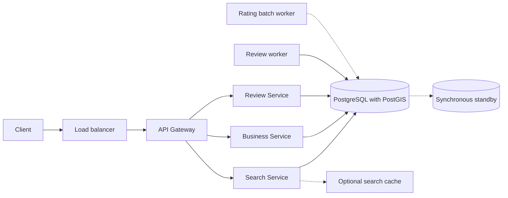
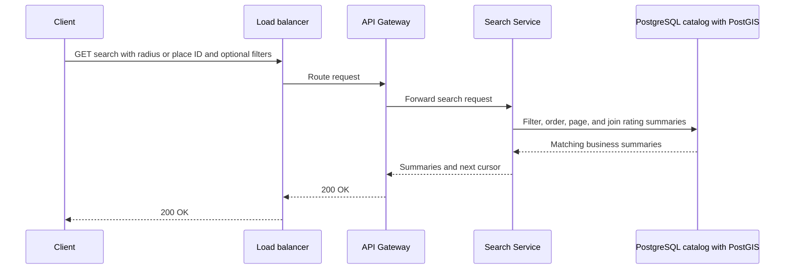
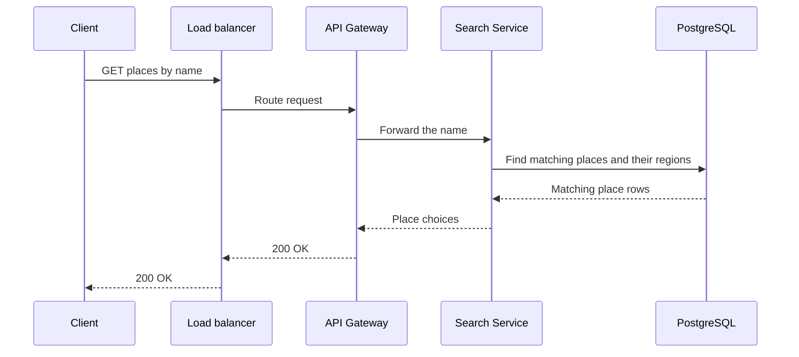
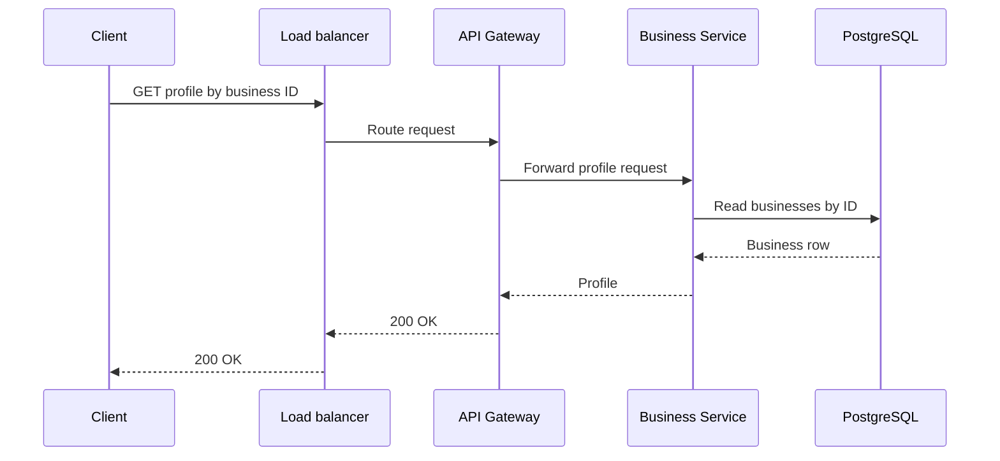
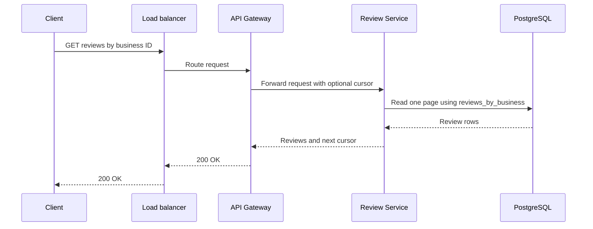
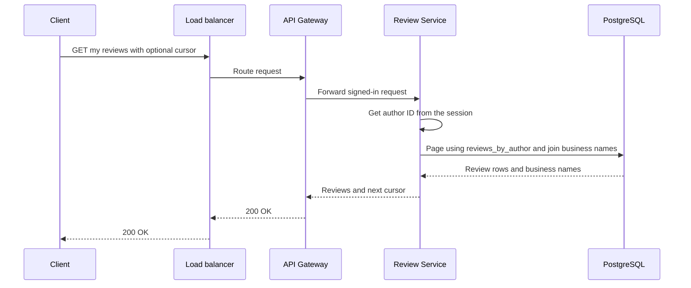
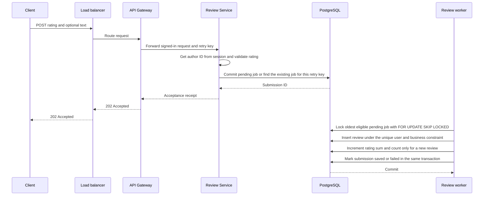
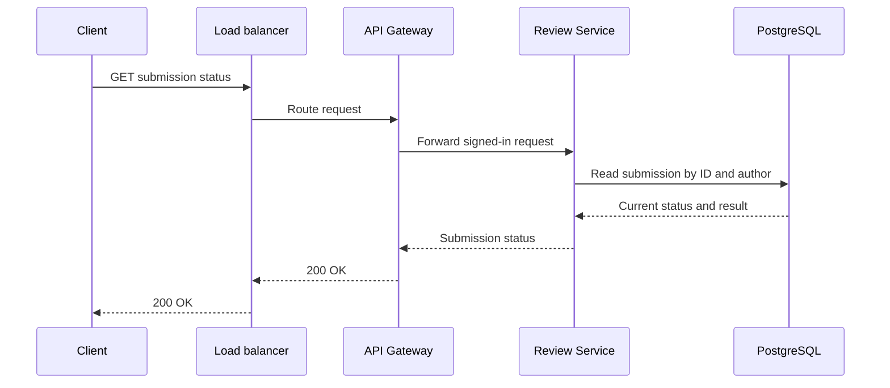

# Final design flow — Yelp

The [Hello Interview Yelp prompt](https://www.hellointerview.com/learn/system-design/problem-breakdowns/yelp) provides the feature split. This design adds named places and a signed-in author's review history.

## Overview



Solid lines show the normal interview path. The optional cache handles repeated searches. The rating batch worker handles a hot business. The synchronous standby applies when acceptance must survive one server loss. The local lab can use one proxy for both ingress roles and one PostgreSQL instance.

## Request paths

A cursor marks where to continue a result list. The service gets the author from the signed-in session. The client reuses the same idempotency key when it retries the same submission.

### Search businesses

```text
GET /v1/businesses/search -> 200 OK { businesses: [{ businessId, name, category, distanceM, averageRating, reviewCount }], nextCursor }
Query: { name?, category?, cursor?, placeId?, areaMode?, nameMode?, cacheMode? }
Radius mode also requires: { lat, lon, radiusM }
Body: none
```



Use either a place ID or coordinates and a radius. With a place ID, the query filters business points by the place boundary and measures distance from the stored center.

### Find a named place

```text
GET /v1/places -> 200 OK { places: [{ placeId, name, region, kind, centerLat, centerLon }] }
Query: { name }
Body: none
```



### Read a business profile

```text
GET /v1/businesses/{businessId} -> 200 OK { businessId, name, category, address }
Body: none
```



### Read a business's reviews

```text
GET /v1/businesses/{businessId}/reviews -> 200 OK { reviews: [{ reviewId, rating, text, createdAt }], nextCursor }
Query: { cursor? }
Body: none
```



When the client opens a search result, it can start the profile and review requests together. Both use the business ID already present in the search result.

### Read my reviews

```text
GET /v1/me/reviews -> 200 OK { reviews: [{ reviewId, businessId, businessName, rating, text, createdAt }], nextCursor }
Query: { cursor? }
Body: none
```



### Submit a review

```text
POST /v1/businesses/{businessId}/reviews -> 202 Accepted { submissionId, status: "accepted" }
Query: { mode? }  // queued (default) | queued-batch | direct
Header: Idempotency-Key
Body: { rating: 1–5, text? }
Direct mode: 200 OK { reviewId, status: "saved" }
Temporary overload: 503 Service Unavailable { errorCode: "REVIEW_QUEUE_BUSY" }
Response header on overload: Retry-After
```



The worker runs independently once the job commits. It can save the review before the acceptance response reaches the client.

In direct mode, the Review Service saves the review and increments the rating totals in one transaction. It returns the saved review ID after commit. In queued-batch mode, the review worker saves a rating event with the review, then the rating batch worker applies the event. The local client uses `X-Demo-User` on signed-in requests.

### Check submission status

```text
GET /v1/review-submissions/{submissionId} -> 200 OK { submissionId, status, reviewId?, errorCode? }
Status: pending | saved | failed
Body: none
Temporary recovery error: 503 Service Unavailable { errorCode: "REVIEW_STATUS_UNAVAILABLE" }
```

If a different submission already saved this user's review for the business, return `failed` with `errorCode: REVIEW_ALREADY_EXISTS`.



## Services

| Service | When it runs | What it does |
| --- | --- | --- |
| Load balancer | On each request | Sends traffic to a healthy gateway instance. |
| API gateway | On each request | Routes API paths to the named service. |
| Search Service | On search or place lookup | Filters the catalog and joins rating totals to the results page. |
| Business Service | When a profile opens | Reads a business by ID. |
| Review Service | On a review read, submission, or status check | Pages saved reviews, accepts jobs, and returns status to the author. |
| Review worker | While eligible jobs exist | Claims jobs, saves reviews, and commits each outcome. |
| Rating batch worker | Hot business variant | Groups pending rating events, updates totals, and marks events applied. |

## Databases

### PostgreSQL with PostGIS

| Table | Primary key | Other fields and rules |
| --- | --- | --- |
| `users` | `user_id` | `display_name`. |
| `businesses` | `business_id` | `name`, `category`, `address`, `location` (WGS 84 point). Use spatial and name indexes for search. |
| `places` | `place_id` | `name`, `region`, `kind`, `center` (WGS 84 point), `boundary` (WGS 84 multipolygon). |
| `reviews` | `review_id` | `user_id` and `business_id` reference their tables. `rating` is 1 to 5. `text` is optional. `created_at` records publication time. The user and business pair is unique. The optional `direct_retry_key` is unique per author for direct writes. Each list has an index on its filter key, time, and review ID. |
| `review_submissions` | `submission_id` | `user_id`, `business_id`, `idempotency_key`, `rating`, `text`, `status`, `review_id`, `error_code`, `created_at`, `next_attempt_at`, `attempt_count`, `batch_rating`. The author and retry key pair is unique. |
| `business_rating_stats` | `business_id` | `rating_sum` and `review_count`. The ID references the business. |
| `rating_outbox` (hot business variant) | `review_id` | `business_id`, `rating`, `created_at`, `applied_at`. The worker updates the summary and sets the applied time in one transaction. |
| `business_places` (precomputed variant) | `(place_id, business_id)` | Both fields reference the corresponding catalog tables. Populate membership from the seeded polygons. |

The synchronous standby replays the same schema. During failover, status reads can return a temporary error until the new primary can verify the receipt.

### Search cache (traffic variant)

Key each entry by the normalized search inputs and cursor. Store the result page and its expiry. A process groups concurrent refreshes by the same key. The lab uses an in-memory cache for this comparison.

See [FLOW.md](FLOW.md) for the interview paths and [COMPONENTS.md](COMPONENTS.md) for responsibilities.
