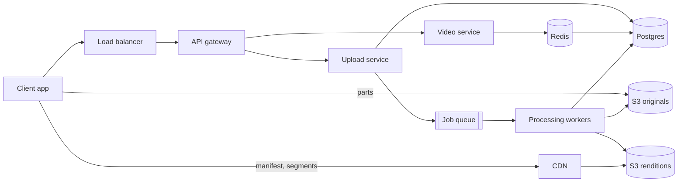
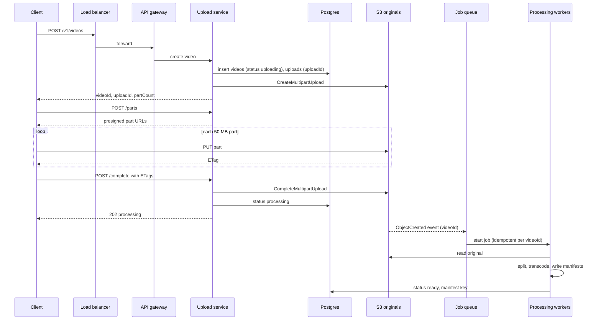
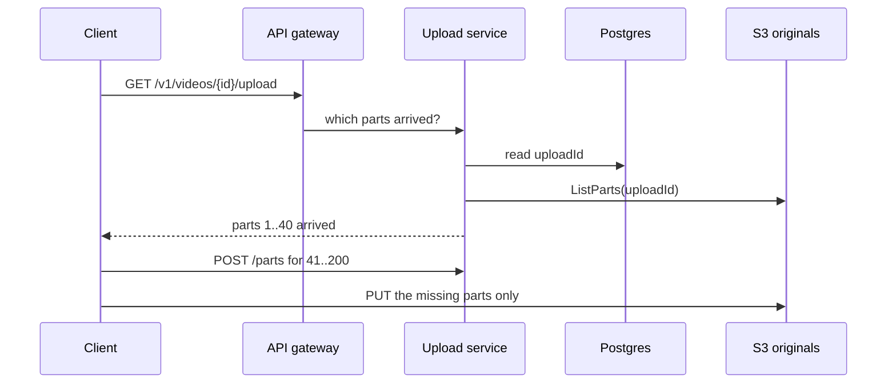
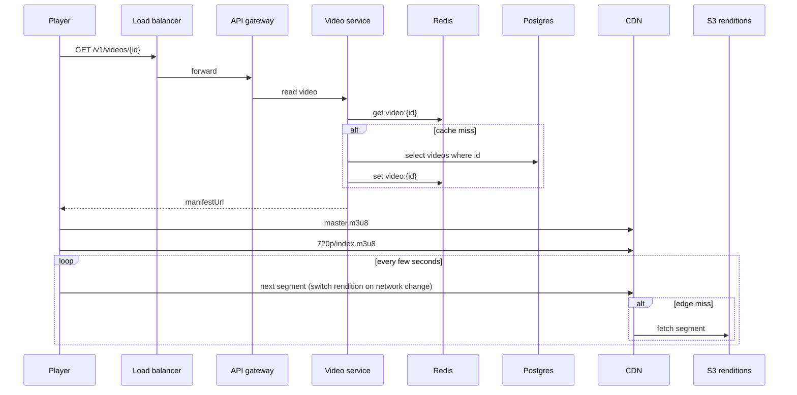
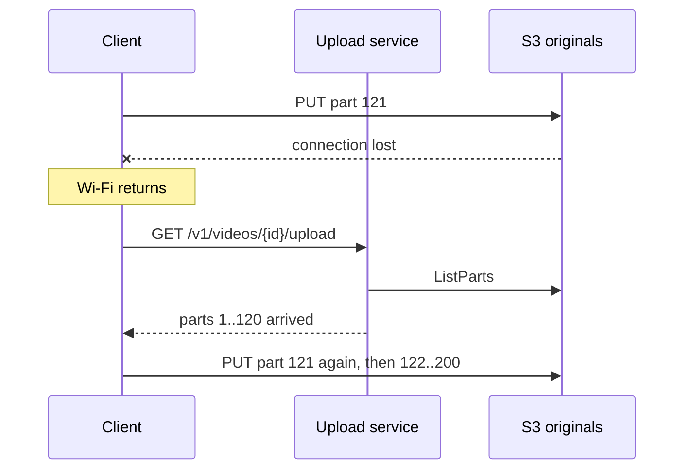

# System flow — YouTube

Each chart runs from the client to the load balancer, the gateway, the service, and the store. Video bytes skip the services: they go to S3 when uploading, and come from the CDN when watching. Hello Interview is the shape source. These notes are original.

## Overview



## Upload a video

```
POST /v1/videos -> 200 OK { videoId, uploadId, partSizeBytes, partCount }
Body: { title, description, fileSizeBytes, contentType, sha256 }

POST /v1/videos/{videoId}/parts -> 200 OK { parts: [{ partNumber, url, headers, expiresAt }] }
Body: { parts: [{ partNumber, sha256 }] }

PUT {presigned part url} -> 200 OK, header ETag
Body: one 50 MB part (sent to S3)

POST /v1/videos/{videoId}/complete -> 202 Accepted { videoId, status } // processing
Body: { parts: [{ partNumber, etag }] }
```



## Every call in one upload

Lee uploads a 20 GB file as video `abc123`, in 400 parts of 50 MB. The client is Lee's app. The service is the upload service. S3 is the originals bucket.

| # | From → to | Call and what it sends | What comes back | Next |
| --- | --- | --- | --- | --- |
| 1 | Client → service | `POST /v1/videos` with `{ title, description, fileSizeBytes: 20000000000, contentType: "video/mp4", sha256: "e3b0..." }` | (after 2 to 4) `200 { videoId: "abc123", uploadId, partSizeBytes: 50000000, partCount: 400 }` | The client asks for part URLs |
| 2 | Service → Postgres | `INSERT videos (abc123, lee, status 'uploading', original_key 'originals/abc123/source.mp4')` | Row created | Start the S3 upload |
| 3 | Service → S3 | `CreateMultipartUpload(key originals/abc123/source.mp4)` | `UploadId: "VXBs..."` | Save it |
| 4 | Service → Postgres | `INSERT uploads (abc123, s3_upload_id 'VXBs...', part_size 50 MB, part_count 400, state 'open')` | Row created | Reply to step 1 |
| 5 | Client → service | `POST /v1/videos/abc123/parts` with `{ parts: [{ partNumber: 1, sha256: "q1w2..." }, ...] }` | `200 { parts: [{ partNumber: 1, url: "https://...?partNumber=1&uploadId=VXBs...&X-Amz-Signature=...", headers: { "x-amz-checksum-sha256": "q1w2..." }, expiresAt }] }` | The client uploads |
| 6 | (service only) | The service signs each URL with its own key. Signing is local math, with no call to S3 | | |
| 7 | Client → S3 | `PUT {url for part 1}` with 50 MB of bytes and a checksum header | `200`, header `ETag: "a1b2..."`. A wrong checksum gets `400 BadDigest` | Keep `(1, "a1b2...")`. Send the next part |
| 8 | Client → S3 | Steps 5 and 7 repeat. New URLs for parts 101 to 200 and later, or when URLs expire | One ETag per part | Continue |
| 9 | (drop) | Wi-Fi drops during part 241. The app restarts, or Lee moves to his laptop, so the receipts are lost | | Resume |
| 10 | Client → service | `GET /v1/videos/abc123/upload` | (after 11) `200 { status: "uploading", uploadedParts: [{ 1, "a1b2..." }, ..., { 240, ... }], uploadedBytes: 12000000000 }` | 240 of 400 parts, 60% |
| 11 | Service → S3 | `ListParts(uploadId VXBs...)` | Parts 1 to 240, each with its size and ETag | Reply to step 10 |
| 12 | Client → service, then S3 | `POST /parts` for 241 to 400, then `PUT` each one | 160 more ETags | The client now holds all 400 |
| 13 | Client → service | `POST /v1/videos/abc123/complete` with `{ parts: [{ 1, "a1b2..." }, ..., { 400, ... }] }` | (after 14 to 16) `202 { videoId: "abc123", status: "processing" }` | Wait for processing |
| 14 | Service → S3 | `CompleteMultipartUpload(uploadId, the 400 pairs)` | `ETag: "9b2cf...-400"`. A pair that matches no stored part gets `InvalidPart` | One object exists now |
| 15 | Service → Postgres | In one transaction: `videos.status = 'processing'`, `original_etag = '9b2cf...-400'`, `size_bytes`. `uploads.state = 'completed'` | Committed | Queue the work |
| 16 | S3 → queue | S3 sends `ObjectCreated:CompleteMultipartUpload` for `originals/abc123/source.mp4` | The event waits on the queue | The service replies to step 13. A consumer starts the job once per `videoId`, even if the event arrives twice |
| 17 | Worker → S3, Postgres | Read the original and compute its SHA-256. A mismatch with `original_sha256` sets `failed`. Otherwise write segments and manifests, then `status = 'ready'`, `manifest_key`. Delete the cache key | | |
| 18 | Client → video service | `GET /v1/videos/abc123`, polled every few seconds | `200 { status: "ready", manifestUrl }` | Lee sees the video |

The roles:

- The client is the only one that moves video bytes.
- The upload service never touches the bytes. It keeps the upload state, signs URLs, and turns S3 answers into our status.
- S3 holds the parts, checks every checksum and ETag, and joins the file.

A second `complete` call finds `uploads.state = 'completed'`. It returns the same 202 and does nothing else.

## Resume an upload

```
GET /v1/videos/{videoId}/upload -> 200 OK { status, uploadedParts: [{ partNumber, etag }] }
```



## Watch a video

```
GET /v1/videos/{videoId} -> 200 OK { videoId, title, status, durationSec, manifestUrl }
GET https://cdn.example.com/v/{videoId}/master.m3u8 -> 200 OK, renditions
GET https://cdn.example.com/v/{videoId}/720p/index.m3u8 -> 200 OK, segments
GET https://cdn.example.com/v/{videoId}/720p/seg_00042.ts -> 200 OK, about 4 s of video
```



## Failure path: the upload drops at 60%



Parts already in S3 stay there. Only the part that broke is sent again.
