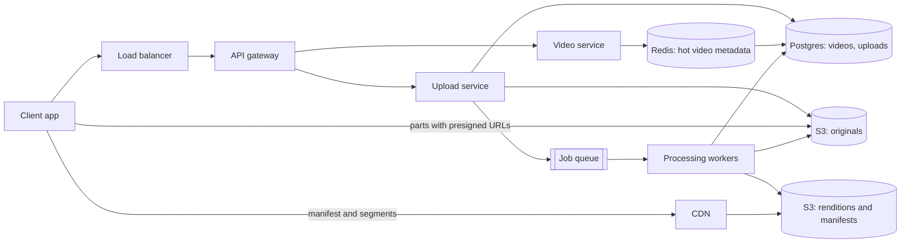

# YouTube

**Status:** Implemented  
**Sources:** [Hello Interview: YouTube](https://www.hellointerview.com/learn/system-design/problem-breakdowns/youtube); Alex Xu Vol 1 Ch 14 (Design YouTube)  
**Slug:** `youtube`

Practice in the five-step interview pattern. Keep notes original; link to Hello Interview / cite Alex Xu instead of copying write-ups.

## 1. Requirements and design scope

### Problem

Design a video platform like YouTube. Creators upload videos. Viewers watch them on phones, laptops, and TVs, on fast and slow networks.

### Functional requirements

- [x] A user uploads a video.
- [x] A user watches (streams) a video.

Hello Interview keeps the same two. Each one hides a hard problem. Upload means very large files and resumable transfer. Watch means smooth playback on any network.

### Non-functional requirements

- [x] **Scale.** About 1 million uploads and about 100 million views a day. Hello Interview gives both numbers. The 1 billion accounts figure is this session's choice. Hello Interview gives no peak. This session plans for three times the average.
- [x] **Large files.** A video can be tens of GB. Hello Interview uses that size. The session's first guess was a couple of GB, which is too small for long 4K video.
- [x] **Low-latency streaming, also on slow networks.** Playback starts before the whole file arrives. The player can drop to a lower quality instead of stopping. This session's target is the first frame in about 2 seconds, with rare rebuffering. Hello Interview gives no number.
- [x] **Resumable uploads.** A dropped connection resumes from the last finished part, not from zero.
- [x] **Availability over consistency.** Hello Interview states this. Watching must stay up. Upload processing may lag. A new video may take minutes to appear, and that is acceptable.
- [x] **Durability.** After the server says "upload complete," the original file and the video's metadata must never be lost. Transcoded copies can be rebuilt from the original. A half-finished upload may be lost, because the client resumes it.

The numbers this session derives (assumptions are marked):

| Quantity | Value | How |
| --- | --- | --- |
| Uploads | About 12 a second, about 35 at peak | 1 million a day / 86,400 s, times 3 |
| View starts | About 1,160 a second, about 3,500 at peak | 100 million a day / 86,400 s, times 3 |
| Bytes watched | About 11 PB a day, about 1 Tbps average, about 3 Tbps peak | Assumption: 5 minutes per view at 3 Mbps, so about 110 MB per view |
| Segment requests | About 87,000 a second on average | Assumption: 4-second segments, so 75 per 5-minute view |
| New raw storage | About 500 TB a day | Assumption: 500 MB average upload |
| Total new storage | About 1 PB a day, about 365 PB a year | Assumption: all quality versions together are about as large as the original |

The read side carries about 20 times the write side in bytes (11 PB out against 0.5 PB in). Those bytes, not the request count, size the watch path.

### Below the line

From Hello Interview (functional):

- View counts and other video info
- Search
- Comments
- Recommendations
- Channels and channel management
- Subscriptions

From Hello Interview (non-functional):

- Protection against bad content
- Protection against bots and fake accounts
- Monitoring and alerting

This session's extra cuts: live streaming, ads, DRM (copy protection), captions, offline downloads, likes, and playlists.

### Core entities

| Entity | Description |
| --- | --- |
| User | An uploader or a viewer |
| Video | The metadata row: id, owner, title, status (uploading, processing, ready, failed), duration |
| Upload | The resumable session for one file: upload id, part size, parts received |
| Original file | The raw bytes the creator sent. Kept as the source for every rebuild |
| Rendition | One playable version: a resolution, a codec, and a bitrate, plus its manifest |
| Segment | A few seconds of one rendition. The unit the player downloads |

Hello Interview names User, Video, and VideoMetadata. This session splits the files into the original, renditions, and segments, because each has a different store and a different lifetime.

### APIs

First sketch. Step 2 will change the upload path, because a file of tens of GB should not pass through an API server.

```
POST /v1/videos -> 202 Accepted { videoId, status }
Body: {
  title,
  description,
  file // the video bytes. Step 2 replaces this
}
```

```
GET /v1/videos/{videoId} -> 200 OK { videoId, title, status, durationSec, manifestUrl }
```

`status` is `processing` until the renditions exist. `manifestUrl` points at the list of renditions, and the player reads the segments from there.

## 2. High-level design

The bytes and the metadata travel on different paths. Video bytes never pass through our servers. They go from the client straight to S3 when uploading, and straight from the CDN to the player when watching. Our servers handle only small requests: metadata, signed URLs, and status. Sequences are in [FLOW.md](FLOW.md). Roles are in [COMPONENTS.md](COMPONENTS.md).



### Upload a video

1. The client sends title, description, and file size to the upload service.
2. The upload service inserts a `videos` row with status `uploading`. It starts an S3 multipart upload and stores its `uploadId` in an `uploads` row.
3. The service returns a presigned URL for each part. A part is 50 MB in this design. A presigned URL lets the client write one object part to S3 for a short time, with no AWS credentials.
4. The client sends each part straight to S3 and keeps the `ETag` that S3 returns for each part.
5. After a drop, the client asks which parts arrived. The service calls S3 `ListParts` and returns them. The client sends only the rest.
6. The client calls complete. The service calls S3 `CompleteMultipartUpload`, sets status `processing`, and returns 202. S3 sends an `ObjectCreated` event to the queue, and that event starts the job.
7. Workers process the original into segments and renditions. They write the segments and the manifests to S3. Then they set status `ready` and store the manifest key.

| Choice | Option | What happens | When it wins |
| --- | --- | --- | --- |
| Byte path | A: Through our API | Every byte crosses an API server | Small files only |
| | B: One presigned PUT | One request to S3. S3 caps a single PUT at 5 GB, and a drop restarts from zero | Files under a few GB |
| | **C: Presigned multipart (pick)** | Parts of 50 MB go straight to S3. Up to 10,000 parts per upload | Tens of GB, resumable |
| Completion signal | A: The service queues the job itself after `complete` | The service completes the multipart upload, then writes Postgres and the queue | Simple. A crash between the S3 completion and the queue write leaves a finished file that nobody processes |
| | **B: S3 event notification (pick in step 5, Hello Interview)** | The client still calls our `complete`, and our service still calls `CompleteMultipartUpload`. S3 then sends `ObjectCreated` to a queue, and that event starts processing | The trigger comes from the file itself, so no completed file is missed. The job start must be idempotent per `videoId` |
| | C: A plus a sweep | The service queues the job, and a sweep finds files that S3 finished but the service never queued | Safe. One more job to run |
| When processing starts | **A: After the whole file arrives (pick for step 2)** | One job per video | Simple |
| | B: While parts arrive | Workers start on early parts | Faster to `ready`. Deep dive in step 3 |
| Metadata store | **A: Postgres (pick)** | About 365 million rows a year. One primary takes 12 writes a second. Replicas take the reads | One store for videos and uploads, with transactions |
| | B: Cassandra by `videoId` (Hello Interview) | Point reads by id, spread over nodes | Multi-region writes, or row counts far past one machine |

We pick C, B, A, A. Step 2 first picked A for the completion signal. Step 5 changed it to B, because the S3 event removes the gap between "S3 finished the file" and "a job was queued." The client never waits for processing in either option. `complete` returns 202 at once. One upload service owns the upload state, and S3 enforces the parts. Postgres holds about 365 GB a year (an assumed 1 KB per row), and a primary handles 12 writes a second easily. We shard by `video_id` only when the rows outgrow one machine.

### Watch a video

1. The player asks the video service for the video. The service reads Redis first, then Postgres. It returns the title, the status, and the manifest URL on the CDN.
2. The player fetches the primary manifest from the CDN. That manifest lists the renditions.
3. The player picks a rendition from its network speed, then fetches that rendition's manifest. That manifest lists its segments.
4. The player fetches segments one at a time from the CDN. It switches rendition when the network changes.
5. On a CDN miss, the CDN fetches the object from the S3 renditions bucket, then keeps it for the next viewer.

| Choice | Option | What happens | When it wins |
| --- | --- | --- | --- |
| Where bytes come from | A: A presigned S3 URL for the whole file | One file, one quality, from the S3 region | Never at 1 Tbps |
| | B: The player reads S3 segments directly | Adaptive, but every view leaves S3, far from many viewers | Small scale |
| | **C: CDN in front of S3 (pick)** | Edge servers near viewers keep popular segments. S3 serves only misses | 1 to 3 Tbps |
| Access control | **A: Public CDN URLs (pick for public videos)** | No signature. Cache keys stay simple | Most videos are public |
| | B: Signed URLs or signed cookies at the CDN | A short-lived signature for private or unlisted videos | Private content |
| Metadata reads | A: Postgres only | About 1,160 reads a second, about 3,500 at peak | Fine for normal videos |
| | **B: Redis cache in front (pick)** | A viral video is read from memory | Hot keys. Deep dive in step 4 |

We pick C, A (B for private), B. At about 1 Tbps on average, the bytes must come from the edge. Metadata is about 3,500 reads a second at peak, so Postgres replicas handle it. Redis is there for the one viral video that every viewer opens.

### API, revised in step 2

```
POST /v1/videos -> 200 OK { videoId, uploadId, partSizeBytes, partCount }
Body: {
  title,
  description,
  fileSizeBytes,
  contentType, // for example video/mp4
  sha256       // hex SHA-256 of the whole file, computed by the client
}
```

```
POST /v1/videos/{videoId}/parts -> 200 OK { parts: [{ partNumber, url, headers, expiresAt }] }
Body: {
  parts // [{ partNumber, sha256 }]. sha256 is the part's base64 SHA-256. The client asks again when URLs expire
}
headers: { "x-amz-checksum-sha256": ... }, which the client must send with the PUT. The URL is signed to require it
```

```
PUT {presigned part url} -> 200 OK, header ETag
Headers: x-amz-checksum-sha256
Body: the bytes of one part (50 MB in the design, 5 MiB in the lab). This call goes to S3, not to our servers
400: the bytes do not match the checksum (XAmzContentChecksumMismatch, or BadDigest for Content-MD5)
```

```
GET /v1/videos/{videoId}/upload -> 200 OK { status, uploadedParts: [{ partNumber, etag }] }
```

```
POST /v1/videos/{videoId}/complete -> 202 Accepted { videoId, status } // status: processing
Body: {
  parts // [{ partNumber, etag }]
}
```

```
GET /v1/videos/{videoId} -> 200 OK { videoId, title, status, durationSec, manifestUrl }
```

```
GET https://cdn.example.com/v/{videoId}/master.m3u8 -> 200 OK, the list of renditions
GET https://cdn.example.com/v/{videoId}/720p/index.m3u8 -> 200 OK, the list of segments
GET https://cdn.example.com/v/{videoId}/720p/seg_00042.ts -> 200 OK, about 4 seconds of video
```

`complete` returns 202, because the video is not playable yet. The manifest and segment paths follow HLS, a common segment-and-manifest format.

See [high-level-design-comparision.md](high-level-design-comparision.md) for Hello Interview, Alex Xu, this session, and production side by side.

## 3. Low-level design and deep dive

### Data model

Postgres `videos`. Primary key `video_id`. Index `(uploader_id, created_at)` for "my videos."

| Column | Role |
| --- | --- |
| video_id | Primary key |
| uploader_id | Who uploaded it |
| title, description | Shown on the watch page |
| status | `uploading`, `processing`, `ready`, or `failed` |
| visibility | `public`, `unlisted`, `private`, or `scheduled`. It decides plain or signed CDN URLs |
| publish_at | For `scheduled` videos, when the video goes public. `ready` means processed. Publishing is a separate step, so a premiere can be pre-warmed between them |
| original_key | S3 key of the original, for example `originals/abc123/source.mp4` |
| manifest_key | S3 key of the primary manifest, for example `v/abc123/master.m3u8`. Empty until `ready` |
| duration_sec, size_bytes | From the probe step |
| original_etag | The finished original's ETag from `CompleteMultipartUpload`, for example `9b2cf...-400`. An integrity job compares it with S3 later |
| original_sha256 | The SHA-256 of the whole file, computed by the client before upload. The probe step computes it again from S3, and a mismatch marks the video `failed` |
| created_at, updated_at, ready_at | Times. `ready_at` is the session's "completed time" |
| error | Why processing failed, when `status` is `failed` |

Postgres `renditions`. Primary key `(video_id, name)`.

| Column | Role |
| --- | --- |
| video_id, name | For example `abc123`, `720p` |
| codec, width, height, bitrate_kbps | The version's settings |
| manifest_key | For example `v/abc123/720p/index.m3u8` |
| segment_count | 900 for one hour at 4 s |

Postgres `uploads`. Primary key `video_id`.

| Column | Role |
| --- | --- |
| video_id | One upload per video |
| s3_upload_id | The S3 multipart upload id |
| part_size_bytes, part_count | 50 MB, and the number of parts |
| state | `open`, `completed`, or `aborted` |
| created_at, expires_at | An S3 lifecycle rule aborts a multipart upload that stays open for 7 days |

S3 key layout:

```
originals/{videoId}/source.mp4               the creator's file, kept forever
v/{videoId}/master.m3u8                      primary manifest
v/{videoId}/{rendition}/index.m3u8           one rendition's segment list
v/{videoId}/{rendition}/seg_{n:05}.ts        about 4 s of that rendition
tmp/{jobId}/...                              intermediate files, deleted after the job
```

**Store keys, not URLs.** Store `original_key`, not a full S3 or CDN URL. The video service builds the URL when it reads the row. The CDN domain can then change, and a signed URL is made fresh for each viewer.

**No row per segment.** A 1-hour video has 900 segments per rendition, or 3,600 with 4 renditions. At 1 million uploads a day, a row per segment would add billions of rows a day. The rendition manifest is the segment index. The key pattern makes every segment name predictable from `(videoId, rendition, n)`.

### Deep dives

Hello Interview's deep dives for this question, and this session's choice:

| Hello Interview deep dive | This session's choice |
| --- | --- |
| 1. Processing a video for adaptive bitrate streaming | A durable workflow DAG. Split at keyframes, fan out one task per chunk per rendition, fan in to write manifests, then set `ready`. Idempotent tasks with fixed output keys. Below |
| 2. Resumable uploads | S3 multipart. S3 checks each part's checksum. `ListParts` is the source of truth for resume. A lifecycle rule aborts open uploads after 7 days, and a sweep fixes the rows. Below |
| 3. Scaling to many uploads and views a day | Stateless services scale out. Postgres plus replicas plus Redis. Workers sized by core-hours and autoscaled on queue depth. A CDN with an origin shield. Storage tiers for cold videos. Below |

#### Deep dive 1: Processing for adaptive bitrate streaming

**The steps.** A 1-hour 4K original arrives. Video `abc123`.

1. **Probe.** Read the duration, codec, resolution, and frame rate. A corrupt file fails here, with `status = failed` and `error` set.
2. **Split.** Cut the original into chunks at keyframes. A keyframe is a full picture. The frames between keyframes store only changes, so a chunk that starts between keyframes cannot be decoded alone.
3. **Fan out.** One transcode task per chunk per rendition. 900 chunks of 4 s times 4 renditions is 3,600 tasks. One audio task and one thumbnail task run next to them. Transcoding means decoding the chunk and encoding it again in another codec, resolution, and bitrate. It is both a compression and a conversion.
4. **Fan in.** After every task for a rendition finishes, write its `index.m3u8`. After every rendition, write `master.m3u8`.
5. **Mark ready.** Set `status = ready`, `manifest_key`, and `ready_at`. This runs last, so no viewer sees a half-made video.
6. **Clean up.** Delete `tmp/{jobId}/`.

Tasks pass S3 keys to each other, not bytes. Intermediate files go to `tmp/`.

**Why minutes, not hours.** This session assumes 10 seconds of one CPU core per task. 3,600 tasks run one after another take 36,000 s, which is 10 hours. Spread over 500 cores, the same work takes about 72 seconds, plus the time to split and fan in. The chunks do not depend on each other, so the only limit is the number of workers.

**A worker dies halfway.** The orchestrator gives each task a lease. A task that misses its heartbeat goes to another worker. The new worker writes the same output key, `v/abc123/720p/seg_00042.ts`. An S3 PUT replaces the whole object at once, so a reader sees the old object or the new one, never half of one. The manifest is written only after all segments exist, so the retry is invisible. A chunk that fails three times marks the video `failed`, and the original stays safe for a later re-run.

**The load on the orchestrator.** This session assumes an average video of 10 minutes. That is 150 chunks times 4 renditions, about 600 tasks a video. At 1 million videos a day, that is about 600 million tasks a day, or about 7,000 a second.

- **Option A: Airflow-style batch DAG.** Clear graphs, and familiar. Airflow schedules each task through its scheduler and a metadata database, with seconds of overhead per task. It is built for thousands of pipeline runs, not 7,000 tasks a second.
- **Option B: A durable workflow engine (Temporal, AWS Step Functions).** Each video is one workflow with fan-out and fan-in, retries, and heartbeats. It is built for millions of runs. Hello Interview names Temporal. You run or pay for the engine.
- **Option C: A plain queue plus a job table.** Workers pull chunk tasks from a queue. A Postgres row counts finished tasks, and the last one writes the manifests. It is simple. Retries, timeouts, and fan-in are your own code.

We pick Option B for the interview, at about 7,000 tasks a second. Option C is the lab's version, because it shows the same fan-out and fan-in with less to run.

**A later speed-up.** Start processing while parts are still arriving. The client sends the video in chunks that start at keyframes, so each part can go to transcoding when it lands. Hello Interview lists this pipelining as an extra deep dive. It cuts the time to `ready`, and it leaves garbage chunks when an upload is abandoned.

#### Deep dive 2: Resumable uploads

Lee uploads a 20 GB file, which is 400 parts of 50 MB. Wi-Fi drops at part 241.

**Did each part arrive undamaged?** The client computes a checksum for each part before it sends it, for example MD5 or CRC32C. It sends that checksum in a header, and the presigned URL is signed to require it. S3 computes the checksum of the bytes it received. If the two differ, S3 rejects the part with `BadDigest`, and the client sends that part again. A damaged part is never stored. After completion, the probe step checks the whole file: it can be decoded, and its duration is plausible.

**Which parts arrived?**

- **Option A: Trust `ListParts` (pick).** S3 already records every stored part, with its number, size, and ETag. The resume call asks S3 and returns that list. Nothing extra is written. `ListParts` returns up to 1,000 parts per page, so a 400-part upload fits in one page.
- **Option B: A chunk list in the metadata (Hello Interview).** The `videos` row keeps every chunk's fingerprint and status, `NotUploaded` or `Uploaded`. The client reports each ETag, and the server checks it with S3. You get a progress bar on any device and an audit trail. You pay one more write per part, about 116 a second on average (assumption: 500 MB average upload, 10 parts each, 1 million uploads a day). Two records can also disagree.
- **Option C: Only the client remembers.** No server state. A switch to another device, or a reinstall, loses the progress.

We pick Option A. S3 already stores the truth, so a second copy only adds a way to disagree. Progress on any device also comes from `ListParts`: the sum of part sizes divided by `fileSizeBytes`. Add Option B's per-part table only for progress without an S3 call, or a part history.

**When is an abandoned upload cleaned up?** Parts of an open multipart upload are billed, but they do not show in a normal bucket listing. Without cleanup, they cost money forever and nobody sees them.

- **Option A: Never clean.** Hidden storage grows with every abandoned upload.
- **Option B: An S3 lifecycle rule, `AbortIncompleteMultipartUpload` (pick).** S3 aborts the upload and deletes its parts a set number of days after it started. The setting is in whole days, so 1 day is the shortest.
- **Option C: Our own sweep job.** It finds `uploads` rows that are still `open` past `expires_at`, calls `AbortMultipartUpload`, and marks the video `failed`.

We pick B plus C, with 7 days. The session's first idea was 24 hours. A 20 GB upload over a slow line, paused over a weekend, would lose all its progress at 24 hours. The lifecycle rule frees the bytes. The sweep fixes the Postgres rows, which S3 does not know about.

#### Deep dive 3: Scaling to many uploads and views a day

| Box | Load at peak (three times the average) | What fills first | How it scales |
| --- | --- | --- | --- |
| Upload service | About 35 new uploads and about 350 part-URL requests a second | Nothing. It only signs URLs | Stateless. Add hosts behind the load balancer |
| Video service | About 3,500 metadata reads a second | One viral video, many reads of one key | Stateless. An in-process cache with a 5-second TTL in each host, then Redis. Coalesce misses so one request fills the cache |
| Postgres | About 3,500 reads a second (most hit the cache), about 100 writes a second (rows and status changes) | Read load if the cache is cold. Rows after a few years | Read replicas. Shard by `video_id` later. Delete the cache key when status changes, or viewers see `processing` until the TTL ends |
| Processing workers | About 69,000 cores busy on average (assumption: 600 million tasks a day at 10 s each) | Compute. This is the most expensive box | Autoscale on queue depth. Spot instances, because tasks are short and idempotent. Low renditions first. Hardware encoders |
| S3 | About 116 part writes a second on average. Reads only on CDN misses | Cost, not speed. About 1 PB a day of new data | Spread keys over prefixes (`v/{videoId}/` already does). Move old originals to colder storage classes. Replicate originals to a second region |
| CDN | About 3 Tbps | A miss storm on a new viral video. Cost for the long tail | An origin shield, a regional cache in front of S3. Long cache times for segments. Pre-warm the edges for big creators |

**Processing workers.** The pipeline uses more compute than anything else. 600 million tasks a day at an assumed 10 seconds each is 6 billion core-seconds a day, or about 69,000 cores busy all day. A peak of uploads does not need peak workers. Jobs wait in the queue, and a video becomes ready a few minutes later. Four levers:

- **Autoscale on queue depth.** Add workers when jobs wait longer than a target, for example 5 minutes.
- **Spot instances.** They cost much less, and a reclaimed machine only retries a 10-second task.
- **Encode the low renditions first.** 360p and 720p become ready first, so the video plays sooner. 4K follows later.
- **Hardware encoders.** Google built custom video transcoding chips for YouTube and described them in a 2021 paper.

**CDN.** A CDN caches on the first request and serves the next viewers from the edge. This session assumes a 95% hit ratio, which leaves about 150 Gbps at peak to come from S3. Three additions:

- **Origin shield.** A new viral video starts on 1,000 edges at once. Without a shield, 1,000 edges miss together and hit S3 together. With a shield, the edges ask one regional cache, and that cache fetches each segment from S3 once.
- **Cache times.** A segment never changes after it is written, so it can be cached for a long time, measured in days. A manifest for a finished video never changes either.
- **The long tail.** Most videos are rarely watched, and they keep the CDN cost high for little benefit. Alex Xu serves popular videos from the CDN, and the long tail from the platform's own video servers, to save cost.

**A viral video.** Kim's cat video gets 10 million views in an hour, about 2,800 starts a second:

- **Metadata.** The in-process cache answers most reads, so Redis sees one read per host every 5 seconds, and Postgres sees almost nothing.
- **Bytes.** Every edge serves the first segments from cache after its first viewer. The origin shield stops the miss storm from reaching S3.
- **Processing.** Nothing changes. The video was processed once.

**Storage cost.** About 1 PB a day is about 365 PB a year. Originals are kept forever. Two levers:

- Move originals that are older than 30 days to a cheaper storage class.
- For a video nobody watches, keep only the low renditions. Rebuild the high ones from the original if the video becomes popular.

## 4. Component questions and special situations

Component roles are in [COMPONENTS.md](COMPONENTS.md).

### 1. The processing workers fall 2 hours behind

A big event makes uploads triple for 2 hours. At about 69,000 cores on an average day, the surge needs about 280,000 extra core-hours (assumption: 2 × 69,000 cores × 2 hours). Spot capacity may not be there, and new machines take minutes to start.

- **Option A: One FIFO queue plus autoscaling.** Simple. A creator's 30-second clip waits behind thousands of 1-hour 4K files.
- **Option B: Priority classes.** Short videos, or the first playable renditions, go first.
- **Option C: Fair share per uploader.** One account that uploads 500 videos cannot take every worker.
- **Option D: A separate queue and worker pool for the event (a bulkhead).** The event surge cannot slow regular uploads. You must know which uploads belong to the event, and the pool sits idle the rest of the time.
- **Option E: Low renditions first.** 360p and 720p finish within minutes, so the video plays. 1080p and 4K follow when workers are free.

We pick A plus B plus C plus E, and D only for an event known in advance. A backlog makes time to first playable the measure that matters. Low renditions are about a quarter of the work, so a video plays after a fraction of the wait. Creators see `processing` with an estimate from queue depth, and they get a notice when the video is ready.

### 2. A creator with 50 million subscribers uploads

Say 1 million people watch in the first minutes. At 3 Mbps each, that is about 3 Tbps, which is the whole platform's normal peak, for one video.

- **Bytes.** Each edge collapses its own simultaneous misses into one upstream request. The origin shield collapses the edges' misses into one request per segment to S3. S3 sees each segment about once.
- **Metadata.** The in-process cache, then Redis, with misses coalesced. The `ready` change is the risky moment: every viewer misses at once. Coalescing sends one read to Postgres.
- **Pre-warm.** For a scheduled premiere, push the manifests and the first segments to the shield and the edges before the video goes public.
- **Capacity.** The CDN must have headroom for 3 Tbps more. Big platforms contract several CDNs, or place caches inside ISPs.

- **Option A: Pull on demand, with collapsing and a shield.** No planning needed, and the first viewers see a short delay.
- **Option B: Pre-warm for known big uploads.** No cold start. It needs the schedule, and it costs bandwidth to push.

We pick A for every video, and B for premieres.

### 3. The S3 region with the originals goes down

What breaks depends on what was prepared.

| Prepared beforehand | Uploads | Watching | Processing |
| --- | --- | --- | --- |
| Nothing (one region) | Fail | CDN hits work. Every miss fails, so the long tail is down | Stops |
| Cross-region replication for originals and renditions, CDN origin failover, a Postgres replica in the second region | The upload service creates new multipart uploads in the second region's bucket | CDN misses go to the second bucket | Jobs read originals from the replica |

- **Option A: One region.** Cheapest. An outage stops uploads and the long tail.
- **Option B: Replicate, then fail over (pick).** S3 copies originals and renditions to a second region. The CDN has an origin group with the second bucket as backup. `original_key` records the bucket, so new uploads can go to the second region. Replication runs a few minutes behind, so uploads from the last few minutes may be missing until the first region returns. A region outage is an availability problem. The data is still in the first region, across its zones.
- **Option C: Active-active.** The client uploads to the nearest region, and metadata is global. This is the most complex option.

We pick Option B. Replication about doubles the storage cost for originals. Some cost can come back by not replicating renditions and rebuilding them from the original copy.

### 4. The CDN fails in one region

Say that region carries 20% of the peak, about 600 Gbps.

- **Option A: Send viewers to S3 directly.** S3 is far from those viewers, egress is costly, and S3 returns 503 while it scales up past 5,500 reads a second per prefix. This is the worst option.
- **Option B: Send them to the same CDN's edges in other regions.** Most CDNs do this by DNS or anycast. Latency rises, and the neighbors need spare capacity.
- **Option C: Send them to a second CDN.** DNS steers that region's viewers to another provider. The second CDN starts cold, so its misses hit the origin shield, and the shield must be ready for that.
- **Option D: Cap the quality during the incident.** The manifest lists renditions up to 480p only. The player adapts on its own. About 1 Mbps instead of 3 cuts the bytes by about three times.

We pick B, then C, plus D when capacity is short. 600 Gbps should never reach S3 directly.

### 5. Traffic grows 10 times

Views grow to 1 billion a day, and uploads to 10 million a day.

| Box | Today | At 10 times | What changes |
| --- | --- | --- | --- |
| CDN | About 3 Tbps at peak | About 30 Tbps | First change. Caches inside ISPs, several CDNs, newer codecs with fewer bytes per view |
| Processing workers | About 69,000 cores | About 690,000 cores | Second change. Hardware encoders, spot instances, low renditions first, skip high renditions for videos nobody watches |
| S3 storage | About 365 PB a year | About 3.6 EB a year | Storage classes, delete cold renditions and rebuild on demand |
| Postgres | About 365 million rows a year, 3,500 reads a second | About 3.6 billion rows a year, 35,000 reads a second | Shard by `video_id`. The cache takes the reads |
| Upload and video services | About 350 and 3,500 requests a second | About 3,500 and 35,000 | Add hosts. They are stateless, so they do not need sharding |

We change the CDN first, then the processing fleet, then storage, then Postgres. The upload service needs only more hosts. Its load is small, because the bytes go to S3.

## 5. Summary and future improvements

**What we designed.** A video platform for about 1 million uploads and 100 million views a day.

- **Upload.** The upload service creates the `videos` row and an S3 multipart upload. The client sends 50 MB parts straight to S3 with presigned URLs and per-part checksums, and it resumes through `ListParts`. On `complete`, S3 emits an event. A workflow probes the file, checks the SHA-256, and splits it at keyframes. It transcodes about 3,600 chunk-rendition tasks in parallel, low renditions first, writes the manifests, and sets `ready`.
- **Watch.** The video service returns metadata from an in-process cache, Redis, and Postgres. The player reads the manifests and the 4-second segments from the CDN, and it switches rendition as the network changes. S3 serves only misses, through an origin shield.

**Main tradeoffs.**

| Choice | We picked | We gave up | Why |
| --- | --- | --- | --- |
| Metadata store | Postgres | Cassandra's multi-region writes and built-in partitioning | About 12 writes and 3,500 reads a second at peak. One primary plus replicas and a cache is enough. Shard by `video_id` later |
| Upload path | Presigned multipart to S3 | Server-side control of the bytes | Tens of GB, resumable, and about 500 TB a day must skip our servers |
| Completion trigger | S3 event | A simpler service-driven queue write | No finished file is missed if the service crashes after S3 completes |
| Streaming | Adaptive bitrate with segments and manifests | About 3,600 files per hour of video, and the processing to make them | Starts fast and keeps playing on slow networks |
| Delivery | CDN with an origin shield | CDN cost, and a cold start for new videos | About 1 to 3 Tbps must come from the edge. The shield turns a miss storm into one S3 read per segment |
| Orchestration | A durable workflow engine | Running or paying for the engine | About 7,000 tasks a second, with retries and fan-in |

**Risks left.**

1. **Processing cost and backlog.** About 69,000 cores every day, the largest cost. A surge can delay `ready` by hours without priority, fair share, and low renditions first.
2. **CDN capacity and cost.** One viral video can add about 3 Tbps. A regional CDN outage needs a second CDN and a quality cap.
3. **Storage growth.** About 365 PB a year, kept forever for originals.
4. **Regional loss.** Replication lags by minutes, so the newest uploads wait for the region to return.
5. **Malicious files.** A crafted video can attack the decoder. Workers run in sandboxes, with no network access beyond S3, and with limits on time and memory.
6. **Stale metadata.** The cache must be invalidated on every status change, or viewers see `processing` after `ready`.
7. **One Postgres primary** until the rows force sharding.

**With more time.**

- From Hello Interview: pipeline processing during upload, resume playback where the viewer stopped, and view counts (exact or estimated).
- From this session: likes and comments (the counter and list patterns from the news feed), captions, live streaming, per-title encoding (the bitrates chosen per video), multi-CDN steering, and storage tiering for cold renditions.

## Local implementation

**Status:** Implemented

### What we implemented

The page at `http://localhost:8300` runs the three steps on real video.

| Piece | Local stand-in | What it does |
| --- | --- | --- |
| Upload and video services | FastAPI `app` (:8300) | The API in step 2, plus the S3 event consumer and the lab switches |
| S3 | MinIO (:9000), with buckets `originals`, `renditions`, `work` | Presigned multipart, per-part SHA-256 checks, `ListParts`, and `ObjectCreated` events to a Redis list |
| Workflow and workers | Two `worker` containers with ffmpeg, Redis lists, and Postgres `jobs` and `tasks` | Probe, SHA-256 check with an `If-Match` read, split at keyframes into 4 s chunks, chunk × rendition tasks with 8 s leases, fan-in to manifests |
| CDN | nginx: edges :8301 and :8302 behind a shield, :8303 and :8304 with no shield, slow edge :8305 | Pull-through caches. `proxy_cache_lock` collapses misses. `X-Edge-Cache` and `X-Shield-Cache` show HIT and MISS |
| Postgres and Redis | Containers | `videos`, `uploads`, `renditions`, `jobs`, `tasks`. A Redis cache for ready videos, the queues, and the event log |

On the page:

- **Upload.** Load a generated 24 s test clip (or your own file). The browser hashes the whole file with SHA-256, asks for one presigned URL per 5 MiB part, and PUTs each part to MinIO with `x-amz-checksum-sha256`. The progress bar and the part receipts (ETags) update as it goes.
- **Variants for upload:**
  - "Damage part 2" flips one byte, so S3 answers `400 XAmzContentChecksumMismatch`, and the browser resends the part.
  - "Simulate drop," then "Forget receipts and resume," rebuilds the receipts from `ListParts`.
  - "Wrong whole-file SHA-256" fails the video in the probe step, with no tasks run.
- **Who starts processing:** the S3 event (default), the service, or the service with a crash before it queues the job. "Run the sweep" starts the stuck video. "Replay the S3 event" shows the job starts once (`starts_seen` grows).
- **Processing grid.** One cell per chunk per rendition, with the attempt count. "Crash the worker on its next task" kills a worker mid-task. Its lease expires, the task is requeued, and the cell shows attempt 2. 240p tasks run first, so the video plays before 720p is done.
- **Watch.** hls.js plays the master manifest from the shielded edge, the slow edge (the player drops to 240p at about 0.8 Mbps), the no-shield edge, or MinIO directly. The panel shows the current rendition, the bandwidth estimate, the edge and shield cache status, and where the metadata came from (Postgres, Redis, or the in-process cache).
- **Origin shield burst.** 20 simultaneous requests for a new segment through two edges: 1 origin fetch with the shield, 2 without it (one per edge).

Run it:

- Setup: `./scripts/setup.sh`
- Integration: `./scripts/run-scenarios.sh`
- Functional: `./scripts/run-functional.sh`
- Stop: `./scripts/stop.sh`

Cuts in this lab:

- Parts are 5 MiB, the S3 minimum, not 50 MB, so a 23 MB clip shows several parts.
- The browser hashes the whole file in memory with WebCrypto, so the lab is for small files. Production hashes while it streams the file.
- Audio is re-encoded in every chunk, which leaves tiny audio overlaps at the chunk joins. Production encodes audio once, as its own track.
- The workflow engine is Redis lists plus Postgres leases and a row lock for fan-in (Option C), not Temporal.
- One region. No replication, origin failover, or second CDN. Those stay in the step 4 notes.
- The master manifest changes while renditions are added, so manifests are cached for 2 s. Production publishes a finished manifest once and caches it long.
- No auth, no signed CDN URLs for private videos, and no S3 lifecycle rule (the cleanup button plays the sweep).

Tests prove, against the running stack:

- An upload goes through the S3 event to `ready`, with 3 renditions, and the edge returns HIT on the second read.
- A resume through `ListParts` returns the stored part and its ETag.
- S3 rejects a damaged part, and the part is not stored.
- A wrong SHA-256 fails the video before any task runs.
- An unknown ETag at `complete` gets 400.
- A duplicate event starts no second job.
- The service crash is rescued by the sweep.
- A crashed worker's task runs again, into the same key.
- The shield turns 20 requests into 1 origin fetch, while 2 unshielded edges make 2.
- The cleanup aborts an abandoned upload.
- Functional tests check the page, the sample clip, the metadata shape with its cache layers, and the slow edge's rate limit.

### Session notes

- 2026-10-24: Questions after the lab: how the player picks a rendition (it measures each segment's download, smooths the estimates with two moving averages, moves up only with a 0.7 margin, and drops mid-download when the buffer runs low), and why the client decides while the server only sets the menu in the manifest. Both are in FAQ "Session" answers. Session closed, and the stack was stopped.
- 2026-10-24: Design steps 1 to 5 closed. Completion moved to the S3 event in step 5. Lab built and verified in the browser: a damaged part was rejected and resent, playback adapted from 240p to 720p on the fast edge and stayed at 240p on the slow edge, and the shield burst made 1 origin fetch.

## Interview checklist

- [ ] 1. Requirements, numbers, and scope stated out loud
- [ ] 2. High-level design that actually works end-to-end
- [ ] 3. Low-level / deep dive with tradeoffs
- [ ] 4. Component probes and special situations (traffic, rush hour)
- [ ] 5. Summary and future improvements
- [ ] FAQ practiced out loud
