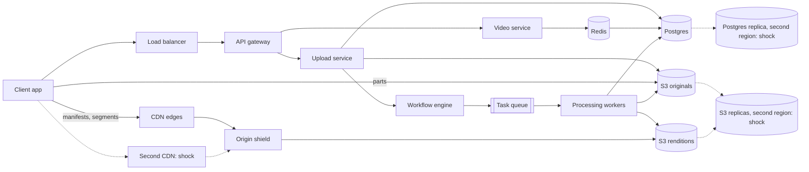
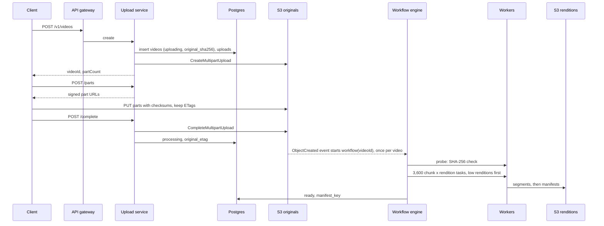
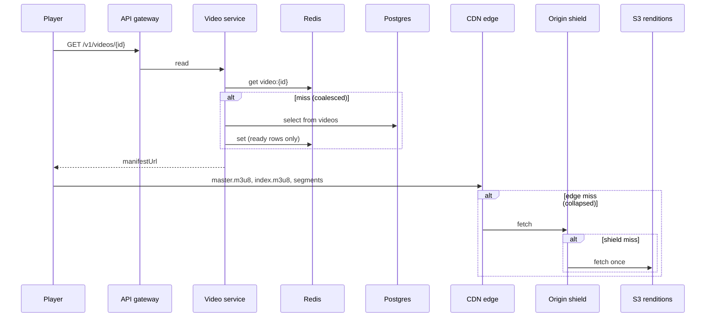

# Final design flow — YouTube

Redraw this at the end. Interview sequences stay in [FLOW.md](FLOW.md). Component roles stay in [COMPONENTS.md](COMPONENTS.md). Hello Interview is the shape source. These notes are original.

## Overview

Video bytes never pass through our services. They go from the client to S3 when uploading, and from the CDN to the player when watching. Boxes marked `shock` exist for the step 4 situations.



## Upload a video

```
POST /v1/videos -> 200 OK { videoId, uploadId, partSizeBytes, partCount }
Body: { title, description, fileSizeBytes, contentType, sha256 }

POST /v1/videos/{videoId}/parts -> 200 OK { parts: [{ partNumber, url, headers, expiresAt }] }
Body: { parts: [{ partNumber, sha256 }] }

PUT {presigned part url} -> 200 OK, header ETag            // client to S3

GET /v1/videos/{videoId}/upload -> 200 OK { status, uploadedParts, uploadedBytes }

POST /v1/videos/{videoId}/complete -> 202 Accepted { videoId, status } // processing
Body: { parts: [{ partNumber, etag }] }
```



## Watch a video

```
GET /v1/videos/{videoId} -> 200 OK { videoId, title, status, durationSec, manifestUrl }
GET https://cdn.example.com/v/{videoId}/master.m3u8 -> 200 OK
GET https://cdn.example.com/v/{videoId}/720p/index.m3u8 -> 200 OK
GET https://cdn.example.com/v/{videoId}/720p/seg_00042.ts -> 200 OK
```



## Services

| Name | When it runs | What it does |
| --- | --- | --- |
| API gateway | Every API call | Auth, rate limits, routing |
| Upload service | Create, parts, resume, complete | Writes `videos` and `uploads`. Runs S3 `CreateMultipartUpload`, `ListParts`, and `CompleteMultipartUpload`. Signs part URLs |
| S3 event consumer | On each `ObjectCreated` in originals | Starts the workflow for that `videoId`, once per video |
| Video service | Every watch | Reads metadata through the in-process cache and Redis. Builds the CDN manifest URL, signed for private videos |
| Workflow engine | After `complete` | Runs probe, split, fan-out, fan-in, and ready. Retries tasks with leases. Applies priority, fair share, and low renditions first |
| Processing workers | Per task | Transcode one chunk into one rendition. Read with `If-Match`. Write fixed keys |
| Integrity job | Monthly | `HEAD` each original and compare the ETag and size |
| Cleanup sweep | Hourly | Aborts expired multipart uploads, marks videos `failed`, deletes `tmp/` |
| Warm-up job | Before a scheduled premiere | Fetches the manifests and the first segments through the CDN in each big region, then flips `visibility` to public at `publish_at` |
| CDN edges and origin shield | Every segment | Serve bytes. Collapse misses. The shield fetches each object from S3 once |

## Databases

### Postgres

`videos`, primary key `video_id`, index `(uploader_id, created_at)`:

`video_id`, `uploader_id`, `title`, `description`, `status` (uploading, processing, ready, failed), `visibility` (public, unlisted, private, scheduled), `publish_at`, `original_key`, `original_etag`, `original_sha256`, `manifest_key`, `duration_sec`, `size_bytes`, `error`, `created_at`, `updated_at`, `ready_at`.

`renditions`, primary key `(video_id, name)`:

`video_id`, `name`, `codec`, `width`, `height`, `bitrate_kbps`, `manifest_key`, `segment_count`.

`uploads`, primary key `video_id`:

`video_id`, `s3_upload_id`, `part_size_bytes`, `part_count`, `state` (open, completed, aborted), `created_at`, `expires_at`.

### S3

| Bucket and key | Holds | Lifetime |
| --- | --- | --- |
| `originals/{videoId}/source.mp4` | The creator's file | Forever. Colder storage class after 30 days. Replicated to the second region |
| `v/{videoId}/master.m3u8` | Primary manifest | While the video exists |
| `v/{videoId}/{rendition}/index.m3u8` | Rendition manifest | While the rendition exists |
| `v/{videoId}/{rendition}/seg_{n:05}.ts` | About 4 s of one rendition | Rebuildable. Cold high renditions can be deleted |
| `tmp/{jobId}/...` | Intermediate files | Deleted after the job |
| Incomplete multipart uploads | Parts not yet joined | Aborted after 7 days by a lifecycle rule |

### Redis

| Key | Value | TTL |
| --- | --- | --- |
| `video:{videoId}` | The `ready` video's metadata | About 10 minutes. Deleted on any status change |

### Workflow engine and task queue

| Item | Fields |
| --- | --- |
| Workflow | `videoId`, state, the tasks done |
| Task | `videoId`, chunk number, rendition, input key, output key, attempt, priority |

Interview sequences are in [FLOW.md](FLOW.md). Component roles are in [COMPONENTS.md](COMPONENTS.md).
